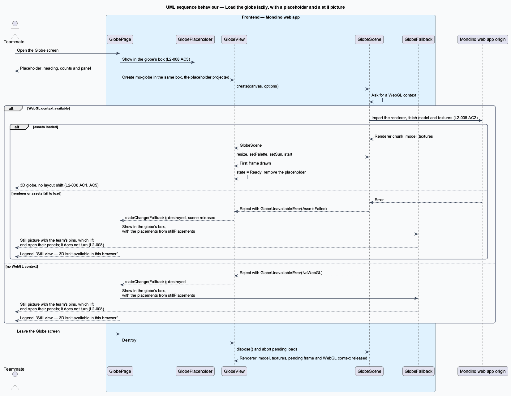

# Draw the globe

## Overview

Mondino shows a team spread around the world as pins on a globe. This feature covers the globe
itself: a lit, shaded, three-dimensional model in the brand's colours, with the half of the
world where it is night right now shaded. It does not cover how the globe turns (see
`turn-globe`) or the pins drawn on it (see `show-pins`).

The globe is the heaviest thing Mondino loads, and Mondino is left open all day in a tab. The
design therefore answers four questions in order: how the globe arrives without slowing the
first paint, what stands in its place until it is ready, what is shown where it cannot be drawn
at all, and how everything it acquires is given back when the teammate leaves the screen.

Terms used below:

- **globe library** — Angular library `@mondino/globe` that holds everything that draws the globe, imported dynamically and never part of the initial bundle
- **scene** — the renderer, the Blender-built model, its textures and the render loop, behind one class
- **placeholder** — element that holds the globe's box, at the globe's size, until the 3D globe has drawn its first frame
- **still picture** — bundled image of the globe shown in the globe's place when WebGL is unavailable or the globe's assets fail to load
- **subsolar point** — position on the Earth where the sun is directly overhead at a given instant
- **detail step** — one level of resolution and model detail at which the scene can be drawn
- **low-power device** — device on which the globe sustains fewer than 30 frames a second (L2-046)

Two decisions are open and belong to an ADR that is written before the globe is built: which
renderer draws the globe, and the web format the Blender model and textures are exported to.
Both are marked `<TO SUPPLY>`. The structure below is the same whichever is chosen, because
only `GlobeScene` touches the renderer.

## Description

The feature lives in the browser. The only backend involvement is the team's pins, which the
`show-pins` feature reads; drawing the globe makes no request to the Mondino API and none to
any other origin.

**In the `mondino` application**

- **`GlobePage`** — page at `/globe`, a lazy route. Its template places the globe inside an
  `@defer` block, so the globe library is a separate chunk that is fetched after the heading,
  the counts and the panel are on screen. The `@placeholder` block holds a `GlobePlaceholder`.
  `JoinPage` and `ProfilePage` load the globe the same way.

**In the `components` library**

- **`GlobePlaceholder`** (`mo-globe-placeholder`) — presentation component with no inputs that
  draws a plain disc in the quiet fill (`--color-bg-subtle`), with a hairline edge and a slow pulse, inside a square box.
  Its block is the mocks' `globe globe--placeholder`, with `role="img"` and the name "The globe
  is loading". Reduced motion removes the pulse. The box takes its size from the
  layout (`aspect-ratio: 1`), not from its content, so replacing the placeholder with the 3D
  globe moves nothing (L2-008). It is part of the page's own chunk, because it is shown before
  the globe library has arrived.

**In the `globe` library**

- **`GlobeView`** (`mo-globe`) — the library's one public component. Inputs: `pins`,
  `selectedId`, `interactive`. Output: `select`. (`show-pins`, `make-accessible` and
  `keep-team-fresh` add `selectGroup`, `label`, `arrivedIds` and `arrivedShown`.) It owns a `<canvas>` and a `state` signal of
  type `GlobeState` (`Loading`, `Ready`, `Fallback`). In `Loading` it renders the content
  projected into it, which `GlobePage` fills with a second `GlobePlaceholder`, so the same
  picture stays in the same box from the first paint to the first 3D frame. The canvas carries
  `aria-hidden="true"`; the text equivalent is `PinList` (L2-040).
- **`GlobeScene`** — class that hides the renderer. Nothing outside it imports the renderer or
  reads the asset format. `GlobeScene.create(canvas, options)` asks for a WebGL context,
  imports the renderer with a dynamic `import()`, fetches the model and textures from
  `options.assetBaseUrl`, and resolves once the scene can draw. It rejects with a
  `GlobeUnavailableError` whose `reason` is `NoWebGL`, `AssetsFailed` or `ContextLost`. Its
  other methods are `resize`, `setSun`, `setDetail`, `setOrientation`, `project`, `onFrame`,
  `start`, `stop` and `dispose`. Renderer: `<TO SUPPLY>`. Asset format: `<TO SUPPLY>`.
- **`GlobeSceneOptions`** — `assetBaseUrl`, the starting `DetailStep`, and an `AbortSignal`
  that cancels the import and the fetches when the teammate leaves before they finish.
- **`SunPosition`** — pure functions. `subsolarPoint(now)` returns the `Position` where the sun
  is overhead: its latitude is the sun's declination for the date and its longitude follows
  from the time in UTC. `isNight(position, now)` reports whether a position is in the shaded
  half. Neither reads the system time; the time is passed in.
- **`DetailLevel`** — class that holds an ordered list of `DetailStep`s and the current one.
  `record(elapsedMs)` takes each frame's duration. When the rate stays under 30 frames a second
  it moves to the next lower step and stays there. The length of the window that counts as
  sustained is `<TO SUPPLY>`. The number of steps and the value of each are `<TO SUPPLY>`,
  because they depend on the renderer.
- **`DetailStep`** — `pixelRatio` (the resolution the canvas is drawn at) and `modelDetail`
  (which level of the model's detail is shown). A step shall not change the lighting, the
  colours or the pins (L2-008).
- **`GlobeFallback`** — component that shows the still picture, an image bundled with the app,
  in the same square box, with `role="img"` and the name "A still picture of the globe". It
  needs neither WebGL nor the renderer. No pin is drawn on it and it is not focusable.

**From the `api` and `domain` libraries**

- **`Clock`** / `CLOCK` — the one injected clock: `now()` and a minute tick signal.
  `BrowserClock` in `domain` implements it and rests while the tab is hidden. `GlobeView`
  injects the token; it shall not call `new Date()`.

**How the parts work together**

`GlobeView` starts the scene after its first render. On success it sizes the scene from a
`ResizeObserver` on its host, sets the sun, starts the loop, and moves to `Ready` when the
first frame has been drawn. On a `GlobeUnavailableError` it moves to `Fallback` and renders
`GlobeFallback`; the teammates stay reachable through the panel and the Team screen, which do
not depend on the scene. A WebGL context lost while the globe is running is handled the same
way. `GlobePage` reads `GlobeView`'s `state`, and in `Fallback` it shows a notice
(`globe-screen__notice`) in place of the legend: "This device can’t draw the 3D globe, so this
is a still picture. Everyone is still here: in the panel, and on Team.", where "Team" links to
the Team screen.

The night side follows the clock. `GlobeView` runs one effect on the clock's minute tick that
calls `SunPosition.subsolarPoint(clock.now())` and passes the result to `GlobeScene.setSun`.
The scene lights the model from that direction, so the shaded half is always the half facing
away from the sun. The subsolar point moves 0.25° west each minute, which is 15° in an hour.
The shading is a darkening of the surface, not a change to the pins: pins and labels are drawn
over the scene by `PinLayer` and keep their own contrast on both sides (L2-041). The legend
that names "Night side" at 576 px and wider is part of `GlobePage`'s template.

The assets are part of the build. The model, its textures and the still picture are emitted
with content-hashed file names and served from the web app's own origin, so a repeat visit
reads them from the browser's cache (L2-046). `GlobeScene` shall request nothing from any other
origin.

`GlobeView` releases everything it acquired when it is destroyed: it aborts pending loads,
disconnects the `ResizeObserver`, and calls `GlobeScene.dispose()`, which stops the render
loop and frees the renderer, the model, the textures and the WebGL context (L2-047). The
clock effect ends with the component.

## Requirements

The feature realises the following level-2 (L2) requirements. Each refines a level-1 (L1)
requirement, cited by identifier.

| L2 ID | Refines (L1) | Requirement |
|-------|--------------|-------------|
| `L2-008` | `L1-003` | The globe is a lit, shaded 3D model: land raised from the sea, soft shadows, rounded forms and saturated colour, in the look of a modern animated film. It has colours of its own, as the mocks draw it: a bright blue ocean with a deeper rim, green land with sand and forest, white ice and cloud, a dusk-shaded night side and an ink outline. The brand's pin and sun mark the people and moments on it. Its model and textures are made in Blender, exported to a web format and bundled with the app. |
| `L2-010` | `L1-003` | The half of the globe where it is night right now is shaded, from the sun's real position at the current time, and the shading moves as time passes. |

## Diagrams

### System context

A teammate, or a person with an invite link, sees the globe through Mondino. Drawing the globe
involves no outside system: the model and textures come from Mondino itself.

### Containers

The Mondino web app draws the globe in the browser from assets served from its own origin. The
Mondino API and the Mondino database appear only because the pins drawn on the globe come from
them.

### Components

`GlobePage` shows `GlobePlaceholder` and loads `GlobeView` with a dynamic import. `GlobeView`
creates the `GlobeScene`, feeds it the sun's position from `SunPosition` and the clock, reports
frame times to `DetailLevel`, and shows `GlobeFallback` when the scene is unavailable.

### Class structure

`GlobeView` owns one `GlobeScene` and one `DetailLevel` and holds a `GlobeState`. `GlobeScene`
is created from `GlobeSceneOptions` and rejects with a `GlobeUnavailableError`. `SunPosition`
returns a `Position`, and `GlobeView` reads the time through the `Clock` contract.

### Behaviour — load the globe lazily

The placeholder is on screen before the globe library is requested. The scene then loads the
renderer and the assets from the app's own origin. Without a WebGL context, or when the assets
fail to load, `GlobeView` shows the still picture instead. Leaving the screen disposes of the
scene.

### Behaviour — shade the night side

`GlobeView` sets the sun when the scene is ready and again on each minute tick. The clock rests
while the tab is hidden and ticks at once when the tab is shown again, so the night side is
correct without any work having been done while hidden.

### Behaviour — step detail down

Each frame's duration reaches `DetailLevel`. A sustained rate under 30 frames a second moves
the scene to the next lower `DetailStep`, which lowers resolution and model detail and leaves
lighting and colour as they were.

