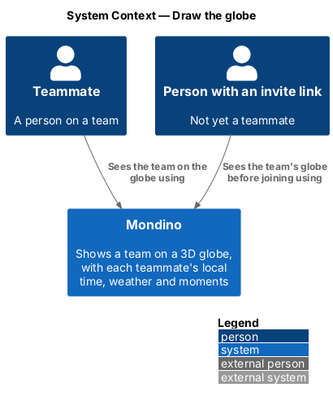
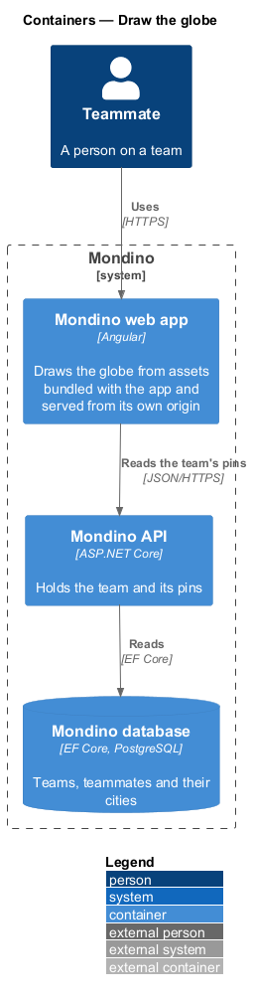
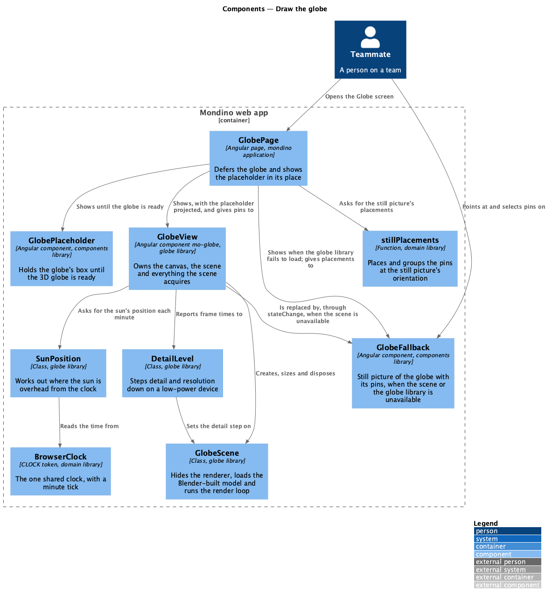
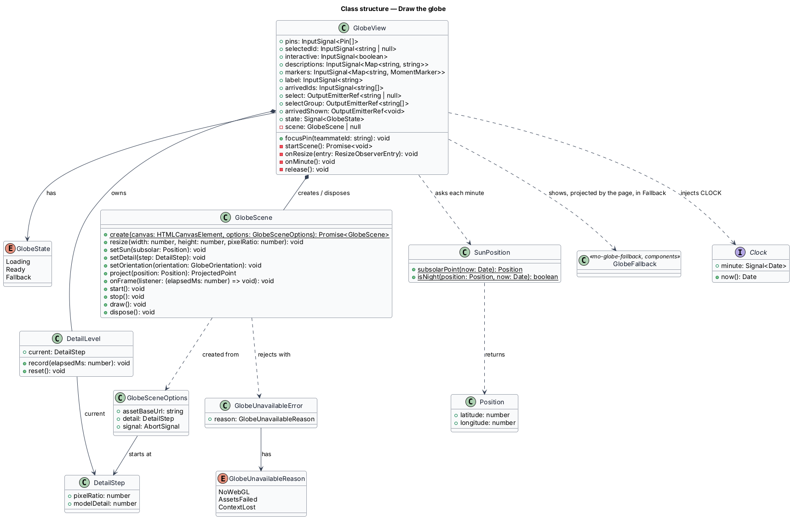
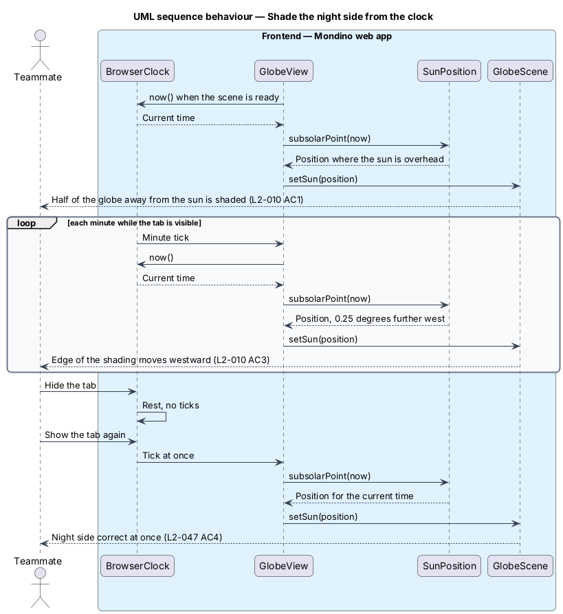
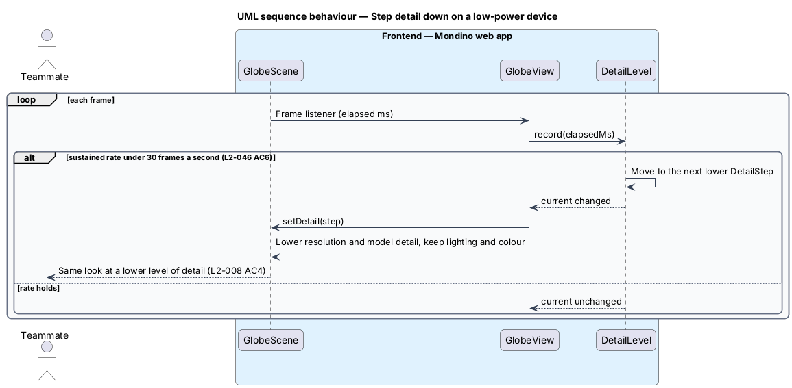

# Draw the globe

## Overview

Mondino shows a team spread around the world as pins on a globe. This feature covers the globe
itself: a lit, shaded, three-dimensional model in the brand's colours, with the half of the
world where it is night right now shaded. It does not cover how the globe turns (see
`turn-globe`) or the pins drawn on it (see `show-pins`).

The globe is the heaviest thing Mondino loads, and Mondino is left open all day in a tab. The
design therefore answers four questions in order: how the globe arrives without slowing the
first paint, what stands in its place until it is ready, what is shown where it cannot be drawn
at all, and how everything it acquires is given back when the teammate leaves the screen.

Terms used below:

- **globe library** — Angular library `@mondino/globe` that holds everything that draws the globe, imported dynamically and never part of the initial bundle
- **scene** — the renderer, the Blender-built model, its textures and the render loop, behind one class
- **placeholder** — element that holds the globe's box, at the globe's size, until the 3D globe has drawn its first frame
- **still picture** — bundled picture of the globe, with the team's pins in place on it, shown in the globe's place when WebGL is unavailable or the globe's assets fail to load; it does not turn and is not dragged
- **subsolar point** — position on the Earth where the sun is directly overhead at a given instant
- **detail step** — one level of resolution and model detail at which the scene can be drawn
- **low-power device** — device on which the globe sustains fewer than 30 frames a second (L2-046)

[ADR 0012](../../../adr/0012-drawing-the-globe.md) decides the renderer (three.js), the format
the Blender-built assets are exported to (a glTF binary model and two mask textures), how the
materials take the palette and the detail steps. Only `GlobeScene` touches the renderer.

## Description

The feature lives in the browser. The only backend involvement is the team's pins, which the
`show-pins` feature reads; drawing the globe makes no request to the Mondino API and none to
any other origin.

**In the `mondino` application**

- **`GlobePage`** — page at `/globe`, a lazy route. It imports `GlobeView` directly: the
  `globe` library's own code (about 8 kB) is part of the page's chunk, and the renderer and the
  assets, the heavy part, are the dynamic import `GlobeScene.create` makes (ADR 0012; an
  `@defer` block would put Angular's defer runtime in the initial chunk). It projects a
  `GlobePlaceholder` into `GlobeView` and follows its `stateChange`: in `Fallback` it replaces
  `GlobeView` with a `GlobeFallback` of its own, so the still picture is created only when it is
  shown and the destroyed `GlobeView` has released the scene. It binds `CLOCK` to its own
  `BrowserClock`. `JoinPage` and `ProfilePage` load the globe the same way.

**In the `components` library**

- **`GlobePlaceholder`** (`mo-globe-placeholder`) — presentation component that draws a plain
  disc with a slow pulse inside a square box, `role="img"` named "The globe is loading". Its one
  input, `variant`, follows the mocks: `globe` (Join's stage, `pages/join/loading`) is the
  block `globe globe--placeholder`, the quiet fill (`--color-bg-subtle`) with a hairline edge;
  `disc` (the Globe screen, `pages/globe/loading`) is the skeleton disc
  `globe-loading__disc skeleton`. Reduced motion removes the pulse. The box takes its size from the
  layout (`aspect-ratio: 1`), not from its content, so replacing the placeholder with the 3D
  globe moves nothing (L2-008). It is part of the page's own chunk, because it is shown before
  the globe library has arrived.
- **`GlobeFallback`** (`mo-globe-fallback`) — presentation component that shows the still
  picture in the same square box: the mocks' `globe` block holding the picture
  (`globe__art`, an SVG bundled with the app and coloured through the `--color-globe-*`
  tokens) and, over it, the pins. It needs neither WebGL, the renderer nor the `globe`
  library, so it shows whenever the scene cannot be drawn, the renderer's chunk failing to
  load among the reasons. Inputs: `placements` (`StillPlacement[]`), `descriptions`, `markers` and
  `selectedId`; outputs: `select` and `selectGroup`. It takes the same pin and label
  templates as `GlobeView`. Its pins are the list `PinLayer` would render,
  `ul.globe__pins > li.globe__pin > button.pin`, each named by its description and carrying
  `aria-pressed`. A pin lifts when it is pointed at, focused or selected, and selecting it
  opens its panel, as on the 3D globe (`show-pins`). The block has `role="group"` and the name
  "A still picture of the globe, with 13 teammates’ pins." (the team's count). The block itself
  is not focusable and listens for no drag and no arrow key: the still picture does not turn.

**In the `domain` library**

- **`stillPlacements(pins, size, options)`** — pure function in `pins/`. It projects each
  place at `STILL_ORIENTATION`, the one orientation the still picture is drawn at, drops the
  places on the far side, groups the rest with `groupPins` (`show-pins`) and returns one
  `StillPlacement` for each: the `PinPlacement`, its `x` and `y` as fractions of the box, and
  the side its label sits on. The pins are therefore where the picture's land is, and pins
  that would cover each other are one group pin, as on the 3D globe. `STILL_ORIENTATION` faces
  10.1° E, 17.4° N (Europe and Africa), fitted from the mocks' own pins (ADR 0012). A teammate whose city is on the far side of the still
  picture has no pin on it and is reached through the panel and the Team screen.

**In the `globe` library**

- **`GlobeView`** (`mo-globe`) — the library's one public component. Inputs in this feature:
  `label` (the globe's accessible name), `pins` (bare positions, drawn as plain markers until
  `show-pins`) and `you` (the teammate's own new pin and its label). Output: `stateChange`.
  (`turn-globe`, `show-pins`, `make-accessible` and `keep-team-fresh` add `interactive`,
  `selectedId`, `select`, `selectGroup`, `descriptions`, `arrivedIds` and `arrivedShown`, and
  `PinLayer` takes the markers' place.) It owns a `<canvas>` (`globe__art`) between the mocks'
  `globe__shadow` and `globe__outline` circles, and a `state` signal of type `GlobeState`
  (`Loading`, `Ready`, `Fallback`), emitted on each change. In `Loading` the canvas is hidden
  and the loading content projected into it shows, which `GlobePage` fills with a second
  `GlobePlaceholder`, so the same picture stays in the same box from the first paint to the
  first 3D frame. In `Fallback` it draws nothing and the page replaces it; the `globe` library
  depends on `api` only and imports no component.
  The canvas carries `aria-hidden="true"`; the text equivalent is `PinLayer`'s list of pins
  (L2-040).
- **`GlobeScene`** — class that hides the renderer. Nothing outside it imports the renderer or
  reads the asset format. `GlobeScene.create(canvas, options)` asks for a WebGL context,
  imports the renderer with a dynamic `import()`, fetches the model and textures from
  `options.assetBaseUrl`, and resolves once the scene can draw. It rejects with a
  `GlobeUnavailableError` whose `reason` is `NoWebGL`, `AssetsFailed` or `ContextLost`. Its
  other methods are `resize`, `setSun`, `setDetail`, `setOrientation`, `project`, `onFrame`,
  `start`, `stop`, `setPalette` and `dispose`. Renderer: three.js on WebGL 2, imported only
  once a WebGL 2 context has been obtained. Asset format: `globe.glb` (glTF binary from
  Blender: `GlobeHigh`, `GlobeLow` and the `Clouds` shell), `surface.png` (land, forest, sand
  and ice masks) and `clouds.png` (ADR 0012). It draws on demand: a frame only when something
  has changed, and none while stopped.
- **`GlobePalette`** — the globe's colours as the scene needs them: ocean, deep ocean, land,
  deep land, sand, ice, cloud and night. The outline and the drop shadow are SVG circles over
  and under the canvas, styled by their tokens. `GlobeView` reads them from the
  `--color-globe-*` tokens on its host with `getComputedStyle` and passes them to
  `GlobeScene.setPalette`. The scene holds no colour of its own.
- **`GlobeSceneOptions`** — the starting `DetailStep`, and an `AbortSignal` that cancels the
  import and the fetches when the teammate leaves before they finish. The assets' addresses are
  the build's own (`file` loader), known only to the scene's lazy chunk.
- **`SunPosition`** — pure functions. `subsolarPoint(now)` returns the `Position` where the sun
  is overhead: its latitude is the sun's declination for the date and its longitude follows
  from the time in UTC. `isNight(position, now)` reports whether a position is in the shaded
  half. Neither reads the system time; the time is passed in.
- **`DetailLevel`** — class that holds an ordered list of `DetailStep`s and the current one.
  `record(elapsedMs)` takes each frame's duration. When the rate stays under 30 frames a second
  it moves to the next lower step and stays there. A rate sustained for 3 seconds counts. There
  are two steps (ADR 0012): `High` and `Low`. `DetailLevel` is built with `stay-fast-and-light`
  (journey 29); this feature builds the steps and `GlobeScene.setDetail`.
- **`DetailStep`** — `pixelRatio` (the resolution the canvas is drawn at: the device's up to 2
  at `High`, 1 at `Low`) and `modelDetail` (`GlobeHigh` or `GlobeLow`). A step shall not change the lighting, the
  colours or the pins (L2-008).

**From the `api` and `domain` libraries**

- **`Clock`** / `CLOCK` — the one injected clock: `now()` and `minute`, a signal of the start of
  the current minute. `BrowserClock` in `domain`'s `time/` implements it, is bound by each
  screen that reads the time, and rests while the tab is hidden. `GlobeView`
  injects the token; it shall not call `new Date()`.

**How the parts work together**

`GlobeView` starts the scene after its first render. On success it sizes the scene from a
`ResizeObserver` on its host, sets the sun, starts the loop, and moves to `Ready` when the
first frame has been drawn. On a `GlobeUnavailableError` it moves to `Fallback`, and the page
shows its `GlobeFallback`. A WebGL context lost while the globe is running is handled the same
way. `GlobePage` gives `GlobeFallback` the placements from `stillPlacements`, the
descriptions, the markers and the selected teammate id, and handles its `select` and
`selectGroup` as it handles `GlobeView`'s, so a pin on the still picture lifts and opens its
panel. The picture stays as it is when a pin or a group pin is selected: nothing turns to it.

`GlobePage` reads `GlobeView`'s `state`. In `Fallback`
the legend's last item reads "Still view — 3D isn’t available in this browser" in place of
"Drag to spin"; "Night side", "Moment this week" and "Teammates close together" stay. Under
640 px, where the legend is not shown, a line under the globe (`globe-screen__still`) reads
"Still view — 3D isn’t available in this browser. Pins still open." The still picture is drawn
at one fixed hour, the mocks' "now"; only the 3D globe follows the clock (ADR 0012).

The night side follows the clock. `GlobeView` runs one effect on the clock's minute tick that
calls `SunPosition.subsolarPoint(clock.now())` and passes the result to `GlobeScene.setSun`.
The scene lights the model from that direction, so the shaded half is always the half facing
away from the sun. The subsolar point moves 0.25° west each minute, which is 15° in an hour.
The shading is a darkening of the surface, not a change to the pins: pins and labels are drawn
over the scene by `PinLayer` and keep their own contrast on both sides (L2-041). The legend
that names "Night side" at 640 px and wider is part of `GlobePage`'s template.

The globe's colours are tokens. The design system defines `--color-globe-ocean`,
`--color-globe-ocean-deep`, `--color-globe-land`, `--color-globe-land-deep`,
`--color-globe-sand`, `--color-globe-ice`, `--color-globe-cloud`, `--color-globe-night` and
`--color-globe-outline` for the light theme and again for the dark theme. In dark the globe
is the same picture a little deeper, with a light outline in place of the ink one. `GlobeView`
reads the tokens when the scene starts and again when the theme changes, which it learns from
a `matchMedia('(prefers-color-scheme: dark)')` listener, and passes the new `GlobePalette` to
the scene; no colour is written in the `globe` library. The still picture, the placeholder, and
the outline and shadow around the canvas are styled with the same tokens, so they follow the
theme with no script. The model's one `ShaderMaterial` takes the palette as uniforms and mixes
it by the mask textures, looked up from each point's direction (ADR 0012).

The assets are part of the build. The model and its textures are emitted with content-hashed
file names (`media/globe-<hash>.glb`, `media/surface-<hash>.png`, `media/clouds-<hash>.png`),
the still picture is part of `GlobeFallback`, and both are served from the web app's own origin, so a repeat visit
reads them from the browser's cache (L2-046). `GlobeScene` shall request nothing from any other
origin.

`GlobeView` releases everything it acquired when it is destroyed: it aborts pending loads,
disconnects the `ResizeObserver`, removes the colour scheme and visibility listeners, and calls
`GlobeScene.dispose()`, which cancels the pending frame and frees the renderer, the model, the
textures, the decoded images and the WebGL context (L2-047). The clock effect ends with the
component. While the tab is hidden `GlobeView` stops the scene, and starts it again when the tab
is shown.

## Requirements

The feature realises the following level-2 (L2) requirements. Each refines a level-1 (L1)
requirement, cited by identifier.

| L2 ID | Refines (L1) | Requirement |
|-------|--------------|-------------|
| `L2-008` | `L1-003` | The globe is a lit, shaded 3D model: land raised from the sea, soft shadows, rounded forms and saturated colour, in the look of a modern animated film. It has colours of its own, as the mocks draw it: a bright blue ocean with a deeper rim, green land with sand and forest, white ice and cloud, a dusk-shaded night side and an ink outline. The brand's pin and sun mark the people and moments on it. Its model and textures are made in Blender, exported to a web format and bundled with the app. |
| `L2-010` | `L1-003` | The half of the globe where it is night right now is shaded, from the sun's real position at the current time, and the shading moves as time passes. |

## Diagrams

### System context

A teammate, or a person with an invite link, sees the globe through Mondino. Drawing the globe
involves no outside system: the model and textures come from Mondino itself.

### Containers

The Mondino web app draws the globe in the browser from assets served from its own origin. The
Mondino API and the Mondino database appear only because the pins drawn on the globe come from
them.

### Components

`GlobePage` shows `GlobeView` with a `GlobePlaceholder` projected into it. `GlobeView`
creates the `GlobeScene`, feeds it the sun's position from `SunPosition` and the clock, reports
frame times to `DetailLevel`, and tells the page through `stateChange` when the scene is
unavailable; `GlobePage` then shows a `GlobeFallback` in its place and gives it the pins'
placements from `stillPlacements`.

### Class structure

`GlobeView` owns one `GlobeScene` and one `DetailLevel` and holds a `GlobeState`. `GlobeScene`
is created from `GlobeSceneOptions` and rejects with a `GlobeUnavailableError`. `SunPosition`
returns a `Position`, and `GlobeView` reads the time through the `Clock` contract and gives the
scene a `GlobePalette`. `GlobeFallback` presents the `StillPlacement`s that `stillPlacements`
returns.

### Behaviour — load the globe lazily

The placeholder is on screen before the renderer is requested. The scene then loads the
renderer and the assets from the app's own origin. Without a WebGL context, or when the
renderer or the assets fail to load, `GlobeView` says so and `GlobePage` shows the still
picture instead. The still picture keeps the team's pins, which lift and open
their panels; it does not turn. Leaving the screen disposes of the scene.

### Behaviour — shade the night side

`GlobeView` sets the sun when the scene is ready and again on each minute tick. The clock rests
while the tab is hidden and ticks at once when the tab is shown again, so the night side is
correct without any work having been done while hidden.

### Behaviour — step detail down

Each frame's duration reaches `DetailLevel`. A sustained rate under 30 frames a second moves
the scene to the next lower `DetailStep`, which lowers resolution and model detail and leaves
lighting and colour as they were.

