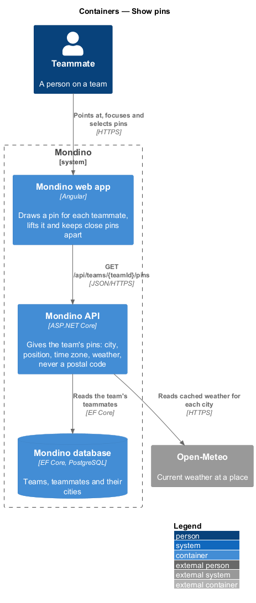
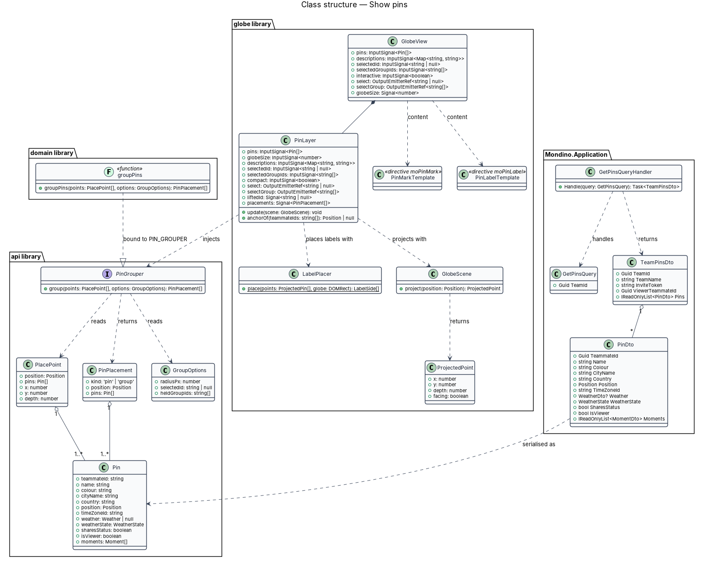

# Show pins

## Overview

Mondino shows a team spread around the world on a 3D globe. Each teammate appears as a pin at
their city. This feature covers the pins: reading them from the backend, drawing each one with
its teammate's initials, colour and label, lifting a pin out when it is pointed at, focused or
selected, and drawing pins that would cover each other, because their teammates live in the
same city or in cities close together, as one group pin with a count.

The feature exists because a pin is how one teammate finds another. A globe on a phone is
about 320 px wide and a team can hold 500 teammates, so a pin at rest is small. Lifting makes
one pin readable at a time, and grouping makes sure no pin hides another.

Terms used below:

- **pin** — a teammate's place on the globe: their initials in their own colour, at their city
- **label** — text beside a pin with the teammate's local time, weather and temperature, and, when the pin is lifted, their name and city
- **lifted pin** — pin drawn larger, raised above the surface and in front of its neighbours, with its label shown
- **hit area** — region around a pin that takes the pointer or a tap, at least 44 × 44 CSS px
- **place** — the pins of one city, which share one position on the globe
- **placement** — one thing drawn over the globe: a pin alone, or a group pin, anchored to a position
- **group pin** — one pin with a count that stands for the pins that would cover each other at the globe's current size and orientation
- **grouping radius** — on-screen distance, in CSS px, within which places are drawn as one group pin
- **viewer** — the teammate looking at the screen

A pin is placed at its city, never at a postal code, and nothing in this feature carries a
postal code (L2-007). Drawing the globe is covered by `draw-globe`, turning it by `turn-globe`.
The moment marker beside a pin (L2-021) and the text a screen reader hears for each pin
(L2-040) are designed in their own features and use the parts described here.

## Description

The slice runs from the Globe screen to the database. The backend gives the pins; the browser
decides how they are drawn.

**Backend**

- **`TeamsController`** — exposes `GET /api/teams/{teamId}/pins` to a teammate of the team. It
  checks nothing itself and sends one `GetPinsQuery`.
- **`GetPinsQuery`** — carries the `TeamId`.
- **`GetPinsQueryHandler`** — loads the team only where the teammate named by
  `ICurrentTeammate` belongs to it, and answers 404 otherwise, the same answer as for a team
  that does not exist (L2-043). For each distinct city it asks `IWeatherSource` for the
  weather and `MomentFinder` for the moments, then builds one `PinDto` for each teammate and
  answers them in a `TeamPinsDto` (the team's id and name, its invite token, the viewer's
  teammate id and the pins). A teammate whose `TeammateSettings.ShareWeather` is false gets a
  null weather and the `WeatherState` `NotShared`. When the weather source fails or times out
  the weather is null, the `WeatherState` is `Unavailable` and the pin is still returned
  (L2-049). The weather source receives a position and nothing else.
- **`PinDto`** — teammate id, name, colour, city name, country, position, time zone id,
  weather or null, the weather's state (`WeatherState`: `Available`, `Unavailable` or
  `NotShared`), whether the status is shared (`SharesStatus`), whether the pin is the viewer's own
  (`IsViewer`), and the moments. The position is the city's. The DTO has no postal code field
  and no local time: the browser works the time out from the time zone id.
- **`CachedWeatherSource`** — `IWeatherSource` decorator over `OpenMeteoWeatherSource`, with a
  timeout and a circuit breaker.
- **`PinColourPicker`** — picks a teammate's colour from the pin palette when they join, so
  that it differs from the teammates nearest to them where the palette allows. It runs in the
  join slice; this feature reads the stored colour.

**In the `api` library**

- **`Pin`** — the browser's type for a `PinDto`.
- **`PlacePoint`** — a place as it is drawn at one instant: the `position` of its city, the
  `pins` of the teammates there, its on-screen `x` and `y` in CSS px, and its `depth`, which
  says how near the viewer it is.
- **`PinPlacement`** — a `kind` (`'pin'` or `'group'`), the `position` it is anchored to, and
  the `pins` it stands for (one for a pin, two or more for a group).
- **`GroupOptions`** — the `radiusPx` of the grouping, the `selectedId` of the selected
  teammate or null, and `heldGroupIds`, the teammate ids of the group pin that is selected, or
  none.
- **`PinGrouper`** / `PIN_GROUPER` — contract and token for the function that turns place
  points into placements: `group(points, options)`. The `globe` library depends on `api` only,
  so it reaches `groupPins` through this token.
- **`TeamApi`** / `TEAM_API`, **`HttpTeamApi`** — read the pins.

**In the `domain` library**

- **`TeamStore`** — holds the pins and the selected teammate id as signals and reads the pins
  again every 15 minutes (L2-048).
- **`groupPins(points, options)`** — pure function in `pins/`, bound to `PIN_GROUPER`. It
  groups greedily by on-screen distance, in four steps:
  1. The selected teammate's pin is taken out of its place and gets a placement of its own, so
     the selected teammate's pin always stands alone.
  2. The pins named by `heldGroupIds` stay one group placement, so a selected group pin keeps
     standing for the teammates its panel lists.
  3. The remaining place points are ordered nearest the viewer first. Each point not yet in a
     group seeds one and takes every other such point within `radiusPx` of it. The placement is
     anchored to the seed's position.
  4. A placement that holds one pin is a pin; one that holds two or more is a group pin with
     their count. Two teammates in one city are therefore always one group pin.

  Neighbours are found in a grid whose cells are `radiusPx` wide, so a seed looks in 9 cells
  and the whole pass is linear in the number of place points. The function reads no clock and
  no DOM, and the same points and options always give the same placements.
- **`initialsOf(name)`** — the first character of up to the first two words of a name, so a
  pin is never blank.
- **`localTime`**, **`formatTime`** — the label's local time, from the pin's time zone id and
  the clock.

**In the `globe` library**

- **`GlobeView`** (`mo-globe`) — takes `pins`, `descriptions`, `selectedId`,
  `selectedGroupIds` and `interactive`, and emits `select` with a teammate id or null and
  `selectGroup` with a group pin's teammate ids. It measures its own width with a
  `ResizeObserver` and passes the pins, the width and the two selections to `PinLayer`. It
  sets `compact` when the globe is less than 400 px wide.
- **`PinLayer`** — component that draws the pins as HTML elements over the scene's canvas.
  The pins it draws are the list a keyboard and a screen reader reach (L2-040): the mocks'
  `ul.globe__pins`, with one `li.globe__pin` for each placement, holding a `button.pin`. A
  button's accessible name is its pin's description (`descriptions`, see `make-accessible`),
  it carries `aria-pressed`, which is true while its pin is selected, and the visible label
  beside it is `aria-hidden`. The buttons are in a fixed order, west to east, which does not
  change as the globe turns. Each is a Tab stop; Enter or Space emits `select`.
  It injects `PIN_GROUPER` and holds the current `placements`. On each frame in which the
  globe has turned it asks `GlobeScene.project` for each placement's anchor and moves that
  placement's element there with a transform. A placement that does
  not face the viewer is hidden, with its label, so it takes no focus and is not in the list
  until the globe turns it into view; its teammate is reached through the panel and the Team
  screen. A placement near the globe's edge is drawn
  fainter and without its label (`globe__pin--far`) until it is lifted; how near is
  `<TO SUPPLY>`. `anchorOf(teammateIds)` gives the position the
  group pin of those teammates is anchored to, which `GlobeView` turns to (`turn-globe`).
  `PinLayer` holds `liftedId`: the pin under
  the pointer, or else the pin with keyboard focus. A pin is drawn lifted when it is the
  lifted pin or the selected pin. The canvas under the layer is hidden from the accessibility
  tree. Whether the renderer also draws a
  3D body under each pin is `<TO SUPPLY>` with the renderer ADR; the element over the canvas
  is what is pointed at, selected and tested.
- **`PinMarkTemplate`** (`ng-template[moPinMark]`) and **`PinLabelTemplate`**
  (`ng-template[moPinLabel]`) — templates that the page projects into `GlobeView`. The `globe`
  library cannot import `components` or `domain`, so it does not know how to draw an avatar or
  format a time. It places and lifts; the page says what a pin and its label show. Each
  template receives the `Pin` and whether it is lifted.
- **`LabelPlacer`** — pure helper. Given the projected pins and the globe's area it picks a
  side for each shown label (right, left, above or below), so that the label sits beside its
  pin, inside the globe's area and clear of other pins.

**In the `mondino` application and the `components` library**

- **`GlobePage`** — binds `PIN_GROUPER` to `groupPins` in its route's providers and fills
  the two templates. The mark template renders `Avatar` with `initialsOf(pin.name)` and the
  pin's colour. The label template renders `PinLabel` with the formatted local time and, where
  `pin.weather` is not null, `WeatherIcon` and the temperature in the viewer's unit. Names and
  cities are rendered as text. Where `pin.isViewer` is true the name is followed by "(you)"
  and the mark carries a ring, so the viewer's pin differs by more than colour. When
  `GlobeView` emits `selectGroup` the page clears the selected teammate, passes the group's
  teammate ids back as `selectedGroupIds` and shows the group in the panel, as `GroupPanel`
  (`team/view-teammate-panel`): the heading "2 teammates close together" (with the group's
  count), "All in Milan · pick someone to see their pin", and under each city's name and local
  time a row for each teammate there, which selects them. The page's legend under the globe
  names the group pin "Teammates close together", beside "Night side", "Moment this week" and
  "Drag to spin". On Join the
  page projects no label template, so pins there carry no name, city, local time or weather
  (L2-001).

**Lifting**

A pin at rest is a small mark inside a transparent hit area of at least 44 × 44 CSS px,
whatever the globe's size. Lifting is a change of state on the pin's element (the mocks'
`globe__pin--lifted` and `pin-label--lifted` modifiers), styled with a transform that raises
and enlarges it and a higher stacking order. The transition lasts no more than 200 ms; its
exact length comes from the design system's motion token `--duration-fast` (150 ms). Under reduced motion the transition
is removed and the pin changes size at once. Each minute the label's time changes through the
shared clock; no pin has a timer of its own.

By pointer, entering the hit area lifts the pin and leaving it settles the pin back unless it
is selected. By keyboard, focus on a pin's button lifts that pin exactly as the
pointer does, and the focus indicator is drawn on the pin itself. A pin on the far side of
the globe is hidden and takes no focus, so focus is never on something hidden. By
touch, where nothing hovers, a tap on a pin selects it and a tap elsewhere on the globe emits
`select` with null. `GlobeGestures` (see `turn-globe`) tells a tap from a drag. A selected
pin stays lifted, and `GlobePage` shows its teammate in the panel (L2-023).

A newly placed pin, the viewer's own after joining (L2-005) or one in `arrivedIds` (see
`keep-team-fresh`), carries the `pin--new` modifier and pulses once. Reduced motion removes
the pulse.

**Grouping pins that are close together**

Pins that would cover each other are one group pin, at every size of the globe; no pin is
moved off its city to make room. The grouping radius is the width of a pin's mark for a small
team, so only pins that would cover each other merge: in the cast of 13, the two teammates in
Milan are one group pin "2", while the pins of Berlin and Stockholm beside it stand alone. For
a large team the radius is about 40 px, and the mock of a team of 500 draws 18 group pins,
with counts from 3 to 68, and one pin alone. Both exact radii, and the size of team from which
the larger applies, are `<TO SUPPLY>`.

A pin alone keeps its label. On a globe less than 400 px wide the marks are drawn smaller and
a label is shown only for the lifted or selected pin. On a wider globe `LabelPlacer` decides
which resting labels fit; a label that cannot be placed clear of other pins is not shown until
its pin is lifted. Hit areas of neighbouring placements may touch; where they would overlap,
the lifted placement's area is in front.

A group pin (`pin--group`) shows its count and carries no label and no moment marker. Its
accessible name, from `describePin` (`make-accessible`), gives the count and either the names
or the place: "2 teammates close together: Sofia Bianchi (you), Luca Ferri", "14 teammates
close together, Mexico City", "60 teammates close together, 3 cities". The mocks name the
teammates of a group of 2 and the place of a group of 3 or more. Selecting a group pin emits
`selectGroup`. The globe turns to the group pin (`turn-globe`), which stays lifted and pressed
while its teammates are listed in the panel. Choosing a teammate there selects that
teammate's pin, which then stands alone, in front of the rest of its place.

The grouping follows the globe as it turns, because the on-screen distance between two cities
changes with the orientation: cities that merge near the globe's edge part as they come to
the front. `PinLayer` groups again when the pins, the globe's width, `selectedId` or
`selectedGroupIds` change, and, while the globe turns, each time the orientation has moved
`RegroupAfterDegrees` since the last grouping. `RegroupAfterDegrees` is `<TO SUPPLY>`. Between
two groupings the placements stay as they are and only move.

**Cost for a team of 500**

A team holds at most 500 teammates, and the pins shall stay cheap at that size:

- The places are worked out once for each `pins` value, not on each frame. A team of 500 has
  at most 500 places, and as many as it has cities.
- A grouping projects each place once, drops those on the far side, and runs `groupPins`,
  which is linear in the places that face the viewer. It runs at most once in a frame, inside
  the scene's frame listener. `PinLayer` has no timer and no loop of its own, and no pin has
  either.
- A frame between two groupings projects only the anchors of the current placements and
  writes one transform for each.
- `PinLayer` keeps an element only for a placement that faces the viewer. Seeds are at least
  one grouping radius apart, so the number of elements is bounded by the globe's area and not
  by the size of the team. Elements are keyed, a pin by its teammate id and a group pin by its
  anchor, so a grouping reuses the elements that stay and removes the rest.
- Each minute the labels' times change through the shared clock, for the pins alone that show
  a label.
- The scene does not draw while the tab is hidden (`turn-globe`), so nothing is grouped then.

**On the still picture**

Where the 3D globe cannot be drawn, `GlobeFallback` shows the still picture with the pins in
place on it (`draw-globe`). It renders the same list, `ul.globe__pins`, from the placements
`stillPlacements` works out once for each `pins` value, width and selection, with `groupPins`
and the same grouping radius. Its pins lift and are selected as described here. Nothing
turns, so nothing is grouped again on a frame.

Nothing grows with the length of a visit. `PinLayer`'s pointer listeners are removed when
`GlobeView` is destroyed, and its elements go with it.

## Requirements

The feature realises the following level-2 (L2) requirements. Each refines a level-1 (L1)
requirement, cited by identifier.

| L2 ID | Refines (L1) | Requirement |
|-------|--------------|-------------|
| `L2-011` | `L1-004` | A pin shows the teammate's initials in the teammate's own colour, and a label beside it with their local time, the weather and the temperature. The viewer's own pin is marked as theirs. |
| `L2-012` | `L1-004` | On a small globe pins are small. A pin that the pointer is over, that has keyboard focus, or that is selected rises from the globe's surface, grows, comes in front of its neighbours and shows its label, so the teammate can be read clearly. When the pointer leaves it settles back. |
| `L2-013` | `L1-004` | Teammates in the same city, or in cities close together at the current size and turn of the globe, are never drawn on top of one another so that one is hidden. Pins that would cover each other are drawn as one group pin that shows how many teammates it stands for. This holds at every size of globe and for a team of any size, from two teammates in one city to a team of 500. Pins are never spread out around a city to keep them apart. |

## Diagrams

### System context

A teammate sees and selects pins in Mondino. Mondino reads the weather shown in a pin's label
from Open-Meteo.

### Containers

The Mondino web app reads the pins from the Mondino API with one request. The API reads the
team's teammates from the Mondino database and the cached weather for each city from
Open-Meteo.

### Components

In the web app, `GlobePage` gives the pins from `TeamStore` to `GlobeView`, which hands them
to `PinLayer`. `PinLayer` asks `groupPins` for placements and draws them as pin buttons that
take the pointer and keyboard focus. In the API, `TeamsController` sends `GetPinsQuery` to
`GetPinsQueryHandler`, which reads the database and `CachedWeatherSource`.

### Class structure

`PinDto` is serialised as `Pin`. `groupPins` realises the `PinGrouper` contract: it reads
`PlacePoint`s and `GroupOptions` and returns `PinPlacement`s, each standing for one or more
pins. `GlobeView` owns `PinLayer`, which injects the contract and uses `LabelPlacer` and
`GlobeScene.project`.

### Behaviour — read the team's pins

The handler answers 404 to anyone who is not a teammate of the team. Otherwise it builds a
`PinDto` for each teammate with the city's position and no postal code. A weather that is not
shared, or that Open-Meteo did not give in time, is null, with the `WeatherState` saying
which, and the pin is returned all the same.

### Behaviour — lift a pin

The pointer lifts a pin in `PinLayer`. Keyboard focus on the pin's button lifts it the same
way. A tap, or Enter or Space, selects it; the selection travels to `TeamStore`
and returns as an input, and the pin stays lifted until the selection is cleared.

### Behaviour — group pins that are close together

`PinLayer` groups when the pins, the globe's size or the selection change, and again each
time the globe has turned `RegroupAfterDegrees`. Between two groupings it only moves the
placements, hides those on the far side and places the labels of the pins that stand alone.
Selecting a group pin turns the globe to it and lists its teammates in the panel; choosing
one makes that teammate's pin stand alone.

