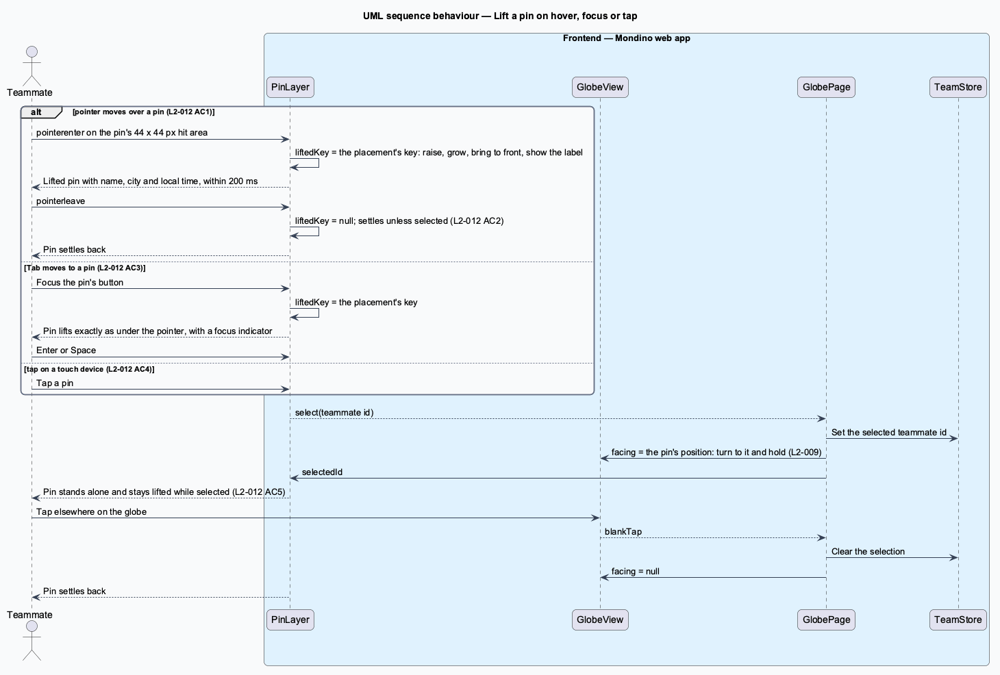
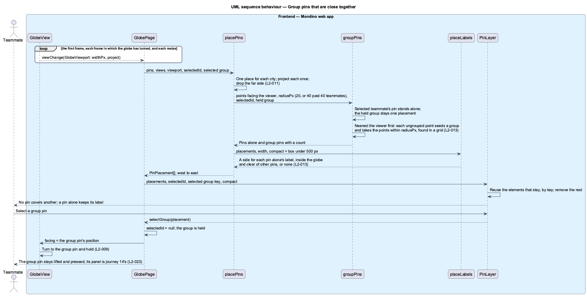

# Show pins

## Overview

Mondino shows a team spread around the world on a 3D globe. Each teammate appears as a pin at
their city. This feature covers the pins: reading them from the backend, drawing each one with
its teammate's initials, colour and label, lifting a pin out when it is pointed at, focused or
selected, and drawing pins that would cover each other, because their teammates live in the
same city or in cities close together, as one group pin with a count.

The feature exists because a pin is how one teammate finds another. A globe on a phone is
about 320 px wide and a team can hold 500 teammates, so a pin at rest is small. Lifting makes
one pin readable at a time, and grouping makes sure no pin hides another.

Terms used below:

- **pin** — a teammate's place on the globe: their initials in their own colour, at their city
- **label** — text beside a pin with the teammate's local time, weather and temperature, and, when the pin is lifted, their name and city
- **lifted pin** — pin drawn larger, raised above the surface and in front of its neighbours, with its label shown
- **hit area** — region around a pin that takes the pointer or a tap, at least 44 × 44 CSS px
- **place** — the pins of one city, which share one position on the globe
- **placement** — one thing drawn over the globe: a pin alone, or a group pin, anchored to a position
- **group pin** — one pin with a count that stands for the pins that would cover each other at the globe's current size and orientation
- **grouping radius** — on-screen distance, in CSS px, within which places are drawn as one group pin
- **viewer** — the teammate looking at the screen

A pin is placed at its city, never at a postal code, and nothing in this feature carries a
postal code (L2-007). Drawing the globe is covered by `draw-globe`, turning it by `turn-globe`.
The moment marker beside a pin (L2-021) and the text a screen reader hears for each pin
(L2-040) are designed in their own features and use the parts described here.

## Description

The slice runs from the Globe screen to the database. The backend gives the pins; the browser
decides how they are drawn.

**Backend**

- **`TeamsController`** — exposes `GET /api/teams/{teamId}/pins` to a teammate of the team. It
  checks nothing itself and sends one `GetPinsQuery`.
- **`GetPinsQuery`** — carries the `TeamId`.
- **`GetPinsQueryHandler`** — loads the team only where the teammate named by
  `ICurrentTeammate` belongs to it, and answers 404 otherwise, the same answer as for a team
  that does not exist (L2-043). For each distinct city it asks `IWeatherSource` for the
  weather and `MomentFinder` for the moments, then builds one `PinDto` for each teammate and
  answers them in a `TeamPinsDto` (the team's id and name, its invite token, the viewer's
  teammate id and the pins). A teammate whose `TeammateSettings.ShareWeather` is false gets a
  null weather and the `WeatherState` `NotShared`. When the weather source fails or times out
  the weather is null, the `WeatherState` is `Unavailable` and the pin is still returned
  (L2-049). The weather source receives a position and nothing else.
- **`PinDto`** — teammate id, name, colour, city name, country, position, time zone id,
  weather or null, the weather's state (`WeatherState`: `Available`, `Unavailable` or
  `NotShared`), whether the status is shared (`SharesStatus`), whether the pin is the viewer's own
  (`IsViewer`), and the moments. The position is the city's. The DTO has no postal code field
  and no local time: the browser works the time out from the time zone id.
- **`CachedWeatherSource`** — `IWeatherSource` decorator over `OpenMeteoWeatherSource`, with a
  timeout and a circuit breaker.
- **`PinColourPicker`** — picks a teammate's colour from the pin palette when they join, so
  that it differs from the teammates nearest to them where the palette allows. It runs in the
  join slice; this feature reads the stored colour.

**In the `api` library**

- **`Pin`** — the browser's type for a `PinDto`; **`TeamPins`** for a `TeamPinsDto`.
- **`TeamApi`** / `TEAM_API`, **`HttpTeamApi`** — read the pins.
- **`GlobeViewport`** — where things are on a globe at one instant: the box's `widthPx` and
  `project(position)`, which gives a position's place in the box (`x` and `y` in % of it and
  its `depth`, 1 facing the viewer and falling towards 0 at the rim), or null on the far side.
- **`PinView`** — what one pin shows, worked out once a minute: the teammate id, the
  `initials`, the `colour`, the `name` (with "(you)" for the viewer's own), the `cityName`,
  the `localTime`, the `description` (its accessible name), `isViewer` and `isNew`.
- **`PinPlacement`** — one thing drawn over the globe: a `key` (the teammate id of a pin, or
  `group:` and its anchor's teammate id), the `kind` (`'pin'` or `'group'`), `x`, `y` and
  `depth`, whether it is `far`, the `pins` it stands for (one `PinView` for a pin, two or more
  for a group), the group's `description`, and the `labelSide` of its label (`right`, `left`,
  `below`, `above`) or null when it shows none at rest.

**In the `domain` library**

- **`groupPins(points, options)`** — pure function in `pins/`. A `PlacePoint` is a place (the
  pins of one city) as it is drawn at one instant: its `x` and `y` in CSS px, its `depth` and
  its pins. `GroupOptions` carry the `radiusPx`, the `selectedId` of the selected teammate or
  null, and `heldIds`, the teammate ids of the group pin that is selected, or none. It groups
  greedily by on-screen distance, in four steps:
  1. The selected teammate's pin is taken out of its place and gets a placement of its own, so
     the selected teammate's pin always stands alone.
  2. The pins named by `heldIds` that face the viewer stay one group, anchored to the first of
     them, so a selected group pin keeps standing for the teammates it was selected with.
  3. The remaining place points are ordered nearest the viewer first. Each point not yet in a
     group seeds one and takes every other such point within `radiusPx` of it. The placement is
     anchored to the seed's position.
  4. A placement that holds one pin is a pin; one that holds two or more is a group pin with
     their count. Two teammates in one city are therefore always one group pin.

  Neighbours are found in a grid whose cells are `radiusPx` wide, so a seed looks in 9 cells
  and the whole pass is linear in the number of place points. The function reads no clock and
  no DOM, and the same points and options always give the same placements.
- **`placeLabels(placements, widthPx, compact)`** — pure helper in `pins/`. For each pin alone that is not far, it tries right, left, below and above,
  in that order, and keeps the first side where the label sits inside the globe's disc and
  clear of every other pin's mark; a pin with no such side shows no label until it is lifted.
  On a compact globe no resting label is shown.
- **`placePins(pins, viewport, selection)`** — pure function in `pins/`: projects each place
  once, drops those on the far side, groups them with `groupPins` at the radius for the
  team's size, marks those under `FarDepth` far, sides the labels with `placeLabels`, and
  orders the placements west to east, so the list's order does not change as the globe turns
  (ADR 0014).
- **`stillViewport(widthPx)`** — the still picture's `GlobeViewport`, from the projection the
  still picture is drawn with (`stillPlacements`).
- **`pinViews(pins, now)`** — the `PinView` of each pin: **`initialsOf(name)`**, the first
  character of up to the first two words of a name, so a pin is never blank;
  **`localTimeIn(timeZoneId, now)`** in `time/`, the 24-hour local time; and
  **`describePin`**, the accessible name: "Tomás Herrera, Mexico City, 08:05". Journeys 11, 13
  and 20 add the status, the weather and the moments to it. **`describeGroup`** names a group
  pin: "2 teammates close together: Sofia Bianchi (you), Luca Ferri", "14 teammates close
  together, Mexico City", "60 teammates close together, 3 cities".

**In the `globe` library**

- **`GlobeView`** (`mo-globe`) — takes `interactive` and `facing` (`turn-globe`) and emits
  `viewChange` with a `GlobeViewport` once the first frame is drawn, on each frame in which the
  globe has turned and when its box is resized, and `blankTap` when a tap lands on the globe
  but on no pin. It projects a `[pins]` slot over its canvas while the globe is drawn. The
  canvas under the slot is hidden from the accessibility tree. The renderer draws no 3D body
  under a pin (ADR 0012): the element over the canvas is the pin, and is what is pointed at,
  selected and tested.
- **`GlobeGestures`** — captures the pointer only once it has moved `TapThresholdPx`, so a
  click on a pin reaches the pin's button, and reports a tap on no pin (ADR 0014).

**In the `components` library**

- **`PinLayer`** (`mo-pin-layer`) — draws the placements as HTML over the globe, the mocks'
  `ul.globe__pins`, with one `li.globe__pin` for each placement, holding a `button.pin` and,
  for a pin with a label, its `span.pin-label`. It takes `placements`, `selectedId`,
  `selectedGroupKey` and `compact`, and emits `select` with a teammate id and `selectGroup`
  with a placement. The pins it draws are the list a keyboard and a screen reader reach
  (L2-040): a button's accessible name is its pin's `description`, it carries `aria-pressed`,
  which is true while its pin or group is selected, and the visible label beside it is
  `aria-hidden`. Each is a Tab stop; Enter or Space, or a click or a tap, selects it. A pin's
  initials, name and city are rendered as text (L2-044). `PinLayer` holds `liftedKey`: the
  placement under the pointer, or else the one with keyboard focus. A placement is drawn
  lifted (`globe__pin--lifted`, and its label `pin-label--lifted` with the name and city and
  the local time) when it is lifted or selected. A placement on the far side is not in the
  list, so it takes no focus; its teammate is reached through the panel and the Team screen. A
  far placement (`globe__pin--far`) is drawn fainter and without its label until it is
  lifted. The viewer's own pin carries `pin--you`, a new pin `pin--new`.
- **`GlobeFallback`** — takes the same `[pins]` slot over the still picture.

**In the `mondino` application**

- **`TeamStore`** — provided at the Globe route. It reads the pins once through `TEAM_API`
  for the remembered team, and holds them, the selected teammate id and the selected group as
  signals. When the backend answers 401 (the session has ended) or 404 (the team is not the
  session's), it forgets the membership, and the page opens its own address again, which then
  shows "You need an invite link" (`adapt-to-every-width`). Reading the pins again every 15
  minutes is `keep-team-fresh`'s (L2-048).
- **`GlobePage`** — makes the `PinView`s from the store's pins and the clock's minute, keeps
  the viewport `GlobeView` (or the still picture's, `stillViewport`) gives, and hands
  `placePins`' placements to `PinLayer` in the globe's `[pins]` slot. A selected pin, or a
  selected group pin's anchor, is passed to `GlobeView` as `facing`, so the globe turns to it
  and holds while it stays selected (`turn-globe`); `blankTap` clears the selection. Straight
  after joining (L2-005) the viewer's own pin is selected and new, so it stands alone, lifted
  and labelled, and pulses once. When `PinLayer` emits `selectGroup`, the page clears the
  selected teammate and keeps the group selected, lifted and pressed; the group's panel is
  `team/view-teammate-panel`'s (journey 14), and so is the teammate's own panel. On Join the
  page draws bare pins with no `PinLayer`, so pins there carry no name, city, local time or
  weather (L2-001).

**Lifting**

A pin at rest is a small mark inside a transparent hit area of at least 44 × 44 CSS px,
whatever the globe's size. Lifting is a change of state on the pin's element (the mocks'
`globe__pin--lifted` and `pin-label--lifted` modifiers), styled with a transform that raises
and enlarges it and a higher stacking order. The transition lasts no more than 200 ms; its
exact length comes from the design system's motion token `--duration-fast` (150 ms). Under reduced motion the transition
is removed and the pin changes size at once. Each minute the label's time changes through the
shared clock; no pin has a timer of its own.

By pointer, entering the hit area lifts the pin and leaving it settles the pin back unless it
is selected. By keyboard, focus on a pin's button lifts that pin exactly as the
pointer does, and the focus indicator is drawn on the pin itself. A pin on the far side of
the globe is hidden and takes no focus, so focus is never on something hidden. By
touch, where nothing hovers, a tap on a pin selects it and a tap elsewhere on the globe
(`blankTap`) clears the selection. `GlobeGestures` (see `turn-globe`) tells a tap from a drag. A selected
pin stays lifted, and `GlobePage` shows its teammate in the panel (L2-023).

A newly placed pin, the viewer's own after joining (L2-005) or, from journey 25, one that
arrived at a refresh (`keep-team-fresh`), carries the `pin--new` modifier and pulses once. Reduced motion removes
the pulse.

**Grouping pins that are close together**

Pins that would cover each other are one group pin, at every size of the globe; no pin is
moved off its city to make room. The grouping radius is the width of a pin's mark for a small
team, so only pins that would cover each other merge: in the cast of 13, the two teammates in
Milan are one group pin "2", while the pins of Berlin and Stockholm beside it stand alone. For
a large team the radius is about 40 px, and the mock of a team of 500 draws 18 group pins,
with counts from 3 to 68, and one pin alone. The radius is 20 px for a team of up to 40 and
40 px above it (ADR 0014).

A pin alone keeps its label. On a globe less than 500 px wide (the mocks' 31.25 rem) the marks are drawn smaller and
a label is shown only for the lifted or selected pin. On a wider globe `placeLabels` decides
which resting labels fit; a label that cannot be placed clear of other pins is not shown until
its pin is lifted. Hit areas of neighbouring placements may touch; where they would overlap,
the lifted placement's area is in front.

A group pin (`pin--group`) shows its count and carries no label and no moment marker. Its
accessible name, from `describeGroup`, gives the count and either the names
or the place: "2 teammates close together: Sofia Bianchi (you), Luca Ferri", "14 teammates
close together, Mexico City", "60 teammates close together, 3 cities". The mocks name the
teammates of a group of 2 and the place of a group of 3 or more. Selecting a group pin emits
`selectGroup`. The globe turns to the group pin (`turn-globe`), which stays lifted and pressed
while its teammates are listed in the panel (journey 14). Choosing a teammate there selects that
teammate's pin, which then stands alone, in front of the rest of its place.

The grouping follows the globe as it turns, because the on-screen distance between two cities
changes with the orientation: cities that merge near the globe's edge part as they come to
the front. `GlobePage` groups again when the pins, the globe's width or the selection change,
and on each frame in which the globe has turned: `RegroupAfterDegrees` is 0, because a grouping
costs no more than moving the placements (ADR 0014).

**Cost for a team of 500**

A team holds at most 500 teammates, and the pins shall stay cheap at that size:

- The places are worked out once for each `pins` value, not on each frame. A team of 500 has
  at most 500 places, and as many as it has cities.
- A grouping projects each place once, drops those on the far side, and runs `groupPins`,
  which is linear in the places that face the viewer. It runs at most once in a frame, when
  `GlobeView` reports the frame's viewport. `PinLayer` has no timer and no loop of its own,
  and no pin has either.
- `PinLayer` keeps an element only for a placement that faces the viewer. Seeds are at least
  one grouping radius apart, so the number of elements is bounded by the globe's area and not
  by the size of the team. Elements are keyed, a pin by its teammate id and a group pin by its
  anchor, so a grouping reuses the elements that stay and removes the rest.
- Each minute the labels' times change through the shared clock, for the pins alone that show
  a label.
- The scene does not draw while the tab is hidden (`turn-globe`), so nothing is grouped then.

**On the still picture**

Where the 3D globe cannot be drawn, `GlobeFallback` shows the still picture with the pins in
place on it (`draw-globe`). It renders the same list, `ul.globe__pins`, from the placements
`placePins` works out from `stillViewport` once for each `pins` value, width and selection,
with `groupPins` and the same grouping radius. Its pins lift and are selected as described here. Nothing
turns, so nothing is grouped again on a frame.

Nothing grows with the length of a visit. `PinLayer`'s listeners are its elements' own and go
with them when the Globe screen is left.

## Requirements

The feature realises the following level-2 (L2) requirements. Each refines a level-1 (L1)
requirement, cited by identifier.

| L2 ID | Refines (L1) | Requirement |
|-------|--------------|-------------|
| `L2-011` | `L1-004` | A pin shows the teammate's initials in the teammate's own colour, and a label beside it with their local time, the weather and the temperature. The viewer's own pin is marked as theirs. |
| `L2-012` | `L1-004` | On a small globe pins are small. A pin that the pointer is over, that has keyboard focus, or that is selected rises from the globe's surface, grows, comes in front of its neighbours and shows its label, so the teammate can be read clearly. When the pointer leaves it settles back. |
| `L2-013` | `L1-004` | Teammates in the same city, or in cities close together at the current size and turn of the globe, are never drawn on top of one another so that one is hidden. Pins that would cover each other are drawn as one group pin that shows how many teammates it stands for. This holds at every size of globe and for a team of any size, from two teammates in one city to a team of 500. Pins are never spread out around a city to keep them apart. |

## Diagrams

### System context

A teammate sees and selects pins in Mondino. Mondino reads the weather shown in a pin's label
from Open-Meteo.

### Containers

The Mondino web app reads the pins from the Mondino API with one request. The API reads the
team's teammates from the Mondino database and the cached weather for each city from
Open-Meteo.

### Components

In the web app, `GlobePage` gives the pins from `TeamStore`, with the viewport `GlobeView`
reports on each turned frame, to `placePins`, which groups them with `groupPins` and sides the
labels with `placeLabels`. `PinLayer`, in `GlobeView`'s `[pins]` slot, draws the placements as
pin buttons that take the pointer and keyboard focus. In the API, `TeamsController` sends
`GetPinsQuery` to `GetPinsQueryHandler`, which reads the database and `CachedWeatherSource`.

### Class structure

`PinDto` is serialised as `Pin`. `GlobePage` makes a `PinView` of each pin once a minute and
places them with `placePins`, which uses `groupPins` and `placeLabels` and returns
`PinPlacement`s, each standing for one or more pins. `GlobeView` reports a `GlobeViewport`
from `GlobeScene.project`; `GlobeView` and `GlobeFallback` each hold `PinLayer` in a slot.

### Behaviour — read the team's pins

The handler answers 404 to anyone who is not a teammate of the team. Otherwise it builds a
`PinDto` for each teammate with the city's position and no postal code. A weather that is not
shared, or that Open-Meteo did not give in time, is null, with the `WeatherState` saying
which, and the pin is returned all the same.

### Behaviour — lift a pin

The pointer lifts a pin in `PinLayer`. Keyboard focus on the pin's button lifts it the same
way. A tap, or Enter or Space, selects it; the selection travels to `TeamStore`, the globe
turns to the pin and holds, and the pin stays lifted until a tap on no pin clears it.

### Behaviour — group pins that are close together

`GlobePage` places the pins when the pins, the globe's size or the selection change, and on
each frame in which the globe has turned: it projects the places, hides those on the far side,
groups the rest and sides the labels of the pins that stand alone. Selecting a group pin turns
the globe to it and holds it lifted and pressed; its panel, and choosing a teammate in it, are
journey 14's.

