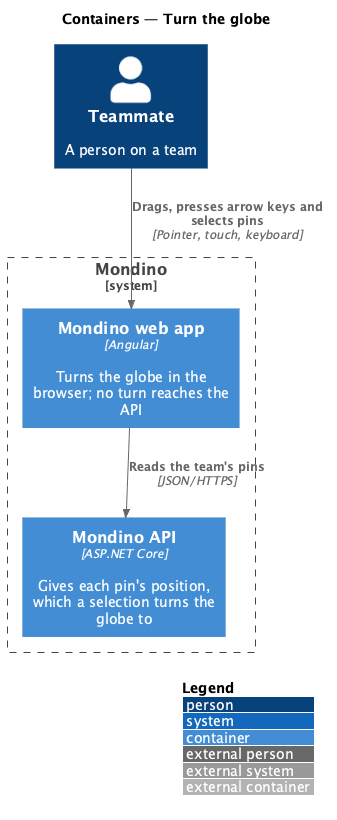
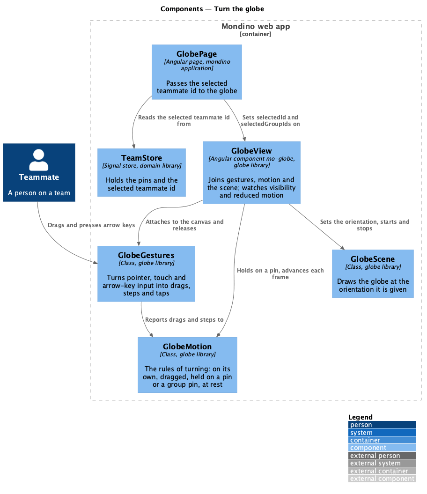

# Turn the globe

## Overview

Mondino shows a team as pins on a 3D globe. This feature covers how that globe moves. Left
alone it turns slowly eastward on its own. A teammate drags it to spin, by pointer or by touch,
or turns it with the arrow keys. When a pin is selected the globe turns to bring that pin to
the front and holds there. While the browser tab is hidden the globe neither turns nor draws.

The feature exists because a globe shows only half the team at once. Turning is how the other
half comes into view, and holding on a selected pin is how the globe and the panel beside it
stay about the same teammate.

Terms used below:

- **orientation** — which way the globe faces the viewer: the longitude at the centre of the view and the tilt towards a pole
- **turning on its own** — slow eastward turn that runs while nothing is selected and nobody has interacted for 5 seconds
- **hold** — state in which the globe stays turned to a selected pin until the selection is cleared
- **step** — fixed turn made by one press of an arrow key
- **rest** — state in which the render loop is stopped because the tab is hidden
- **reduced motion** — system setting, read from the `prefers-reduced-motion` media query, that asks for motion to be removed

Everything here happens in the browser, inside the `globe` library. No turn reaches the Mondino
API. Drawing the globe is covered by `draw-globe` and the pins by `show-pins`.

## Description

**In the `globe` library**

- **`GlobeMotion`** — class that holds the rules of turning and nothing else. It has no access
  to the DOM, the renderer or a timer, so each rule is unit tested by calling it with elapsed
  milliseconds. It holds the current `GlobeOrientation` and a `MotionMode`:
  - `TurningOnItsOwn` — `advance` moves the longitude eastward at the auto-turn rate.
  - `Dragged` — the orientation follows `dragBy`.
  - `Waiting` — nothing moves; `advance` counts frame time and returns to `TurningOnItsOwn`
    after `IdleDelayMs` (5000 ms).
  - `TurningToPin` — `advance` eases the orientation towards the held position along the
    shorter way round and finishes within `TurnToPinMaxMs` (1000 ms).
  - `Holding` — the orientation stays on the held position.

  Its methods are `advance(elapsedMs)`, `dragStart()`, `dragBy(deltaLongitude, deltaTilt)`,
  `dragEnd()`, `canTurn(deltaLongitude, deltaTilt)`, `step(direction)`, `hold(position)`,
  `release()`, `setReducedMotion(reduced)` and `isMoving()`. The tilt is limited so a pole
  never passes the centre of the view; `canTurn` reports whether a turn would exceed the limit.
  The auto-turn rate, the size of a step, the tilt limit and the easing curve are
  `<TO SUPPLY>`; the mocks and the design system's motion tokens settle them.
- **`GlobeOrientation`** — `longitude` and `tilt`, in degrees.
- **`GlobeGestures`** — class that listens on the globe's element and turns input into calls on
  `GlobeMotion`. Pointer events give a drag: pointer down calls `dragStart`, each move converts
  the distance in CSS px into degrees at the globe's current size and calls `dragBy`, and
  pointer up calls `dragEnd`. Arrow keys call `step` while the globe has keyboard focus. A
  pointer that goes down and up without moving further than a small threshold
  (`<TO SUPPLY>` px) is a tap, not a drag, and is passed to `PinLayer` (see `show-pins`).
  `attach(target, signal)` registers each listener with an `AbortSignal`, so aborting the
  signal removes them all.
- **`GlobeView`** (`mo-globe`) — joins the parts. It owns one `GlobeMotion` and one
  `GlobeGestures`, and registers a frame listener on `GlobeScene`. On each frame it calls
  `motion.advance(elapsedMs)` and passes the result to `GlobeScene.setOrientation`. It attaches
  `GlobeGestures` only when its `interactive` input is true, so the small globe on Profile &
  Settings is not dragged, and never over the still picture (see `draw-globe`).
- **`GlobeScene`** — draws the globe at the orientation it is given and owns the render loop
  (`start`, `stop`, `onFrame`). It decides nothing about motion.

**In the `mondino` application and the `domain` library**

- **`GlobePage`** passes `TeamStore`'s `selectedTeammateId` to `GlobeView`'s `selectedId`
  input. On `GlobeView`'s `select` output it navigates to `/globe?teammate={teammateId}`, or
  to `/globe` for null, and the store follows the address (`team/view-teammate-panel`).
- **`TeamStore`** holds `selectedTeammateId`. A refresh of the team (L2-048) leaves the
  selection and the orientation as they are, because neither is rebuilt from the response.

**The rules**

*Turning on its own.* The globe starts in `TurningOnItsOwn` when nothing is selected. Any drag
or step moves it to `Dragged` or `Waiting`, and it returns to turning on its own 5 seconds
after the last interaction. The 5 seconds are counted from frame time inside `advance`, not
from a timer, so the count stops while the tab is hidden and there is no timer to release.

*Dragging.* One finger or one pointer spins the globe; no gesture needs two fingers or a path
(L2-039). The globe's element sets `touch-action: pan-y`, which leaves vertical touch drags
available to the page. On the first move of a touch drag `GlobeGestures` asks
`GlobeMotion.canTurn`. Where the drag is vertical and the tilt is already at its limit in that
direction, the listener does not cancel the event and the page scrolls. Otherwise it cancels
the event and the globe takes the drag. The globe therefore never traps the page on a phone.

*Arrow keys.* The globe's element is focusable and has a visible focus indicator. Left and
right turn the longitude by one step and up and down turn the tilt by one step, within the
limit.

*Selecting.* An effect on `selectedId` looks up the pin's position and calls
`motion.hold(position)`. The globe turns to face the pin within 1 second and holds. Clearing
the selection calls `release()`, which moves to `Waiting`, so the globe turns on its own again
5 seconds later. What a drag does while a pin is selected (whether it is ignored, or turns the
globe and returns to the pin) is `<TO SUPPLY>`; the mocks do not draw it.

*Reduced motion.* `GlobeView` injects `MOTION_PREFERENCE` (`platform/make-accessible`) and
passes its `reduced` signal to `setReducedMotion` in an effect, so the setting is followed
without a reload (L2-042). With reduced
motion `GlobeMotion` never enters `TurningOnItsOwn`, and `hold` sets the orientation at once
and goes straight to `Holding`. Dragging and arrow keys still work, because they are the
teammate's own movement.

*Resting.* `GlobeView` listens for `visibilitychange` on the document. When the tab is hidden
it calls `GlobeScene.stop()`, which cancels the pending animation frame; with no frames,
`GlobeMotion` does not advance and nothing is drawn. When the tab is shown again it calls
`start()`. The first frame's elapsed time is capped so the globe continues from where it
rested and does not jump. When `isMoving()` is false, as in `Holding` or under reduced motion,
the scene should draw only when something changes (a new orientation, a new sun position, a
resize) and not on every frame.

*Release.* When `GlobeView` is destroyed it aborts the signal that holds the pointer, touch and
key listeners, removes the `visibilitychange` listener, and disposes of the
scene, which ends the frame loop (L2-047).

## Requirements

The feature realises the following level-2 (L2) requirement, which refines a level-1 (L1)
requirement, cited by identifier.

| L2 ID | Refines (L1) | Requirement |
|-------|--------------|-------------|
| `L2-009` | `L1-003` | Left alone, the globe turns slowly on its own. It is dragged to spin, by pointer or touch, and turned with the arrow keys. When a pin is selected the globe turns to bring it to the front and holds there. |

## Diagrams

### System context

A teammate spins the globe and selects pins in Mondino. No outside system takes part.

### Containers

Turning happens in the Mondino web app. The Mondino API appears only because a selection turns
the globe to a pin's position, and that position came from the API.

### Components

`GlobeGestures` reports drags and steps to `GlobeMotion`. `GlobeView` advances `GlobeMotion` on
each frame, passes the orientation to `GlobeScene`, and holds on a pin when `GlobePage` sets
`selectedId` from `TeamStore`'s `selectedTeammateId`.

### Class structure

`GlobeView` owns `GlobeMotion` and `GlobeGestures`. `GlobeMotion` has a `MotionMode` and a
`GlobeOrientation`, steps by an `ArrowDirection` and holds on a `Position`. `GlobeScene` is
drawn at a `GlobeOrientation`.

### Behaviour — turn on its own and spin with a drag

The globe turns eastward until a drag begins. A drag turns the globe, except a vertical touch
drag at the tilt limit, which is left to the page. After the drag or an arrow-key step the
globe waits 5 seconds of frame time and turns on its own again.

### Behaviour — turn to a selected pin and hold

A selection travels from `GlobeView` to `GlobePage`, into the address and `TeamStore`, and
returns as the `selectedId` input. `GlobeMotion` then turns to the pin within 1 second, or at once under
reduced motion, and holds until the selection is cleared.

### Behaviour — rest while the tab is hidden

Hiding the tab stops the render loop, so the globe neither turns nor draws. Showing the tab
starts the loop again and the globe continues from where it rested.

