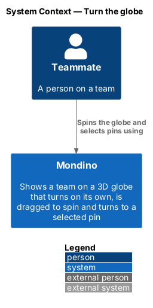
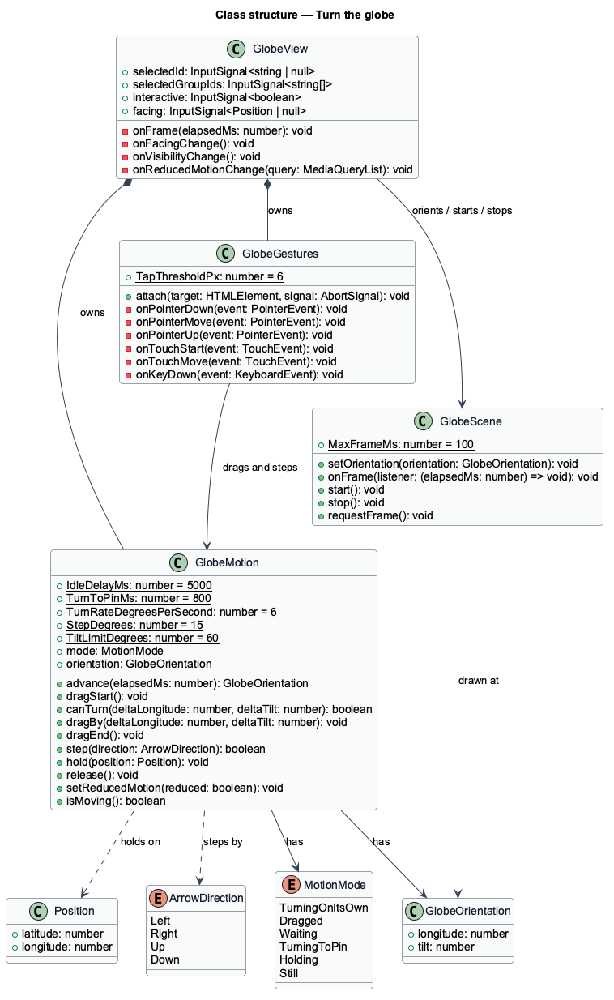
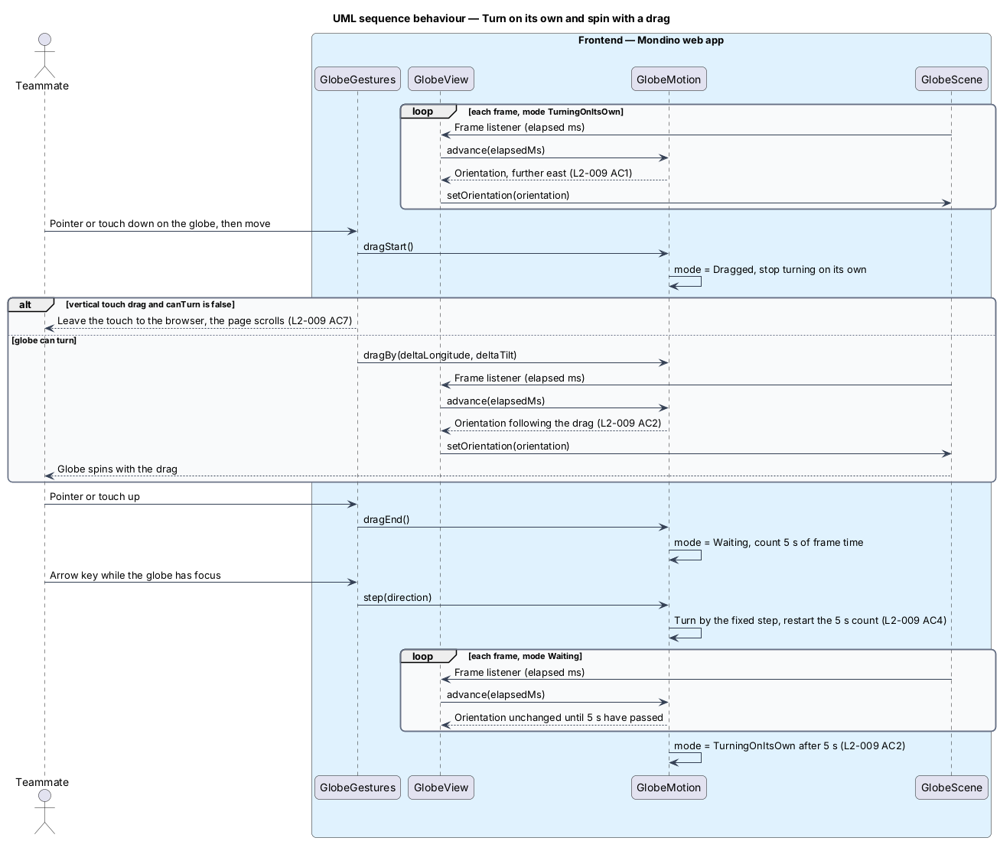
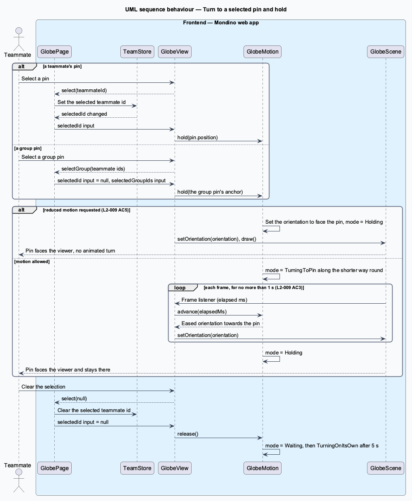
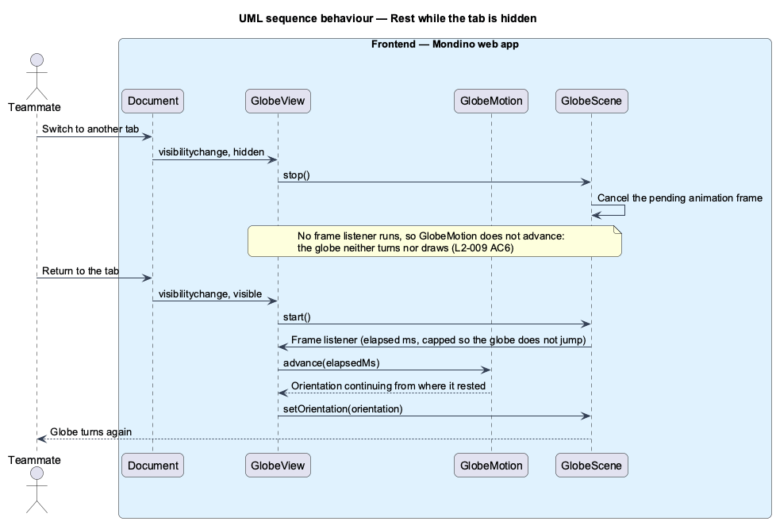

# Turn the globe

## Overview

Mondino shows a team as pins on a 3D globe. This feature covers how that globe moves. Left
alone it turns slowly eastward on its own. A teammate drags it to spin, by pointer or by touch,
or turns it with the arrow keys. When a pin or a group pin is selected the globe turns to
bring it to the front and holds there. While the browser tab is hidden the globe neither turns
nor draws.

The feature exists because a globe shows only half the team at once. Turning is how the other
half comes into view, and holding on a selected pin is how the globe and the panel beside it
stay about the same teammate.

Terms used below:

- **orientation** — which way the globe faces the viewer: the longitude at the centre of the view and the tilt towards a pole
- **turning on its own** — slow eastward turn of the Globe screen's globe that runs while nothing is selected and nobody has interacted for 5 seconds
- **hold** — state in which the globe stays turned to a selected pin or group pin until the selection is cleared
- **group pin** — one pin with a count that stands for pins that would cover each other (`show-pins`)
- **step** — fixed turn made by one press of an arrow key
- **rest** — state in which the render loop is stopped because the tab is hidden
- **reduced motion** — system setting, read from the `prefers-reduced-motion` media query, that asks for motion to be removed

Everything here happens in the browser, inside the `globe` library. No turn reaches the Mondino
API. Drawing the globe is covered by `draw-globe` and the pins by `show-pins`. The still
picture shown where the 3D globe cannot be drawn (`draw-globe`) is outside this feature's
motion: it does not turn on its own, is not dragged, takes no arrow key and does not turn to a
selected pin.

## Description

**In the `globe` library**

- **`GlobeMotion`** — class that holds the rules of turning and nothing else. It has no access
  to the DOM, the renderer or a timer, so each rule is unit tested by calling it with elapsed
  milliseconds. It holds the current `GlobeOrientation` and a `MotionMode`:
  - `TurningOnItsOwn` — `advance` moves the longitude eastward at the auto-turn rate.
  - `Dragged` — the orientation follows `dragBy`.
  - `Waiting` — nothing moves; `advance` counts frame time and returns to `TurningOnItsOwn`
    after `IdleDelayMs` (5000 ms).
  - `TurningToPin` — `advance` eases the orientation towards the held position along the
    shorter way round and finishes within `TurnToPinMaxMs` (1000 ms).
  - `Holding` — the orientation stays on the held position.
  - `Still` — nothing moves and nothing is counted: a globe that does not turn on its own, under
    reduced motion, or after a drag while a pin is held.

  Its methods are `advance(elapsedMs)`, `dragStart()`, `dragBy(deltaLongitude, deltaTilt)`,
  `dragEnd()`, `canTurn(deltaLongitude, deltaTilt)`, `step(direction)` (an `ArrowDirection`:
  `Left`, `Right`, `Up` or `Down`; false when the tilt is at its limit that way), `hold(position)`,
  `release()`, `setReducedMotion(reduced)` and `isMoving()`. It is made with `turnsOnItsOwn`
  (the `interactive` input) and the starting orientation. The tilt is limited so a pole never
  passes the centre of the view; `canTurn` reports whether a turn would exceed the limit.
  `isMoving()` is true while it turns on its own, turns to a pin or waits out the 5 seconds:
  the states that need the next frame. The numbers are named constants (ADR 0013):
  `TurnRateDegreesPerSecond` 6, `StepDegrees` 15, `TiltLimitDegrees` 60, `IdleDelayMs` 5000,
  `TurnToPinMs` 800 eased out (`1 − (1 − t)³`, the shape of `--ease-standard`), and
  `MaxFrameMs` 100, the most one frame may advance it.
- **`GlobeOrientation`** — `longitude` and `tilt`, in degrees: the longitude and the latitude
  at the centre of the view. Turning eastward lowers the longitude, so pins move right.
- **`GlobeGestures`** — class that listens on the globe's element and turns input into calls on
  `GlobeMotion`. A mouse or a pen gives a drag through pointer events, with pointer capture:
  pointer down records where, the first move past `TapThresholdPx` (6 px) calls `dragStart`,
  each move converts the distance in CSS px into degrees at the globe's current size (one radius
  of the disc for one radian, so the place under the pointer follows it) and calls `dragBy`, and
  pointer up or cancel calls `dragEnd`. A finger gives a drag through touch events (see
  *Dragging*); a second finger is ignored. Arrow keys call `step` while the globe has keyboard
  focus. A pointer that goes down and up without passing the threshold is a tap, not a drag,
  and is passed to `PinLayer` (see `show-pins`). `attach(target, signal)` registers each
  listener with an `AbortSignal`, so aborting the signal removes them all and releases a pointer
  capture held at that moment.
- **`GlobeView`** (`mo-globe`) — joins the parts. It owns one `GlobeMotion` and one
  `GlobeGestures`, and registers a frame listener on `GlobeScene`. On each frame it calls
  `motion.advance(elapsedMs)`, passes the result to `GlobeScene.setOrientation`, and asks for
  the next frame while `isMoving()`. Its `interactive` input, set only by `GlobePage`, makes the
  globe's box a focusable `role="group"` whose name ends "Drag to spin, or use the arrow keys.",
  attaches `GlobeGestures`, and lets the globe turn on its own. A globe that is not interactive
  (Join's, the small one on Profile & Settings) is a `role="img"`, is not dragged and does not
  turn on its own; it only turns to `facing` (ADR 0013). Its `facing` input is the position to
  turn to and hold, or null. In the `Fallback` state it creates neither `GlobeMotion` nor
  `GlobeGestures` and registers no frame listener: `GlobeFallback`, the still picture, has no
  drag, no arrow keys and no focus of its own, and its pins stay where they are.
- **`GlobeScene`** — draws the globe at the orientation it is given (`setOrientation`) and owns
  the render loop (`start`, `stop`, `onFrame`, `requestFrame`), drawing a frame only when one is
  asked for. It decides nothing about motion.

**In the `mondino` application and the `domain` library**

- **`GlobePage`** passes `TeamStore`'s selected teammate id to `GlobeView`'s `selectedId` input
  and writes `GlobeView`'s `select` output back to the store. It passes the teammate ids of a
  selected group pin to `selectedGroupIds` (`team/view-teammate-panel`).
- **`TeamStore`** holds the selected teammate id. A refresh of the team (L2-048) leaves the
  selection and the orientation as they are, because neither is rebuilt from the response.

**The rules**

*Turning on its own.* The Globe screen's globe starts in `TurningOnItsOwn` when nothing is
selected; a globe that is not interactive starts `Still`. Any drag
or step moves it to `Dragged` or `Waiting`, and it returns to turning on its own 5 seconds
after the last interaction. The 5 seconds are counted from frame time inside `advance`, not
from a timer, so the count stops while the tab is hidden and there is no timer to release.

*Dragging.* One finger or one pointer spins the globe; no gesture needs two fingers or a path
(L2-039). The globe's element sets `touch-action: pan-y`, which leaves vertical touch drags
available to the page, and its `touchmove` listener is not passive. On the first move of a touch
drag `GlobeGestures` asks `GlobeMotion.canTurn`. Where the drag is vertical and the tilt is
already at its limit in that direction, the listener does not cancel the event, ignores the rest
of that touch, and the page scrolls. Otherwise it cancels the event and the globe takes the drag
to its end. The globe therefore never traps the page on a phone. Touch is read from touch events
rather than pointer events because the browser cancels a touch pointer as soon as it pans, so a
pointer listener could not hand a drag back to the page.

*Arrow keys.* The globe's element is focusable and has the shared focus ring. Each key turns
the globe's front the way it points by one step (15°), as a drag that way would: left and right
turn the longitude, up and down the tilt, within the limit. The key's default (scrolling the
page) is prevented only when the globe turns.

*Selecting.* An effect on `facing` calls `motion.hold(position)`, and `motion.release()` when
it goes back to null. Until pins can be selected (journey 10), `JoinPage` passes the new pin's
position, so Join's globe turns to the found city and holds, as the mock `join/found` draws it.
With `show-pins`, an effect on `selectedId` and `selectedGroupIds` resolves the position to face
into the same call. For a selected teammate it is their pin's position. For a
selected group pin it is the position the group pin is anchored to, which `PinLayer` gives
for the group's teammate ids. The globe turns to face it within 1 second and holds. Turning
to a group pin groups the pins again as its cities come to the front (`show-pins`); the
selected group stays one group pin while its panel is open. Choosing a teammate in the
group's panel sets `selectedId`, and the globe turns from the group pin to that teammate's
pin. Clearing the selection calls `release()`, which moves to `Waiting`, so the globe turns on
its own again 5 seconds later. A drag or a step while a pin is held turns the globe, which then
stays where it was left (`Still`) and does not turn on its own while the selection lasts
(ADR 0013).

*Reduced motion.* `GlobeView` reads `matchMedia('(prefers-reduced-motion: reduce)')` and
listens for its change, so the setting is followed without a reload (L2-042). With reduced
motion `GlobeMotion` never enters `TurningOnItsOwn` or `Waiting` (a turn on its own stops where
it is and a drag ends `Still`), and `hold` sets the orientation at once and goes straight to
`Holding`; a turn to a pin under way finishes at once. When the setting is turned off, a
`Still` globe with nothing held turns on its own again. Dragging and arrow keys still work, because they are the
teammate's own movement.

*Resting.* `GlobeView` listens for `visibilitychange` on the document. When the tab is hidden
it calls `GlobeScene.stop()`, which cancels the pending animation frame; with no frames,
`GlobeMotion` does not advance and nothing is drawn. When the tab is shown again it calls
`start()`. The scene reports the first frame after a rest, or after a frame that was not
chained to the one before, as 0 ms, and any frame as at most `MaxFrameMs`, so the globe
continues from where it rested and does not jump. When `isMoving()` is false, as in `Holding` or under reduced motion,
the scene should draw only when something changes (a new orientation, a new sun position, a
resize) and not on every frame.

*Release.* When `GlobeView` is destroyed it aborts the signal that holds the pointer, touch and
key listeners, removes the `visibilitychange` and media query listeners, and disposes of the
scene, which ends the frame loop (L2-047).

## Requirements

The feature realises the following level-2 (L2) requirement, which refines a level-1 (L1)
requirement, cited by identifier.

| L2 ID | Refines (L1) | Requirement |
|-------|--------------|-------------|
| `L2-009` | `L1-003` | Left alone, the globe turns slowly on its own. It is dragged to spin, by pointer or touch, and turned with the arrow keys. When a pin is selected the globe turns to bring it to the front and holds there. |

## Diagrams

### System context

A teammate spins the globe and selects pins in Mondino. No outside system takes part.

### Containers

Turning happens in the Mondino web app. The Mondino API appears only because a selection turns
the globe to a pin's position, and that position came from the API.

### Components

`GlobeGestures` reports drags and steps to `GlobeMotion`. `GlobeView` advances `GlobeMotion` on
each frame, passes the orientation to `GlobeScene`, and holds on a pin when `GlobePage` sets
the selected teammate id from `TeamStore`, or on a group pin when it sets the group's
teammate ids.

### Class structure

`GlobeView` owns `GlobeMotion` and `GlobeGestures`. `GlobeMotion` has a `MotionMode` and a
`GlobeOrientation`, steps by an `ArrowDirection` and holds on a `Position`. `GlobeScene` is
drawn at a `GlobeOrientation`.

### Behaviour — turn on its own and spin with a drag

The globe turns eastward until a drag begins. A drag turns the globe, except a vertical touch
drag at the tilt limit, which is left to the page. After the drag or an arrow-key step the
globe waits 5 seconds of frame time and turns on its own again.

### Behaviour — turn to a selected pin and hold

A selection travels from `GlobeView` to `GlobePage` and `TeamStore` and returns as the
`selectedId` input; a selected group pin returns as `selectedGroupIds`. `GlobeMotion` then
turns to the pin, or to the group pin's anchor, within 1 second, or at once under reduced
motion, and holds until the selection is cleared.

### Behaviour — rest while the tab is hidden

Hiding the tab stops the render loop, so the globe neither turns nor draws. Showing the tab
starts the loop again and the globe continues from where it rested.

