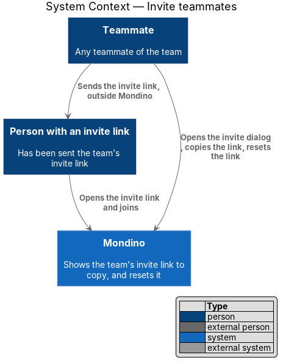
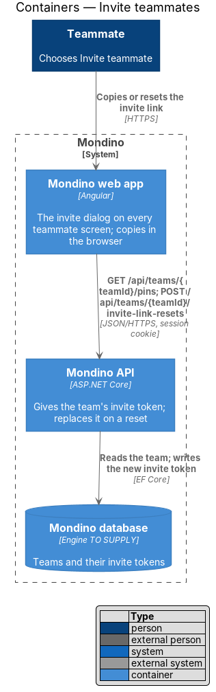
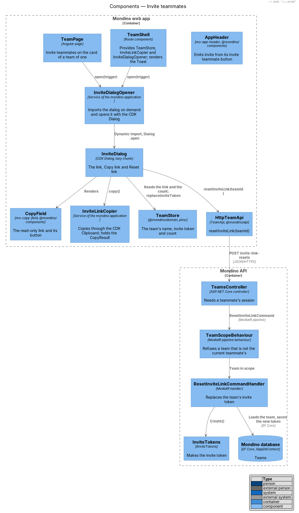
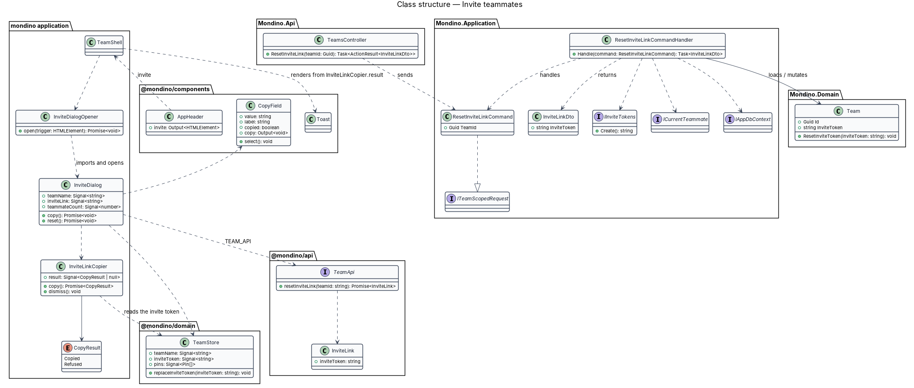
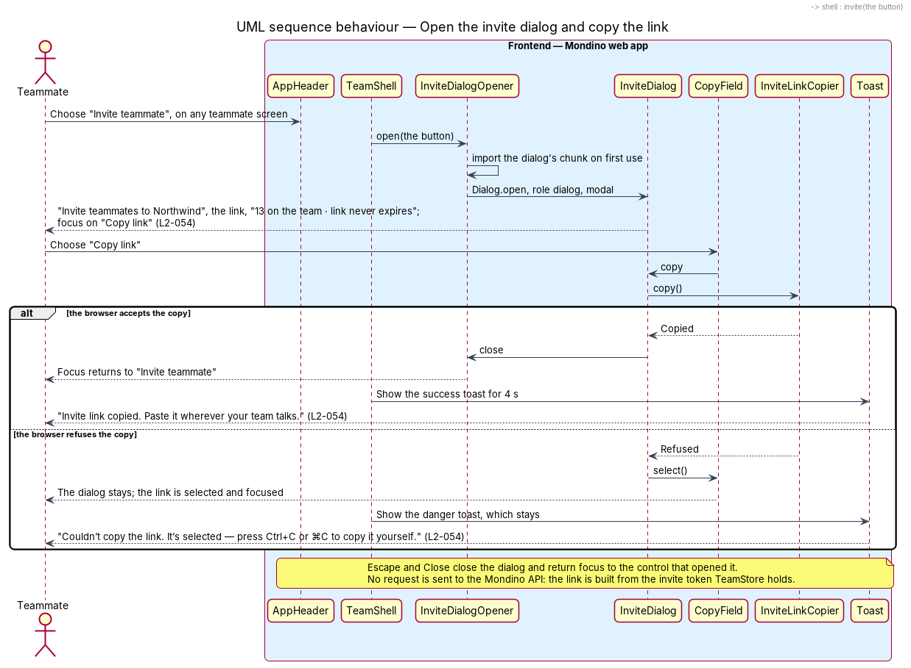
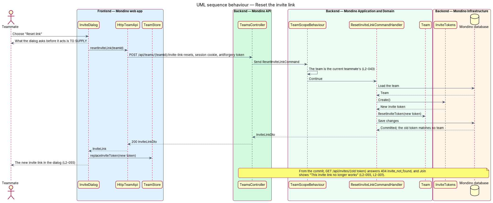

# Invite teammates

## Overview

Mondino shows a team on a 3D globe, each teammate as a pin at their city. A person becomes a
teammate through the team's invite link. This feature covers how a teammate gets that link to
send it, and how a teammate replaces it.

**invite link** — address of the form `/join/:inviteToken` that opens the Join screen for one team

**invite dialog** — dialog, opened from every teammate screen, that shows the team's invite link to copy

**reset** — replacement of a team's invite token by a new one, after which the old invite link opens no team

"Invite teammate", in the header of Globe, Team, Moments and Profile & Settings, opens the
invite dialog. Under 768 px the button is an icon alone, with the same accessible name.
"Invite teammates", on the card the Team screen shows a team of one, opens the same dialog. The
button no longer copies the link itself.

The dialog is titled "Invite teammates to Northwind". It reads "Share this link with anyone on
the team. They place their own pin with a postal code — only their city is ever shown.", shows
the link under the label "Invite link", and offers "Copy link". Under the link it reads "13 on
the team · link never expires" and offers "Reset link".

Copying closes the dialog and confirms with a toast. When the browser refuses the copy, the
dialog stays with the link selected, so one keystroke copies it, and a toast says so.

Any teammate can reset the team's invite link: Mondino has no roles. The old link stops
working at once, and Join then shows "This invite link no longer works" (`open-invite-link`).
The new link is shown in the dialog. An invite link never expires on its own.

What "Reset link" asks before it acts is not designed, and the reset is not built before that
design exists: `<TO SUPPLY>`.

Mondino sends the link to no one. The teammate pastes it wherever the team talks; "Invite
teammate" opens the dialog and nothing else.

## Description

The feature is a vertical slice from the header to the database. Copying happens in the
browser alone; only the reset calls the Mondino API. No outside source takes part.

**Frontend (`mondino` application, `@mondino/api`, `@mondino/components`, `@mondino/domain`)**

- **`AppHeader`** (`mo-app-header`) — its "Invite teammate" button (`app-header__invite`) emits
  the output `invite` with the button's element. From 768 px the button shows its label
  (`app-header__invite-label`); under 768 px it shows the icon alone and keeps the accessible
  name "Invite teammate" (`adapt-to-every-width`).
- **`TeamShell`** — provides `InviteDialogOpener` beside `TeamStore` and `InviteLinkCopier`. On
  the header's `invite` it calls `InviteDialogOpener.open(trigger)`. It renders the `Toast`
  from `InviteLinkCopier.result`, so the toast outlives the dialog and is the same on all four
  screens.
- **`TeamPage`** — for a team of one it shows the card "It’s just you on Northwind so far"
  (`view-team-through-the-day`), whose button "Invite teammates" calls the same
  `InviteDialogOpener.open(trigger)`.
- **`InviteDialogOpener`** — service of the `mondino` application, provided at `TeamShell`'s
  route. `open(trigger)` imports `InviteDialog` dynamically, so the dialog's code is loaded
  when it is first opened and is in no screen's chunk, then opens it through the CDK `Dialog`
  service with `TeamShell`'s injector. It opens one dialog at a time and returns focus to
  `trigger` when the dialog closes.
- **`InviteDialog`** — CDK Dialog with `role="dialog"`, `aria-modal`, the title as its name and
  the paragraph as its description; its block is `dialog`.
  - It reads the team's name, the invite token and the number of pins from `TeamStore`, and
    builds the link with `inviteLinkFor`. The team's name is rendered as text. The line under
    the link (`dialog__meta`) reads the count and "link never expires".
  - Focus starts on "Copy link" and stays inside the dialog. Escape and the "Close" button
    close it.
  - "Copy link" calls `InviteLinkCopier.copy()`. On `Copied` the dialog closes. On `Refused`
    the dialog stays open and calls `CopyField.select()`.
  - "Reset link" calls `TeamApi.resetInviteLink(teamId)` and, on the answer, calls
    `TeamStore.replaceInviteToken`, so the dialog and the invite card show the new link without
    a further read. What the dialog asks before the request, what it shows while the request
    is pending and what it shows when the request fails are `<TO SUPPLY>`.
  - Under 576 px the dialog is a sheet from the bottom.
- **`CopyField`** (`mo-copy-field`, block `copy-field`) — presentation component in
  `@mondino/components`: the link in a read-only input (`copy-field__value`) and the button
  "Copy link". It takes `value`, `label` and `copied`, emits `copy`, and `select()` selects the
  link and moves focus to it. It injects nothing. Create Team uses the same component
  (`make-team`).
- **`InviteLinkCopier`** — service of the `mondino` application
  (`view-week-around-the-world`). `copy()` copies the link through the CDK `Clipboard`, sets
  `result` and returns it. The invite card on the Globe of a team of one calls the same method
  directly, with no dialog, and ends in the same toasts.
- **`Toast`** (`mo-toast`, block `toast`) — presentation component in `@mondino/components`,
  rendered by `TeamShell` in the mocks' `toast-region`.

  | `CopyResult` | Toast | Region | Dismissal |
  |--------------|-------|--------|-----------|
  | `Copied` | "Invite link copied. Paste it wherever your team talks." | `role="status"`, polite | After 4 s; the timer pauses while the toast is pointed at or focused. "Dismiss" closes it at once. |
  | `Refused` | "Couldn’t copy the link. It’s selected — press Ctrl+C or ⌘C to copy it yourself." | `role="alert"`, assertive | Stays until "Dismiss" is chosen |

  The 4 s dismissal is one timer, cleared when `InviteLinkCopier` is destroyed; unit tests
  advance a fake clock. On the invite card, where there is no dialog, a refused copy selects
  the link in the card instead.
- **`TeamApi.resetInviteLink(teamId)`** — sends `POST /api/teams/{teamId}/invite-link-resets`
  with the antiforgery token and no body, and returns an `InviteLink`: the new `inviteToken`.
- **`TeamStore.replaceInviteToken(inviteToken)`** — replaces the invite token the store holds.
  Another teammate's browser receives the new token with its next read of the pins
  (`keep-team-fresh`).

**Backend**

- **`TeamsController`** — `POST /api/teams/{teamId}/invite-link-resets`. The action needs a
  teammate's session and an antiforgery token, as every state-changing request under
  `/api/teams/` does. It checks nothing itself, sends one `ResetInviteLinkCommand` and answers
  200 with an `InviteLinkDto`.
- **`ResetInviteLinkCommand`** — carries the `TeamId` and implements `ITeamScopedRequest`, so
  `TeamScopeBehaviour` refuses a team that is not the current teammate's with 404
  (`protect-team-data`, L2-043). It names no teammate: any teammate of the team may reset its
  link.
- **`ResetInviteLinkCommandHandler`** — loads the `Team`, calls `Team.ResetInviteToken` with a
  token from `IInviteTokens.Create()` (`make-team`), saves through `IAppDbContext` and returns
  the new token.
- **`Team.ResetInviteToken(inviteToken)`** — replaces `InviteToken`. The old token is kept
  nowhere, so from the save it matches no team: `GetInviteQueryHandler`,
  `LookUpPostalCodeQueryHandler` and `JoinTeamCommandHandler` refuse it with
  `invite_not_found`, as they refuse a token that was never issued. A person who is on the Join
  screen with the old link when it is reset is refused at their next step, and the form gives
  way to "This invite link no longer works". Teammates who already joined are unaffected.
- **`InviteLinkDto`** — `InviteToken`.
- **`TeamPinsDto.InviteToken`** — the token every teammate's browser reads with the pins. It is
  how the dialog has the link without a request of its own.

**Refusals**

| Case | Status | `code` | The screen says |
|------|--------|--------|-----------------|
| `teamId` is not the teammate's own team | 404 | `team_not_found` | `<TO SUPPLY>` |
| No session, or the teammate has left | 401 | none | `sessionExpiredInterceptor` forgets the membership and the address shows "You need an invite link" in place |
| The backend cannot be reached, or answers 5xx | none or 5xx | none | `<TO SUPPLY>` |

**Open points**

- The confirmation "Reset link" asks for, and the dialog's pending and failed states, are
  `<TO SUPPLY>`.
- A limit on how often a team's link is reset is `<TO SUPPLY>`.
- Whether teammates are told that the link was reset, and by whom, is `<TO SUPPLY>`. No mock
  draws it.

## Requirements

The feature realises the following level-2 (L2) requirements. Each refines the level-1 (L1)
requirement cited by identifier.

| L2 ID | Refines (L1) | Requirement |
|-------|--------------|-------------|
| `L2-054` | `L1-018` | "Invite teammate" in the header of every teammate screen, and "Invite teammates" on Team for a team of one, open a dialog that shows the team's invite link and copies it. A copy that succeeds closes the dialog and is confirmed by a toast; a copy that is refused leaves the link selected and says so. The invite link never expires. |
| `L2-055` | `L1-018` | Any teammate can reset the team's invite link. The old link stops working, and a new one is shown. |

## Diagrams

### System context

A teammate takes the team's invite link from Mondino and sends it to a person outside Mondino,
who opens it and joins. A teammate can also reset the link.

### Containers

The Mondino web app has the invite token from its read of the team's pins and copies the link
in the browser. Only a reset reaches the Mondino API, which writes the new token to the Mondino
database.

### Components

`AppHeader` and `TeamPage` open `InviteDialog` through `InviteDialogOpener`, which imports it
on demand. The dialog copies through `InviteLinkCopier` and resets through `HttpTeamApi`. In
the Mondino API, `TeamsController` sends `ResetInviteLinkCommand` past `TeamScopeBehaviour` to
`ResetInviteLinkCommandHandler`, which takes a new token from `InviteTokens`.

### Class structure

`InviteDialog` depends on `CopyField`, `InviteLinkCopier`, `TeamStore` and the `TeamApi`
contract. `InviteLinkCopier` holds a `CopyResult`, which `TeamShell` shows as a `Toast`.
`ResetInviteLinkCommand` is an `ITeamScopedRequest`, and its handler replaces the `Team`'s
invite token.

### Behaviour — open the invite dialog and copy the link

`AppHeader` emits `invite`, and `InviteDialogOpener` imports and opens the dialog with focus on
"Copy link". A copy that succeeds closes the dialog, returns focus to the button that opened
it and shows the toast for 4 s. A copy that is refused keeps the dialog open with the link
selected and shows a toast that stays (`L2-054`).

### Behaviour — reset the invite link

The request passes `TeamScopeBehaviour`, the handler replaces the team's invite token, and the
dialog shows the new link. From the commit the old token matches no team, so the old link
opens "This invite link no longer works" (`L2-055`). The step before the request is not
designed.

