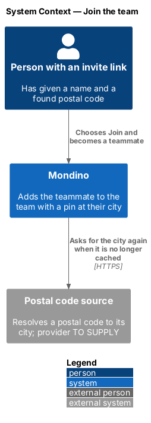
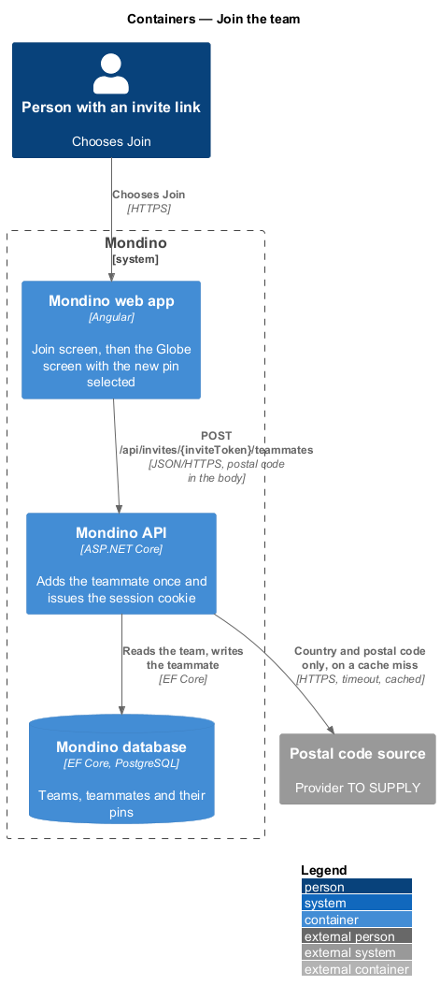
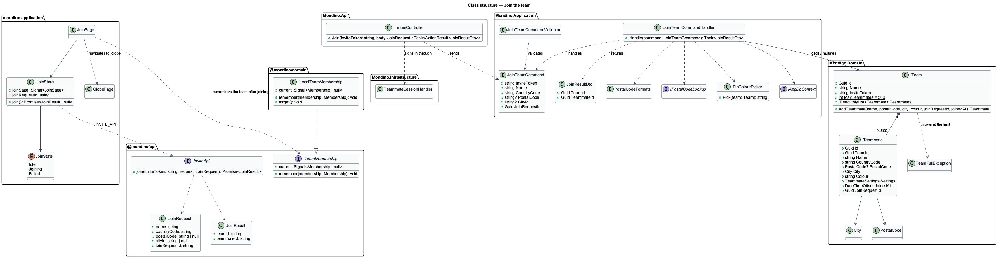
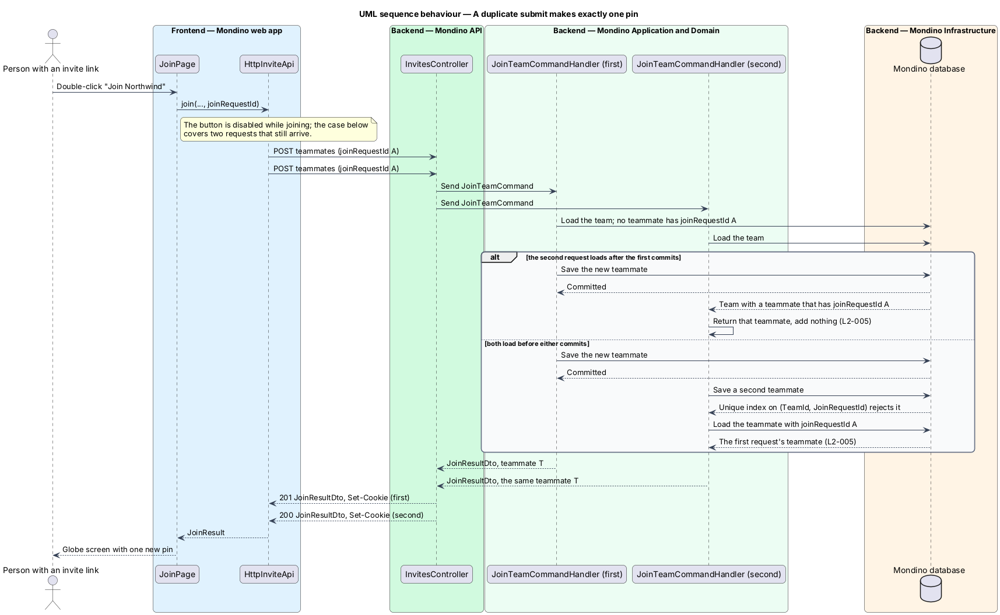
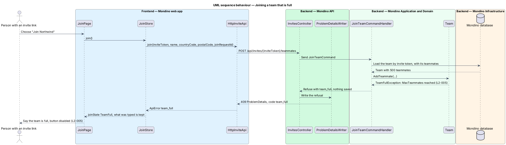

# Join the team

## Overview

Mondino shows a team on a 3D globe, each teammate as a pin at their city. A person who has
opened a team's invite link and whose postal code has been found sees the button "Join" and the
team's name, for example "Join Northwind". This feature covers what that button does.

**joining** — adding a teammate to a team with a pin at the city their postal code lies in

**session** — proof, held in a cookie, that a browser belongs to one teammate of one team

**join request id** — random identifier the browser makes once for a Join screen and sends with every join request from it

Joining adds the teammate to the team, issues their session, and opens the Globe screen with
their own pin selected. The new pin pulses once, and does not pulse under reduced motion, and a
toast reads "You’re on the map. Northwind can now see your pin in Milan."

Four things can go wrong, and each has a defined outcome. A request that fails leaves the
person on the Join screen with what they typed intact and the button "Try joining again". Two
requests from a double-click make exactly one pin. A client over the limit is told how long to
wait. A team that has reached 500 teammates refuses the join with the code `team_full`, and a
notice that the team is full takes the form's place.

The backend does not trust the city the browser saw. It resolves the postal code again and
places the pin at the city it finds. The features `open-invite-link` and
`place-pin-from-postal-code` cover the steps before this one. `sign-in` covers how a teammate
signs in again on another device. Join asks for no email, so how a teammate who joined by
invite link signs in again is not designed: `<TO SUPPLY>`.

## Description

The feature is a vertical slice from the Join button to the database, and on to the Globe
screen.

**Frontend (`mondino` application, `@mondino/api`)**

- **`JoinPage`** — calls `JoinStore.join()` when the person chooses the button. On success it
  calls `TeamMembership.remember(membership)` with a `Membership`: the `teamId` and `teammateId`
  of the `JoinResult` and the `teamName` of the `Invite`, and never the postal code. It then
  navigates to `/globe` and passes a `JustJoined` in the navigation state, never in the URL:
  the new teammate's id, their name and the found city's name and position. `GlobePage` shows
  that pin lifted and labelled ("Sofia Bianchi (you) · Milan"), pulses it once, and shows the
  toast "You’re on the map. Northwind can now see your pin in Milan." (`mo-toast`, block
  `toast`, in a `role="status"` region, so it is announced once), which dismisses itself after
  4 s by the shared clock's timer and has a "Dismiss" button. Until `draw-globe` and
  `show-pins` (journeys 8 and 10) `GlobePage` draws the still globe (`GlobeFallback`) with
  only that pin; opened without a `JustJoined` (a reload), it shows the still globe with no
  pin and no toast. Under the fields, `Failed` shows the alert "We couldn’t add you to Northwind. Your
  details are still here — try joining again." and the button reads "Try joining again".
- **`JoinStore`** — route-scoped service. It holds the `joinState` signal and one
  `joinRequestId`, made with `crypto.randomUUID()` when the store is created.
  - `join()` sets `Joining` and calls `InviteApi.join(inviteToken, request, signal)`. While `Joining`, the button reads
    "Joining" and the team's name with an ellipsis ("Joining Northwind…") and is disabled, the
    name and postal code are read-only and the country cannot be changed.
  - A failure sets `RateLimited` or `Failed` by the `code` of the `ApiError`. The signals
    `name`, `countryCode` and `postalCode` (and a city chosen through "Your city") are left as
    they are. `Failed` keeps the found city and enables the button again. `RateLimited` is the
    lookup's own state (`place-pin-from-postal-code`), as `pages/join/rate-limited` draws it:
    the found city goes, "Too many tries from this device. You can try again in 9:42." is
    shown, and the button reads "Place my pin" and stays disabled until the countdown from the
    refusal's `Retry-After` ends; it then finds the city again (from the cache) before
    "Join Northwind" comes back.
  - The code `team_full` sets `inviteState` to `Full`, and the code `invite_not_found` sets it
    to `NotFound`. Each replaces the form with its notice and takes the pins off the globe
    (`open-invite-link`): "Northwind is full", or "This invite link no longer works".
  - A retry sends the same `joinRequestId`, so a join whose response was lost does not make a
    second pin.
- **`JoinState`** — feature-local union of `Idle`, `Joining`, `RateLimited` and `Failed`.
- **`InviteApi.join(inviteToken, request)`** — sends
  `POST /api/invites/{inviteToken}/teammates` with a `JoinRequest` body: `name`, `countryCode`,
  `postalCode` or `cityId`, and `joinRequestId`. It returns a `JoinResult`: `teamId` and
  `teammateId`. The `cityId` is sent in the postal code's place when the pin was placed
  through the city search, while the postal code lookup was down.
- The postal code is held in memory by `JoinStore` only. It is never written to browser storage
  and goes when the person leaves the Join screen.

**Backend**

- **`InvitesController`** — `POST /api/invites/{inviteToken}/teammates`. The action is marked as
  open to an invite link's holder and carries the join policy of `RateLimitPolicies`: 5 join
  requests a minute for one client, then 429 with `Retry-After` (L2-045). It sends one
  `JoinTeamCommand`, signs the returned teammate in through `TeammateSessionHandler`, and
  answers 201 for a new teammate and 200 for a repeated join request. Fields the body does not
  define, such as a teammate id, a position or a colour, are ignored.
- **`JoinTeamCommand`** — `InviteToken`, `Name`, `CountryCode`, `PostalCode` or `CityId`,
  `JoinRequestId`.
- **`JoinTeamCommandValidator`** — after `NameNormaliser` has removed control characters from
  the name and trimmed it (`protect-team-data`), refuses an empty name, a name over 60 characters, a country outside the supported list, a
  postal code over 12 characters, a command with neither a postal code nor a city id, or an
  empty `JoinRequestId`. The refusal is 400 with the code
  `validation_failed`, and nothing is stored (L2-044).
- **`JoinTeamCommandHandler`** — runs these steps in order.
  1. It loads the `Team` by invite token with its teammates, and refuses with
     `invite_not_found` when no team matches.
  2. When a teammate of that team already has the command's `JoinRequestId`, it returns that
     teammate and adds nothing. Steps 2 to 5 run one at a time for one team within an API
     instance (`TeamJoinGate`, a fixed set of 64 locks chosen by the team's id), so a
     double-click on one instance cannot pass step 2 twice; across instances the unique index
     of step 6 holds.
  3. It normalises the postal code with `PostalCodeFormats` and resolves the city through
     `IPostalCodeLookup`. The outcome is normally in the cache of `CachedPostalCodeLookup` from
     the lookup on the Join screen. `NotFound` and `Unavailable` are refused with
     `postal_code_not_found` and `postal_code_unavailable`. A command with a `CityId` resolves
     the city through `ICityDirectory.Find` instead, calls no outside source, and stores no
     postal code for the teammate; an unknown city id, or one in another country, is refused
     with `validation_failed`. The found `KnownCity` becomes the `City` entity whose
     `DirectoryId` is its `CityId`, made the first time a teammate is placed there.
  4. It picks the pin's colour with `PinColourPicker` and calls `Team.AddTeammate` with the
     time from `TimeProvider`.
  5. It saves through `IAppDbContext` in one unit of work.
  6. When the save is rejected by the unique index on (`TeamId`, `JoinRequestId`), it loads the
     teammate the other request made and returns it.
- **`Team.AddTeammate(name, postalCode, city, colour, joinRequestId, joinedAt)`** — creates the
  `Teammate` with a random `Guid` id and the default `TeammateSettings`, and adds it to the
  team. When the team already has `MaxTeammates` (500) teammates, it throws `TeamFullException`.
- **`Teammate.JoinRequestId`** — addition this feature makes to the shared `Teammate` entity. It
  is never returned in any DTO.
- **`Teammate.PostalCode`** — optional. A teammate placed through the city search has none
  until they give one on Profile & Settings (`change-location`).
- **`TeamFullException`** — feature-local domain exception. `ProblemDetailsWriter` maps it to
  409 with the code `team_full`.
- **`JoinResultDto`** — `TeamId` and `TeammateId`. The Globe screen reads the pin itself through
  `GetPinsQuery`.
- **`TeammateSessionHandler`** — issues the session cookie `__Host-mondino-session`:
  `HttpOnly`, `Secure` and `SameSite=Lax`. The cookie carries the team id and teammate id; it
  lasts 365 days and slides ([ADR 0008](../../../adr/0008-session-and-cross-site-requests.md)).
- **`[SameSiteOnly]`** — the join action refuses a request from another site with 403 and the
  code `cross_site_request` (ADR 0008).

**Refusals**

| Case | Status | `code` | The screen says |
|------|--------|--------|-----------------|
| Team has 500 teammates | 409 | `team_full` | "Northwind is full" and "The team has all 500 of its places taken. Ask a teammate at Northwind to tell you when a place opens, then open this link again.", in the form's place |
| Over 5 join requests a minute | 429 | `rate_limited` | "Too many tries from this device. You can try again in 9:42."; the button is disabled until the countdown ends |
| Invalid name, country or postal code | 400 | `validation_failed` | "We couldn’t add you to Northwind. Your details are still here — try joining again." |
| From another site (`Sec-Fetch-Site` or `Origin`) | 403 | `cross_site_request` | — (a browser on Mondino never sends one) |
| Unknown or reset invite token | 404 | `invite_not_found` | "This invite link no longer works", in the form's place |
| Network failure or any other error | — | — | "We couldn’t add you to Northwind. Your details are still here — try joining again." and "Try joining again" |

In each case the person stays on the Join screen. What they typed is kept, except for a full
team and an unknown invite token, which replace the form with a notice.

**Open points**

- Two different people who join at the same moment when the team has 499 teammates can both
  pass the limit check. The guard that makes the limit exact under concurrency (a concurrency
  token on `Team`, which PostgreSQL ([ADR 0004](../../../adr/0004-database-engine.md)) can
  give as its `xmin` system column) is `<TO SUPPLY>`.
- The protection of this pre-session, state-changing request against cross-site request
  forgery is decided in [ADR 0008](../../../adr/0008-session-and-cross-site-requests.md).

## Requirements

The feature realises the following level-2 (L2) requirement, which refines the level-1 (L1)
requirement cited by identifier.

| L2 ID | Refines (L1) | Requirement |
|-------|--------------|-------------|
| `L2-005` | `L1-001` | Once the city is found, joining adds the teammate to the team with a pin at that city, and takes them to the Globe screen with their own pin selected. A team holds up to 500 teammates. |

## Diagrams

### System context

A person with an invite link chooses Join and becomes a teammate. Mondino asks the Postal code
source for the city again only when its earlier answer is no longer cached.

### Containers

The Mondino web app posts the join request to the Mondino API with the postal code in the body.
The Mondino API writes the teammate to the Mondino database and answers with the session cookie.

### Components

`InvitesController` sends `JoinTeamCommand` through `JoinTeamCommandValidator` to
`JoinTeamCommandHandler`. The handler resolves the city, picks a colour, calls
`Team.AddTeammate` and saves. The controller then signs the teammate in through
`TeammateSessionHandler`. The Mondino web app is shown as one element; its parts are listed in
the Description.

### Class structure

`JoinStore` holds a `JoinState` and a `joinRequestId` and depends on `InviteApi`.
`JoinTeamCommandHandler` loads and mutates `Team`, which owns up to 500 `Teammate` entities and
throws `TeamFullException` at the limit. `Teammate` carries the `JoinRequestId` that makes a
repeated request recognisable.

### Behaviour — join the team

The handler loads the team, resolves the city, adds the teammate and commits in one unit of
work. The controller issues the session cookie, and `JoinPage` opens the Globe screen with the
new pin selected (`L2-005`). A failed request leaves the person on the Join screen with what
they typed.

### Behaviour — a duplicate submit makes exactly one pin

Both requests of a double-click carry the same `joinRequestId`. The second handler either finds
the first request's teammate when it loads the team, or has its save rejected by the unique
index and then loads that teammate. Both responses name the same teammate, and the team gains
one pin (`L2-005`).

### Behaviour — joining a team that is full

`Team.AddTeammate` refuses when the team has 500 teammates. Nothing is saved, the Mondino API
answers 409 with the code `team_full`, and the notice "Northwind is full" takes the form's
place (`L2-005`).

