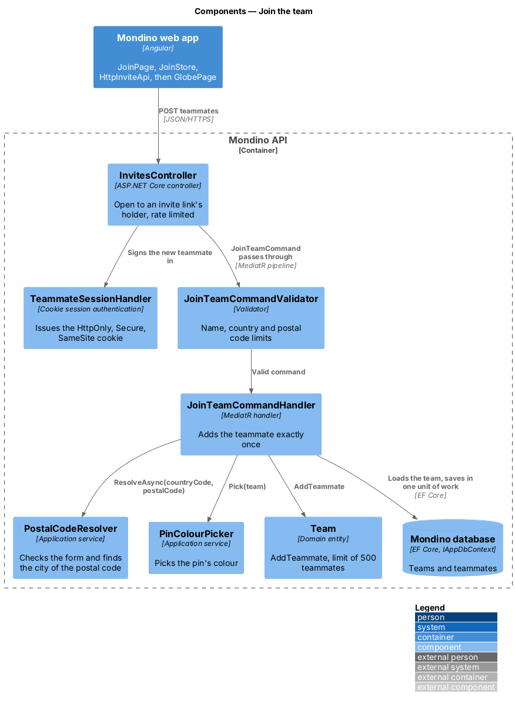
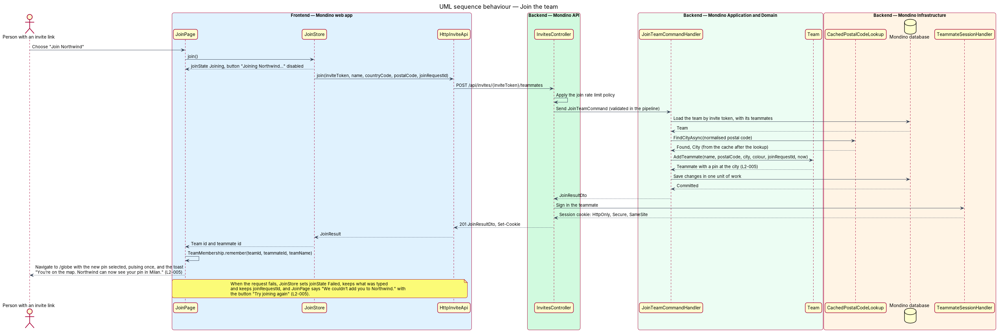

# Join the team

## Overview

Mondino shows a team on a 3D globe, each teammate as a pin at their city. A person who has
opened a team's invite link and whose postal code has been found sees the button "Join" and the
team's name, for example "Join Northwind". This feature covers what that button does.

**joining** — adding a teammate to a team with a pin at the city their postal code lies in

**session** — proof, held in a cookie, that a browser belongs to one teammate of one team

**join request id** — random identifier the browser makes once for a Join screen and sends with every join request from it

Joining adds the teammate to the team, issues their session, and opens the Globe screen with
their own pin selected. The new pin pulses once, and does not pulse under reduced motion.

Three things can go wrong, and each has a defined outcome. A request that fails leaves the
person on the Join screen with what they typed intact and an offer to try again. Two requests
from a double-click make exactly one pin. A team that has reached 500 teammates refuses the
join with the code `team_full`, and the screen says the team is full.

The backend does not trust the city the browser saw. It resolves the postal code again and
places the pin at the city it finds. The features `open-invite-link` and
`place-pin-from-postal-code` cover the steps before this one. How a teammate signs in again on
another device is not designed: `<TO SUPPLY>`.

## Description

The feature is a vertical slice from the Join button to the database, and on to the Globe
screen.

**Frontend (`mondino` application, `@mondino/api`)**

- **`JoinPage`** — calls `JoinStore.join()` when the person chooses the button. On success it
  calls `TeamMembership.remember(membership)` with a `Membership`: the `teamId`, `teammateId`
  and `colour` of the `JoinResult`, the `teamName` of the `Invite` and the `initials` that
  `initialsOf(name)` from `domain`'s `pins/` gives for the name typed, and never the postal
  code or the city. The header avatar is drawn from the membership, so it shows before the
  pins are read. It then
  navigates to `/globe` and passes the new teammate's id and a "new" flag in the navigation
  state, never in the URL. `GlobePage` selects that pin and pulses it once.
- **`JoinStore`** — route-scoped service. It holds the `joinState` signal and one
  `joinRequestId`, made with `crypto.randomUUID()` when the store is created.
  - `join()` sets `Joining` and calls `InviteApi.join`. While `Joining`, the button reads
    "Joining" and the team's name with an ellipsis ("Joining Northwind…") and is disabled, the
    name and postal code are read-only and the country cannot be changed.
  - A failure sets `TeamFull`, `RateLimited` or `Failed` by the `code` of the `ApiError`. The
    signals `name`, `countryCode` and `postalCode` and the found city are left as they are.
    `TeamFull` keeps the button disabled; `Failed` and `RateLimited` enable it again. The code
    `invite_not_found` sets `inviteState` to `NotFound` instead, which replaces the form.
  - A retry sends the same `joinRequestId`, so a join whose response was lost does not make a
    second pin.
- **`JoinState`** — feature-local union of `Idle`, `Joining`, `TeamFull`, `RateLimited` and
  `Failed`.
- **`InviteApi.join(inviteToken, request)`** — sends
  `POST /api/invites/{inviteToken}/teammates` with a `JoinRequest` body: `name`, `countryCode`,
  `postalCode` and `joinRequestId`. It returns a `JoinResult`: `teamId`, `teammateId` and
  `colour`, the colour the backend assigned to the pin.
- The postal code is held in memory by `JoinStore` only. It is never written to browser storage
  and goes when the person leaves the Join screen.

**Backend**

- **`InvitesController`** — `POST /api/invites/{inviteToken}/teammates`. The action is marked as
  open to an invite link's holder and carries the join policy of `RateLimitPolicies`: 5 join
  requests a minute for one client, then 429 with `Retry-After` (L2-045). It sends one
  `JoinTeamCommand`, signs the returned teammate in through `TeammateSessionHandler`, and
  answers 201 for a new teammate and 200 for a repeated join request. Fields the body does not
  define, such as a teammate id, a position or a colour, are ignored.
- **`JoinTeamCommand`** — `InviteToken`, `Name`, `CountryCode`, `PostalCode`, `JoinRequestId`.
- **`JoinTeamCommandValidator`** — after `NameNormaliser` has removed control characters from
  the name and trimmed it (`protect-team-data`), refuses an empty name, a name over 60 characters, a country outside the supported list, a
  postal code over 12 characters or an empty `JoinRequestId`. The refusal is 400 with the code
  `validation_failed`, and nothing is stored (L2-044).
- **`JoinTeamCommandHandler`** — runs these steps in order.
  1. It loads the `Team` by invite token with its teammates, and refuses with
     `invite_not_found` when no team matches.
  2. When a teammate of that team already has the command's `JoinRequestId`, it returns that
     teammate and adds nothing.
  3. It resolves the postal code and the city through `PostalCodeResolver`
     (`place-pin-from-postal-code`), as the lookup on the Join screen did. The outcome is
     normally in the cache of `CachedPostalCodeLookup` from that lookup. `NotFound` and
     `Unavailable` are refused with `postal_code_not_found` and `postal_code_unavailable`.
  4. It picks the pin's colour with `PinColourPicker` and calls `Team.AddTeammate` with the
     time from `TimeProvider`.
  5. It saves through `IAppDbContext` in one unit of work.
  6. When the save is rejected by the unique index on (`TeamId`, `JoinRequestId`), it loads the
     teammate the other request made and returns it.
- **`Team.AddTeammate(name, postalCode, city, colour, joinRequestId, joinedAt)`** — creates the
  `Teammate` with a random `Guid` id and the default `TeammateSettings`, and adds it to the
  team. When the team already has `MaxTeammates` (500) teammates, it throws `TeamFullException`.
- **`Teammate.JoinRequestId`** — addition this feature makes to the shared `Teammate` entity. It
  is never returned in any DTO.
- **`TeamFullException`** — feature-local domain exception. `ProblemDetailsWriter` maps it to
  409 with the code `team_full`.
- **`JoinResultDto`** — `TeamId`, `TeammateId` and `Colour`, the colour `PinColourPicker`
  assigned. The Globe screen reads the pin itself through `GetPinsQuery`.
- **`TeammateSessionHandler`** — issues the session cookie: `HttpOnly`, `Secure` and `SameSite`.
  The cookie carries the team id and teammate id; its lifetime is `<TO SUPPLY>`.

**Refusals**

| Case | Status | `code` | The screen says |
|------|--------|--------|-----------------|
| Team has 500 teammates | 409 | `team_full` | The team is full and holds up to 500 teammates; the button is disabled |
| Over 5 join requests a minute | 429 | `rate_limited` | Wait a moment and try again |
| Invalid name, country or postal code | 400 | `validation_failed` | A generic message, try again |
| Unknown invite token | 404 | `invite_not_found` | The invite link cannot be used |
| Network failure or any other error | — | — | Joining did not work; try again |

In each case the person stays on the Join screen. What they typed is kept, except for an unknown
invite token, which replaces the form with the message.

**Open points**

- Two different people who join at the same moment when the team has 499 teammates can both
  pass the limit check. The guard that makes the limit exact under concurrency (a concurrency
  token on `Team`) depends on the database engine: `<TO SUPPLY>`.
- The protection of this pre-session, state-changing request against cross-site request forgery
  follows the session design: `<TO SUPPLY>`.

## Requirements

The feature realises the following level-2 (L2) requirement, which refines the level-1 (L1)
requirement cited by identifier.

| L2 ID | Refines (L1) | Requirement |
|-------|--------------|-------------|
| `L2-005` | `L1-001` | Once the city is found, joining adds the teammate to the team with a pin at that city, and takes them to the Globe screen with their own pin selected. |

## Diagrams

### System context

A person with an invite link chooses Join and becomes a teammate. Mondino asks the Postal code
source for the city again only when its earlier answer is no longer cached.

### Containers

The Mondino web app posts the join request to the Mondino API with the postal code in the body.
The Mondino API writes the teammate to the Mondino database and answers with the session cookie.

### Components

`InvitesController` sends `JoinTeamCommand` through `JoinTeamCommandValidator` to
`JoinTeamCommandHandler`. The handler resolves the city through `PostalCodeResolver`, picks a colour, calls
`Team.AddTeammate` and saves. The controller then signs the teammate in through
`TeammateSessionHandler`. The Mondino web app is shown as one element; its parts are listed in
the Description.

### Class structure

`JoinStore` holds a `JoinState` and a `joinRequestId` and depends on `InviteApi`. `JoinPage`
remembers a `Membership` in `TeamMembership` from the `JoinResult`.
`JoinTeamCommandHandler` loads and mutates `Team`, which owns up to 500 `Teammate` entities and
throws `TeamFullException` at the limit. `Teammate` carries the `JoinRequestId` that makes a
repeated request recognisable.

### Behaviour — join the team

The handler loads the team, resolves the city through `PostalCodeResolver`, adds the teammate
and commits in one unit of work. The controller issues the session cookie, `JoinPage` remembers
the membership with the pin's initials and colour, and opens the Globe screen with the new pin
selected (`L2-005`). A failed request leaves the person on the Join screen with what
they typed.

### Behaviour — a duplicate submit makes exactly one pin

Both requests of a double-click carry the same `joinRequestId`. The second handler either finds
the first request's teammate when it loads the team, or has its save rejected by the unique
index and then loads that teammate. Both responses name the same teammate, and the team gains
one pin (`L2-005`).

### Behaviour — joining a team that is full

`Team.AddTeammate` refuses when the team has 500 teammates. Nothing is saved, the Mondino API
answers 409 with the code `team_full`, and the screen says the team is full and disables the
button (`L2-005`).

