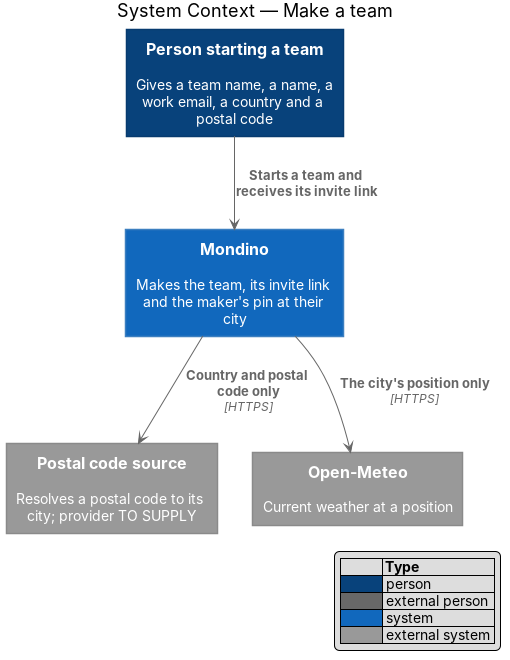
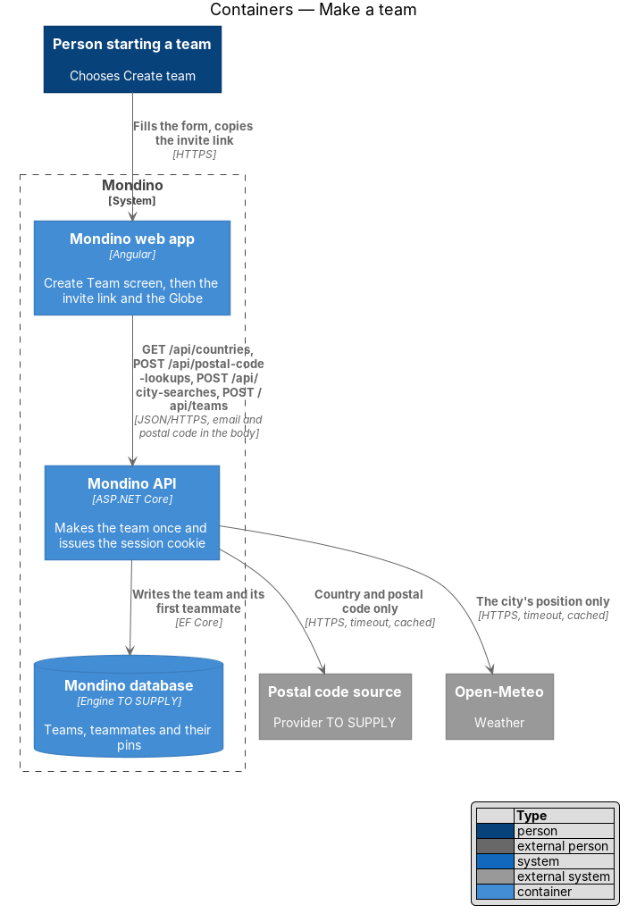
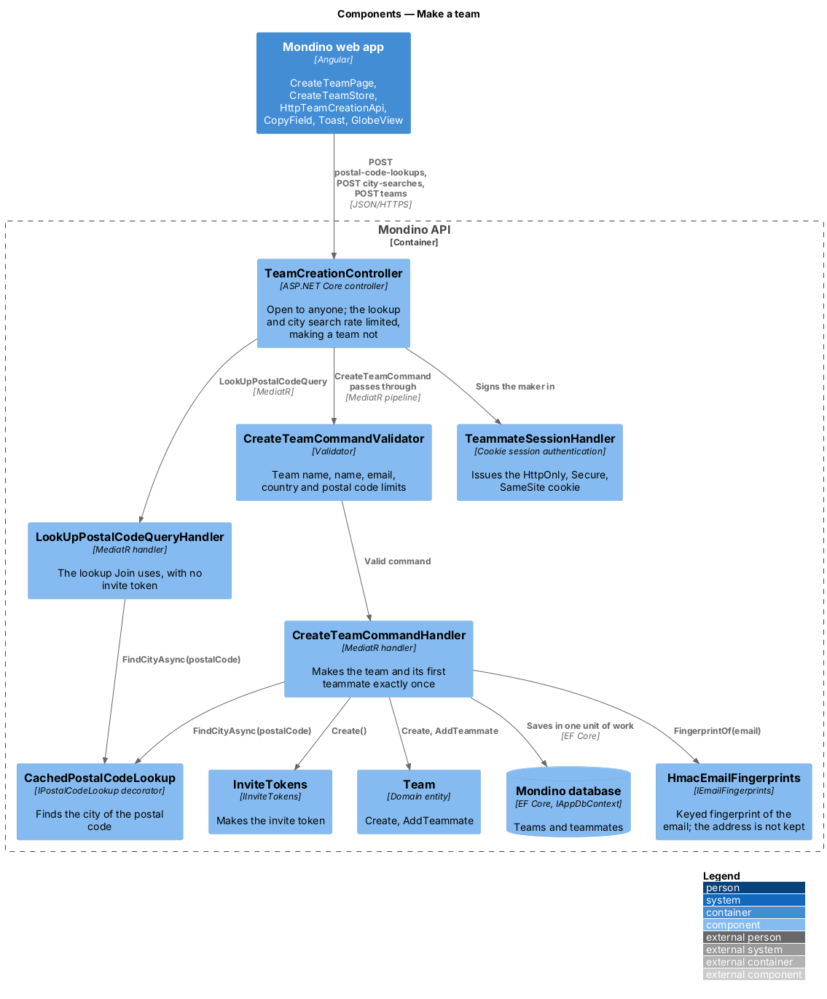
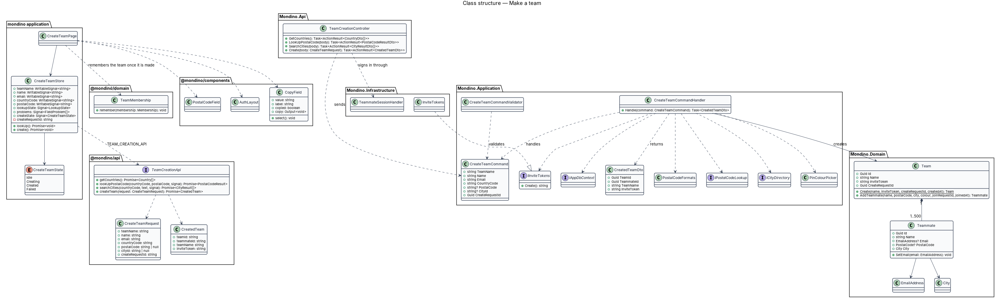
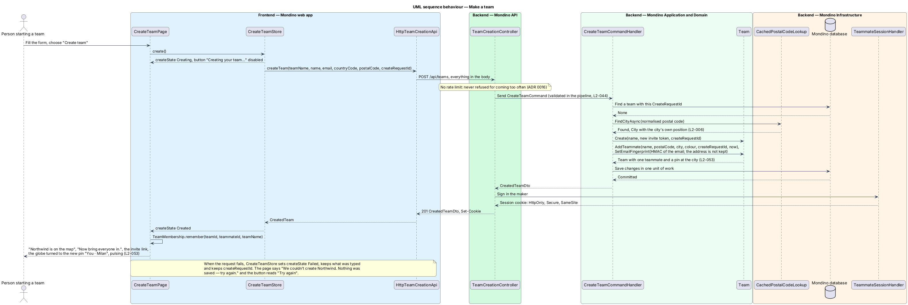
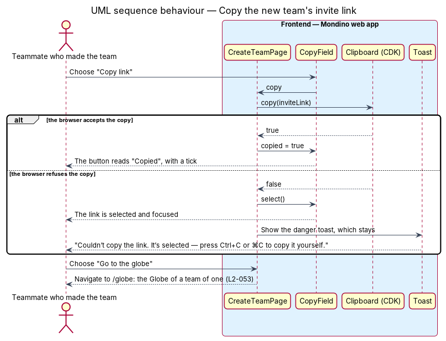
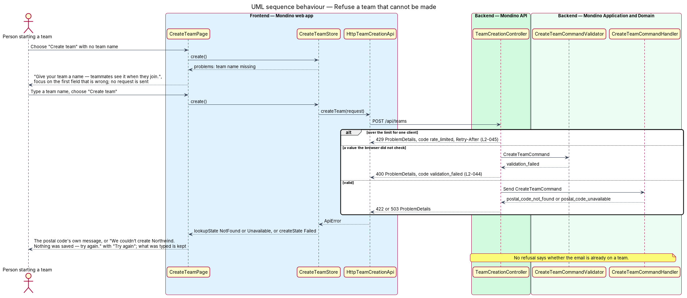

# Make a team

## Overview

Mondino shows a team on a 3D globe, each teammate as a pin at their city. Every other feature
of this subsystem begins with a team's invite link. This feature covers where a team and its
invite link come from: a person starts a team, places their own pin, and receives the link that
brings everyone else in.

**maker** — teammate who made a team; a teammate like any other, with no role and no rights the others lack

**invite link** — address of the form `/join/:inviteToken` that opens the Join screen for one team

**create request id** — random identifier the browser makes once for a Create Team screen and sends with every request from it to make the team

The Create Team screen, at `/new`, has the title "Start a team." and the lead "Name it, place
your own pin, and you’ll get a link to invite everyone else." Its form has five fields: "Team
name", "Your name", "Work email", "Country" and "Postal code". The help under the email reads
"We’ll send sign-in links here.", and the line under the postal code reads "Only your city is
shown. Your postal code stays private." The button reads "Create team".

Making the team creates the team, its invite token and the maker's pin at the city of the
postal code, and starts the maker's session. The screen then reads "Northwind is on the map"
and "Now bring everyone in.", shows the invite link with "Copy link", and offers "Go to the
globe". The globe beside it turns to the maker's city with their new pin, "You · Milan",
pulsing.

The postal code is looked up as on Join (`place-pin-from-postal-code`): the same messages, and
a pin at the city, never at the postal code. The email is where sign-in links are sent
(`sign-in`) and is never shown to a teammate. Mondino has no roles: the maker can do nothing
another teammate cannot.

The endpoints behind the screen are open to anyone and are rate limited.

## Description

The feature is a vertical slice from the Create Team screen to the database and to two outside
sources, the Postal code source and Open-Meteo. The browser calls only the Mondino API.

**Frontend (`mondino` application, `@mondino/api`, `@mondino/components`, `@mondino/globe`)**

- **`CreateTeamPage`** — page at the lazy route `/new`, not behind `teammateGuard`. It provides
  `CreateTeamStore` and binds `TEAM_CREATION_API`, so neither is in the initial bundle. It
  renders `AuthLayout` (`sign-in`) with the form or, once the team is made, the invite link,
  and the footer "Already have a team? Sign in", which leads to `/sign-in`.
  - A submit with a problem sends no request. Each field that is wrong is marked
    `aria-invalid` and carries its message in a `role="alert"` element under it, and focus
    moves to the first of them. A missing team name reads "Give your team a name — teammates
    see it when they join." The words for a missing name, email and postal code are said the
    same way, under their fields; their exact wording is `<TO SUPPLY>`.
  - `Creating` disables the button, marks it `aria-busy` and reads "Creating your team…".
  - `Failed` shows an alert with the team's name rendered as text, "We couldn’t create
    Northwind. Nothing was saved — try again.", and the button reads "Try again". What was
    typed is kept.
  - `Created` replaces the form. The kicker "Northwind is on the map" is a `role="status"`
    element, the title "Now bring everyone in." takes focus, and the lead reads "Send this link
    to your team. Each person places their own pin with a postal code." Under it are
    `CopyField` with the invite link and the link "Go to the globe", which leads to `/globe`.
    On reaching `Created` the page calls `TeamMembership.remember(membership)` with the
    `teamId`, `teammateId` and `teamName` of the `CreatedTeam`.
  - "Copy link" copies the invite link through the CDK `Clipboard`. When the copy succeeds the
    button reads "Copied", with a tick. When the browser refuses it, the page calls
    `CopyField.select()` and shows the `Toast` of the invite dialog, which stays: "Couldn’t
    copy the link. It’s selected — press Ctrl+C or ⌘C to copy it yourself."
    (`invite-teammates`).
- **`CreateTeamStore`** — service provided at the `/new` route, so its state goes when the
  person leaves the screen. It holds the writable signals `teamName`, `name`, `email`,
  `countryCode` and `postalCode`, the signals `lookupState`, `problems` and `createState`, the
  `countries` it read, and one `createRequestId`, made with `crypto.randomUUID()` when the
  store is created.
  - `lookUp()` runs when the person leaves the postal code field, and before `create()` when
    no city is found yet. It maps the answer to a `LookupState` as `JoinStore` does. One lookup
    runs at a time, and a new one aborts the pending one.
  - `create()` sets `Creating` and calls `TeamCreationApi.createTeam`. A retry sends the same
    `createRequestId`, so a request whose response was lost does not make a second team.
  - A failure maps the `code` of the `ApiError`: `postal_code_not_found` and
    `postal_code_unavailable` set the `lookupState`, and every other code and no answer set
    `Failed`.
- **`CreateTeamState`** — feature-local union of `Idle`, `Creating`, `Created` and `Failed`.
- **`TeamCreationApi` / `TEAM_CREATION_API`, `HttpTeamCreationApi`** — contract, injection
  token and HTTP client in `@mondino/api`: `getCountries()`, `lookUpPostalCode(countryCode,
  postalCode, signal)`, `searchCities(countryCode, text, signal)` and `createTeam(request)`.
  The email and the postal code travel in a request body, never in a URL, and neither is
  written to browser storage.
- **`CreateTeamRequest`** — `teamName`, `name`, `email`, `countryCode`, `postalCode` or
  `cityId`, and `createRequestId`.
- **`CreatedTeam`** — `teamId`, `teammateId`, `teamName` and `inviteToken`. The page builds the
  invite link from its own origin and the token.
- **`PostalCodeField`** and **`CityField`** — the presentation components Join uses, in the
  same shape and with Join's messages (`place-pin-from-postal-code`). While the postal code
  lookup is down, "Your city" takes the postal code's place as it does on Join. No mock draws
  a found city on this screen before the team is made; whether the screen names it then is
  `<TO SUPPLY>`.
- **`CopyField`** (`mo-copy-field`, block `copy-field`) — presentation component in
  `@mondino/components`: a read-only input with the link (`copy-field__value`) and a button.
  Its inputs are `value`, `label` and `copied`; it emits `copy`, and `select()` selects the
  link and moves focus to it. The invite dialog uses the same component.
- **`GlobeView`** (`mo-globe`) — imported dynamically inside a `@defer` block, not interactive.
  It has no pins until the team is made ("The globe, with no pins"). In `Created` the page
  passes it the maker's pin, selected and marked as new, so the globe turns to the city, holds
  there, and the pin labelled "You · Milan" pulses once, and not under reduced motion.

**Backend**

- **`TeamCreationController`** — four actions, each marked as open to anyone, each with a
  policy of `RateLimitPolicies` (`protect-team-data`, L2-045), each sending one MediatR
  request.

  | Action | Request | Policy |
  |--------|---------|--------|
  | `GET /api/countries` | `GetCountriesQuery` | `Countries` |
  | `POST /api/postal-code-lookups` | `LookUpPostalCodeQuery` with no invite token | `PostalCodeLookup` |
  | `POST /api/city-searches` | `SearchCitiesQuery` with no invite token | `CitySearch` |
  | `POST /api/teams` | `CreateTeamCommand` | `CreateTeam` |

  `POST /api/teams` signs the returned teammate in through `TeammateSessionHandler` and
  answers 201 for a new team and 200 for a repeated request. Fields the body does not define
  are ignored.
- **`GetCountriesQuery` / `GetCountriesQueryHandler`** — projects `PostalCodeFormats` to the
  `CountryDto` list that Join receives on its `InviteDto`.
- **`LookUpPostalCodeQuery`** — the query Join sends. Its `InviteToken` is optional; with none,
  the handler skips the check of the invite token and runs its other steps unchanged.
- **`CreateTeamCommand`** — `TeamName`, `Name`, `Email`, `CountryCode`, `PostalCode` or
  `CityId`, and `CreateRequestId`.
- **`CreateTeamCommandValidator`** — after `NameNormaliser` has cleaned the team's name and the
  maker's name, refuses a team name or a name that is empty or over 60 characters, an email
  over 254 characters or not in the form of an address, a country outside the supported list,
  a postal code over 12 characters, a command with neither a postal code nor a city id, and an
  empty `CreateRequestId`. The refusal is 400 with the code `validation_failed`, and nothing
  is stored (L2-044).
- **`CreateTeamCommandHandler`** — runs these steps in order.
  1. When a team already has the command's `CreateRequestId`, it returns that team and its
     first teammate and adds nothing.
  2. It resolves the city: from the postal code through `PostalCodeFormats` and
     `IPostalCodeLookup`, or from the city id through `ICityDirectory`. `NotFound` and
     `Unavailable` are refused with `postal_code_not_found` and `postal_code_unavailable`.
  3. It calls `Team.Create` with the name, a token from `IInviteTokens.Create()`, the
     `CreateRequestId` and the time from `TimeProvider`.
  4. It picks the pin's colour with `PinColourPicker`, calls `Team.AddTeammate` and sets the
     teammate's `Email`.
  5. It saves through `IAppDbContext` in one unit of work. When the save is rejected by the
     unique index on `Team.CreateRequestId`, it loads the team the other request made and
     returns it.
- **`Team.Create(name, inviteToken, createRequestId, createdAt)`** — creates the `Team` with a
  random `Guid` id and no teammates.
- **`IInviteTokens`** — interface in `Mondino.Application`. `InviteTokens` in
  `Mondino.Infrastructure` makes a token of at least 128 bits from `RandomNumberGenerator`,
  encoded for a URL. `invite-teammates` uses it to reset a team's invite link.
- **`Teammate.Email`** — optional `EmailAddress` (`sign-in`). It is returned in no DTO to
  another teammate.
- **`CreatedTeamDto`** — `TeamId`, `TeammateId`, `TeamName` and `InviteToken`. It echoes
  neither the email nor the postal code.
- **`TeammateSessionHandler`** — issues the session cookie, as it does after a join.

**Refusals**

| Case | Status | `code` | The screen says |
|------|--------|--------|-----------------|
| Postal code in the wrong form, or unknown to the source | 422 | `postal_code_not_found` | Join's message, naming the postal code, the country and the form |
| Postal code source timed out or circuit open | 503 | `postal_code_unavailable` | Join's "Your city" search in the postal code's place |
| A value outside its limits | 400 | `validation_failed` | "We couldn’t create Northwind. Nothing was saved — try again." |
| Over the limit for one client | 429 | `rate_limited` | The same alert, with "Try again" |
| Network failure or any other error | — | — | The same alert, with "Try again" |

In each case the person stays on the Create Team screen and what they typed is kept. No refusal
says whether the email is already on a team.

**Open points**

- The limits of the `Countries`, `CitySearch` and `CreateTeam` policies are `<TO SUPPLY>`.
- What an email that is already on a team means for a second team, and which team its sign-in
  link then opens, are `<TO SUPPLY>` (`sign-in`).
- The protection of this pre-session, state-changing request against cross-site request
  forgery follows the session design: `<TO SUPPLY>`.
- What becomes of a team when its last teammate leaves is `<TO SUPPLY>` (`leave-team`).

## Requirements

The feature realises the following level-2 (L2) requirement, which refines the level-1 (L1)
requirement cited by identifier.

| L2 ID | Refines (L1) | Requirement |
|-------|--------------|-------------|
| `L2-053` | `L1-018` | Create Team (`/new`), "Start a team.", lets anyone make a team: they name it, place their own pin, and get the invite link for everyone else. The person who makes a team is its first teammate and a teammate like any other; Mondino has no roles. The work email given here is where sign-in links are sent (L2-052) and is never shown to a teammate. |

## Diagrams

### System context

A person starts a team in Mondino and receives its invite link. Mondino asks the Postal code
source for the city and Open-Meteo for the weather there; neither learns a name, an email or a
team.

### Containers

The Mondino web app reads the countries, looks up the postal code and posts the new team to
the Mondino API, with the email and the postal code in a request body. The Mondino API writes
the team and its first teammate to the Mondino database and answers with the session cookie.

### Components

`TeamCreationController` sends `CreateTeamCommand` through `CreateTeamCommandValidator` to
`CreateTeamCommandHandler`. The handler resolves the city, takes an invite token from
`InviteTokens`, calls `Team.Create` and `Team.AddTeammate`, and saves. The controller then
signs the maker in through `TeammateSessionHandler`. The Mondino web app is shown as one
element; its parts are listed in the Description.

### Class structure

`CreateTeamStore` holds a `CreateTeamState` and a `createRequestId` and depends on
`TeamCreationApi`. `CreateTeamCommandHandler` creates a `Team`, which owns its `Teammate`
entities; the first of them carries the `EmailAddress` that sign-in links are sent to.

### Behaviour — make a team

The handler resolves the city, creates the team with a new invite token, adds the maker with a
pin at the city and commits in one unit of work. The controller issues the session cookie, and
`CreateTeamPage` shows the invite link beside the globe, turned to the new pin (`L2-053`). A
failed request leaves the person on the screen with what they typed.

### Behaviour — copy the new team's invite link

"Copy link" copies the invite link, and the button reads "Copied". When the browser refuses
the copy, the link is selected and focused and a toast that stays says so. "Go to the globe"
opens the Globe of a team of one (`L2-053`).

### Behaviour — refuse a team that cannot be made

A form with a field that is wrong sends no request. A request over the limit is refused with
429 before the handler runs, and a value the browser did not check is refused with
`validation_failed` (L2-044, L2-045). A postal code that cannot be found or checked receives
the postal code's own refusal. Nothing is saved in any of these cases.

