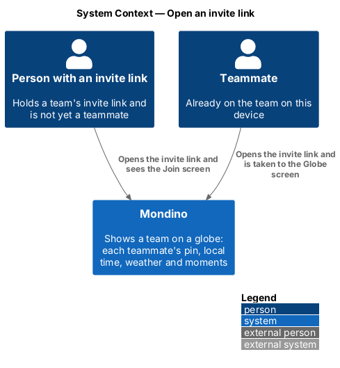
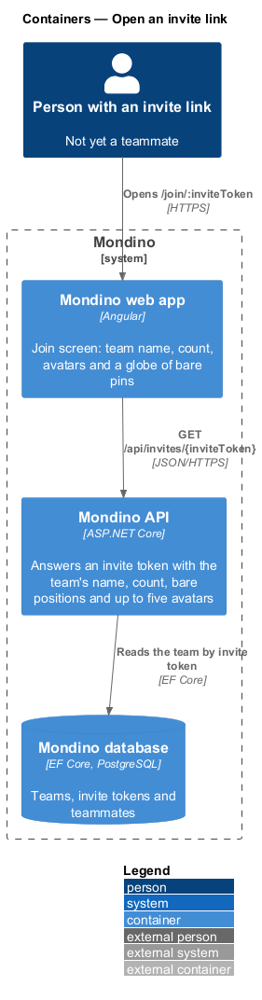
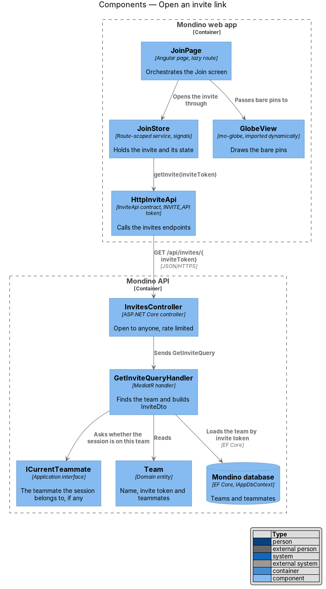
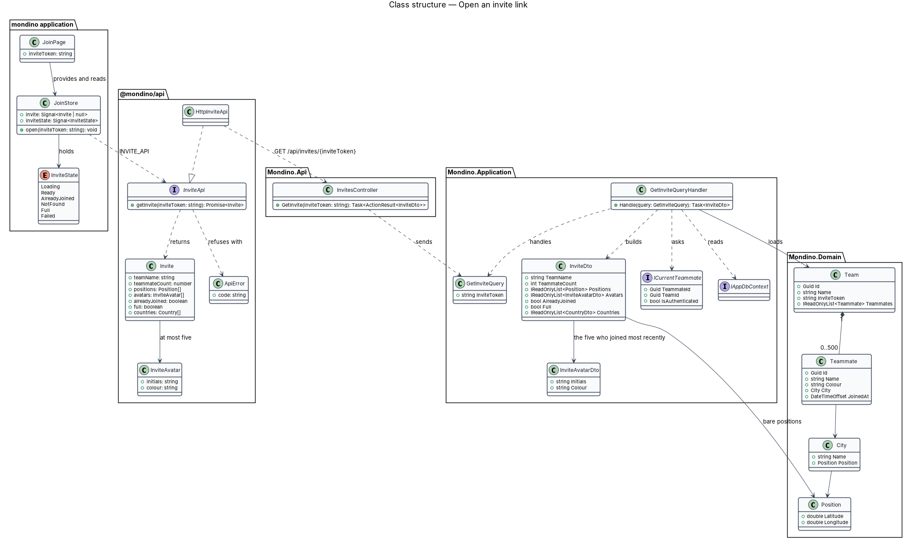
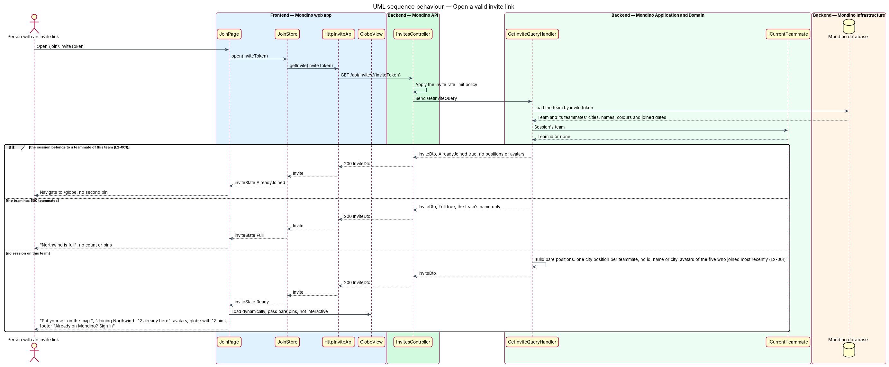
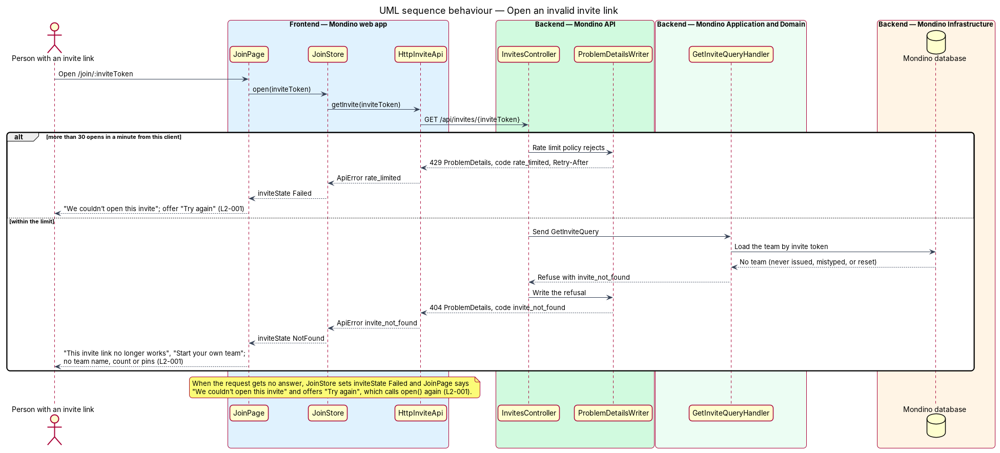

# Open an invite link

## Overview

Mondino shows a team spread around the world on a 3D globe. Each teammate is a pin at their
city, with their local time and weather. A person becomes a teammate through the team's invite
link.

**invite link** — address of the form `/join/:inviteToken` that opens the Join screen for one team

**invite token** — random value in an invite link that identifies its team and gives no access beyond joining that team

**bare pin** — pin drawn on the Join screen's globe from a position alone, with no name, city, local time or weather

This feature covers the first step of joining: opening the link. The Join screen shows the
heading "Put yourself on the map.", the team's name, how many teammates are already on the
globe ("Joining Northwind · 12 already here"), the initials of up to five of them (the five who
joined most recently), and the globe with their bare pins. It shows all of this before the person has given anything. Under the form, on every state,
the footer reads "Already on Mondino? Sign in" and leads to the Sign In screen (`sign-in`).

An invite link that does not exist, was mistyped or has been reset shows "This invite link no
longer works" and nothing about any team. An invite link to a team that has all 500 of its
places taken shows the team's name and that it is full, and nothing else about the team. A
person who is already a teammate of the team on this device is taken to the Globe screen
instead, and no second pin is made.

The person opening the link has no session, so the endpoint behind this feature is one of the
endpoints that are open to anyone, here to anyone who holds an invite link. It answers with the least a stranger to
the team may learn: a name, a count, positions and up to five teammates' initials and colours.
Initials and a colour are the most a holder of an invite link learns of a teammate.

The features `place-pin-from-postal-code` and `join-team` cover the rest of the Join screen.
`make-team` covers how a team and its invite link are made, and `invite-teammates` how a
teammate resets an invite link, after which the old link stops working.

## Description

The feature is a vertical slice from the Join screen to the database. It calls no outside
source.

**Frontend (`mondino` application, `@mondino/api`, `@mondino/components`, `@mondino/globe`)**

- **`JoinPage`** — page at the lazy route `/join/:inviteToken`. It reads the invite token from
  the route, provides `JoinStore`, and renders one of five states: loading, ready, invite link
  no longer works, team full, and could not be opened. On the state `AlreadyJoined` it
  navigates to `/globe`. In the last three the form's place is taken by a `Notice` (`mo-notice`,
  block `notice`: an icon, a title, a text and its actions), and the globe has no pins ("The
  globe, with no pins"). Every state keeps the footer (`join__footer`) "Already on Mondino?
  Sign in", a link to `/sign-in`.
  - Loading shows the heading, skeletons for the team and the form, and a globe placeholder,
    and announces "Opening your invite link…" in a `role="status"` element.
  - `NotFound` shows "This invite link no longer works" and "Someone on the team reset it, so
    it can’t be used to join. Ask whoever sent it for the new link.", with the link "Start
    your own team", which leads to `/new` (`make-team`). The same notice serves a link that was
    reset, withdrawn or mistyped.
  - `Full` shows the team's name, as text, in "Northwind is full" and "The team has all 500 of
    its places taken. Ask a teammate at Northwind to tell you when a place opens, then open
    this link again." It offers no action. `join-team` sets the same state when a join is
    refused with `team_full`.
  - `Failed` shows "We couldn’t open this invite" and "Mondino didn’t answer. Check your
    connection and try the link again — it hasn’t been used up.", with "Try again", which calls
    `JoinStore.open(inviteToken)` again.
  - An open refused with 429 (`rate_limited`) has no state of its own: it shows the same
    `Failed` state, with "Try again".
  - Ready shows the team's name and the count as text, never as HTML, in the `join__team`
    line, with the avatars beside it. The avatars are decorative and hidden from assistive
    technology.
- **`JoinStore`** — service provided at the `JoinPage` route, so its state goes when the person
  leaves the screen. It holds the `invite` signal and the `inviteState` signal. Its
  `open(inviteToken)` method calls `InviteApi.getInvite` and maps an `ApiError` to a state by
  its `code`: `invite_not_found` to `NotFound`, and `rate_limited`, any other code and no answer
  to `Failed`. An `Invite` with `full` set gives `Full`. It aborts the pending request when it
  is destroyed.
- **`InviteState`** — feature-local union of `Loading`, `Ready`, `AlreadyJoined`, `NotFound`,
  `Full` and `Failed`.
- **`InviteApi` / `INVITE_API`, `HttpInviteApi`** — contract, injection token and HTTP client.
  `getInvite(inviteToken)` sends `GET /api/invites/{inviteToken}` and returns an `Invite`. The
  Join route binds the token, so the client stays out of the initial bundle.
- **`Invite`** — `teamName`, `teammateCount`, `positions`, `avatars`, `alreadyJoined`, `full`
  and `countries`. The `countries` list serves the Join form and is described in
  `place-pin-from-postal-code`.
- **`InviteAvatar`** — `initials` and `colour` of one teammate, drawn by the design system's
  avatar.
- **`GlobeView`** (`mo-globe`) — imported dynamically inside a `@defer` block. `JoinPage` passes
  it the bare pins and sets it not interactive. The globe's renderer is `<TO SUPPLY>`.

**Backend**

- **`InvitesController`** — `GET /api/invites/{inviteToken}`. The action is marked as open to
  anyone and carries the invite policy of `RateLimitPolicies`: 30 opens a minute for one client,
  then 429 with `Retry-After` and the code `rate_limited` (L2-045). The controller checks
  nothing itself and sends one `GetInviteQuery`.
- **`GetInviteQuery`** — carries the `InviteToken`.
- **`GetInviteQueryHandler`** — loads the `Team` whose `InviteToken` equals the token, through
  `IAppDbContext`. When no team matches, it refuses with `invite_not_found`. An invite link
  that was reset (`invite-teammates`) receives the same refusal as one that was never issued.
  When `ICurrentTeammate` reports a session on this team, the handler returns an `InviteDto`
  with `AlreadyJoined` set and no positions or avatars. When the team has `Team.MaxTeammates`
  (500) teammates, it returns an `InviteDto` with `Full` set, the team's name and no count,
  positions or avatars. Otherwise it builds the full `InviteDto`.
- **`InviteDto`** — `TeamName`, `TeammateCount`, `Positions`, `Avatars`, `AlreadyJoined`, `Full`
  and `Countries`. `Positions` holds one `Position` for each teammate: the position of the
  teammate's `City`. `Avatars` holds the initials and colour of at most five teammates, the
  five who joined most recently (by `Teammate.JoinedAt`), in no order that matches `Positions`. The DTO carries no teammate id,
  full name, city name, time zone or weather, and never a postal code.
  `Avatars`, `AlreadyJoined`, `Full` and `Countries` are additions this subsystem makes to the
  shared `InviteDto`.
- **`ICurrentTeammate`** — the teammate the session cookie belongs to, or none. The session
  cookie is issued by `join-team`, `make-team` and `sign-in`.
- **`ProblemDetailsWriter`** — writes each refusal as ProblemDetails with a `code` extension:
  404 with `invite_not_found`, 429 with `rate_limited`.
- **`MondinoTelemetry`** — records the route as its template, `/api/invites/{inviteToken}`, so
  no log, metric or span carries an invite token.

**Rules the slice applies**

- The response for an unknown invite token carries no team name, no count, no positions and
  no avatars. The response for a full team carries the team's name and nothing else about it.
- `JoinPage` branches on the `code` of an `ApiError` and shows its own message.
- The invite token appears in the address of the Join screen and in the API route only. The
  response header `Referrer-Policy: no-referrer` from `SecurityHeadersMiddleware` keeps it from
  reaching another site.

## Requirements

The feature realises the following level-2 (L2) requirement, which refines the level-1 (L1)
requirement cited by identifier.

| L2 ID | Refines (L1) | Requirement |
|-------|--------------|-------------|
| `L2-001` | `L1-001` | An invite link opens the Join screen for its team. The screen shows the team's name, how many teammates are already on the globe, the initials of up to five of them, and the globe with their pins, before the person has given anything. Under the form, "Already on Mondino? Sign in" leads to Sign In (L2-052). |

## Diagrams

### System context

A person with an invite link opens it in Mondino and sees the Join screen. A teammate who opens
the same link on a device that already holds their session is taken to the Globe screen. No
outside source takes part.

### Containers

The Mondino web app asks the Mondino API for the invite by its token. The Mondino API reads the
team from the Mondino database.

### Components

In the Mondino web app, `JoinPage` opens the invite through `JoinStore` and `HttpInviteApi`, and
passes the bare pins to `GlobeView`. In the Mondino API, `InvitesController` sends
`GetInviteQuery` to `GetInviteQueryHandler`, which reads the `Team` and asks `ICurrentTeammate`
whether the session is already on that team.

### Class structure

`JoinStore` depends on the `InviteApi` contract, which `HttpInviteApi` implements.
`GetInviteQueryHandler` handles `GetInviteQuery`, loads a `Team` with its `Teammate` cities, and
builds an `InviteDto` whose positions are bare `Position` values.

### Behaviour — open a valid invite link

The handler finds the team by its invite token. When the session already belongs to a teammate
of that team, the response says so and `JoinPage` navigates to `/globe`. Otherwise the response
carries the team's name, the count, one bare position for each teammate and up to five
avatars, and `JoinPage` shows the Join screen with the globe (`L2-001`).

### Behaviour — open an invalid invite link

An invite token that matches no team is refused with 404 and the code `invite_not_found`, and
`JoinPage` says "This invite link no longer works", with no team name, count or pins
(`L2-001`). A client over the limit of 30 opens a minute is refused with 429 before the handler
runs. That refusal, and a request that gets no answer, set `Failed`, and `JoinPage` says "We
couldn’t open this invite" and offers "Try again" (`L2-001`).

