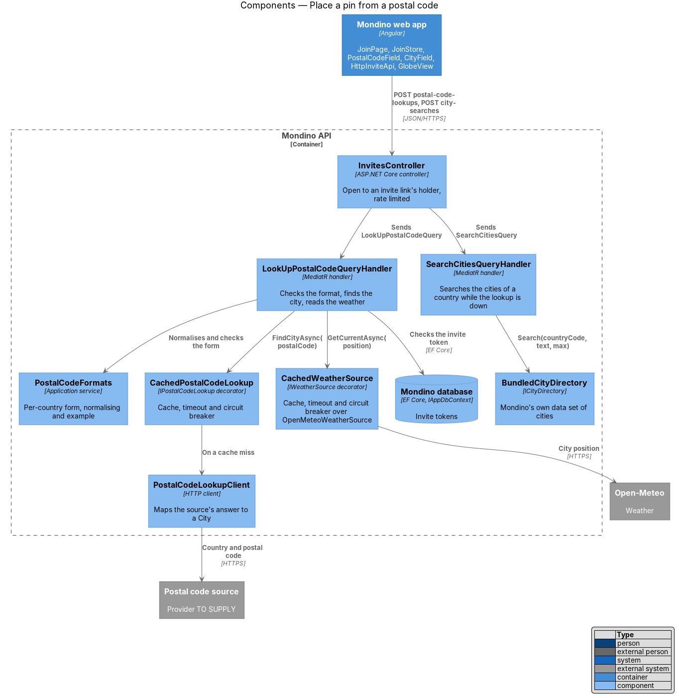
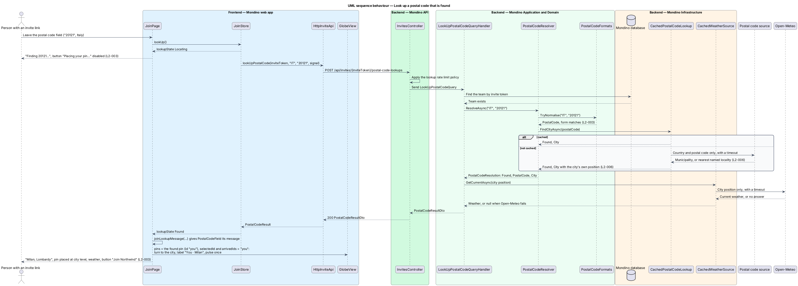
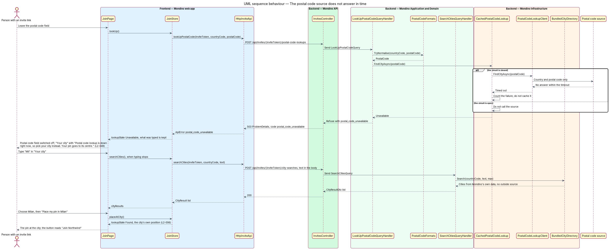

# Place a pin from a postal code

## Overview

Mondino shows a team on a 3D globe, each teammate as a pin at their city. A person who has
opened a team's invite link puts themselves on the globe through the Join form. The form has
exactly three fields: "Your name", "Country" and "Postal code". It asks for no street address,
e-mail address or phone number, and the text "Only your city is shown. Your postal code stays
private." sits under the postal code field. Under the form the footer reads "Already on
Mondino? Sign in" (`open-invite-link`).

**postal code lookup** — resolution of a country and a postal code to the city that postal code lies in

**city** — municipality a postal code lies in, the level at which Mississauga and Toronto are different places

**form** — pattern a country's postal codes take, such as five digits in Italy

This feature covers the form and the lookup. The postal code is looked up when the person leaves
the field or submits the form. While the lookup runs, the screen shows "Finding 20121…" and the
button reads "Placing your pin…" and is disabled. When the city is found, the screen names the
city and region and the weather there ("Milan, Lombardy — pinned at city level. 13° and foggy
right now."), the globe turns to the city, a pin labelled "You" appears and pulses once (not
under reduced motion), and the button changes from
"Place my pin" to "Join" and the team's name.

A postal code in the wrong form, or one the postal code source does not know, is refused with an
alert that names the postal code, the country and the form with an example. Nothing is placed.

A postal code source that does not answer in time does not stop the person joining. The postal
code field is switched off and a field "Your city" appears, with the help "Postal code lookup is
down right now, so pick your city instead. Your pin goes to its centre." The field searches the
cities of the chosen country, the button reads "Place my pin in Milan", and choosing a city
places the pin at the city, as a postal code would. The search is served by the Mondino API from
its own data, so the browser still calls only the backend.

**city search** — search, by the start of a name, of the cities of one country that Mondino holds itself

The pin takes the city's own position, never the position of the postal code. Two teammates in
Toronto with different postal codes have the same position.

Nothing is stored by this feature. The pin on the Join screen exists in the browser only, until
the feature `join-team` adds the teammate. The feature `open-invite-link` supplies the invite
that this feature builds on. Create Team uses the same lookup, the same city search and the
same messages (`make-team`).

## Description

The feature is a vertical slice from the Join form to two outside sources: the Postal code
source and Open-Meteo. The browser calls only the Mondino API.

**Frontend (`mondino` application, `@mondino/api`, `@mondino/components`, `@mondino/globe`)**

- **`JoinPage`** — renders the form beside the globe from 992 px, and in one column under
  it. It lists `Invite.countries` in the Country field in alphabetical order. It passes the
  found city to `GlobeView` as the selected pin labelled "You".
- **`JoinStore`** — route-scoped service. It holds the writable signals `name`, `countryCode`
  and `postalCode`, and the signals `lookupState`, `found`, `nameProblem` and
  `postalCodeMissing`.
  - `lookUp()` sets `Locating`, calls `InviteApi.lookUpPostalCode`, and maps the answer or the
    `ApiError` code to a `LookupState`; the code `invite_not_found` sets `inviteState` to
    `NotFound` instead, which replaces the form. One lookup runs at a time: a new lookup aborts the
    pending one through its `AbortController`.
  - `clearFound()` runs when the postal code or the country changes. It aborts a pending lookup,
    removes the found city and the new pin, removes any alert, and returns the state to `Idle`,
    so the button reads "Place my pin" again.
  - `nameProblem` reports a name that is empty, only spaces, or longer than 60 characters. A
    submit with a name problem places no pin, marks the name field `aria-invalid` and shows
    "Add your name so teammates know whose pin this is." A name over 60 characters gets the
    same message with the limit; its exact wording is `<TO SUPPLY>`.
  - `postalCodeMissing` reports an empty postal code. A submit with it makes no lookup, marks
    the postal code field `aria-invalid` and shows "Enter a postal code."
  - A submit with either problem makes `JoinPage` show a summary alert above the fields
    ("Two things are missing") that links to each field ("Add your name", "Enter a postal
    code") and takes focus.
  - A submit with no problem and no found city runs `lookUp()` first.
  - While `lookupState` is `Unavailable`, the store holds the city search: the writable signal
    `cityText`, the signals `cityResults` and `chosenCity`, `searchCities()`, which runs when
    typing stops and aborts the search before it, and `placeAtCity()`, which sets `Found` with
    the chosen city. The interval after typing stops is `<TO SUPPLY>`; unit tests advance a
    fake clock. The state stays `Unavailable` for the life of the store, so the lookup is tried
    again when the screen is next opened. What was typed in the postal code field is kept.
  - While `lookupState` is `RateLimited`, the store holds `retryAt`, worked out from the
    refusal's `Retry-After` and the injected `CLOCK`, and one timer that counts down to it. The
    timer is cleared at zero and when the store is destroyed.
- **`LookupState`** — union in `@mondino/api` of `Idle`, `Locating`, `Found` (with its
  `PostalCodeResult`), `NotFound`, `Unavailable` and `RateLimited`. Profile & Settings uses the
  same type.
- **`PostalCodeField`** — presentation component, the same on Join, on Create Team and on
  Profile & Settings. Its inputs are `value`, `country` (the chosen `Country`), `lookupState`
  (a `LookupState`), `disabled` and `mode` (`Join` or `Move`), and it emits `valueChange`,
  `blurred` and `retry`. It renders the field and, under the row, the mocks' `lookup` line in
  a polite live region. In the mode `Join` the line shows "Only your city is shown. Your postal
  code stays private." while idle, "Finding 20121…" while locating, the found city, region and
  weather, and the not-found message with `role="alert"` and `aria-invalid` on the input. It
  renders the postal code and the country's form as text. In the mode `Join` it shows nothing
  of its own for `Unavailable` and `RateLimited`: `JoinPage` sets `disabled` and renders
  `CityField` for the first and an alert for the second. The mode `Move` is described in
  `change-location`.
- **`CityField`** (`mo-city-field`) — presentation component in `@mondino/components`: the
  field "Your city", a text input with `role="combobox"`, `aria-autocomplete="list"`,
  `aria-expanded` and `aria-controls` naming its list of matching cities, built on the CDK
  listbox. Its inputs are `text`, `results` and `chosen`; it emits `textChange` and `choose`.
  Its help, in a `role="status"` element linked with `aria-describedby`, reads "Postal code
  lookup is down right now, so pick your city instead. Your pin goes to its centre." Each
  result shows the city's name and region as text. It injects nothing.
- **The button.** It reads "Place my pin" until a city is found; "Placing your pin…", disabled
  and `aria-busy`, while locating; "Place my pin in Milan" once a city is chosen in
  `CityField`; and "Join Northwind" once the pin is placed.
- **The rate limit alert.** For `RateLimited`, `JoinPage` shows a warning alert, "Too many
  tries from this device. You can try again in 9:42.", and disables the button until the
  countdown ends. The alert is announced once, not at each second, and what was typed is kept.
  The same alert serves a join refused with `rate_limited` (`join-team`).
- **`InviteApi.lookUpPostalCode(inviteToken, countryCode, postalCode, signal)`** — sends
  `POST /api/invites/{inviteToken}/postal-code-lookups` with the country and postal code in the
  body. A postal code never travels in a URL and is never written to browser storage.
- **`InviteApi.searchCities(inviteToken, countryCode, text, signal)`** — sends
  `POST /api/invites/{inviteToken}/city-searches` with the country and the text in the body,
  and returns a list of `CityResult`: a `cityId` and the `city`.
- **`PostalCodeResult`** — the `city` (name, region, country code, position, time zone id) and
  the `weather`, or null. A city chosen in `CityField` gives a `PostalCodeResult` with that
  city and no weather; the words of the found line without weather are `<TO SUPPLY>`.
- **`Country`** — feature-local type: `code`, `name`, `postalCodeForm` ("Italian postal codes
  have five digits") and `postalCodeExample` ("20121"). The not-found message is made of the
  postal code, the `name`, the `postalCodeForm` and the example: "We couldn’t find “2012” in
  Italy. Italian postal codes have five digits, like 20121." The list arrives on the `Invite`,
  so the frontend holds no second copy of the formats.

**Backend**

- **`InvitesController`** — `POST /api/invites/{inviteToken}/postal-code-lookups`. The action is
  marked as open to an invite link's holder and carries the lookup policy of
  `RateLimitPolicies`: 10 lookups a minute for one client, then 429 with `Retry-After`, before
  any outside source is called (L2-045). It sends one `LookUpPostalCodeQuery`.
- **`InvitesController`** — `POST /api/invites/{inviteToken}/city-searches`. The action is
  marked as open to an invite link's holder and carries the `CitySearch` policy of
  `RateLimitPolicies`, whose limit is `<TO SUPPLY>`. It sends one `SearchCitiesQuery`.
- **`LookUpPostalCodeQuery`** — `InviteToken`, `CountryCode`, `PostalCode`. The invite token is
  absent when Create Team sends the query (`make-team`).
- **`LookUpPostalCodeQueryValidator`** — refuses a country outside the supported list or a
  postal code over 12 characters with 400 and the code `validation_failed`.
- **`LookUpPostalCodeQueryHandler`** — runs four steps in order.
  1. It confirms a team holds the invite token, and refuses with `invite_not_found` otherwise.
  2. It calls `PostalCodeFormats.TryNormalise`. A postal code that does not fit the country's
     form is refused with `postal_code_not_found`, and `IPostalCodeLookup` is not called.
  3. It calls `IPostalCodeLookup.FindCityAsync`. `NotFound` is refused with
     `postal_code_not_found`; `Unavailable` is refused with `postal_code_unavailable`.
  4. It calls `IWeatherSource.GetCurrentAsync` with the city's position. A failure there yields
     a null weather, and the lookup still succeeds.
- **`PostalCodeFormats`** — holds one `PostalCodeFormat` for each supported country. To begin
  with these are thirteen: Australia, Brazil, Canada, Germany, Ghana, India, Ireland, Italy,
  Japan, Mexico, Sweden, United Arab Emirates and United States. `TryNormalise` trims the value, removes spaces and
  hyphens, upper-cases it, tests it against the country's pattern, and returns a `PostalCode` in
  the country's canonical spelling. "l5b3c1" and "L5B 3C1" normalise to the same `PostalCode`.
- **`PostalCodeFormat`** — feature-local type: `CountryCode`, `CountryName`, `Pattern`, `Form`
  and `Example`. `GetInviteQueryHandler` projects the list to `CountryDto` on the `InviteDto`.
- **`IPostalCodeLookup`** — `FindCityAsync(postalCode, ct)` returns a
  `PostalCodeLookupOutcome`: a `PostalCodeLookupStatus` of `Found`, `NotFound` or `Unavailable`,
  and the `City` when found. The contract fixes two rules. The `City` is the municipality the
  postal code lies in, or the nearest named locality the source gives when the postal code
  belongs to no city. The `City.Position` is the city's own position, the same for every postal
  code in that city, and never the position of the postal code.
- **`SearchCitiesQuery`** — `InviteToken`, `CountryCode`, `Text`. Its validator refuses a
  country outside the supported list and a text that is empty or over 60 characters.
- **`SearchCitiesQueryHandler`** — confirms a team holds the invite token, as the lookup does,
  and returns the cities `ICityDirectory.Search` gives as `CityResultDto` (`CityId`, name,
  region, country code, position, time zone id). It calls no outside source.
- **`ICityDirectory`** — interface in `Mondino.Application` over the cities Mondino holds
  itself. `Search(countryCode, text, max)` returns the cities of the country whose names start
  with the text, largest first, and `Find(cityId)` returns one `City` or none. Each `City`
  carries the city's own position and its IANA `TimeZoneId`, as a looked-up city does.
  `BundledCityDirectory` in `Mondino.Infrastructure` reads a data set shipped with the API and
  loaded once. The data set, its smallest city and `max` are `<TO SUPPLY>`.
- **`CachedPostalCodeLookup`** — decorator over `PostalCodeLookupClient`. It caches `Found` and
  `NotFound` outcomes by normalised postal code, applies the 5 s timeout of L2-049, and opens a
  circuit breaker after repeated failures. It does not cache `Unavailable`. The cache lifetimes
  and the breaker thresholds are `<TO SUPPLY>`.
- **`PostalCodeLookupClient`** — calls the Postal code source and maps its answer to a `City`
  with its IANA `TimeZoneId`. The provider is `<TO SUPPLY>`, and so is the means by which the
  city's own position is obtained from that provider.
- **`CachedWeatherSource`** over **`OpenMeteoWeatherSource`** — current weather at a position,
  with the same 5 s timeout, a cache that keeps the weather for 15 minutes (L2-018) and a
  circuit breaker.
- **`PostalCodeResultDto`** — the city (name, region, country code, position, time zone id) and
  the weather or null. It does not echo the postal code.

**Refusals**

| Case | Status | `code` | The screen says |
|------|--------|--------|-----------------|
| Wrong form, or unknown to the source | 422 | `postal_code_not_found` | The postal code could not be found in the country, with the form and an example |
| Source timed out or circuit open | 503 | `postal_code_unavailable` | The postal code field is switched off and "Your city" takes its place |
| Over 10 lookups a minute | 429 | `rate_limited` | "Too many tries from this device. You can try again in 9:42."; the button is disabled until the countdown ends |
| Unsupported country or over 12 characters | 400 | `validation_failed` | A generic message |
| Unknown or reset invite token | 404 | `invite_not_found` | "This invite link no longer works", in the form's place |

In each case but the last, what the person typed is kept; an unknown invite token replaces the
form with the message.

**What leaves the backend.** The Postal code source receives a country and a postal code.
Open-Meteo receives a position. Neither receives a name, a team or an invite token. A city
search leaves the backend for no one. No log, metric or span carries the postal code, the
position or the text of a city search.

**Open point.** The mock's countdown, "9:42", is longer than the one-minute window of the
lookup policy (L2-045). The alert counts down from whatever `Retry-After` the refusal carries;
whether the window lengthens is `<TO SUPPLY>`.

## Requirements

The feature realises the following level-2 (L2) requirements. Each refines the level-1 (L1)
requirement cited by identifier.

| L2 ID | Refines (L1) | Requirement |
|-------|--------------|-------------|
| `L2-002` | `L1-001` | The Join form has exactly three fields: the teammate's name, a country chosen from the supported countries, and a postal code. It asks for no street address, email address or phone number. (While the postal code lookup is down, a fourth field, "Your city", stands in for the postal code: L2-004.) |
| `L2-003` | `L1-001` | On Join, the postal code is looked up for the chosen country when the teammate leaves the field or submits the form. While it is looked up the screen says so; when it is found the screen names the city and the weather there, places the teammate's pin on the globe, and the button changes from "Place my pin" to "Join" and the team's name. Create Team looks its postal code up in the same way (L2-053); Profile & Settings starts the lookup from its "Look up" button (L2-032). |
| `L2-004` | `L1-001` | A postal code that does not match the country's format, or that the lookup does not know, is refused with a message that names the postal code, the country and the form that country's postal codes take. Nothing is placed. When the lookup itself is down, the person picks their city instead, so nobody is kept from joining because an outside source failed. The same holds on Create Team (L2-053). |
| `L2-006` | `L1-002` | A postal code is resolved to its city: the municipality it lies in, the level at which Mississauga and Toronto are different places. The pin takes the city's own position, never the position of the postal code. |

## Diagrams

### System context

A person with an invite link gives Mondino a postal code. Mondino asks the Postal code source
for the city and Open-Meteo for the weather at that city.

### Containers

The Mondino web app posts the country and postal code to the Mondino API in a request body. The
Mondino API checks the invite token in the Mondino database and is the only container that calls
the two outside sources.

### Components

`InvitesController` sends `LookUpPostalCodeQuery` to `LookUpPostalCodeQueryHandler`. The handler
checks the form with `PostalCodeFormats`, finds the city through `CachedPostalCodeLookup`, and
reads the weather through `CachedWeatherSource`. When the lookup is down, the controller sends
`SearchCitiesQuery` to `SearchCitiesQueryHandler`, which reads `BundledCityDirectory`. The Mondino web app is shown as one element;
its parts are listed in the Description.

### Class structure

`JoinStore` holds a `LookupState` and depends on `InviteApi`. `LookUpPostalCodeQueryHandler`
depends on `PostalCodeFormats`, `IPostalCodeLookup` and `IWeatherSource`. Each of those two
interfaces has a client and a caching decorator in `Mondino.Infrastructure`.
`SearchCitiesQueryHandler` depends on `ICityDirectory`, which `BundledCityDirectory` implements.

### Behaviour — look up a postal code that is found

The screen shows "Finding 20121…" while the request runs (`L2-003`). The handler normalises the
postal code, finds the city with the city's own position (`L2-006`), and reads the weather. The
screen then names the city and region, the globe turns to the new pin, and the button reads
"Join Northwind" (`L2-003`).

### Behaviour — refuse a postal code in the wrong form or not found

A postal code that does not fit the country's form is refused before the Postal code source is
called. A postal code in the right form that the source does not know receives the same refusal.
Both show the same alert, and editing the postal code removes it (`L2-004`).

### Behaviour — the postal code source does not answer in time

`CachedPostalCodeLookup` reports `Unavailable` when the source exceeds the timeout or the
circuit is open. The Mondino API answers 503 with `postal_code_unavailable`. The screen
switches the postal code field off without saying the postal code is wrong, and offers "Your
city". The person types the start of a city's name, `SearchCitiesQueryHandler` answers from
`ICityDirectory`, and choosing a city and "Place my pin in Milan" places the pin at the city
(`L2-006`, L2-049).

