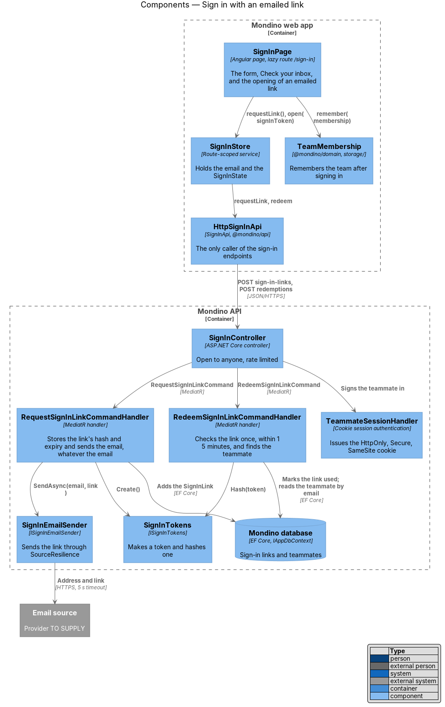
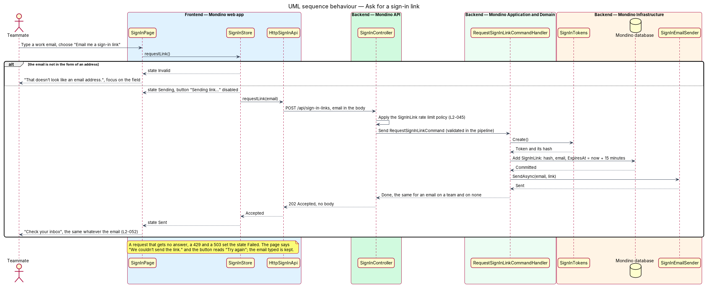

# Sign in with an emailed link

## Overview

Mondino shows a team on a 3D globe, each teammate as a pin at their city. A browser belongs to
a teammate through a session, which `join-team` and `make-team` start on the device where the
teammate joined or made the team. This feature covers how a teammate who is already on a team
comes back on a new browser or device. Mondino has no passwords.

**sign-in link** — address, sent by email, that starts the session of the teammate whose email it was sent to

**sign-in token** — random value in a sign-in link that can be used once, for 15 minutes

**session** — proof, held in a cookie, that a browser belongs to one teammate of one team

The Sign In screen, at `/sign-in`, has the title "Welcome back." and the lead "No passwords.
We’ll email you a link that signs you straight in." It has one field, "Work email", and the
button "Email me a sign-in link". After the button is chosen the screen reads "Check your
inbox" and "We sent a sign-in link to **sofia@northwind.co**. It works once, for the next 15
minutes.", with "Use another email".

The screen reads the same whether or not the email is on a team, so it never tells anyone which
emails Mondino knows (L2-043, L2-045). Opening the emailed link starts the teammate's session
and shows the Globe. Opening a link sent to an email that is on no team shows "You need an
invite link".

The two endpoints behind the screen are open to anyone and are rate limited. The email is the
teammate's own, as the postal code is: it is never shown to another teammate.

Three things are not designed, and none is built before its design exists:

- What is shown when an emailed link has expired or was already used: `<TO SUPPLY>`.
- How a teammate who joined by invite link signs in again. Join asks for a name, a country and
  a postal code and no email, so only the teammate who made a team has an email on record:
  `<TO SUPPLY>`.
- Which team a sign-in link opens when one email is on more than one team: `<TO SUPPLY>`.

## Description

The feature is a vertical slice from the Sign In screen to the database and to one outside
source, the Email source. The browser calls only the Mondino API.

**Frontend (`mondino` application, `@mondino/api`, `@mondino/components`, `@mondino/globe`)**

- **`SignInPage`** — page at the lazy route `/sign-in`, not behind `teammateGuard`. It provides
  `SignInStore` and binds `SIGN_IN_API`, so neither is in the initial bundle. It renders
  `AuthLayout` with the form, or the "Check your inbox" notice, and the footer "New here?
  Start a team or open the invite link a teammate sent you.", whose link leads to `/new`.
  - The button's submit calls `SignInStore.requestLink()`.
  - `Invalid` marks the field `aria-invalid` and shows "That doesn’t look like an email
    address." in a `role="alert"` element linked with `aria-describedby`. Focus returns to the
    field, and the message goes when the field is edited.
  - `Sending` disables the button, marks it `aria-busy` and reads "Sending link…".
  - `Sent` replaces the form with a `Notice` in a `role="status"` element: the title "Check
    your inbox", which takes focus, the text with the email rendered as text, and "Use another
    email", which calls `SignInStore.useAnotherEmail()` and shows the form again.
  - `Failed` shows an alert, "We couldn’t send the link. Mondino didn’t answer — try again in a
    moment.", and the button reads "Try again". The email typed is kept.
  - When the address carries a fragment, the page takes it as the sign-in token, removes it
    from the address with `replaceUrl`, and calls `SignInStore.open(signInToken)`. On a
    `SignInResult` with a membership it calls `TeamMembership.remember(membership)` and
    navigates to `/globe`. On a result with no membership it navigates to `/globe` with the
    email in the navigation state; `teammateGuard` refuses the match and `InviteNeededPage`
    shows "You need an invite link" with that email (`adapt-to-every-width`).
  - What the page shows in `Opening` and in `LinkUnusable` is `<TO SUPPLY>`.
- **`SignInStore`** — service provided at the `/sign-in` route, so its state goes when the
  person leaves the screen. It holds the writable signal `email` and the signal `state`.
  `requestLink()` checks the email's form, sets `Sending`, calls `SignInApi.requestLink` and
  sets `Sent` on any 202. An `ApiError` of any code, and no answer, set `Failed`. It aborts a
  pending request when it is destroyed. `open(signInToken)` sets `Opening` and calls
  `SignInApi.redeem`; the code `sign_in_link_unusable` sets `LinkUnusable`.
- **`SignInState`** — feature-local union of `Idle`, `Invalid`, `Sending`, `Sent`, `Failed`,
  `Opening` and `LinkUnusable`.
- **`SignInApi` / `SIGN_IN_API`, `HttpSignInApi`** — contract, injection token and HTTP client
  in `@mondino/api`. `requestLink(email, signal)` sends `POST /api/sign-in-links`, and
  `redeem(signInToken)` sends `POST /api/sign-in-links/redemptions`. The email and the token
  travel in a request body, never in a URL.
- **`SignInResult`** — `membership` (a `Membership`: `teamId`, `teammateId`, `teamName`) or
  null, and the `email` the link was sent to.
- **`AuthLayout`** (`mo-auth`, block `auth`) — presentation component in `@mondino/components`
  that Sign In and Create Team share: the mark and wordmark, a body slot (`auth__body`), a
  footer slot (`auth__footer`) and a stage slot (`auth__stage`) for the globe. Its layout is in
  `adapt-to-every-width`.
- **`Notice`** (`mo-notice`, block `notice`) — presentation component in `@mondino/components`:
  an icon, a title, a text and an actions slot. Join uses it for an invite link that cannot be
  used (`open-invite-link`).
- **`GlobeView`** (`mo-globe`) — imported dynamically inside a `@defer` block, with no pins and
  not interactive ("The globe, with no pins").
- The email is held in memory by `SignInStore`, and by the navigation state for
  `InviteNeededPage`. It is never written to browser storage and never placed in a URL.
- The sign-in token is in the fragment of the emailed address, so the browser sends it to no
  server when the address is opened, and no log of the host that serves the app holds it.

**Backend**

- **`SignInController`** — `POST /api/sign-in-links` and `POST /api/sign-in-links/redemptions`.
  Both actions are marked as open to anyone and carry the `SignInLink` and `SignInRedemption`
  policies of `RateLimitPolicies` (`protect-team-data`, L2-045). Each sends one MediatR request
  and checks nothing itself. The first answers 202 with no body. The second signs the returned
  teammate in through `TeammateSessionHandler` and answers 200 with a `SignInResultDto`.
- **`RequestSignInLinkCommand`** — carries the `Email`.
- **`RequestSignInLinkCommandValidator`** — refuses an email over 254 characters or not in the
  form of an address with 400 and the code `validation_failed`.
- **`RequestSignInLinkCommandHandler`** — runs the same steps for every email, so neither its
  answer nor the time it takes says whether the email is on a team.
  1. It parses the email to an `EmailAddress`, which trims it and lower-cases it.
  2. It asks `ISignInTokens.Create()` for a token and its hash.
  3. It adds a `SignInLink` with the hash, the email and `ExpiresAt`, which is the time from
     `TimeProvider` plus `SignInLink.Lifetime` (15 minutes), and saves through `IAppDbContext`.
     The token itself is not stored.
  4. It calls `ISignInEmailSender.SendAsync` with the email and the link. When the Email source
     does not accept the message, it refuses with `sign_in_email_unavailable`.
- **`RedeemSignInLinkCommand`** — carries the `SignInToken`.
- **`RedeemSignInLinkCommandHandler`** — hashes the token with `ISignInTokens.Hash` and loads
  the `SignInLink` with that hash. It calls `SignInLink.TryUse(now)` with the time from
  `TimeProvider`. A link that does not exist, has expired or was used before is refused with
  `sign_in_link_unusable`; the three cases receive the same refusal. Otherwise it saves the use
  and finds the `Teammate` whose `Email` equals the link's. It returns a `SignInResultDto` with
  the team id, the teammate id and the team's name, or with the email alone when no teammate
  has it.
- **`SignInLink`** — entity in `Mondino.Domain`: `Id`, `TokenHash`, `Email`, `ExpiresAt` and
  `UsedAt`. `TryUse(now)` sets `UsedAt` and returns true when the link is unused and `now` is
  before `ExpiresAt`. The save carries a concurrency check on `UsedAt`, so two requests with
  one token start one session. A link that is used or expired is deleted by a later request for
  the same email; no timer runs.
- **`EmailAddress`** — value object in `Mondino.Domain`. `Teammate.Email` is an optional
  `EmailAddress`; `make-team` sets it for the teammate who makes a team. No DTO returned to
  another teammate carries it.
- **`ISignInTokens`** — interface in `Mondino.Application`. `SignInTokens` in
  `Mondino.Infrastructure` makes a token of at least 128 bits from `RandomNumberGenerator`,
  encoded for a URL, and hashes a token with SHA-256.
- **`ISignInEmailSender`** — interface in `Mondino.Application` for the outside source that
  delivers email. `SendAsync(email, link, ct)` returns whether the source accepted the message.
  `SignInEmailSender` in `Mondino.Infrastructure` calls the Email source through
  `SourceResilience` with the 5 s timeout and the circuit breaker of `survive-source-failure`.
  The message holds the link, that it works once and for 15 minutes, and nothing else: no
  teammate's name, no team's name and no city. The provider, the sender's address and the
  message's wording are `<TO SUPPLY>`.
- **`TeammateSessionHandler`** — issues the session cookie, as it does after a join
  (`join-team`).
- **`MondinoTelemetry`** — records the two routes as their templates and the call to the Email
  source as the source `email` with its outcome. No log, metric or span carries the email or
  the token (`observe-without-exposing`, L2-051).

**Refusals**

| Case | Status | `code` | The screen says |
|------|--------|--------|-----------------|
| Email over 254 characters or not an address | 400 | `validation_failed` | "We couldn’t send the link." and "Try again"; the browser's own check catches the form first |
| Over the limit for asking | 429 | `rate_limited` | "We couldn’t send the link." and "Try again" |
| Email source did not accept the message | 503 | `sign_in_email_unavailable` | "We couldn’t send the link." and "Try again" |
| Sign-in link unknown, expired or used | 410 | `sign_in_link_unusable` | `<TO SUPPLY>` |
| Network failure or any other error | — | — | "We couldn’t send the link." and "Try again" |

No refusal depends on whether the email is on a team.

**Open points**

- The limits of the `SignInLink` and `SignInRedemption` policies, and a limit on the links sent
  to one address, are `<TO SUPPLY>`.
- The protection of these pre-session, state-changing requests against cross-site request
  forgery follows the session design: `<TO SUPPLY>`.
- A link is emailed to any address in the right form, since an answer that depended on the
  address would reveal which emails Mondino knows. Whether an address on no team receives a
  different message is `<TO SUPPLY>`.

## Requirements

The feature realises the following level-2 (L2) requirement, which refines the level-1 (L1)
requirement cited by identifier.

| L2 ID | Refines (L1) | Requirement |
|-------|--------------|-------------|
| `L2-052` | `L1-018` | A teammate who is already on a team signs in on a new browser or device with a link sent to their email. The link works once, for 15 minutes. The screen says the same whether or not the email is on a team; opening the link starts the teammate's session and shows the Globe, or says that an invite link is needed when the email is on no team. |

## Diagrams

### System context

A teammate gives Mondino a work email and opens the link that arrives. Mondino hands the Email
source the address and the link, and no name or team.

### Containers

The Mondino web app posts the email, and later the sign-in token, to the Mondino API in a
request body. The Mondino API stores the link's hash and expiry in the Mondino database and is
the only container that calls the Email source.

### Components

`SignInPage` works through `SignInStore` and `HttpSignInApi`. `SignInController` sends
`RequestSignInLinkCommand` or `RedeemSignInLinkCommand` to its handler. The first handler
stores a `SignInLink` and sends the email through `SignInEmailSender`; the second uses the link
once, and the controller signs the teammate in through `TeammateSessionHandler`.

### Class structure

`SignInStore` holds a `SignInState` and depends on the `SignInApi` contract, which
`HttpSignInApi` implements. `RequestSignInLinkCommandHandler` creates a `SignInLink`, which
holds a token's hash, an `EmailAddress` and an expiry. `RedeemSignInLinkCommandHandler` uses
the link once and finds the `Teammate` by its `Email`.

### Behaviour — ask for a sign-in link

An email that is not in the form of an address is refused in the browser. Otherwise the handler
stores the link's hash with an expiry 15 minutes ahead and sends the email, and the API answers
202 whatever the email. The screen reads "Check your inbox" in every case (`L2-052`). A request
that fails keeps the email typed and offers "Try again".

### Behaviour — open the emailed sign-in link

`SignInPage` reads the sign-in token from the fragment, removes it from the address and redeems
it. A link that is unknown, expired or used is refused. A usable link is marked used; when its
email is on a team the controller issues the session cookie and the Globe opens, and when it is
on no team the browser shows "You need an invite link" (`L2-052`).

