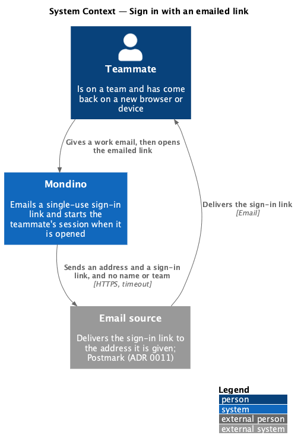
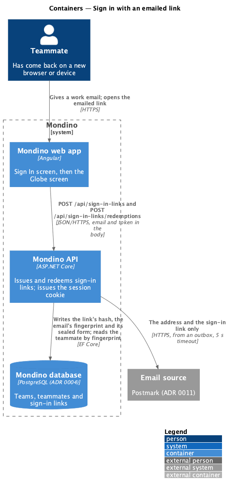
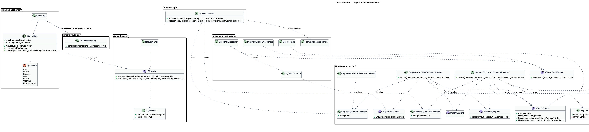
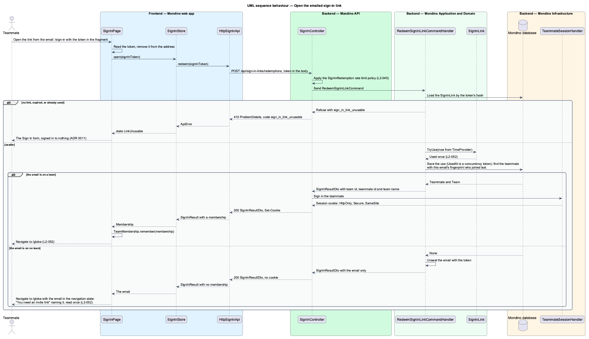

# Sign in with an emailed link

## Overview

Mondino shows a team on a 3D globe, each teammate as a pin at their city. A browser belongs to
a teammate through a session, which `join-team` and `make-team` start on the device where the
teammate joined or made the team. This feature covers how a teammate who is already on a team
comes back on a new browser or device. Mondino has no passwords.

**sign-in link** — address, sent by email, that starts the session of the teammate whose email it was sent to

**sign-in token** — random value in a sign-in link that can be used once, for 15 minutes

**session** — proof, held in a cookie, that a browser belongs to one teammate of one team

The Sign In screen, at `/sign-in`, has the title "Welcome back." and the lead "No passwords.
We’ll email you a link that signs you straight in." It has one field, "Work email", and the
button "Email me a sign-in link". After the button is chosen the screen reads "Check your
inbox" and "We sent a sign-in link to **sofia@northwind.co**. It works once, for the next 15
minutes.", with "Use another email".

The screen reads the same whether or not the email is on a team, so it never tells anyone which
emails Mondino knows (L2-043, L2-045). Opening the emailed link starts the teammate's session
and shows the Globe. Opening a link sent to an email that is on no team shows "You need an
invite link".

The two endpoints behind the screen are open to anyone and are rate limited. The email is the
teammate's own, as the postal code is: it is never shown to another teammate.

Two things are not designed, and neither is built before its design exists:

- What is shown when an emailed link has expired or was already used, and while one is being
  opened: until it is designed, Sign In shows its form (ADR 0011).
- How a teammate who joined by invite link signs in again. Join asks for a name, a country and
  a postal code and no email, so only the teammate who made a team has an email on record:
  `<TO SUPPLY>`.

An email on more than one team opens the team its teammate joined or made last (ADR 0011).

## Description

The feature is a vertical slice from the Sign In screen to the database and to one outside
source, the Email source (Postmark, ADR 0011). The browser calls only the Mondino API.

**Frontend (`mondino` application, `@mondino/api`, `@mondino/components`)**

- **`SignInPage`** — page at the lazy route `/sign-in`, not behind `teammateGuard`. The route
  binds `SIGN_IN_API` and the page provides `SignInStore`, so neither is in the initial bundle.
  It draws the `auth` block itself, as `CreateTeamPage` does, from the Sass partial the two
  share (`app/auth/_auth.scss`): the wordmark, the form or the "Check your inbox" notice, the
  footer "New here? Start a team or open the invite link a teammate sent you.", whose link
  leads to `/new`, and the stage with `GlobeFallback`, "The globe, with no pins", until journey 8
  draws the 3D globe.
  - The form's submit calls `SignInStore.requestLink()`.
  - `Invalid` marks the field `aria-invalid` and shows "That doesn’t look like an email
    address." in a `role="alert"` element linked with `aria-describedby` (`TextField`). Focus
    returns to the field, and the message goes when the field is edited.
  - `Sending` disables the button, marks it `aria-busy` and reads "Sending link…".
  - `Sent` replaces the form with a `Notice` in a `role="status"` element: the title "Check
    your inbox", which takes focus, the text with the email rendered as text, and "Use another
    email", a link to `/sign-in`, as the mock draws it, that calls `SignInStore.useAnotherEmail()`:
    the form is shown again, with focus on the field.
  - `Failed` shows an `Alert`, "We couldn’t send the link. Mondino didn’t answer — try again in
    a moment.", and the button reads "Try again". The email typed is kept.
  - When the address carries a fragment, the page takes it as the sign-in token, removes it
    from the address with `replaceUrl`, and calls `SignInStore.open(signInToken)`. On a
    `SignInResult` with a membership it calls `TeamMembership.remember(membership)` and
    navigates to `/globe`, replacing the address. On a result with no membership it navigates
    to `/globe` with the email in the navigation state; `teammateGuard` refuses the match and
    `InviteNeededPage` shows "You need an invite link" with that email.
  - In `Opening` and in `LinkUnusable` the page shows its form, as in `Idle` (ADR 0011).
- **`SignInStore`** — service the page provides, so its state goes when the person leaves the
  screen. It holds the signal `email` and the signal `state`. `requestLink()` checks the
  email's form (`isEmailAddress` in `@mondino/domain`, the backend's own rule), sets `Sending`,
  calls `SignInApi.requestLink` and sets `Sent`. Any `ApiError`, `rate_limited` included, sets
  `Failed`. `open(signInToken)` sets `Opening` and calls `SignInApi.redeem`; any refusal sets
  `LinkUnusable`. It aborts a pending request when it is destroyed.
- **`SignInState`** — feature-local union of `Idle`, `Invalid`, `Sending`, `Sent`, `Failed`,
  `Opening` and `LinkUnusable`.
- **`SignInApi` / `SIGN_IN_API`, `HttpSignInApi`** — contract, injection token and HTTP client
  in `@mondino/api`. `requestLink(email, signal)` sends `POST /api/sign-in-links`, and
  `redeem(signInToken, signal)` sends `POST /api/sign-in-links/redemptions`. The email and the
  token travel in a request body, never in a URL.
- **`SignInResult`** — `membership` (a `Membership`: `teamId`, `teammateId`, `teamName`) or
  null, and `email`, the address the link was sent to when it is on no team, or null.
- **`InviteNeededPage`** — reads the email from the navigation state once, when it is a string,
  then takes it out of history, as `GlobePage` does with its greeting; opened or reloaded
  without it, the sentence reads "and you aren’t on one yet". `NoticePage` renders the email as
  text, in `strong`.
- **`Notice`** (`mo-notice`, block `notice`) — presentation component in `@mondino/components`:
  an icon, a title, a text and an actions slot. Join uses it for an invite link that cannot be
  used (`open-invite-link`).
- The email is held in memory by `SignInStore`, and for one navigation by the navigation state
  for `InviteNeededPage`. It is never written to browser storage and never placed in a URL.
- The sign-in token is in the fragment of the emailed address, so the browser sends it to no
  server when the address is opened, and no log of the host that serves the app holds it.

**Backend**

- **`SignInController`** — `POST /api/sign-in-links` and `POST /api/sign-in-links/redemptions`.
  Both actions are marked as open to anyone, carry `[SameSiteOnly]` (ADR 0008) and the
  `sign-in-link` and `sign-in-redemption` policies of `RateLimitPolicies` (L2-045). Each sends
  one MediatR request and checks nothing itself. The first answers 202 with no body. The
  second signs the returned teammate in through `TeammateSessionHandler` when the result has a
  membership, and answers 200 with a `SignInResultDto`.
- **`RequestSignInLinkCommand`** — carries the `Email`.
- **`RequestSignInLinkCommandHandler`** — refuses an email over 254 characters or not in the
  form of an address (`EmailAddress.TryParse`) with 400 and the code `validation_failed`. Then
  it runs the same steps for every email, so its answer says nothing about the email:
  1. It fingerprints the email (`IEmailFingerprints`, ADR 0009), deletes the links of that
     fingerprint that have expired, and counts those made in the last 15 minutes, by
     `TimeProvider`. When there are already 3, it stops here, stores and sends nothing, and
     answers as for any other request (L2-045).
  2. It asks `ISignInTokens` for a token, its hash, and the email sealed with the token.
  3. It adds a `SignInLink` with the hash, the fingerprint, the sealed email, `CreatedAt` and
     `ExpiresAt` (`SignInLink.Lifetime`, 15 minutes, later), and saves through `IAppDbContext`.
     The token itself is not stored.
  4. When a teammate has the fingerprint, it hands `ISignInMailOutbox` a `SignInMail`: the
     email and the link `{SignInEmail:AppAddress}/sign-in#{token}`. It never waits for the
     Email source.
- **`RedeemSignInLinkCommand`** — carries the `SignInToken`.
- **`RedeemSignInLinkCommandHandler`** — refuses an empty token or one over 128 characters
  with `sign_in_link_unusable`. It hashes the token with `ISignInTokens.Hash`, one redemption
  of a hash at a time in this instance, and loads the `SignInLink` with that hash. It calls
  `SignInLink.TryUse(now)` with the time from `TimeProvider`. A link that does not exist, has
  expired or was used before is refused with 410 and `sign_in_link_unusable`; the three cases
  receive the same refusal. Otherwise it saves the use and finds the `Teammate` with the link's
  fingerprint who joined last. It returns a `SignInResultDto` with a `MembershipDto` (team id,
  teammate id and team name), or, when no teammate has it, with the email unsealed by the
  token.
- **`SignInLink`** — entity in `Mondino.Domain`: `Id`, `TokenHash`, `EmailFingerprint`,
  `SealedEmail`, `CreatedAt`, `ExpiresAt` and `UsedAt`. `TryUse(now)` sets `UsedAt` and
  returns true when the link is unused and `now` is before `ExpiresAt`. `UsedAt` is a
  concurrency token, so two requests with one token start one session.
- **`EmailAddress`** — value object in `Mondino.Domain`. A teammate's email is kept only as
  `Teammate.EmailFingerprint` (ADR 0009); no DTO carries it.
- **`ISignInTokens`** — interface in `Mondino.Application`. `SignInTokens` in
  `Mondino.Infrastructure` makes a token of 256 bits from `RandomNumberGenerator`, base64url;
  hashes a token with SHA-256; and seals an email with AES-GCM under a key derived from the
  token, so only the link's holder can read it back (ADR 0011).
- **`ISignInMailOutbox`** — interface in `Mondino.Application`. `SignInMailOutbox` in
  `Mondino.Infrastructure` is a bounded channel; `SignInMailDispatcher`, a hosted service,
  hands each mail to `ISignInEmailSender` and drops one the source refuses.
- **`ISignInEmailSender`** — interface in `Mondino.Application` for the Email source.
  `SendAsync(mail, ct)` returns whether the source accepted the message.
  `PostmarkSignInEmailSender` in `Mondino.Infrastructure` posts it to Postmark with a 5 s
  timeout and a breaker (5 failures in a row open it for 30 seconds), open and link tracking
  off. The message is plain text: the link, that it works once and for 15 minutes, and
  nothing else; no teammate's name, no team's name and no city (ADR 0011). Without
  `SignInEmail:ServerToken`, `SignInEmail:From` or `SignInEmail:AppAddress` nothing is sent.
- **`TeammateSessionHandler`** — issues the session cookie, as it does after a join
  (`join-team`).
- No log carries the email or the token: the Email source's `HttpClient` logs nothing, neither
  the handlers nor the dispatcher log a request, and every request record of the API prints only
  its type, since MVC writes an action's arguments to its Trace log (`observe-without-exposing`,
  L2-051).

**Refusals**

| Case | Status | `code` | The screen says |
|------|--------|--------|-----------------|
| Email over 254 characters or not an address | 400 | `validation_failed` | "We couldn’t send the link." and "Try again"; the screen's own check catches the form first |
| Over the limit for one client | 429 | `rate_limited` | "We couldn’t send the link." and "Try again", until Sign In's own state for it is drawn (L2-045, ADR 0011) |
| Sign-in link unknown, expired or used | 410 | `sign_in_link_unusable` | The Sign In form (ADR 0011) |
| Opening refused for one client, or not answered | 429, — | `rate_limited`, — | The Sign In form |
| Network failure or any other error | — | — | "We couldn’t send the link." and "Try again" |

No refusal depends on whether the email is on a team, and the Email source being down
changes no answer.

**Open points**

- The `sign-in-link` policy allows one client 5 requests in 15 minutes, and the
  `sign-in-redemption` policy 10 openings a minute; each then answers 429 with `Retry-After`
  (L2-045). What Sign In shows for a 429 is not drawn: `<TO SUPPLY>`.
- Only an address on a team is mailed; an address on no team receives nothing, and the
  answer is the same.

## Requirements

The feature realises the following level-2 (L2) requirement, which refines the level-1 (L1)
requirement cited by identifier.

| L2 ID | Refines (L1) | Requirement |
|-------|--------------|-------------|
| `L2-052` | `L1-018` | Sign In (`/sign-in`) is for a teammate who is already on a team and has come back on a new browser or device. There is no password: the teammate gives their work email, and Mondino emails a link that signs them straight in. The link works once, for 15 minutes. A newcomer opens their team's invite link instead, or starts a team. |

## Diagrams

### System context

A teammate gives Mondino a work email and opens the link that arrives. Mondino hands the Email
source the address and the link, and no name or team.

### Containers

The Mondino web app posts the email, and later the sign-in token, to the Mondino API in a
request body. The Mondino API stores the link's hash and expiry in the Mondino database and is
the only container that calls the Email source.

### Components

`SignInPage` works through `SignInStore` and `HttpSignInApi`. `SignInController` sends
`RequestSignInLinkCommand` or `RedeemSignInLinkCommand` to its handler. The first handler
stores a `SignInLink` and sends the email through `SignInEmailSender`; the second uses the link
once, and the controller signs the teammate in through `TeammateSessionHandler`. Mail leaves
through `SignInMailOutbox` and `SignInMailDispatcher`, never while the request waits.

### Class structure

`SignInStore` holds a `SignInState` and depends on the `SignInApi` contract, which
`HttpSignInApi` implements. `RequestSignInLinkCommandHandler` creates a `SignInLink`, which
holds a token's hash, the email's fingerprint, the email sealed by the token and an expiry.
`RedeemSignInLinkCommandHandler` uses the link once and finds the `Teammate` by its
`EmailFingerprint`.

### Behaviour — ask for a sign-in link

An email that is not in the form of an address is refused in the browser. Otherwise the handler
stores the link's hash with an expiry 15 minutes ahead, hands a teammate's mail to the outbox,
and the API answers 202 whatever the email. The screen reads "Check your inbox" in every case (`L2-052`). A request
that fails keeps the email typed and offers "Try again".

### Behaviour — open the emailed sign-in link

`SignInPage` reads the sign-in token from the fragment, removes it from the address and redeems
it. A link that is unknown, expired or used is refused. A usable link is marked used; when its
email is on a team the controller issues the session cookie and the Globe opens, and when it is
on no team the browser shows "You need an invite link" (`L2-052`).

