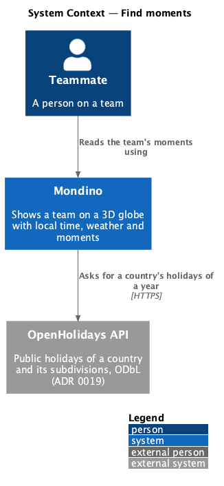
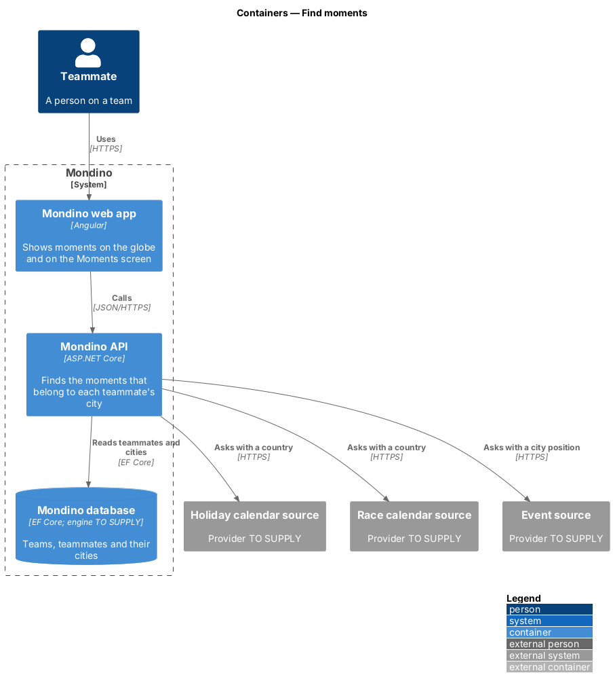
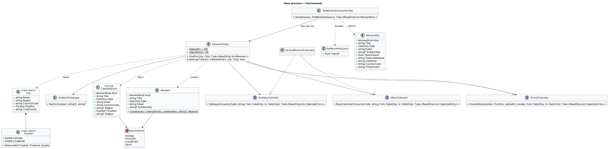

# Find moments

## Overview

Mondino shows a team spread around the world on a 3D globe. Each teammate has a pin, placed at
the city their postal code belongs to. Beside the local time and the weather, Mondino shows what
is happening where a teammate lives, so teammates have something to talk about.

**moment** — something happening where a teammate lives, with a kind, a title, a date local to
that place and one line of detail

**kind** — one of the four categories of moment: holiday, Formula 1, local event or sport

This feature is the backend rule that decides which moments belong to a teammate. A moment
belongs to a teammate when it happens where they live, and each kind has its own test of that. A
public holiday belongs to everyone in its country or region. A Formula 1 race weekend, or a
dated happening in that race's own calendar such as its tickets going on sale, belongs to
everyone in the country that holds the race. A local event or a sport fixture belongs to everyone
whose city is within 100 km of it.

The moments come from three outside sources: the holiday calendar source, the race calendar
source and the event source. Only the Mondino API calls them, and it asks each one about a
place, never about a teammate or a team. The feature has no screen of its own. Its result feeds
the moment marker on a pin (`mark-pins-with-moments`) and the Moments screen (`list-moments`).

## Description

The feature runs from the API endpoint to the three calendar interfaces. The provider behind
each source is `<TO SUPPLY>`.

- **`TeamsController`** — ASP.NET Core controller. `GET /api/teams/{teamId}/moments` sends one
  `GetMomentsQuery` and checks nothing itself.
- **`GetMomentsQuery`** — request carrying the `TeamId`. It is an `ITeamScopedRequest`: for a
  team that is not the current teammate's own, `TeamScopeBehaviour` answers 404 with the code
  `team_not_found` before the handler runs (`platform/protect-team-data`).
- **`GetMomentsQueryHandler`** — MediatR handler. It loads the team of the teammate named by
  `ICurrentTeammate` through `IAppDbContext` and collects
  the team's distinct cities. It calls `MomentFinder` once per city, not once per teammate. It
  then emits one `MomentDto` for each teammate a moment belongs to, so two teammates in one city
  each get their own entry. The result is in date order; the browser orders the moments of one
  date west to east by their teammate (`list-moments`).
- **`MomentFinder`** — application service holding the rule. `FindFor(city)` reads today's date
  in the city's time zone from `TimeProvider` and `City.TimeZoneId`, and asks each calendar for
  the window from that date to 90 days ahead. It keeps the entries that pass `BelongsTo`,
  asks `EmblemCatalogue` for an emblem key, and creates the moments. `GetPinsQueryHandler` uses
  the same service to fill the moments of a `PinDto`.
- **`IHolidayCalendar`**, **`IRaceCalendar`**, **`IEventCalendar`** — interfaces in
  `Mondino.Application` over the three sources. `HolidaysIn` and `RaceCalendarIn` take a country
  code. `RaceCalendarIn` returns the race weekends held in that country and the dated
  happenings in those races' own calendars, such as "Monza tickets on sale". `EventsNear` takes
  the city's `Position` and a radius, and returns local events and sport fixtures. No method takes a teammate's name, a team or a postal code.
- **`CalendarEntry`** — record a calendar returns: `Kind`, `Title`, `Date`, `Detail`,
  `CountryCode`, optional `Region`, optional `Position`, and an optional `Subject` naming the
  team or series the entry is about.
- **`Moment`** — domain type: `Kind`, `Title`, `Date`, `Detail`, `EmblemKey`. `Moment.Create`
  cuts the title to 80 characters and the detail to 160 characters, each with an ellipsis.
- **`Position.DistanceKmTo`** — great-circle distance between two positions, in kilometres.
- **`EmblemCatalogue`** — application service. `KeyFor(subject)` returns an emblem key where
  Mondino holds the right to use the subject's emblem, and nothing otherwise.
- **`MomentDto`** — the moment with its teammate's id (`TeammateId`) and name, the city's name
  and country code, and the city's time zone id. The time zone id lets the browser compare the
  moment's date with today in the moment's own place. It carries no initials and no colour: the
  browser takes a teammate's avatar from their pin in `TeamStore`, by `TeammateId`.
- **`CachedMomentCalendars`** — infrastructure decorator over `HolidayCalendarClient`,
  `RaceCalendarClient` and `EventCalendarClient`. It caches each answer under its place and
  window, applies a 5 second timeout (L2-049), and holds a circuit breaker per source. The
  cache lifetime is `<TO SUPPLY>`.

`BelongsTo` applies one rule per kind:

| Kind | Source | An entry belongs to a city when |
|---|---|---|
| `Holiday` | `IHolidayCalendar` | The entry's country is the city's country, and the entry has no region or its region is the city's region |
| `Formula1` | `IRaceCalendar` | The entry's country, the country that holds the race the entry is about, is the city's country |
| `LocalEvent` | `IEventCalendar` | The entry's position is within 100 km of the city's position |
| `Sport` | `IEventCalendar` | The entry's position is within 100 km of the city's position |

`MomentFinder` applies the rule to every entry itself and does not rely on a source's own
filtering. The form in which a source names a region, and how it is matched to `City.Region`, is
`<TO SUPPLY>`. The day of a race weekend that a Formula 1 moment's `Date` carries is
`<TO SUPPLY>`.

For a calendar that times out, fails or has an open circuit, `CachedMomentCalendars` answers
with the last entries it cached for that place, or with none when it holds none
(L2-049, `platform/survive-source-failure`). `MomentFinder` returns those with the moments of
the remaining calendars, and the request succeeds. A source's title and
detail are data: the API sends them as plain strings, and no layer treats them as markup.

## Requirements

The feature realises the following level-2 (L2) requirement, which refines the level-1 (L1)
requirement cited by identifier.

| L2 ID | Refines (L1) | Requirement |
|-------|--------------|-------------|
| `L2-020` | `L1-007` | A moment is something happening where a teammate lives. It has a kind, a title, a date local to that place and one line of detail. There are exactly four kinds: a holiday, Formula 1, a local event and sport. A moment belongs to a teammate when it happens where they live. |

## Diagrams

### System context

A teammate reads the team's moments through Mondino. Mondino asks the holiday calendar source,
the race calendar source and the event source, each about a place.

### Containers

The Mondino web app calls the Mondino API. The API reads the team's cities from the Mondino
database and is the only container that calls the three sources.

### Components

`TeamsController` sends `GetMomentsQuery` to its handler. The handler asks `MomentFinder` for
each city, and `MomentFinder` reads the three calendar interfaces through
`CachedMomentCalendars`, which calls the calendar clients on a cache miss.

### Class structure

`MomentFinder` depends on the three calendar interfaces and on `EmblemCatalogue`. It filters
`CalendarEntry` records against a `City` and creates `Moment` values. `GetMomentsQueryHandler`
turns them into `MomentDto` values, and `CachedMomentCalendars` implements all three interfaces.

### Behaviour — find the moments of a team's cities

The handler loads the team and asks `MomentFinder` once per distinct city. `MomentFinder` reads
the three calendars, keeps the entries that belong to the city under `L2-020`, and creates the
moments. For a source that does not answer in time the last cached entries stand in, and the
other calendars' moments are still returned.

