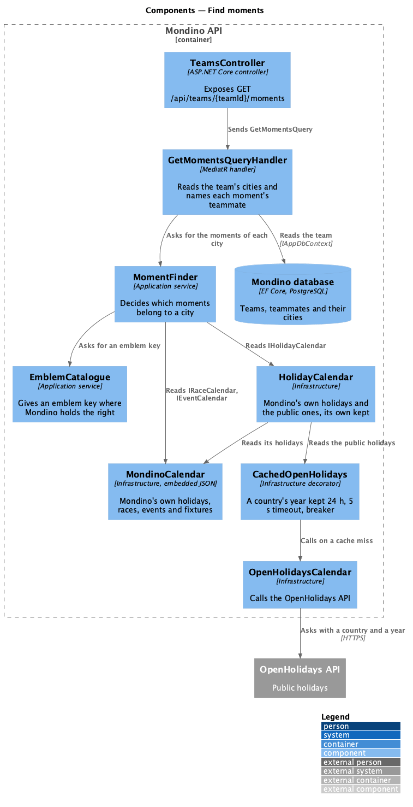
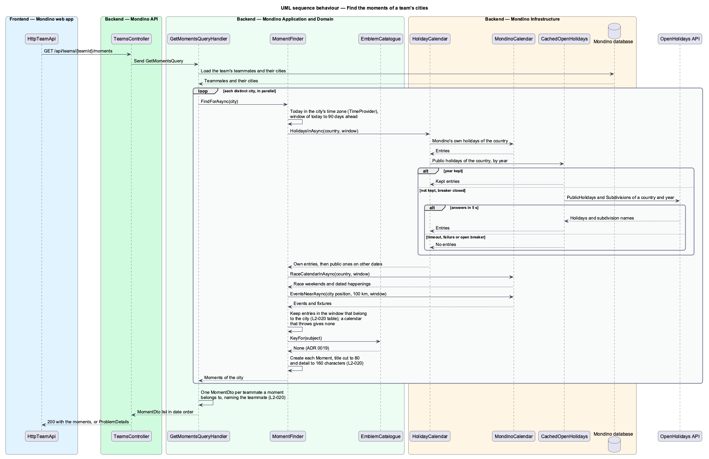

# Find moments

## Overview

Mondino shows a team spread around the world on a 3D globe. Each teammate has a pin, placed at
the city their postal code belongs to. Beside the local time and the weather, Mondino shows what
is happening where a teammate lives, so teammates have something to talk about.

**moment** — something happening where a teammate lives, with a kind, a title, a date local to
that place and one line of detail

**kind** — one of the four categories of moment: holiday, Formula 1, local event or sport

This feature is the backend rule that decides which moments belong to a teammate. A moment
belongs to a teammate when it happens where they live, and each kind has its own test of that. A
public holiday belongs to everyone in its country or region. A Formula 1 race weekend, or a
dated happening in that race's own calendar such as its tickets going on sale, belongs to
everyone in the country that holds the race. A local event or a sport fixture belongs to everyone
whose city is within 100 km of it.

The moments come from three calendars: the holiday calendar, the race calendar and the event
calendar (ADR 0019). Only the Mondino API calls them, and it asks each one about a
place, never about a teammate or a team. The feature has no screen of its own. Its result feeds
the moment marker on a pin (`mark-pins-with-moments`) and the Moments screen (`list-moments`).

## Description

The feature runs from the API endpoint to the three calendar interfaces, and in the browser from
`TeamApi.getMoments` to the screens that show a teammate's moments. The providers are
ADR 0019's: holidays from the OpenHolidays API and Mondino's own calendar; Formula 1, local
events and sport from Mondino's own calendar.

- **`TeamsController`** — ASP.NET Core controller. `GET /api/teams/{teamId}/moments` sends one
  `GetMomentsQuery` and checks nothing itself.
- **`GetMomentsQuery`** — request carrying the `TeamId`; an `ITeamScopedRequest`, so a team that
  is not the caller's is answered 404 `team_not_found` before the handler runs (L2-043).
- **`GetMomentsQueryHandler`** — MediatR handler. It loads the team's teammates with their cities
  through `IAppDbContext` and collects the team's distinct cities. It calls `MomentFinder` once
  per city, not once per teammate, the cities in parallel. It then emits one `MomentDto` for
  each teammate a moment belongs to, so two teammates in one city each get their own entry. The
  result is in date order; the browser orders the moments of one date west to east by their
  teammate.
- **`MomentFinder`** — application service holding the rule. `FindForAsync(city)` reads today's
  date in the city's time zone from `TimeProvider` and `City.TimeZoneId`, and asks each calendar
  for the window from that date to 90 days ahead. It keeps the entries that are in the window and
  pass `CalendarEntry.BelongsTo`, asks `EmblemCatalogue` for an emblem key, and creates the
  moments. A calendar that throws yields no entries, and the others' moments are still returned.
- **`IHolidayCalendar`**, **`IRaceCalendar`**, **`IEventCalendar`** — interfaces in
  `Mondino.Application` over the three sources. `HolidaysInAsync` and `RaceCalendarInAsync` take a
  country code and the window. `RaceCalendarInAsync` returns the race weekends held in that
  country and the dated happenings in those races' own calendars, such as "Monza tickets on
  sale". `EventsNearAsync` takes the city's `Position`, a radius and the window, and returns local
  events and sport fixtures. No method takes a teammate's name, a team or a postal code.
- **`CalendarEntry`** — domain record a calendar returns: `Kind`, `Title`, `Date`, `Detail`,
  `CountryCode`, optional `Region`, optional `Position`, and an optional `Subject` naming the
  team or series the entry is about. `BelongsTo(city)` applies the table below.
- **`Moment`** — domain type: `Kind`, `Title`, `Date`, `Detail`, `EmblemKey`. `Moment.Create`
  cuts the title to 80 characters and the detail to 160 characters, each ending in an ellipsis
  ("…") within the limit.
- **`City.Region`** — the English name of the city's first-level division, as GeoNames names it
  ("Lombardy", "Karnataka"), taken from the city directory when a pin is placed; null for a city
  stored before it was kept, which then has its country's holidays only.
- **`Position.DistanceKmTo`** — great-circle distance between two positions, in kilometres.
- **`EmblemCatalogue`** — application service. `KeyFor(subject)` returns an emblem key where
  Mondino holds the right to use the subject's emblem. It holds none (ADR 0019).
- **`MomentDto`** — the moment (`Kind` as `holiday`, `formula-1`, `local-event` or `sport`,
  `Title`, `Date` as `2025-11-01`, `Detail`, `EmblemKey`) with its teammate's id
  (`TeammateId`) and name, the city's name and country code, and the city's time zone id. The
  time zone id lets the browser compare the moment's date with today in the moment's own place.
  It carries no postal code, position, initials or colour: the browser takes a teammate's avatar
  from their pin in `TeamStore`, by `TeammateId`.
- **`MondinoCalendar`** — infrastructure. Mondino's own calendar, `Moments/calendar.json`
  embedded in `Mondino.Infrastructure`, read once. It implements `IRaceCalendar` and
  `IEventCalendar` and gives its holidays to `HolidayCalendar`.
- **`OpenHolidaysCalendar`** — infrastructure. Reads a country's public holidays for a calendar
  year and the English names of its subdivisions from the OpenHolidays API
  (`HolidaySource:BaseAddress`). Its client logs nothing.
- **`CachedOpenHolidays`** — infrastructure decorator over `OpenHolidaysCalendar`. It keeps a
  country's year 24 hours (at most 1,000), applies a 5 second timeout (L2-049), keeps no failure,
  and opens its breaker for 30 seconds after 5 failures in a row.
- **`HolidayCalendar`** — infrastructure, the registered `IHolidayCalendar`. It gives Mondino's
  own holidays and the public calendar's in the window; where both have one in a country on a
  date and in a region (or none), Mondino's own is kept. A public holiday's detail is "Public
  holiday in Ireland", or "Public holiday in Lombardy" for a regional one.

`BelongsTo` applies one rule per kind:

| Kind | Source | An entry belongs to a city when |
|---|---|---|
| `Holiday` | `IHolidayCalendar` | The entry's country is the city's country, and the entry has no region or its region is the city's region (names equal, ignoring case and accents) |
| `Formula1` | `IRaceCalendar` | The entry's country, the country that holds the race the entry is about, is the city's country |
| `LocalEvent` | `IEventCalendar` | The entry's position is within 100 km of the city's position |
| `Sport` | `IEventCalendar` | The entry's position is within 100 km of the city's position |

`MomentFinder` applies the rule to every entry itself and does not rely on a source's own
filtering. A race weekend is dated by its race day, a dated happening by its own day (ADR 0019).
A source's title and detail are data: the API sends them as plain strings, and no layer treats
them as markup.

In the browser:

- **`Moment`** — `api` type mirroring `MomentDto`; **`MomentKind`** is its kind.
  **`TeamApi.getMoments(teamId, signal)`** / **`HttpTeamApi`** read them.
- **`TeamStore.moments`** — the team's moments, read once beside the pins on entering the
  team's screens. The screens show the pins without waiting for them; a refused or failed read
  leaves the list empty, and the screens show what they show with no moment.
- **`daysUntil(date, timeZoneId, now)`** and **`whenLabel(date, daysAhead)`** — `domain`'s
  `moments/`. The days from today in the moment's own time zone, so Melbourne Cup Day on 4 November
  is 7 days off in Melbourne while it is 8 in Milan (L2-020); "Today", "Tomorrow" and "In 3 days" up
  to 7 days ahead, then the day and month ("9 Nov").
- **`upcomingMoments(moments, teammateId, now)`** — a teammate's moments from today on, nearest
  first, as `MomentView`s (`kind`, `kindName`, `title`, `detail`, `when`, `today`). The panel shows
  them as `MomentCard`s ("Holiday · In 5 days"); none, and the panel shows no moments section.
- **`weekMoments(moments, pins, now)`** — the moments of today and the next 7 days, in date order
  and, on one date, west to east by `orderWestToEast`, as `WeekMoment`s with the teammate's first
  name and city. The Globe's panel lists the first six, each selecting its teammate's pin.
- **`nextMoment(moments, teammateId, now)`** — a Team row's "Coming up": the nearest moment from
  today on, as a `moment-pill` with the kind's icon named by the kind, its title and `when`.
- **`MomentIcon`** (`components`) — Mondino's own icon for a kind: a party popper, a flag, a
  ticket, a trophy. No team's or series' logo is shipped (ADR 0019).

## Requirements

The feature realises the following level-2 (L2) requirement, which refines the level-1 (L1)
requirement cited by identifier.

| L2 ID | Refines (L1) | Requirement |
|-------|--------------|-------------|
| `L2-020` | `L1-007` | A moment is something happening where a teammate lives. It has a kind, a title, a date local to that place and one line of detail. There are exactly four kinds: a holiday, Formula 1, a local event and sport. A moment belongs to a teammate when it happens where they live. |

## Diagrams

### System context

A teammate reads the team's moments through Mondino. Mondino asks the holiday calendar source,
the race calendar source and the event source, each about a place.

### Containers

The Mondino web app calls the Mondino API. The API reads the team's cities from the Mondino
database and is the only container that calls the three sources.

### Components

`TeamsController` sends `GetMomentsQuery` to its handler. The handler asks `MomentFinder` for
each city, and `MomentFinder` reads the three calendar interfaces through
`CachedMomentCalendars`, which calls the calendar clients on a cache miss.

### Class structure

`MomentFinder` depends on the three calendar interfaces and on `EmblemCatalogue`. It filters
`CalendarEntry` records against a `City` and creates `Moment` values. `GetMomentsQueryHandler`
turns them into `MomentDto` values, and `CachedMomentCalendars` implements all three interfaces.

### Behaviour — find the moments of a team's cities

The handler loads the team and asks `MomentFinder` once per distinct city. `MomentFinder` reads
the three calendars, keeps the entries that belong to the city under `L2-020`, and creates the
moments. A source that does not answer in time yields no entries, and the other calendars'
moments are still returned.

## Open questions

- Where OpenHolidays' attribution (ODbL, "Holiday data © OpenHolidays API contributors") is shown;
  no mock draws it (ADR 0019), as Open-Meteo's is open in `weather/show-weather`.
