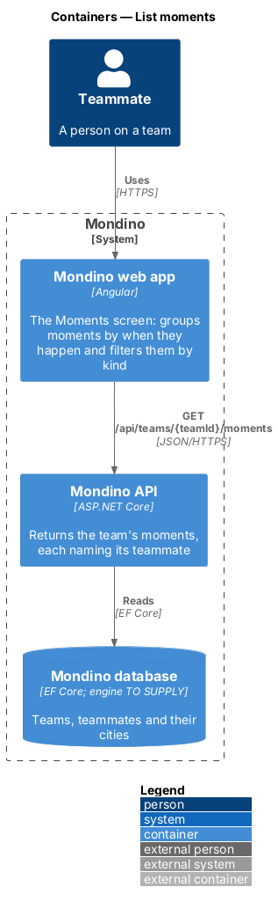
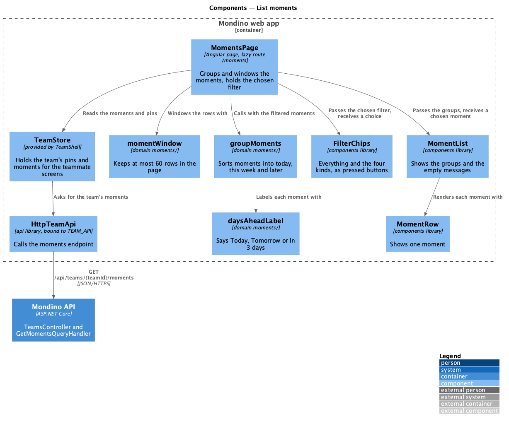
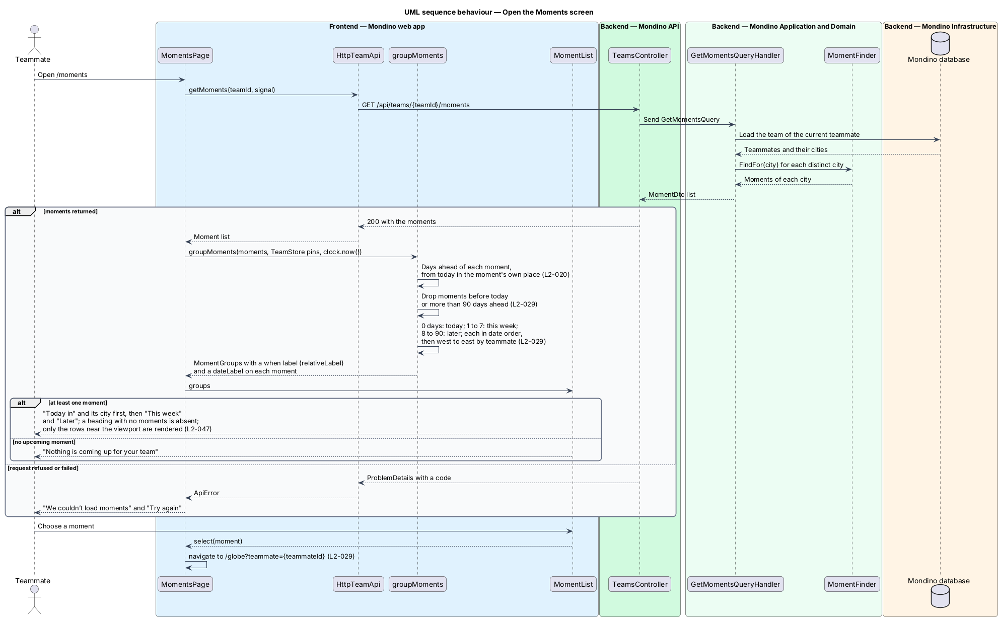

# List moments

## Overview

Mondino shows a team spread around the world, and what is happening where each teammate lives.
The Moments screen is one of Mondino's five screens. It gathers the whole team's upcoming
moments into one list, so a teammate sees what is coming up for the people they work with.

**moment** — something happening where a teammate lives, with a kind, a title, a date local to
that place and one line of detail

**kind** — one of the four categories of moment: holiday, Formula 1, local event or sport

The list is ordered by when each moment happens, and on one date west to east by teammate. A
moment today comes first and is the most prominent, headed "Today in" and its city. "This week" holds the moments 1 to 7 days ahead, and
"Later" those 8 to 90 days ahead. Each moment gives its kind, when it happens, its title, its
detail, and its teammate's first name and city. Choosing a moment opens the Globe screen with
that teammate's pin selected.

A row of filters narrows the list to one kind: Everything, Holiday, Formula 1, Local event or
Sport. The viewer's choice of which kinds mark pins on the globe (`mark-pins-with-moments`) does
not apply here: the Moments screen lists every kind.

"Today" is the date in the moment's own place. A moment dated 4 November in Melbourne is "today"
while it is 4 November in Melbourne, whatever the date is where the viewer sits.

## Description

The screen is a lazy route in the `mondino` application. The backend supplies the moments
(`find-moments`), and the browser groups and filters them.

- **`MomentsPage`** — page at `/moments`, loaded with `loadComponent` behind `teammateGuard`,
  headed "Moments" and "Holidays, races and local happenings where your teammates live." It
  asks `TEAM_API` for the team's moments once on entry and holds them in a signal. It holds the
  chosen filter in a second signal, "everything" at first. A computed signal filters the moments
  by kind and passes them to `groupMoments` with `TeamStore`'s pins and the clock's time. The
  computed signal reads the clock's minute tick, so a moment moves from "This week" to "Today" without a reload. The page
  cancels a pending request when the teammate leaves, and its state goes with it.
- **`TeamApi.getMoments(teamId, signal)`** / **`HttpTeamApi`** — contract and HTTP client in `api` for
  `GET /api/teams/{teamId}/moments`. A refusal arrives as an `ApiError` with a `code`.
- **`Moment`** — `api` type: kind, title, date, detail, emblem key, the teammate's id and name,
  the city's name and country code, and the city's time zone id. It carries no postal code, no
  position, and no initials or colour.
- **`groupMoments(moments, pins, now)`** — pure function in `domain`'s `moments/`. For each
  moment it works out the days ahead with `daysUntil`, from today in the moment's own time zone.
  It drops a moment before today or more than 90 days ahead. It returns `MomentGroups`: `today`
  (0 days), `thisWeek` (1 to 7 days) and `later` (8 to 90 days), each in date order and, on one
  date, west to east by teammate: the order `orderWestToEast` (`pins/`) gives the pins of
  `TeamStore`, the Team screen's order.
- **`DatedMoment`** — a moment with its days ahead, its `when` label, its `dateLabel` (the
  weekday, day and month, "Fri 31 Oct"), and its teammate's first
  name, initials and colour. The first name is `firstName(name)` from `pins/`, the first word
  of the teammate's name; the initials and colour are those of the teammate's pin in
  `TeamStore`, found by the moment's teammate id.
- **`relativeLabel(daysAhead)`** — pure function in `moments/`: "Today", "Tomorrow" or "In 3
  days", at any number of days ahead. It gives a `DatedMoment` its `when` label, which
  `MomentRow` shows after the kind ("Local event · In 4 days", "Formula 1 · In 13 days"),
  beside the `dateLabel`.
- **`whenLabel(daysAhead, date)`** — pure function in `moments/`, the one helper that words
  when a moment happens where no date stands beside it: `relativeLabel`'s words up to 7 days
  ahead and the day and month ("12 Nov") beyond. The teammate panel's moment cards, the Team
  table's "Coming up", the week panel and the moment marker use it; the rows of this screen
  show the date themselves, so they keep the relative wording at every distance, as the mock
  draws.
- **`FilterChips`** — presentation component. It renders the five filters as buttons in a group
  labelled "Filter by kind": "Everything" by its name, and each kind with its `MomentIcon` and
  its name. The chosen filter carries `aria-pressed="true"` and is
  styled through that attribute, with a mark that does not depend on colour. It emits the
  choice.
- **`MomentList`** — presentation component. It renders the three groups and omits the heading
  of a group with no moments. With no moment at all the page shows no filter and says "Nothing is coming up
  for your team", with a link back to the globe. With a kind chosen and no moment of it, it says "Nothing of this kind coming up for your
  team." It emits a chosen moment.
- **`MomentRow`** — presentation component for one moment (`moment-row`): the `dateLabel`, kind icon
  and `when` label, title, detail, and the teammate's `Avatar` with their first name and city
  ("Jordan · Austin"). The prominent form (`today-moment`) is used for a moment today: "Today
  in" and its city, the kind ("Today in Dublin · Holiday"), the moment's emblem, title, detail and the teammate's first name, and "On the globe". Title, detail
  and names are rendered as text, never as HTML. The whole row is one control, reachable by
  keyboard and at least 44 × 44 px.
- **`TeamStore`** — the page reads `pins` from it for the order and the avatars. When a moment
  is chosen, `MomentsPage` navigates to `/globe?teammate={teammateId}`, and the selection
  follows the address (`team/view-teammate-panel`).
- **`TeamsController`**, **`GetMomentsQuery`**, **`GetMomentsQueryHandler`** — the backend
  endpoint and handler, described in `find-moments`. The handler returns the moments of the next
  90 days only for a teammate of the team.

A filter choice sends no request: it narrows the moments already loaded. The filter is not kept
between visits. The response is bounded by the 90-day window, and the page replaces its moments
on each load. `MomentList` renders its rows through the Angular CDK virtual scroll viewport,
as `TeamTable` does, so the number of rows in the page stays under a fixed limit for a team of
up to 500 teammates (L2-047, `platform/stay-fast-and-light`).

While the request is pending the page is marked busy and announces "Loading moments…". When it
fails the page says "We couldn’t load moments", with "Try again", which asks again, and "Back
to the globe".

## Requirements

The feature realises the following level-2 (L2) requirements. Each refines the level-1 (L1)
requirement cited by identifier.

| L2 ID | Refines (L1) | Requirement |
|-------|--------------|-------------|
| `L2-029` | `L1-010` | The Moments screen lists the team's upcoming moments. A moment today is shown first and most prominently, "Today in" and its city; then "This week" (1 to 7 days ahead) and "Later" (8 to 90 days ahead), each in date order and, on one date, west to east by their teammate. Each moment gives its kind, when it happens, its title, its detail, and its teammate's first name and city. |
| `L2-030` | `L1-010` | The Moments screen is filtered by Everything, Holiday, Formula 1, Local event or Sport. |

## Diagrams

### System context

A teammate reads and filters the team's upcoming moments through Mondino, which reads them from
the calendar sources.

### Containers

The Mondino web app asks the Mondino API for the team's moments with one request. The API reads
the team from the Mondino database.

### Components

`MomentsPage` loads the moments through `HttpTeamApi`, groups them with `groupMoments`, and
passes the result to `MomentList`, which renders each moment with `MomentRow`. `FilterChips`
reports the chosen kind to the page.

### Class structure

`MomentsPage` depends on the `TeamApi` and `Clock` contracts, on `TeamStore` and on
`groupMoments`, which returns `MomentGroups` of `DatedMoment` values. `FilterChips`, `MomentList` and `MomentRow`
take inputs and emit outputs only.

### Behaviour — open the Moments screen

The page loads the team's moments with one request. `groupMoments` counts each moment's days
ahead from today in its own place, drops what falls outside 0 to 90 days, and sorts the rest
into today, this week and later, each in date order and then west to east (`L2-029`). Choosing a moment opens the Globe screen with its
teammate's pin selected.

### Behaviour — filter moments by kind

Choosing a filter narrows the loaded moments in the browser and regroups them; no request is
sent. The chosen filter is exposed as pressed. A kind with no upcoming moment shows "Nothing of
this kind coming up for your team." (`L2-030`).

