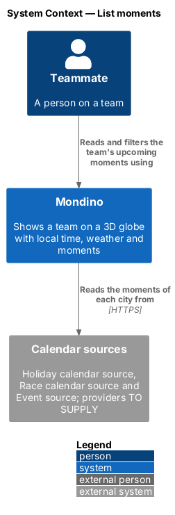
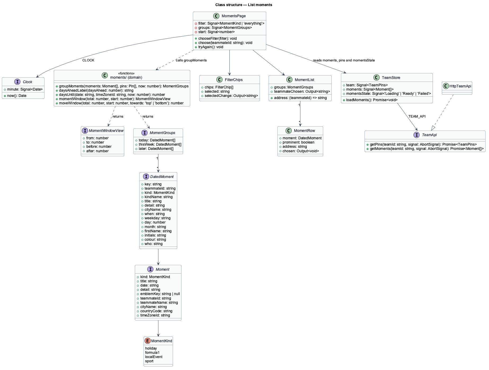
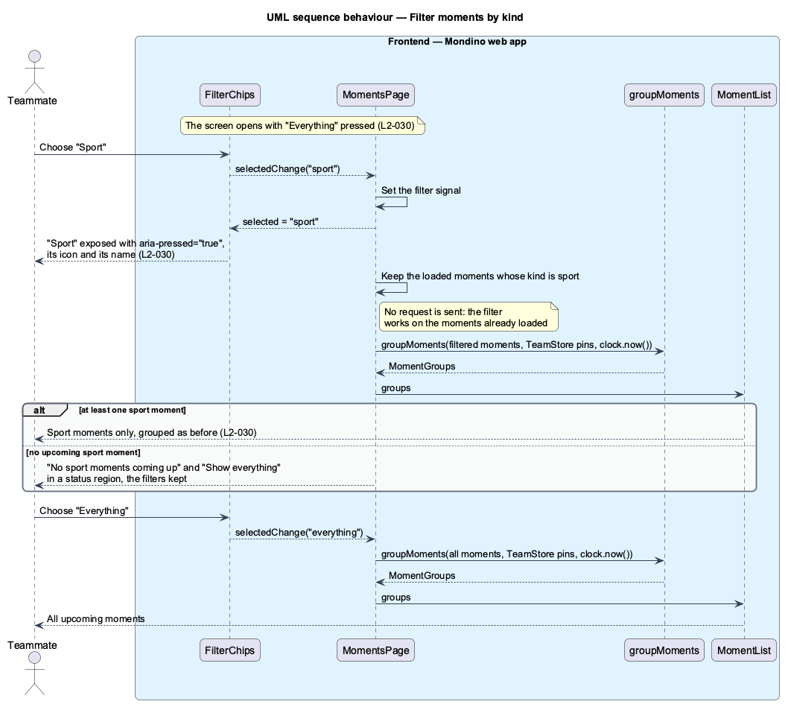

# List moments

## Overview

Mondino shows a team spread around the world, and what is happening where each teammate lives.
The Moments screen is one of Mondino's five screens. It gathers the whole team's upcoming
moments into one list, so a teammate sees what is coming up for the people they work with.

**moment** — something happening where a teammate lives, with a kind, a title, a date local to
that place and one line of detail

**kind** — one of the four categories of moment: holiday, Formula 1, local event or sport

The list is ordered by when each moment happens, and on one date west to east by teammate. A
moment today comes first and is the most prominent, headed "Today in" and its city. "This week" holds the moments 1 to 7 days ahead, and
"Later" those 8 to 90 days ahead. Each moment gives its kind, when it happens, its title, its
detail, and its teammate's first name and city. Choosing a moment opens the Globe screen with
that teammate's pin selected.

A row of filters narrows the list to one kind: Everything, Holiday, Formula 1, Local event or
Sport. The viewer's choice of which kinds mark pins on the globe (`mark-pins-with-moments`) does
not apply here: the Moments screen lists every kind.

"Today" is the date in the moment's own place. A moment dated 4 November in Melbourne is "today"
while it is 4 November in Melbourne, whatever the date is where the viewer sits.

## Description

The screen is a lazy route in the `mondino` application, a child of `TeamShell`, whose header
("Globe", "Team", "Moments", "Invite teammate") it shares. The backend supplies the moments
(`find-moments`); `TeamStore` holds them for every teammate screen, and the browser groups and
filters them.

- **`MomentsPage`** — page at `/moments`, loaded with `loadComponent` under `TeamShell` behind
  `teammateGuard`, headed "Moments" and "Holidays, races and local happenings where your teammates
  live." It sends no request of its own: it reads the moments and the pins from `TeamStore`, which
  read them once for the teammate screens. It holds the chosen filter in a signal, "everything" at
  first. A computed signal filters the moments by kind and passes them to `groupMoments` with
  `TeamStore`'s pins and the time of the screen's own `BrowserClock`. The computed signal reads the
  clock's minute tick, so a moment moves from "This week" to "Today", and off the list, at its place's
  midnight without a reload. The viewer's chosen kinds (`SETTINGS_STORE`, ADR 0020) are not read here:
  Moments lists every kind (L2-022).
- **`TeamStore.momentsState`** — `Loading`, `Ready` or `Failed`, beside `TeamStore.moments`; the Globe
  and Team ignore it, since a moment there is a highlight. **`TeamStore.loadMoments()`** reads them
  again, which "Try again" calls. The request is the store's, cancelled when the teammate leaves the
  teammate screens.
- **`TeamApi.getMoments(teamId, signal)`** / **`HttpTeamApi`** — contract and HTTP client in `api` for
  `GET /api/teams/{teamId}/moments`. A refusal arrives as an `ApiError` with a `code`.
- **`Moment`** — `api` type: kind, title, date, detail, emblem key, the teammate's id and name,
  the city's name and country code, and the city's time zone id. It carries no postal code, no
  position, and no initials or colour.
- **`groupMoments(moments, pins, now)`** — pure function in `domain`'s `moments/`. For each
  moment it works out the days ahead with `daysUntil`, from today in the moment's own time zone.
  It drops a moment before today or more than 90 days ahead, and a moment of someone no longer on
  the team. It returns `MomentGroups`: `today` (0 days), `thisWeek` (1 to 7 days) and `later` (8 to
  90 days), each in date order and, on one date, west to east by teammate: the order
  `orderWestToEast` (`pins/`) gives the pins of `TeamStore`, the Team screen's order.
- **`DatedMoment`** — a moment as a row shows it: its kind and the kind's name, its title and
  detail, its `when` label, its weekday, day and month ("Fri", "31", "Oct"), its teammate's id,
  first name, initials and colour, its city, and `who`, "Jordan · Austin". The first name is
  `firstName(name)` from `pins/`, the first word of the teammate's name; the initials and colour are
  those of the teammate's pin in `TeamStore`, found by the moment's teammate id.
- **`daysAheadLabel(daysAhead)`** — "Today", "Tomorrow" or "In 13 days", however far ahead.
  `MomentRow` shows it after the kind ("Local event · In 4 days"), beside the weekday, day and month.
  (The panel's and Team's `whenLabel` gives the date past a week; Moments has the date beside it.)
- **`FilterChips`** — presentation component. It renders the five filters as buttons in a group
  labelled "Filter by kind": "Everything" by its name, and each kind with its `MomentIcon` and
  its name. The chosen filter carries `aria-pressed="true"` and is
  styled through that attribute, with a mark that does not depend on colour. It emits the
  choice.
- **`MomentList`** — presentation component. It renders today's moments as `today-moment` cards,
  then the groups "This week" and "Later", and omits a group with no moments, heading and all. It
  emits a chosen moment's teammate.
- **Nothing to list** — with no moment at all the page shows no filter and, in the mocks'
  `empty` block, "Nothing coming up" and "No holidays, races or local events in the next 90
  days where your teammates live. We’ll add them here as they’re announced.", with "Back to
  the globe". With a kind chosen and no moment of it, the filters stay and a note in a
  `role="status"` region (`list-note`) names the kind: "No sport moments coming up" and "None
  of your teammates’ cities have one in the next 90 days.", with the button "Show everything",
  which returns the filter to Everything. The other kinds' titles are "No holiday moments coming
  up", "No Formula 1 moments coming up" and "No local event moments coming up".
- **`MomentRow`** — presentation component for one moment (`moment-row`): the date, kind icon
  and `when` label, title, detail, and the teammate's `Avatar` with their first name and city
  ("Jordan · Austin"). The prominent form (`today-moment`) is used for each moment today: "Today
  in" and its city, the kind ("Today in Dublin · Holiday"), the moment's large `Emblem`, title,
  detail and the teammate's first name ("Office closed in Ireland today · Liam"), and "On the
  globe". Title, detail and names are rendered as text, never as HTML. The whole row is one link
  to the Globe with the teammate selected, reachable by keyboard and at least 44 × 44 px.
- **`TeamStore`** — the page reads `pins` from it for the order and the avatars. When a moment
  is chosen, `MomentsPage` navigates to `/globe?teammate={teammateId}`, and the selection
  follows the address (`team/view-teammate-panel`).
- **`momentWindow(total, start)`** — pure function in `domain`'s `moments/` (ADR 0021). Up to 60
  moments, every row is in the page. Past 60 it gives the 60 moments from `start`, counted across
  today's cards and both groups, and how many lie before and after them. **`moveWindow(total,
  start, towards)`** moves the start 20 rows towards the top or the bottom, never past either end.
  The page watches a sentinel above and below the rows with one `IntersectionObserver` (800 px
  margin), moves the window when one comes near, and pads the list by the rows out of the window
  times the measured height of a row in it. The observer is disconnected when the page goes.
- **`TeamsController`**, **`GetMomentsQuery`**, **`GetMomentsQueryHandler`** — the backend
  endpoint and handler, described in `find-moments`. The handler returns the moments of the next
  90 days only for a teammate of the team.

A filter choice sends no request: it narrows the moments already loaded. The filter is not kept
between visits. The response is bounded by the 90-day window, and the rows in the page by
`momentWindow`, so a team of 500 has at most 60 rows in the page however far it is scrolled
(L2-047).

While the moments or the pins are being read the page is marked busy, draws the placeholder of
`moments/loading` and announces "Loading moments…". When either fails the page says "Moments didn’t
load" and "We couldn’t fetch holidays and events for your team. Check your connection and try
again.", with "Try again", which asks again, and "Back to the globe". A session that no longer has
the team says an invite link is needed, as on the Team screen.

## Requirements

The feature realises the following level-2 (L2) requirements. Each refines the level-1 (L1)
requirement cited by identifier.

| L2 ID | Refines (L1) | Requirement |
|-------|--------------|-------------|
| `L2-029` | `L1-010` | The Moments screen, "Holidays, races and local happenings where your teammates live.", lists the team's upcoming moments. A moment today is shown first and most prominently, "Today in" and its city; then "This week" (1 to 7 days ahead) and "Later" (8 to 90 days ahead), each in date order and, on one date, west to east by their teammate. Each moment gives its kind, when it happens, its title, its detail, and its teammate's first name and city. |
| `L2-030` | `L1-010` | The Moments screen is filtered by "Everything", "Holiday", "Formula 1", "Local event" or "Sport". |

## Diagrams

### System context

A teammate reads and filters the team's upcoming moments through Mondino, which reads them from
the calendar sources.

### Containers

The Mondino web app asks the Mondino API for the team's moments with one request. The API reads
the team from the Mondino database.

### Components

`MomentsPage` reads the moments `TeamStore` loaded through `HttpTeamApi`, groups them with
`groupMoments`, windows them with `momentWindow`, and passes the result to `MomentList`, which
renders each moment with `MomentRow`. `FilterChips` reports the chosen kind to the page.

### Class structure

`MomentsPage` depends on the `Clock` contract, on `TeamStore` (which depends on `TeamApi`) and on
`groupMoments` and `momentWindow`, which returns `MomentGroups` of `DatedMoment` values. `FilterChips`, `MomentList` and `MomentRow`
take inputs and emit outputs only.

### Behaviour — open the Moments screen

`TeamStore` loads the team's moments with one request for the teammate screens. `groupMoments` counts each moment's days
ahead from today in its own place, drops what falls outside 0 to 90 days, and sorts the rest
into today, this week and later, each in date order and then west to east (`L2-029`). Choosing a moment opens the Globe screen with its
teammate's pin selected.

### Behaviour — filter moments by kind

Choosing a filter narrows the loaded moments in the browser and regroups them; no request is
sent. The chosen filter is exposed as pressed. A kind with no upcoming moment shows a note,
"No sport moments coming up" for Sport, with "Show everything" (`L2-030`).

