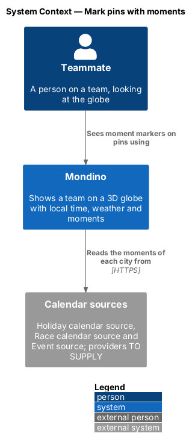
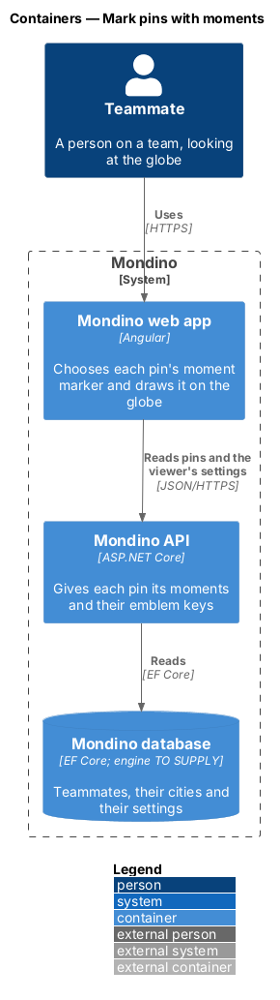
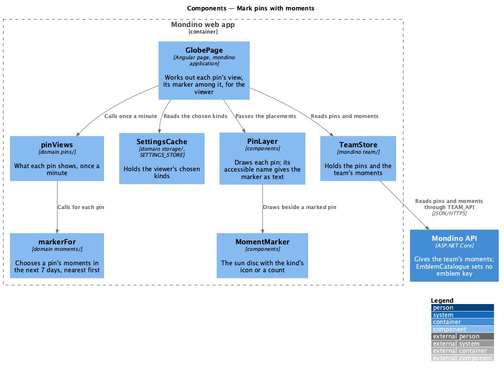
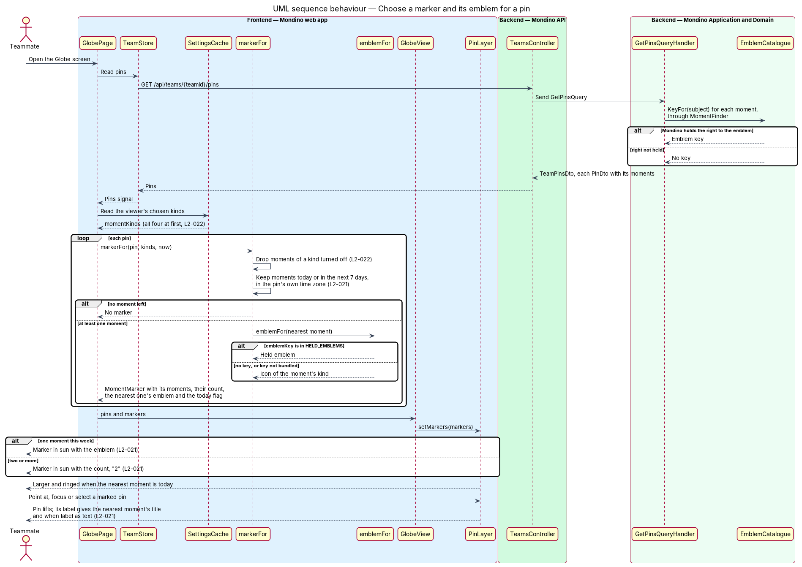

# Mark pins with moments

## Overview

Mondino shows a team on a 3D globe. Each teammate is a pin with their initials, local time and
weather. When something is happening where a teammate lives in the coming week, their pin
carries a small marker so the viewer notices it at a glance.

**moment** — something happening where a teammate lives, of one of four kinds: holiday,
Formula 1, local event or sport

**moment marker** — mark beside a pin, in the sun colour, showing that its teammate has a moment
today or in the next 7 days

**emblem** — picture inside a moment marker that says what the moment is

**count** — number a moment marker shows in place of an emblem when its teammate has two or
more moments this week

**viewer** — teammate looking at the globe

This feature decides, for each pin, whether it carries a moment marker, which moments the
marker stands for, and whether it shows an emblem, for one moment this week, or the count, for
two or more. A team's or a series' own logo is used only where Mondino
holds the right to use it. Everywhere else the marker shows Mondino's own icon for the kind, and
the moment's title names the team or race.

The viewer chooses which kinds of moment mark pins, in Profile & Settings. All four kinds are on
at first. The choice changes only the viewer's own globe. The Moments screen ignores it and
lists every kind.

The moments themselves come from the backend (`find-moments`). This feature is the browser-side
rule and the drawing of the marker.

## Description

The rule lives in `domain`'s `moments/`. The `globe` library draws the result and holds no rule.

- **`EmblemCatalogue`** — backend application service. It sets `Moment.EmblemKey` where Mondino
  holds the right to use the emblem of the moment's subject, and leaves it empty otherwise. The
  emblems Mondino holds the right to use are `<TO SUPPLY>`.
- **`Pin`** — `api` type. Each pin carries its `timeZoneId` and its teammate's `moments`.
- **`Settings.momentKinds`** — the viewer's chosen kinds. `ProfileApi` reads and saves them, and
  `SettingsCache` holds them in the browser for the next visit.
- **`markerFor(pin, kinds, now)`** — pure function. It drops the moments whose kind is not in
  `kinds`. It keeps the moments dated today or 1 to 7 days ahead, counted in the pin's own time
  zone by `daysUntil`. With none left it returns nothing. Otherwise it returns a `MomentMarker`
  holding the moments left, nearest first. `now` comes from the injected `Clock`.
- **`daysUntil(date, timeZoneId, now)`** — number of whole days from today in the given time
  zone to the date.
- **`emblemFor(moment)`** — pure function returning an `Emblem`. It returns the held emblem when
  the moment's `emblemKey` is in `HELD_EMBLEMS`, and the icon of the moment's kind otherwise.
- **`HELD_EMBLEMS`** — set of emblem keys whose pictures are bundled with the app. Its contents
  are `<TO SUPPLY>`. A key the backend sends that is not in the set falls back to the kind's
  icon. Emblem pictures are served with the app and never loaded from a third party.
- **`Emblem`** — `api` type: whether the picture is a held emblem or a kind's icon, its key and
  the kind.
- **`MarkedMoment`** — `api` type: a `moment` and its `when` label from `whenLabel` ("Today",
  "In 5 days").
- **`MomentMarker`** — `api` type: the `moments` of the window as `MarkedMoment`s, nearest
  first; the `emblem` of the nearest; the `count` of the moments; and a `today` flag, true
  when the nearest moment is today. The type sits in `api` so `globe` can read it without
  importing `domain`.
- **`GlobePage`** — page in the `mondino` application. A computed signal maps each teammate id
  to its marker from `TeamStore`'s pins, the chosen kinds and the clock's minute tick. The page
  passes the map to `GlobeView`.
- **`GlobeView`** — `mo-globe`. It takes the markers as an input beside the pins and hands them
  to `PinLayer`.
- **`PinLayer`** — draws each marker beside its pin in the sun colour, as the mocks'
  `moment-marker` block. When `count` is 1 the marker shows the emblem: the kind's icon, or a
  held emblem. When `count` is 2 or more it shows the count in figures and no emblem
  (`moment-marker--count`): Tomás, with Día de Muertos in 5 days and the Clásico Nacional in 6,
  carries "2". A marker whose nearest moment is today is larger and carries a ring
  (`moment-marker--today`), with an emblem or with a count. A marker is at least 16 px across
  at every globe size and sits clear of the pin's initials. A marker is not a control of its
  own: when its pin is pointed at, focused or selected and lifts, the label shows the nearest
  moment's title and `when` label as text ("Día de Muertos · In 5 days"). A group pin
  (`globe/show-pins`) carries no marker; its teammates' moments are in "This week around the
  world" and on each teammate's own pin once it is selected. `dispose()` releases what the
  layer created.
  The marker is in the pin's text too, and is hidden from assistive technology itself. The
  accessible name of the pin's button, built by `describePin` (`make-accessible`), ends with
  the moment's title and `when` label for one moment ("October Bank Holiday, today"), and for
  two or more with the count and each moment in turn: "2 moments this week: Día de Muertos, in
  5 days; Clásico Nacional, in 6 days". The count is therefore never given by the figure
  alone.
- **`GlobeFallback`** — draws the same markers beside the pins of the still picture
  (`globe/draw-globe`).

When the viewer turns a kind off, `markerFor` no longer sees moments of that kind. A pin whose
only moment this week is of that kind carries no marker. `WeekPanel` receives the same chosen
kinds, so the moment is absent from "This week around the world". A pin with two moments this
week, one of a kind turned off, carries the other's emblem and no count.

With every kind off, no pin carries a marker. In place of the week's moments the panel shows a
note (`panel__note`): "Every kind of moment is switched off", "Holidays, races, events and
sport won’t show on pins until you turn some back on." and the link "Choose moments", which
leads to Profile & Settings (`team/view-week-around-the-world`). The legend under the globe
then has no "Moment this week" item, since there is nothing for it to explain; "Night side",
"Teammates close together" and "Drag to spin" stay.

When two moments fall on the same day, the order between them is `<TO SUPPLY>`.

## Requirements

The feature realises the following level-2 (L2) requirements. Each refines the level-1 (L1)
requirement cited by identifier.

| L2 ID | Refines (L1) | Requirement |
|-------|--------------|-------------|
| `L2-021` | `L1-007` | A pin whose teammate has a moment today or in the next 7 days carries a moment marker beside it, in the sun colour. With one moment this week the marker shows an emblem for it, so it can be told at a glance: a race car for Formula 1, a team's emblem for a sport fixture, and so on. With two or more it shows how many there are. An emblem that belongs to someone else (a team's or a series' own logo) is used only where Mondino holds the right to use it; otherwise the marker shows Mondino's own icon for the kind and the title names the team or race. |
| `L2-022` | `L1-007` | The viewer chooses which kinds of moment mark pins on the globe, with four switches in Profile & Settings under "Moments on the globe": "Public holidays", "Formula 1 race weekends", "Local events and festivals" and "Big sporting days". All four kinds are on to begin with. The choice changes what the viewer sees and nothing for anyone else. |

## Diagrams

### System context

A teammate sees moment markers on the pins of the globe. Mondino reads the moments behind them
from the calendar sources.

### Containers

The Mondino API gives each pin its moments and their emblem keys. The Mondino web app chooses
each pin's marker and draws it.

### Components

`GlobePage` reads the pins from `TeamStore` and the chosen kinds from `SettingsCache`. It calls
`markerFor`, which calls `emblemFor`, and passes the markers to `GlobeView`. `PinLayer` draws
them, with an emblem or a count, and each pin's accessible name gives its marker as text.

### Class structure

`markerFor` reads a `Pin` and the chosen kinds and returns a `MomentMarker`, which holds its
`Moment`s, their count and the `Emblem` of the nearest. `GlobePage` passes the markers to `GlobeView`, and `PinLayer`
presents them.

### Behaviour — choose a marker and its emblem for a pin

The backend sets an emblem key only where the right is held. In the browser, `markerFor` drops
the kinds the viewer turned off (`L2-022`) and keeps the moments of the next 7 days, nearest
first (`L2-021`). `emblemFor` returns the held emblem or the icon of the kind. `PinLayer` draws
the emblem for one moment and the count for two or more. A pin with no moment left carries no
marker.

