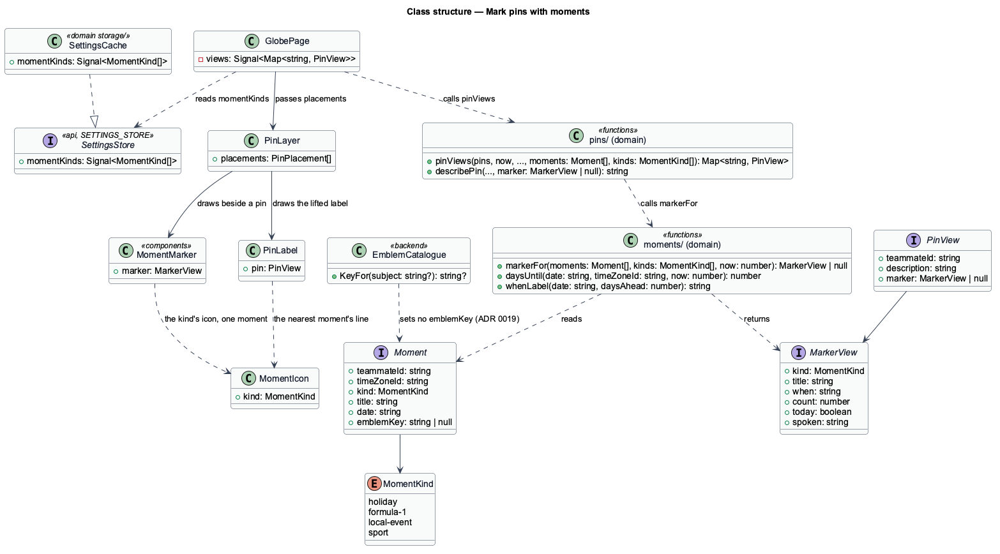

# Mark pins with moments

## Overview

Mondino shows a team on a 3D globe. Each teammate is a pin with their initials, local time and
weather. When something is happening where a teammate lives in the coming week, their pin
carries a small marker so the viewer notices it at a glance.

**moment** — something happening where a teammate lives, of one of four kinds: holiday,
Formula 1, local event or sport

**moment marker** — mark beside a pin, in the sun colour, showing that its teammate has a moment
today or in the next 7 days

**emblem** — picture inside a moment marker that says what the moment is

**count** — number a moment marker shows in place of an emblem when its teammate has two or
more moments this week

**viewer** — teammate looking at the globe

This feature decides, for each pin, whether it carries a moment marker, which moments the
marker stands for, and whether it shows an emblem, for one moment this week, or the count, for
two or more. A team's or a series' own logo is used only where Mondino
holds the right to use it. Everywhere else the marker shows Mondino's own icon for the kind, and
the moment's title names the team or race.

The viewer chooses which kinds of moment mark pins, in Profile & Settings. All four kinds are on
at first. The choice changes only the viewer's own globe. The Moments screen ignores it and
lists every kind.

The moments themselves come from the backend (`find-moments`). This feature is the browser-side
rule and the drawing of the marker.

## Description

The rule lives in `domain`'s `moments/`. The components draw the result and hold no rule.

- **`EmblemCatalogue`** — backend application service. It sets `Moment.EmblemKey` where Mondino
  holds the right to use the emblem of the moment's subject, and leaves it empty otherwise. Mondino
  holds the right to no emblem (ADR 0019), so it sets none, and the browser shows the kind's icon
  whatever key arrives. When an emblem is first held, the change that bundles its picture adds the
  set of held keys and the choice between them and the kind's icon.
- **`Moment`** — `api` type (`find-moments`). A pin carries no moments; its teammate's are
  `TeamStore.moments` with its `teammateId`.
- **`SettingsStore`** — `api` contract and `SETTINGS_STORE` injection token: the viewer's chosen
  kinds, `momentKinds`, as a signal, all four to begin with. The teammate screens read it; the
  token is bound by `TeamShell`, so its code stays out of the initial bundle (ADR 0020).
- **`SettingsCache`** — `domain`'s `storage/`, the `SettingsStore` kept in the browser's local
  storage under `mondino.settings` with the viewer's teammate id (ADR 0020). It reads the kinds
  kept for the teammate the membership names and drops any it does not know; with nothing kept,
  or storage blocked, all four kinds are on. Profile & Settings (`choose-display-and-sharing`)
  writes it on a save and replaces it with the backend's copy once a profile is read.
- **`ALL_MOMENT_KINDS`** — `api` constant: the four kinds, in the order the switches list them.
- **`markerFor(moments, kinds, now)`** — pure function over one teammate's moments. It drops the
  moments whose kind is not in `kinds`. It keeps the moments dated today or 1 to 7 days ahead,
  counted in each moment's own place by `daysUntil`. With none left it returns null. Otherwise it
  returns a `MarkerView` of the moments left, nearest first, and on the same day by title.
- **`MarkerView`** — `api` type: the nearest moment's `kind`, `title` and `when` label from
  `whenLabel` ("Today", "In 5 days"); the `count` of the moments; a `today` flag, true when the
  nearest moment is today; and `spoken`, the words the pin's accessible name ends with. It sits in
  `api` so the components can read it without importing `domain`.
- **`PinView.marker`** — `pinViews` (`globe/show-pins`) takes the team's moments and the chosen
  kinds and gives each pin its `MarkerView`, or null, in the same pass as its local time, once a
  minute. The moments are grouped by teammate once, so a team of 500 is one pass over its pins
  and one over its moments.
- **`GlobePage`** — page in the `mondino` application. It reads the moments from `TeamStore`,
  the chosen kinds from `SETTINGS_STORE` and the minute from the one clock, and passes them to
  `pinViews`. The pins, with their markers, go to `PinLayer` over the 3D globe and over the
  still picture alike.
- **`MomentMarker`** — `components`, `span[mo-moment-marker]`, the design system's
  `moment-marker` block, drawn inside the pin's button after the initials. With a `count` of 1 it
  shows the kind's icon (`MomentIcon`). With 2 or more it shows the count in figures and no icon
  (`moment-marker--count`): Tomás, with Día de Muertos in 5 days and the Clásico Nacional in 6,
  carries "2". A marker whose nearest moment is today is larger and carries an ink ring
  (`moment-marker--today`), with an icon or with a count. It is 16 px across, 20 px today, at
  every globe size, and on a globe under 500 px it moves further out so it is clear of the pin.
  It is hidden from assistive technology and is not a control of its own.
- **`PinLayer`** — draws a pin's `MomentMarker` when its view has one. A group pin
  (`globe/show-pins`) carries no marker; its teammates' moments are in "This week around the
  world" and on each teammate's own pin once it is selected.
- **`PinLabel`** — a lifted label of a marked pin ends with the nearest moment's line
  (`pin-label__moment`): the kind's icon and the title and `when` label as one text, "Día de
  Muertos · In 5 days".
- **`describePin`** — the accessible name of the pin's button (`make-accessible`) ends with the
  marker's `spoken` words: for one moment its title and `when` label, "October Bank Holiday,
  today"; for two or more the count and each moment in turn, "2 moments this week: Día de
  Muertos, in 5 days; Clásico Nacional, in 6 days". The count is therefore never given by the
  figure alone.

When the viewer turns a kind off, `markerFor` no longer sees moments of that kind. A pin whose
only moment this week is of that kind carries no marker. `GlobePage` gives `weekMoments` only the
moments of the chosen kinds, so the moment is absent from "This week around the world". A pin with
two moments this week, one of a kind turned off, carries the other's icon and no count. The
Moments screen (`list-moments`) does not read the chosen kinds and lists every kind.

With every kind off, no pin carries a marker. In place of the week's lead, its moments and "All
moments", `WeekPanel` shows a note (`panel__note`): "Every kind of moment is switched off",
"Holidays, races, events and sport won’t show on pins until you turn some back on." and the link
"Choose moments", which leads to Profile & Settings (`/profile`). `GlobeLegend` then has no
"Moment this week" item, since there is nothing for it to explain; "Night side", "Teammates close
together" and "Drag to spin" stay.

When two moments of one teammate fall on the same day, they are ordered by title, so the marker,
the label and the accessible name read the same on every visit.

## Requirements

The feature realises the following level-2 (L2) requirements. Each refines the level-1 (L1)
requirement cited by identifier.

| L2 ID | Refines (L1) | Requirement |
|-------|--------------|-------------|
| `L2-021` | `L1-007` | A pin whose teammate has a moment today or in the next 7 days carries a moment marker beside it, in the sun colour. With one moment this week the marker shows an emblem for it, so it can be told at a glance: a race car for Formula 1, a team's emblem for a sport fixture, and so on. With two or more it shows how many there are. An emblem that belongs to someone else (a team's or a series' own logo) is used only where Mondino holds the right to use it; otherwise the marker shows Mondino's own icon for the kind and the title names the team or race. |
| `L2-022` | `L1-007` | The viewer chooses which kinds of moment mark pins on the globe, with four switches in Profile & Settings under "Moments on the globe": "Public holidays", "Formula 1 race weekends", "Local events and festivals" and "Big sporting days". All four kinds are on to begin with. The choice changes what the viewer sees and nothing for anyone else. |

## Diagrams

### System context

A teammate sees moment markers on the pins of the globe. Mondino reads the moments behind them
from the calendar sources.

### Containers

The Mondino API gives each pin its moments and their emblem keys. The Mondino web app chooses
each pin's marker and draws it.

### Components

`GlobePage` reads the pins and moments from `TeamStore` and the chosen kinds from
`SETTINGS_STORE`, which `SettingsCache` keeps. `pinViews` calls `markerFor` for each pin, and
`PinLayer` draws each marker with `MomentMarker`, with the kind's icon or a count; each pin's
accessible name gives its marker as text.

### Class structure

`markerFor` reads a teammate's `Moment`s and the chosen kinds and returns a `MarkerView`: the
nearest moment's kind, title and when, the count and the today flag. `pinViews` puts it on the
`PinView`, and `PinLayer` presents it with `MomentMarker`.

### Behaviour — choose a marker and its emblem for a pin

The backend sets an emblem key only where the right is held, which is nowhere (ADR 0019). In
the browser, `markerFor` drops the kinds the viewer turned off (`L2-022`) and keeps the moments of
the next 7 days, nearest first (`L2-021`). `MomentMarker` draws the kind's icon for one moment and
the count for two or more. A pin with no moment left carries no marker.

