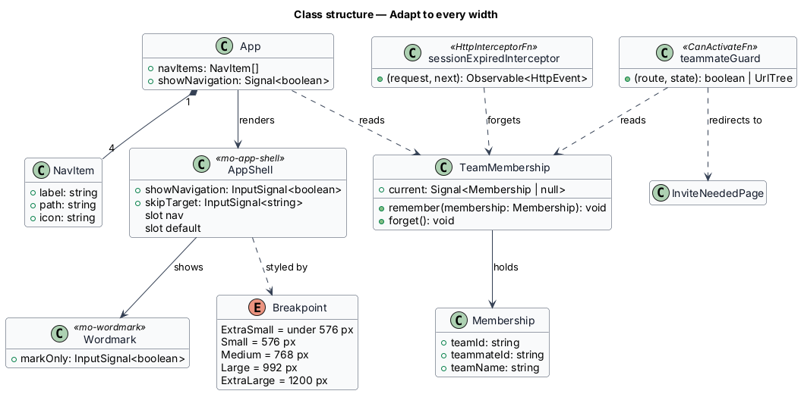
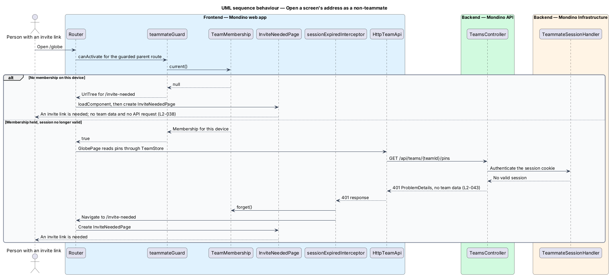

# Adapt to every width

## Overview

Mondino is where a team spread around the world sees each other: each teammate is a pin on a 3D
globe, with their local time, weather and moments. It is one responsive web application, used
on a phone, a tablet, a desktop and a large screen. This feature covers what every screen
shares so that it works at each of those widths: the shell around the screens, the navigation
between them, the rule each screen's layout follows, and what happens when a screen's address
is opened directly.

The terms used below:

- **breakpoint** — viewport width at which a layout changes: 576 px, 768 px, 992 px and 1200 px
- **shell** — header, navigation and content area that surround every screen
- **teammate screen** — one of Globe, Team, Moments and Profile & Settings, shown only to a teammate
- **membership** — record on the device that it has joined a team: the team's id, the teammate's id and the team's name

A teammate reaches Globe, Team, Moments and Profile & Settings from every screen after joining.
A person who is not a teammate of any team on the device and opens one of those addresses is
shown that an invite link is needed, and no team's data. The backend, not the browser, decides
who is a teammate; the browser's check is a convenience that saves a request
(`protect-team-data`, L2-043).

The mocks in `docs/mocks/` are the source of truth for each layout. This design fixes the
mechanism the layouts use, not their appearance.

## Description

The feature lives in the `Mondino web app`, in the `mondino` application and the `components`
and `domain` libraries. The `Mondino API` takes part only by answering a teammate screen's
requests.

**Routes.** `app.routes.ts` in the `mondino` application declares one route per screen, each
with `loadComponent`, so each screen is its own chunk.

| Address | Component | Guarded |
|---------|-----------|---------|
| `/join/:inviteToken` | `JoinPage` | no |
| `/globe` | `GlobePage` | yes |
| `/team` | `TeamPage` | yes |
| `/moments` | `MomentsPage` | yes |
| `/profile` | `ProfilePage` | yes |
| `/left` | `LeftPage` | no |
| `/invite-needed` | `InviteNeededPage` | no |

The four teammate screens are children of one pathless parent route. The parent carries
`canActivate: [teammateGuard]` and provides `TeamStore`, so the team's pins are shared by the
four screens and released when the teammate leaves them. The empty address redirects to
`/globe`. The router uses path addresses, so an address that is opened directly or reloaded
shows its screen and the browser's back button returns to the previous screen (L2-038). The
host that serves the app shall answer each of these addresses with the app's `index.html`; the
hosting platform is `<TO SUPPLY>`.

**`teammateGuard`** — `CanActivateFn` in the `mondino` application. It reads
`TeamMembership.current()`. With a membership it returns `true`. Without one it returns a
`UrlTree` for `/invite-needed`, and no request is sent to the `Mondino API`.

**`TeamMembership`** — service in `domain`'s `storage/`. It holds a `Membership` (`teamId`,
`teammateId`, `teamName`) in the browser's local storage and exposes it as the signal
`current`. `JoinPage` calls `remember(...)` after a successful join, and leaving the team calls
`forget()`. It holds no postal code, no position and no session: the session is an `HttpOnly`
cookie that scripts cannot read (L2-043). How a teammate signs in again on another device is
`<TO SUPPLY>`.

**`sessionExpiredInterceptor`** — `HttpInterceptorFn` bound in `app.config.ts`. When the
`Mondino API` answers 401, it calls `TeamMembership.forget()` and navigates to
`/invite-needed`. A membership that outlives its session therefore leads to the same screen as
no membership.

**`InviteNeededPage`** — lazy route component. It says that an invite link is needed to see a
team. It reads no API and shows no team's name or data.

**`App`** — root component of the `mondino` application. It renders `mo-app-shell` and the
router outlet. It holds the four `NavItem`s (Globe, Team, Moments, Profile & Settings) and
projects one link per item into the shell's `nav` slot. Each link is an anchor with
`routerLink` and `ariaCurrentWhenActive="page"`, so the current screen carries
`aria-current="page"`. `App` sets `showNavigation` from `TeamMembership.current()`, so the Join
screen, `LeftPage` and `InviteNeededPage` show the header without navigation.

**`AppShell`** (`mo-app-shell`) — presentation component in `components`. It renders the
header with `Wordmark`, the `nav` slot inside a `nav` landmark, and the default slot inside
`main`. It injects no router and no service. Its stylesheet places the navigation by
breakpoint: under 576 px the navigation is a bar within reach of a thumb, and each target is at
least 44 × 44 px; from 576 px it sits in the header. The placement at each width is drawn in
`docs/mocks/`.

**`Wordmark`** (`mo-wordmark`) — presentation component in `components`. It renders the mark
and the lowercase wordmark "mondino" in Gabarito. Its own stylesheet hides the word under
576 px, so the header on a phone shows the mark alone. The input `markOnly` shows the mark
alone at every width.

**Layouts.** Each screen's layout is decided by CSS in that component's own stylesheet, written
for one column first and extended with `min-width` media queries at the breakpoints. The
breakpoints are Sass variables in the global foundations, since a CSS custom property cannot be
read in a media query. No component reads the viewport width in TypeScript, and no template
branches on it. One component instance therefore serves every width, and turning a phone from
upright to sideways keeps the selected pin, any filter and anything typed (L2-037).

| Screen | Under the breakpoint | From the breakpoint |
|--------|----------------------|---------------------|
| Join | under 576 px: form above the globe, one column | 992 px: form beside the globe |
| Globe | under 992 px: heading, globe, then panel, one scrolling column | 992 px: panel to the right of the globe, scrolling on its own |
| Team | under 768 px: name, local time with city and offset, next moment | 768 px: `TeamTable` with all its columns |
| Profile & Settings | under 992 px: the pin's card above the settings | 992 px: the pin's card beside the settings, kept in view |

From 1200 px, text columns are capped in width and centred, and the Globe screen's globe grows
to fill the space. The Team screen under 768 px hides columns with CSS; it does not render a
second component. Each layout uses flexible tracks and `min-width: 0` on its children so that
nothing overflows sideways from 320 px upward.

## Requirements

The feature realizes the following level-2 (L2) requirements. Each L2 requirement refines a
level-1 (L1) requirement, cited by identifier.

| L2 ID | Refines (L1) | Requirement |
|-------|--------------|-------------|
| `L2-037` | `L1-012` | Each screen has a one-column layout on a phone and uses the width it is given on a tablet and a desktop. Nothing is cut off and the page never scrolls sideways, from 320 px wide upward. |
| `L2-038` | `L1-012` | Globe, Team, Moments and Profile & Settings are reachable from every screen after joining. The header carries the lowercase wordmark **mondino**; on a phone it shows the mark without the wordmark. |

## Diagrams

### System context

A teammate opens Mondino at any width. A person who is not yet a teammate and opens a
screen's address is shown that an invite link is needed.

### Containers

The shell, the navigation, the lazy routes and each screen's layout are in the
`Mondino web app`. The `Mondino API` answers a teammate screen's requests for a teammate's
session only.

### Components

`app.routes.ts` runs `teammateGuard` before a teammate screen and loads the screen's chunk.
`App` renders `AppShell` with the navigation links. `teammateGuard`, `App` and
`sessionExpiredInterceptor` all read or clear `TeamMembership`.

### Class structure

`App` composes four `NavItem`s and renders `AppShell`, which shows `Wordmark` and is styled by
the breakpoints. `teammateGuard` and `sessionExpiredInterceptor` depend on `TeamMembership`,
which holds one `Membership`.

### Behaviour — open a screen's address as a teammate

The teammate opens or reloads `/team`. `teammateGuard` finds a membership, the router loads
`TeamPage`, and the navigation marks Team with `aria-current="page"` (L2-038). The screen
reads its pins with the session cookie and shows them in the layout for the current width
(L2-037).

### Behaviour — open a screen's address as a non-teammate

With no membership on the device, `teammateGuard` redirects to `InviteNeededPage` and no
request reaches the `Mondino API` (L2-038). With a membership whose session is no longer valid,
the API answers 401 with no team data (L2-043), and `sessionExpiredInterceptor` forgets the
membership and shows the same screen.

