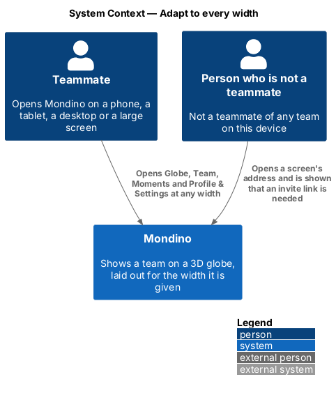

# Adapt to every width

## Overview

Mondino is where a team spread around the world sees each other: each teammate is a pin on a 3D
globe, with their local time, weather and moments. It is one responsive web application, used
on a phone, a tablet, a desktop and a large screen. This feature covers what every screen
shares so that it works at each of those widths: the shell around the screens, the navigation
between them, the rule each screen's layout follows, and what happens when a screen's address
is opened directly.

The terms used below:

- **breakpoint** — viewport width at which a layout changes: 576 px, 768 px, 992 px and 1200 px
- **shell** — what surrounds the four teammate screens: the header with its navigation, the refresh banner and the toast
- **teammate screen** — one of Globe, Team, Moments and Profile & Settings, shown only to a teammate
- **membership** — record on the device that it has joined a team: the team's id, the teammate's id, the team's name, and the initials and colour of the teammate's own pin

A teammate reaches Globe, Team, Moments and Profile & Settings from every screen after joining.
A person who is not a teammate of any team on the device and opens one of those addresses is
shown, at that address, that an invite link is needed, and no team's data. An address that
belongs to no screen says so. The backend, not the browser, decides
who is a teammate; the browser's check is a convenience that saves a request
(`protect-team-data`, L2-043).

The mocks in `docs/mocks/` are the source of truth for each layout. This design fixes the
mechanism the layouts use, not their appearance.

## Description

The feature lives in the `Mondino web app`, in the `mondino` application and the `components`
and `domain` libraries. The `Mondino API` takes part only by answering a teammate screen's
requests.

**Routes.** `app.routes.ts` in the `mondino` application declares one route per screen, each
with `loadComponent`, so each screen is its own chunk.

| Address | Component | Guarded |
|---------|-----------|---------|
| `/join/:inviteToken` | `JoinPage` | no |
| `/globe` | `GlobePage` | yes |
| `/team` | `TeamPage` | yes |
| `/moments` | `MomentsPage` | yes |
| `/profile` | `ProfilePage` | yes |
| `/left` | `LeftPage` | no |
| `**` | `NotFoundPage` | no |

The four teammate screens are children of one pathless parent route, whose component is
`TeamShell`. The parent carries `canMatch: [teammateGuard]` and `TeamShell` provides
`TeamStore`, so the team's pins are shared by the four screens and released when the teammate
leaves them. The parent has a last child, `**`, which loads `NotFoundPage`, so a teammate who
opens an address that belongs to no screen keeps the header and its navigation, as the mock
draws. A second pathless parent follows it with the same four addresses, each loading
`InviteNeededPage`; the router falls through to it when the guard refuses the first, so the
address stays as it was opened, and any other address then reaches the last `**` route. The empty address
redirects to `/globe`. The router uses path addresses, so an address that is opened directly or reloaded
shows its screen and the browser's back button returns to the previous screen (L2-038). The
host that serves the app shall answer each of these addresses with the app's `index.html`; the
hosting platform is `<TO SUPPLY>`.

**`teammateGuard`** — `CanMatchFn` in the `mondino` application. It reads
`TeamMembership.current()`. With a membership it returns `true`. Without one it returns
`false`, the same address shows `InviteNeededPage`, and no request is sent to the
`Mondino API`.

**`TeamMembership`** — service in `domain`'s `storage/`. It holds a `Membership`, a type in `@mondino/api` (`teamId`,
`teammateId`, `teamName`, and the viewer's `initials` and `colour`) in the browser's local
storage and exposes it as the signal `current`. `JoinPage` calls `remember(membership)` after
a successful join, with the colour the `JoinResult` returns (`join-team`), and when an
invite link answers `AlreadyJoined`, with the `Membership` the `InviteDto` then carries
(`open-invite-link`), so a browser that holds a session and no membership gets it back by
opening the team's invite link; `TeamShell` calls
`remember(membership)` again with the initials and colour of the viewer's pin whenever the
pins are read; and leaving the team and `sessionExpiredInterceptor` call `forget()`. It holds no postal code, no city, no
position and no session: the session is an `HttpOnly`
cookie that scripts cannot read (L2-043). How a teammate signs in again on another device is
`<TO SUPPLY>`.

**`sessionExpiredInterceptor`** — `HttpInterceptorFn` bound in `app.config.ts`. When the
`Mondino API` answers 401, it calls `SettingsStore.clear()`, which also clears `SettingsCache`,
and `TeamMembership.forget()`, as leaving the team does (`profile/leave-team`), and navigates
to the current address again, which now shows `InviteNeededPage`. A session that has ended
leaves nothing of the team in the browser, and a membership that outlives its session
therefore leads to the same screen as no membership.

**`InviteNeededPage`** — lazy route component. It says "You need an invite link" and that a
teammate can give their team's. It reads no API and shows no team's name or data. It renders
`mo-app-header` without navigation.

**`NotFoundPage`** — lazy route component for an address that belongs to no screen. It says
"This page isn’t on the map" and links back to the globe. It reads no API. Inside `TeamShell`
it sits under the shell's header; for a person with no membership it renders `mo-app-header`
without navigation itself.

**`App`** — root component of the `mondino` application. It renders the "Skip to content"
link, which is the first focusable element of every screen, and the router outlet, and nothing
else. Each screen renders its own `main`, which is the skip link's target.

**`TeamShell`** — route component of the guarded parent route, in the `mondino` application.
It provides `TeamStore` and `InviteLinkCopier`, calls `TeamStore.load(teamId)` once, when it
is created, with the `teamId` of the `Membership` (no page calls `load` except through "Try
again"), and renders `mo-app-header`, the refresh banner (`keep-team-fresh`),
the router outlet that holds Globe, Team, Moments and Profile & Settings, and the toast. The
banner and the toast are therefore the same on all four screens and are not rendered by a
page. `TeamShell` holds the three `NavItem`s (Globe, Team, Moments) and projects one link per
item into the header's `nav` slot, and
the link to Profile & Settings, the viewer's avatar with the accessible name "Profile &
Settings", into its `me` slot. Each link is an anchor with `routerLink` and
`ariaCurrentWhenActive="page"`, so the current screen carries `aria-current="page"`. The
avatar's initials and colour come from the `Membership`, so the avatar shows while the pins
are loading and when their read has failed, as the mocks draw. An effect on
`TeamStore.viewerPin` keeps the membership's initials (`initialsOf(pin.name)`) and colour in
step with the pin. On the header's
`invite` output `TeamShell` calls `InviteLinkCopier.copy()`, which copies the team's invite
link, and shows the toast (`view-week-around-the-world`, L2-025).

**`AppHeader`** (`mo-app-header`) — presentation component in `components`; its block is
`app-header`. It renders the header with `Wordmark`, the `nav` slot inside a `nav` landmark
named "Primary", and, at the header's end (`app-header__actions`), its own "Invite teammate"
button (`app-header__invite`), which the mocks draw from 768 px and which emits the output
`invite`, and the `me` slot. It injects no router
and no service. The navigation sits in the header at every width, and each target is at least
44 × 44 px; under 360 px the header's gaps and the options' padding tighten, so the three
options and the avatar fit at 320 px. With the input `showNavigation` the mark and wordmark
link to the Globe; without it the header is the mocks' `app-header--bare`, which shows the
mark and wordmark alone, not as a link, with no "Invite teammate" button. `LeftPage` and `InviteNeededPage` render it that way.
The Join screen shows no header and carries the mark and wordmark at the top of its form.

**`Wordmark`** (`mo-wordmark`) — presentation component in `components`. It renders the mark
and the lowercase wordmark "mondino" in Gabarito. With the input `collapses` set, as in the
header with navigation, its own stylesheet hides the word under 576 px, so that header on a
phone shows the mark alone. Without it, as in the header without navigation and on the Join
screen, the word shows at every width.

**Layouts.** Each screen's layout is decided by CSS in that component's own stylesheet, written
for one column first and extended with `min-width` media queries at the breakpoints. The
breakpoints are Sass variables in the global foundations, since a CSS custom property cannot be
read in a media query. No component reads the viewport width in TypeScript, and no template
branches on it. One component instance therefore serves every width, and turning a phone from
upright to sideways keeps the selected pin, any filter and anything typed (L2-037).

| Screen | Under the breakpoint | From the breakpoint |
|--------|----------------------|---------------------|
| Join | under 992 px: form above the globe, one column | 992 px: form beside the globe |
| Globe | under 992 px: globe, then panel, one scrolling column; the heading is above the globe under 576 px and over its top corner from 576 px | 992 px: panel to the right of the globe, scrolling on its own |
| Team | under 768 px: name, status, local time with city and offset, next moment | 768 px: `TeamTable` with all its columns |
| Profile & Settings | under 992 px: the pin's card above the settings | 992 px: the pin's card beside the settings, kept in view |

From 1200 px, text columns are capped in width and centred, and the Globe screen's globe grows
to fill the space. The Team screen under 768 px hides columns with CSS; it does not render a
second component. Each layout uses flexible tracks and `min-width: 0` on its children so that
nothing overflows sideways from 320 px upward.

## Requirements

The feature realizes the following level-2 (L2) requirements. Each L2 requirement refines a
level-1 (L1) requirement, cited by identifier.

| L2 ID | Refines (L1) | Requirement |
|-------|--------------|-------------|
| `L2-037` | `L1-012` | Each screen has a one-column layout on a phone and uses the width it is given on a tablet and a desktop. Nothing is cut off and the page never scrolls sideways, from 320 px wide upward. |
| `L2-038` | `L1-012` | Globe, Team, Moments and Profile & Settings are reachable from every screen after joining. The header carries the lowercase wordmark **mondino**; on a phone it shows the mark without the wordmark. |

## Diagrams

### System context

A teammate opens Mondino at any width. A person who is not yet a teammate and opens a
screen's address is shown that an invite link is needed.

### Containers

The shell, the header, the lazy routes and each screen's layout are in the
`Mondino web app`. The `Mondino API` answers a teammate screen's requests for a teammate's
session only.

### Components

`app.routes.ts` runs `teammateGuard` to match a teammate screen and loads the screen's chunk.
`TeamShell` provides `TeamStore` and renders `AppHeader` with the navigation links, the
viewer's avatar from `TeamMembership`, the refresh banner and the toast around the four
screens. `teammateGuard` reads `TeamMembership`; `sessionExpiredInterceptor` clears it, and
`SettingsStore` with it.

### Class structure

`TeamShell` composes three `NavItem`s and renders `AppHeader`, which shows `Wordmark` and is
styled by the breakpoints. `teammateGuard`, `sessionExpiredInterceptor` and `TeamShell` depend on
`TeamMembership`, which holds one `Membership` with the viewer's initials and colour;
`sessionExpiredInterceptor` also clears `SettingsStore`.

### Behaviour — open a screen's address as a teammate

The teammate opens or reloads `/team`. `teammateGuard` finds a membership, the router loads
`TeamPage`, and the navigation marks Team with `aria-current="page"` beside the avatar drawn
from the membership (L2-038). `TeamShell`
reads the pins once, with the session cookie, and the screen shows them in the layout for the current width
(L2-037).

### Behaviour — open a screen's address as a non-teammate

With no membership on the device, `teammateGuard` refuses the match, the same address shows
`InviteNeededPage` and no request reaches the `Mondino API` (L2-038). With a membership whose session is no longer valid,
the API answers 401 with no team data (L2-043), and `sessionExpiredInterceptor` clears the
settings, forgets the membership and shows the same screen.

