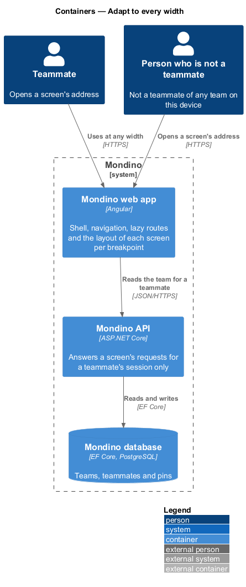
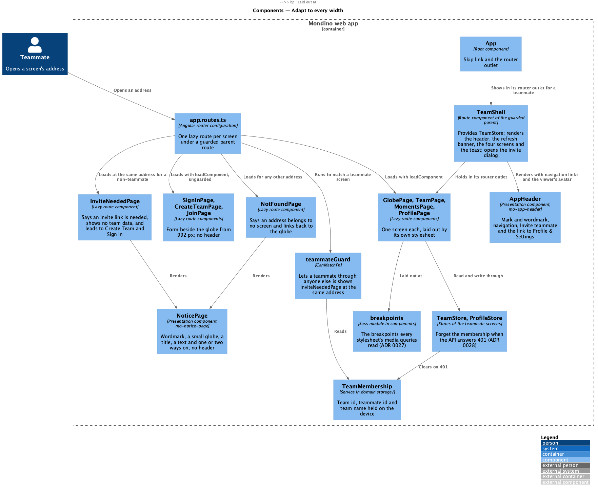
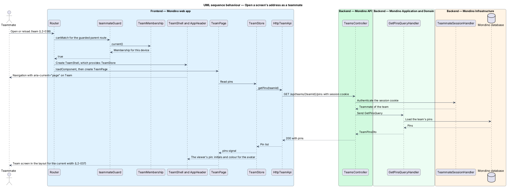

# Adapt to every width

## Overview

Mondino is where a team spread around the world sees each other: each teammate is a pin on a 3D
globe, with their local time, weather and moments. It is one responsive web application, used
on a phone, a tablet, a desktop and a large screen. This feature covers what every screen
shares so that it works at each of those widths: the shell around the screens, the navigation
between them, the rule each screen's layout follows, and what happens when a screen's address
is opened directly.

The terms used below:

- **breakpoint** — viewport width at which a layout changes: 576 px, 640 px, 768 px, 992 px, 1024 px and 1200 px (ADR 0027)
- **shell** — what surrounds the four teammate screens: the header with its navigation, the refresh banner and the toast
- **teammate screen** — one of Globe, Team, Moments and Profile & Settings, shown only to a teammate
- **membership** — record on the device that it has joined a team: the team's id, the teammate's id and the team's name

A teammate reaches Globe, Team, Moments and Profile & Settings from every screen after joining,
and "Invite teammate" from the header of each. A person who is not a teammate of any team on
the device and opens one of those addresses is shown, at that address, that an invite link is
needed, and no team's data. An address that belongs to no screen says so. Join, Sign In,
Create Team and the pages that say one thing show no header; each carries the mark and
wordmark itself. The backend, not the browser, decides
who is a teammate; the browser's check is a convenience that saves a request
(`protect-team-data`, L2-043).

The mocks in `docs/mocks/` are the source of truth for each layout. This design fixes the
mechanism the layouts use, not their appearance.

## Description

The feature lives in the `Mondino web app`, in the `mondino` application and the `components`
and `domain` libraries. The `Mondino API` takes part only by answering a teammate screen's
requests.

**Routes.** `app.routes.ts` in the `mondino` application declares one route per screen, each
with `loadComponent`, so each screen is its own chunk.

| Address | Component | Guarded |
|---------|-----------|---------|
| `/join/:inviteToken` | `JoinPage` | no |
| `/sign-in` | `SignInPage` | no |
| `/new` | `CreateTeamPage` | no |
| `/globe` | `GlobePage` | yes |
| `/team` | `TeamPage` | yes |
| `/moments` | `MomentsPage` | yes |
| `/profile` | `ProfilePage` | yes |
| `/left` | `LeftPage` | no |
| `**` | `NotFoundPage` | no |

The four teammate screens are children of one pathless parent route, whose component is
`TeamShell`. The parent carries `canMatch: [teammateGuard]` and `TeamShell` provides
`TeamStore`, so the team's pins are shared by the four screens and released when the teammate
leaves them. A second pathless parent follows it with the same four addresses, each loading
`InviteNeededPage`; the router falls through to it when the guard refuses the first, so the
address stays as it was opened. Any other address reaches the last `**` route, which loads
`NotFoundPage` for a teammate and for anyone else alike, with no header, as the mock draws. The empty address
redirects to `/globe`. The router uses path addresses, so an address that is opened directly or reloaded
shows its screen and the browser's back button returns to the previous screen (L2-038). The
host that serves the app shall answer each of these addresses with the app's `index.html`; the
hosting platform is `<TO SUPPLY>`.

**`teammateGuard`** — `CanMatchFn` in the `mondino` application. It reads
`TeamMembership.current()`. With a membership it returns `true`. Without one it returns
`false`, the same address shows `InviteNeededPage`, and no request is sent to the
`Mondino API`.

**`TeamMembership`** — service in `domain`'s `storage/`. It holds a `Membership` (`teamId`,
`teammateId`, `teamName`) in the browser's local storage and exposes it as the signal
`current`. `JoinPage` calls `remember(...)` after a successful join, `CreateTeamPage` once the
team is made (`make-team`) and `SignInPage` once an emailed link is opened (`sign-in`); leaving
the team calls `forget()`. It holds no postal code, no email, no position and no session: the
session is an `HttpOnly` cookie that scripts cannot read (L2-043).

**An ended session** (ADR 0028) — there is no interceptor: the clients call `fetch` (ADR 0005).
Each store that speaks for the teammate decides on a 401 itself. `TeamStore` forgets the
membership when the pins are refused with 401 or 404 and enters `Forgotten`; Globe, Team and
Moments then navigate to their own address again, replacing it, which now shows
`InviteNeededPage`. `ProfileStore` does the same when reading the profile, saving or leaving is
refused with 401: it discards the draft first, so `unsavedChangesGuard` does not ask "Leave
without saving?", clears `SETTINGS_STORE`, calls `TeamMembership.forget()` and navigates to
`/profile` again; an open "Leave Northwind?" closes with the page. A membership that outlives its
session therefore leads to the same screen as no membership.

**`NoticePage`** (`mo-notice-page`, block `notice-page`) — presentation component in
`components` for a page that says one thing: the mark and wordmark, a small still picture of
the globe (`GlobeFallback` in `notice-page__art`, named "A small globe"), a title
(`notice-page__title`), one text (`notice-page__text`) and an actions slot
(`notice-page__actions`) for one or two ways on. The text is the inputs `lead`, `emphasis`
(in strong) and `rest`, all rendered as text. It renders the screen's `main`, and no header,
and loads no renderer. `InviteNeededPage`, `NotFoundPage` and
`LeftPage` (`leave-team`) render it.

**`InviteNeededPage`** — lazy route component. Its title reads "You need an invite link". Its
text reads "Mondino teams are invite-only, and **sofia@northwind.co** isn’t on one yet. Ask a
teammate to send you their team’s link — it opens straight onto the globe.", with the email
that `SignInPage` passed in the navigation state rendered as text (`sign-in`). With no email
known, the sentence reads "and you aren’t on one yet". Its actions are the links "Start a
team", to `/new`, and "Use a different email", to `/sign-in`. It reads no API and shows no
team's name or data.

**`NotFoundPage`** — lazy route component for an address that belongs to no screen. Its title
reads "This page fell off the map" and its text "There’s nothing at
**mondino.app/team/northwind/pins/old**. It may have moved, or the link was mistyped." The
address is the app's host and the path that was opened, rendered as text, never as markup, and
without its query string or fragment (`shownAddress`). Its one action is "Back to the globe", a
link to
`/globe`; a person on no team is then shown `InviteNeededPage` there. It reads no API.

**`App`** — root component of the `mondino` application. It renders the "Skip to content"
link, which is the first focusable element of every screen, and the router outlet, and nothing
else. Each screen renders its own `main`, which is the skip link's target.

**`TeamShell`** — route component of the guarded parent route, in the `mondino` application.
It provides `TeamStore`, `InviteLinkCopier` and `InviteDialogOpener` and renders `mo-app-header`, the refresh banner (`keep-team-fresh`),
the router outlet that holds Globe, Team, Moments and Profile & Settings, and the toast. The
banner and the toast are therefore the same on all four screens and are not rendered by a
page. `TeamShell` holds the three `NavItem`s (Globe, Team, Moments) and projects one link per
item into the header's `nav` slot, and
the link to Profile & Settings, the viewer's avatar with the accessible name "Profile &
Settings", into its `me` slot. Each link is an anchor with `routerLink` and
`ariaCurrentWhenActive="page"`, so the current screen carries `aria-current="page"`. The
avatar's initials and colour come from the viewer's pin in `TeamStore`. On the header's
`invite` output `TeamShell` calls `InviteDialogOpener.open(trigger)`, which opens the invite
dialog on whichever screen is showing (`invite-teammates`, L2-054).

**`AppHeader`** (`mo-app-header`) — presentation component in `components`; its block is
`app-header`. It renders the header with `Wordmark`, the `nav` slot inside a `nav` landmark
named "Primary", and, at the header's end (`app-header__actions`), its own "Invite teammate"
button (`app-header__invite`) and the `me` slot. The button is in the header at every width
and emits the output `invite` with its own element. From 768 px it shows an icon and its
label (`app-header__invite-label`); under 768 px its stylesheet hides the label, so it is an
icon alone, with the same accessible name, "Invite teammate". The header injects no router
and no service. The navigation sits in the header at every width, and each target is at least
44 × 44 px; under 360 px the header's gaps and the options' padding tighten, so the three
options, the invite icon and the avatar fit at 320 px. The mark and wordmark link to the
Globe. Only `TeamShell` renders the header: Join, Sign In, Create Team and the pages that say
one thing show none and carry the mark and wordmark themselves.

**`Wordmark`** (`mo-wordmark`) — presentation component in `components`. It renders the mark
and the lowercase wordmark "mondino" in Gabarito. With the input `collapses` set, as in the
header, its own stylesheet hides the word under 576 px, so the header on a phone shows the
mark alone. Without it, as on Join, Sign In, Create Team and `NoticePage`, the word shows at
every width.

**Layouts.** Each screen's layout is decided by CSS in that component's own stylesheet, written
for one column first and extended with `min-width` media queries at the breakpoints. The
breakpoints are the Sass module `breakpoints` in `components` (`src/styles/_breakpoints.scss`,
read with `@use 'breakpoints' as bp` through `stylePreprocessorOptions.includePaths`), holding the
values of the `--layout-breakpoint-*` tokens, since a CSS custom property cannot be read in a
media query (ADR 0027). A `max-width` query is the next breakpoint less `0.01rem`. No component reads the viewport width in TypeScript, and no template
branches on it. One component instance therefore serves every width, and turning a phone from
upright to sideways keeps the selected pin, any filter and anything typed (L2-037).

| Screen | Under the breakpoint | From the breakpoint |
|--------|----------------------|---------------------|
| Join | under 992 px: form above the globe, one column | 992 px: form beside the globe |
| Sign In, Create Team (block `auth`, drawn by each page from one Sass partial, ADR 0011) | under 992 px: form above the globe, one column | 992 px: form beside the globe, each filling the height of the viewport |
| Invite Needed, Left Team, Not Found (`NoticePage`) | one centred column at every width; the two actions stack on a phone | 576 px: wider side padding |
| Globe | under 1024 px: globe, then panel, one scrolling column; the globe is a square the width of the screen under 640 px, with the heading above it, and from 640 px a 4:3 stage with the heading over its top corner | 1024 px: panel to the right of the globe, scrolling on its own; the globe fills the window's height beside it |
| Team | under 768 px: name, status, local time with city and offset, next moment | 768 px: `TeamTable` with all its columns |
| Profile & Settings | under 1024 px: the pin's card above the settings | 1024 px: the pin's card beside the settings, kept in view |

From 1200 px, text columns are capped in width and centred by their containers' maximum widths
(`--layout-container-*`), with no query of their own, and the Globe screen's globe, which has no
maximum width, grows to fill the space. The Team screen under 768 px hides columns with CSS; it does not render a
second component. The invite dialog and the two other dialogs are centred from 576 px and are
a sheet from the bottom under it. Each layout uses flexible tracks and `min-width: 0` on its children so that
nothing overflows sideways from 320 px upward.

## Requirements

The feature realizes the following level-2 (L2) requirements. Each L2 requirement refines a
level-1 (L1) requirement, cited by identifier.

| L2 ID | Refines (L1) | Requirement |
|-------|--------------|-------------|
| `L2-037` | `L1-012` | Each screen has a one-column layout on a phone and uses the width it is given on a tablet and a desktop. Nothing is cut off and the page never scrolls sideways, from 320 px wide upward. |
| `L2-038` | `L1-012` | Globe (`/globe`), Team (`/team`), Moments (`/moments`) and Profile & Settings (`/profile`) are reachable from every screen after joining. The header carries the lowercase wordmark **mondino**; on a phone it shows the mark without the wordmark. Join (`/join/{inviteToken}`), Sign In (`/sign-in`), Create Team (`/new`), Left Team (`/left`) and the pages that say one thing carry the wordmark and no navigation. |

## Diagrams

### System context

A teammate opens Mondino at any width. A person who is not yet a teammate and opens a
screen's address is shown that an invite link is needed.

### Containers

The shell, the header, the lazy routes and each screen's layout are in the
`Mondino web app`. The `Mondino API` answers a teammate screen's requests for a teammate's
session only.

### Components

`app.routes.ts` runs `teammateGuard` to match a teammate screen and loads the screen's chunk.
`TeamShell` provides `TeamStore` and renders `AppHeader` with the navigation links and
"Invite teammate", the refresh banner and the toast around the four screens. `teammateGuard`
reads `TeamMembership`, and `TeamStore` and `ProfileStore` clear it on a 401. Every stylesheet
reads the `breakpoints` module.

### Class structure

`TeamShell` composes three `NavItem`s and renders `AppHeader`, which shows `Wordmark` and is
styled by the `breakpoints` module. `teammateGuard`, `TeamStore` and `ProfileStore` depend on
`TeamMembership`, which holds one `Membership`.

### Behaviour — open a screen's address as a teammate

The teammate opens or reloads `/team`. `teammateGuard` finds a membership, the router loads
`TeamPage`, and the navigation marks Team with `aria-current="page"` (L2-038). The screen
reads its pins with the session cookie and shows them in the layout for the current width
(L2-037).

### Behaviour — open a screen's address as a non-teammate

With no membership on the device, `teammateGuard` refuses the match, the same address shows
`InviteNeededPage`, with its ways on to Create Team and Sign In, and no request reaches the
`Mondino API` (L2-038). With a membership whose session is no longer valid,
the API answers 401 with no team data (L2-043), and `TeamStore` forgets the membership and the
screen shows its own address again, which is then the same screen (ADR 0028).

