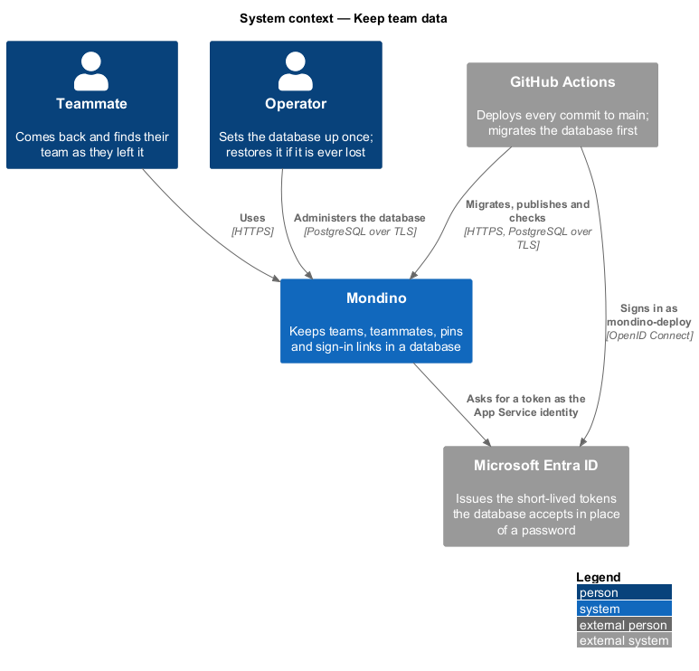
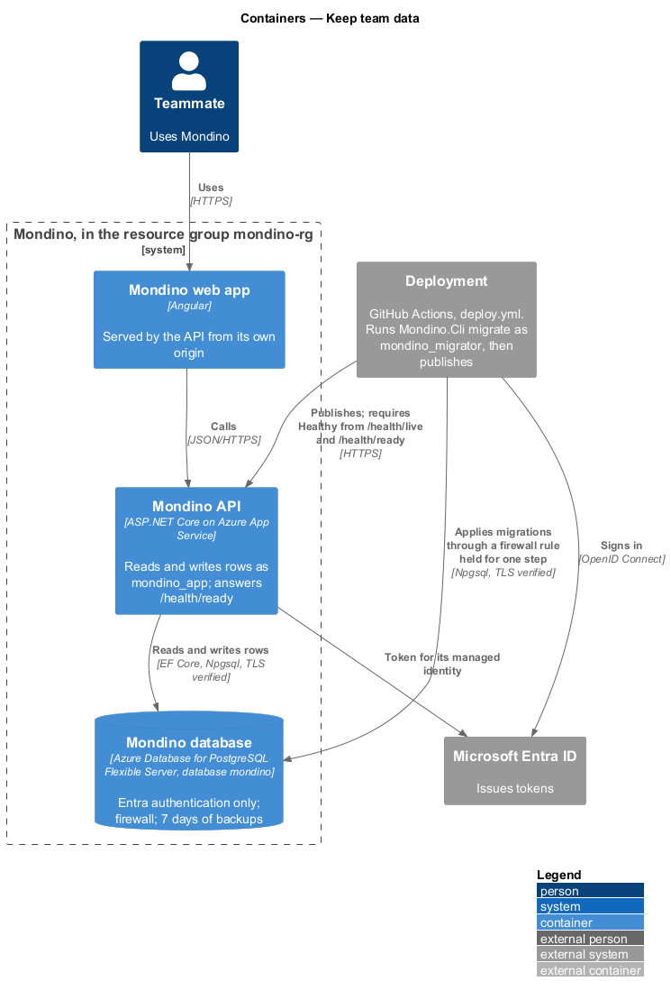
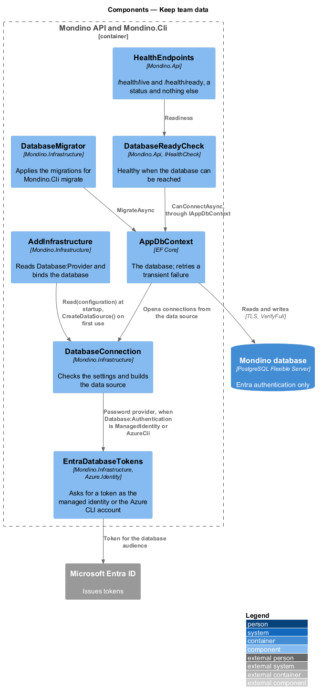
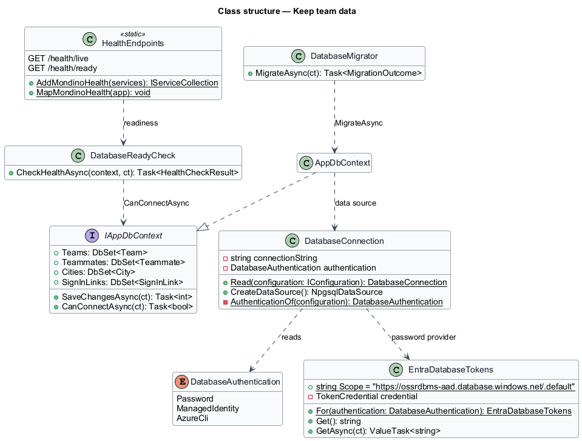
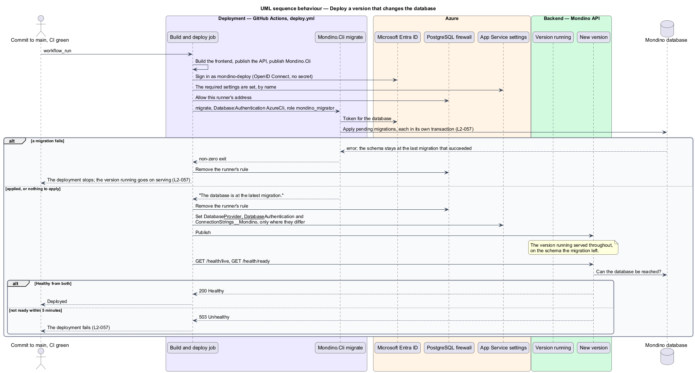
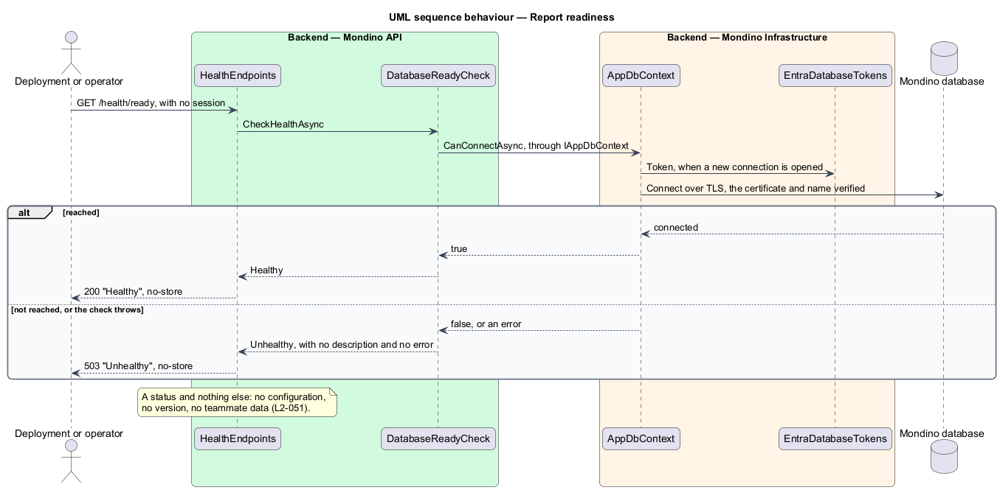

# Keep team data

## Overview

A team is made once and used for months. What it stores (the team and its invite link, its
teammates and their pins, and its sign-in links) has to be there when a teammate comes back,
whatever happened to the `Mondino API` in between. This feature covers where a deployed Mondino
keeps that data, how the API and the deployment reach it without a password, how a new
version's changes to the database are applied, and how the API reports that it can reach its
database.

It sits under every other backend feature: each of them reads and writes through
`IAppDbContext`, and none of them knows which database is behind it. The decisions are in
[ADR 0017](../../../adr/0017-azure-postgresql.md), which adds to
[ADR 0004](../../../adr/0004-database-engine.md).

The terms used below:

- **Mondino database** — the database `mondino` on the Azure Database for PostgreSQL Flexible Server `mondino-pg-27660`
- **Entra token** — short-lived credential Microsoft Entra ID issues to an identity, which the server accepts in place of a password
- **managed identity** — identity Azure gives the App Service itself, with no secret to hold
- **migration** — one recorded change to the database's tables, made by EF Core's tools
- **role** — a PostgreSQL account, with the rights it was granted
- **readiness** — whether the API can serve a request that needs the database, as opposed to liveness, which says only that the process runs
- **transient failure** — a failure that a second try is likely to pass, such as a dropped connection

## Description

**The server.** `infra/database.bicep` describes it: PostgreSQL 18, Burstable `Standard_B1ms`,
32 GiB, no high availability, automatic backups kept 7 days, in `canadacentral` beside the App
Service. Password authentication is off and Microsoft Entra authentication is on. The firewall
allows the App Service's possible outbound addresses; public access from any Azure service is
off. The template also defines the custom role that lets the deployment write and delete
firewall rules on this server, and assigns it to `mondino-deploy`.

**The roles.** `infra/database-roles.sql` is run once by the server's Entra administrator.

| Role | Signs in as it | Rights |
|---|---|---|
| `mondino_migrator` | the deployment's service principal, `mondino-deploy` | `CREATE` and `USAGE` on the schema `public`; owns every table it creates |
| `mondino_app` | the App Service's system-assigned managed identity | `SELECT`, `INSERT`, `UPDATE` and `DELETE` on the tables, `USAGE` on the schema; granted by default privileges to every table `mondino_migrator` creates |

`PUBLIC` keeps no right on the database. `mondino_app` cannot create, alter or drop a table.
The administrator is a member of `mondino_migrator`, so an operator can apply the migrations by
hand as that role and the tables keep one owner.

**`DatabaseConnection`** — class in `Mondino.Infrastructure` (`Persistence`).
`AddInfrastructure` uses it when `Database:Provider` is `PostgreSQL`.

- `Read(configuration)` reads and checks `ConnectionStrings:Mondino` and
  `Database:Authentication` as the services are registered, so a wrong setting stops the
  process at startup. It connects to nothing and asks for no token.
- `CreateDataSource()` returns the `NpgsqlDataSource` every `AppDbContext` opens its
  connections from. The data source is a singleton, made on first use, so its pool is shared
  and is disposed with the host.
- `Database:Authentication` is a `DatabaseAuthentication`: `Password` (the default),
  `ManagedIdentity` or `AzureCli`. Another value stops the process at startup.
- With `Password` the connection string is used as it is given, as on a laptop.
- With `ManagedIdentity` or `AzureCli` the connection string shall name a host and a user name
  and shall hold no password; otherwise the process stops at startup. `SSL Mode` is set to
  `VerifyFull` whatever the string says, and the password of each new connection is an Entra
  token from `EntraDatabaseTokens`.
- A refusal names the setting that is wrong and never its value.

**`EntraDatabaseTokens`** — class in `Mondino.Infrastructure` that asks Microsoft Entra ID for a
token for the database's audience, `https://ossrdbms-aad.database.windows.net/.default`.

- `For(ManagedIdentity)` holds a `ManagedIdentityCredential` for the system-assigned identity;
  `For(AzureCli)` holds an `AzureCliCredential`, which answers as whoever `az login` signed in.
  The credential is named by the setting and never discovered.
- `Get` and `GetAsync` are called when a physical connection is opened. The token is never
  logged.

**Retries.** `AppDbContext` is configured with the provider's retrying execution strategy
(`EnableRetryOnFailure`), so a transient failure is tried again. No handler opens a transaction
of its own.

**`IAppDbContext.CanConnectAsync`** — says whether the database can be reached. `AppDbContext`
answers through EF Core (`Database.CanConnectAsync`); EF Core InMemory always can.

**`DatabaseReadyCheck`** — `IHealthCheck` in `Mondino.Api` (`Health`). It asks
`IAppDbContext.CanConnectAsync` and reports `Healthy` or `Unhealthy`. A check that throws is
`Unhealthy` too. The result carries no description and no error, so nothing about the database
reaches the answer or a log.

**`HealthEndpoints`** — static class in `Mondino.Api` (`Health`).

- `GET /health/live` reports that the process is running and checks nothing else.
- `GET /health/ready` runs `DatabaseReadyCheck`: 200 `Healthy`, or 503 `Unhealthy`.
- Each answers one word as plain text, never cached, to anyone, with no session
  (`observe-without-exposing`, L2-051).

**`Mondino.Cli migrate`** applies the migrations through `DatabaseMigrator`, with the settings
of the environment, as before. The API applies nothing on startup.

**The deployment** — `.github/workflows/deploy.yml`, in this order:

1. Build the frontend, publish the API with it, and publish `Mondino.Cli`.
2. Sign in to Azure as `mondino-deploy` and take the database token at once, while the sign-in
   is fresh.
3. Check that the settings only the owner can give are set (`docs/deployment/README.md`).
4. Allow the runner's own address through the server's firewall, run `Mondino.Cli migrate` with
   `Database__Authentication` `AzureCli` as `mondino_migrator`, and remove the rule again
   whether or not the migration passed. A failure stops the job here, before anything is
   published.
5. Set `Database__Provider`, `Database__Authentication` and `ConnectionStrings__Mondino` on the
   App Service, only where they differ from what the migration used.
6. Publish, then require `Healthy` from `/health/live` and `/health/ready` within 5 minutes.

The server's name is the GitHub `production` variable `AZURE_POSTGRES_SERVER`. The job holds no
secret.

**Migrations suit the version before them.** The version running serves while the schema
changes, so a migration only adds what that version can ignore. Removing or renaming takes two
releases (ADR 0017).

**Backups and restore.** The server restores to any moment of the last 7 days as a new server.
`docs/deployment/README.md` gives the steps.

**How it is proved.** Acceptance tests prove readiness (healthy, unhealthy when the database is
down, open to anyone, a status and nothing else) and that a setting that breaks the rules above
stops the API at startup without showing a value. The connection, the retries and the
migrations need a real PostgreSQL, which no test has: each deployment proves its migrations
before it publishes and its connection after, and L2-057's criteria are checked on the deployed
system.

## Requirements

The feature realizes the following level-2 (L2) requirement. It refines a level-1 (L1)
requirement, cited by identifier. The health endpoints it builds are designed in
`observe-without-exposing`, which realizes L2-051.

| L2 ID | Refines (L1) | Requirement |
|-------|--------------|-------------|
| `L2-057` | `L1-018` | A deployed Mondino keeps what a team stores (the team and its invite link, its teammates and their pins, and its sign-in links) in a database, so a restart or a new version loses none of it and a teammate who comes back finds their team as they left it. A new version's changes to the database are applied by the deployment, before that version serves a request. |

## Diagrams

### System context

A teammate uses Mondino and finds their team as they left it. GitHub Actions migrates the
database and publishes each version, and both it and Mondino take their database tokens from
Microsoft Entra ID.

### Containers

The `Mondino API` reads and writes rows as `mondino_app`. The deployment reaches the
`Mondino database` as `mondino_migrator`, through a firewall rule it holds for one step.

### Components

`AddInfrastructure` binds the database through `DatabaseConnection`, which takes its password
from `EntraDatabaseTokens` when the setting says so. `DatabaseReadyCheck` asks the context
whether the database can be reached.

### Class structure

`DatabaseConnection` reads a `DatabaseAuthentication` and builds the data source.
`DatabaseReadyCheck` depends on `IAppDbContext` only, so a test replaces the database to make
it fail.

### Behaviour — deploy a version that changes the database

The migration runs before anything is published. When it fails the deployment stops and the
version running goes on serving; when it passes the new version is published and has to report
itself ready (L2-057).

### Behaviour — report readiness

Readiness asks the database once and answers one word, to anyone, with nothing about the
database in it (L2-051).

