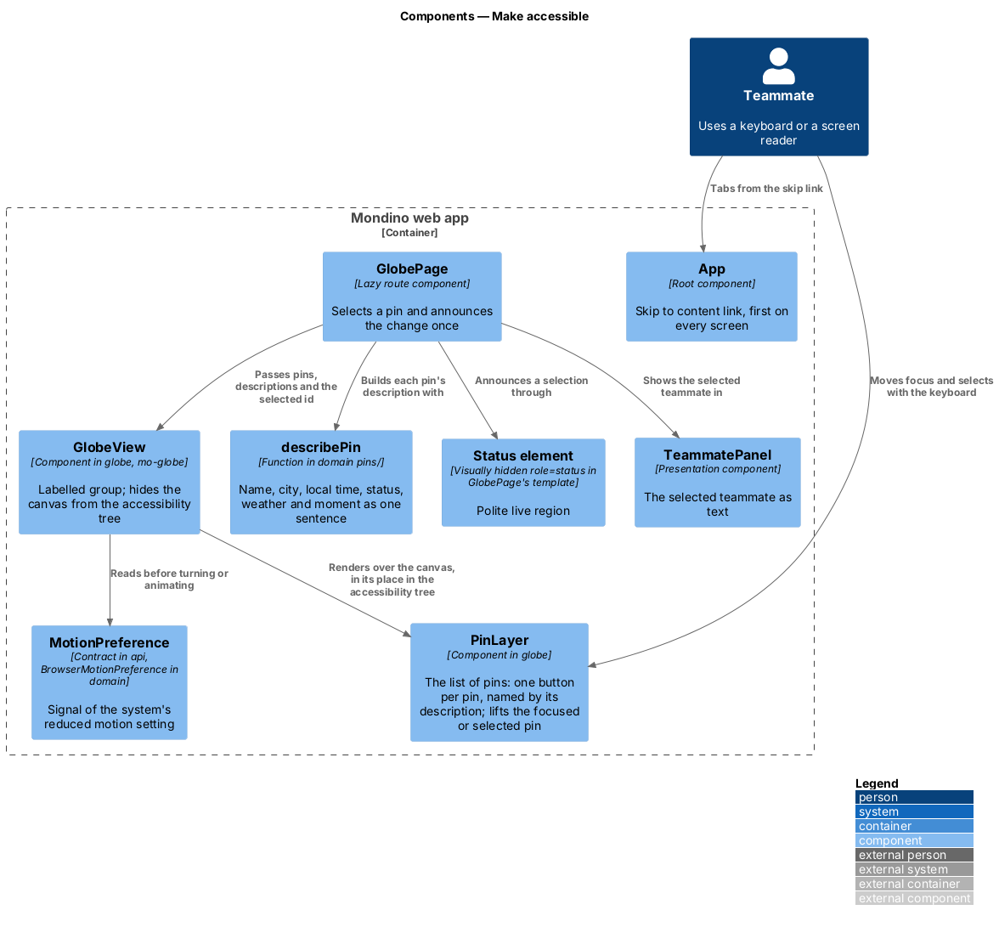
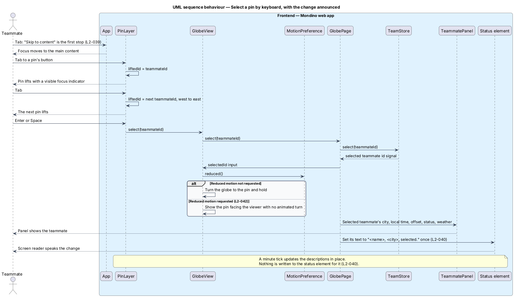

# Make accessible

## Overview

Mondino shows a team as pins on a 3D globe, each with a teammate's local time, weather and
moments. Mondino meets WCAG 2.2 level AA: every interaction works by keyboard and by touch,
everything shown on the globe is also available as text, and motion is reduced for a person
who asks for it. This feature covers the parts every screen shares to meet that level. A
screen's own controls are described in that screen's design; this design fixes the rules they
follow.

The globe is drawn on a canvas, which assistive technology cannot read. The feature's central
part is therefore the globe's text equivalent: the pins drawn over the canvas are a list of
buttons, and that list stands in place of the canvas.

The terms used below:

- **text equivalent** — list of pins, as text, that a screen reader and a keyboard reach in place of the 3D canvas
- **live region** — part of the page whose changes a screen reader announces without focus moving to it
- **reduced motion** — system setting, read through `prefers-reduced-motion`, that asks for motion to be removed

## Description

The feature lives in the `Mondino web app`. The `Mondino API` takes part only by giving each
pin's city, time zone, weather and moments, which the text equivalent reads.

**Keyboard and touch (L2-039).**

- **`App`** renders a "Skip to content" link as the first focusable element of every
  screen. Its target is the screen's `main` element (`adapt-to-every-width`).
- Each control is a native `button`, `a`, `input` or `select`, or a CDK primitive, so it takes
  focus in reading order with no positive `tabindex`.
- The global foundations define one `:focus-visible` indicator with a contrast of at least 3:1
  against its surroundings. No component removes it.
- Each interactive element in `components` has a minimum size of 44 × 44 CSS px, set in its own
  stylesheet from a foundation token.
- `LeaveTeamDialog` and `DiscardChangesDialog` open through the CDK Dialog, which keeps focus
  inside the dialog, closes on Escape and returns focus to the control that opened it.
  `LeaveTeamDialog` stays open while its request is pending or has failed: while it is
  pending both buttons are disabled and Escape does not close it (`leave-team`, L2-036).
- On the globe, one finger spins and one tap selects. No interaction needs a multi-finger or
  path-based gesture; each pin is a button, and selecting one turns the globe to it, which is
  the single-pointer and keyboard alternative to dragging.

**The globe's text equivalent (L2-040).**

- **`GlobeView`** (`mo-globe`) — the host element has `role="group"` and an accessible name
  from its input `label`. The canvas inside it carries `aria-hidden="true"`. `PinLayer`'s
  list of pins is drawn over the canvas and stands in its place in the accessibility tree.
- **`PinLayer`** — component in `globe` (`show-pins`). The pins it draws are the list: the
  mocks' `ul.globe__pins` with one `li.globe__pin` per pin, each holding a `button.pin`. A
  button's accessible name is the pin's description, and the visible label beside it is
  `aria-hidden`, so a pin is read once. The button carries `aria-pressed`, which is true for
  the selected pin. Each button is a Tab stop, in a fixed order from west to east; Enter or
  Space selects. The arrow keys stay with the globe, which they turn (`turn-globe`). There is
  no separate, visually hidden list. A pin with focus lifts and carries the focus indicator,
  with a contrast of at least 3:1 over the day side and the night side. Where the still
  picture stands in for the globe (`draw-globe`) there is no list of pins; the teammates are
  reached through the panel and the Team screen.
- **`describePin(pin, now, settings)`** — function in `domain`'s `pins/`. It returns one
  sentence: the teammate's name, city, local time, status, weather and any moment this week,
  as in "Tomás Herrera, Mexico City, 08:05, Early morning, Partly cloudy 22°, Día de Muertos,
  in 5 days". It calls `localTime`, `formatTime` and `statusFor` from `time/`. It leaves the
  status out when `statusFor` gives none, and the weather out when the pin has none. `globe` depends on `api` only, so `GlobePage` computes
  the descriptions and passes them to `GlobeView` as the input `descriptions`, keyed by
  teammate id.
- **Selection is announced once.** `GlobePage` holds one visually hidden element with
  `role="status"` and `aria-live="polite"`, as the mocks draw it, and sets its text when the
  selected teammate id changes, whether the selection came from a tap, a click or the
  keyboard. The message is the selected teammate's name and city and the word "selected", as
  in "Tomás Herrera, Mexico City, selected."; for a group pin it is the count, "3 teammates
  close together." (`view-teammate-panel`). `TeammatePanel` is not itself a live region.
- **A minute tick is silent.** The descriptions and the panel update in place when the clock
  ticks. Neither is inside a live region, and `GlobePage` writes to its status element only on a change of selection.
- **The postal code lookup is announced.** `PostalCodeField` renders the `LookupMessage` it
  is given (`message`) inside a polite live region while `lookupState` is `Locating` or
  `Found`, and otherwise in an element with `role="alert"`, linked to the input with
  `aria-describedby`. Its input `invalid` sets `aria-invalid`: the screen sets it for an empty
  postal code on submit and when the postal code is not found, and not when the lookup is
  unavailable or rate limited, since nothing is wrong with what was typed.

**Colour, contrast and text size (L2-041).**

- Each colour role in the design tokens is paired with a background role, and each pair is
  verified at 4.5:1 for body text and 3:1 for large text and meaningful graphics in
  `docs/design-system/`. Components read colour by role, never by hex.
- `PinLabel` draws its text on its own surface, not on the globe, so its contrast does not
  depend on whether the pin is on the day side or the night side.
- A state is never carried by colour alone. `StatusBadge` shows the status in words.
  `FilterChips`, the Moments filter, is a labelled `group` of buttons and marks a pressed chip
  with `aria-pressed`. `Segmented` (`mo-segmented`) takes a `mode`: as `tabs`, the Team
  filter, it is a `tablist` whose chosen `tab` carries `aria-selected`, with a count on each
  option; as `radio`, the Profile choices, it is a `radiogroup` whose chosen `radio` carries
  `aria-checked`. The header's navigation marks the current screen with
  `aria-current="page"`. `MomentIcon` pairs the kind's icon with its name. An invalid field
  carries `aria-invalid` and a message.
- Sizes are in `rem` and layouts are fluid (`adapt-to-every-width`, L2-037), so text at 200%
  reflows at 1280 px wide with no sideways scrolling.
- Times and temperatures use `font-variant-numeric: tabular-nums`, set by a foundation utility.
- An axe sweep with the WCAG 2.2 AA rules covers every screen in every state. Like the visual
  and responsive sweeps, it is kept current and runs only when a person asks.

**Reduced motion (L2-042).**

- **`MotionPreference`** / `MOTION_PREFERENCE` — contract and injection token in `api`, with
  one member, the signal `reduced`.
- **`BrowserMotionPreference`** — implementation in `domain`. It reads
  `matchMedia('(prefers-reduced-motion: reduce)')`, listens for its `change` event, so the app
  follows the setting without a reload, and removes the listener when destroyed.
- `GlobeView` reads `reduced`. When it is true the globe does not turn on its own, a selected
  pin is shown facing the viewer with no animated turn, a lifted pin moves to its lifted place
  with no animation, and a newly placed pin does not pulse.
- The panel's fade and every other CSS transition sit inside
  `@media (prefers-reduced-motion: no-preference)`, so they are absent when reduced motion is
  requested.
- No animation repeats faster than three times in a second. The pulse of a newly placed pin
  runs once.

## Requirements

The feature realizes the following level-2 (L2) requirements. Each L2 requirement refines a
level-1 (L1) requirement, cited by identifier.

| L2 ID | Refines (L1) | Requirement |
|-------|--------------|-------------|
| `L2-039` | `L1-013` | Every control is reachable and operable by keyboard alone and by touch alone, in an order that follows the screen, with a visible focus indicator. |
| `L2-040` | `L1-013` | Nothing is available only as a picture on the globe. Every teammate and moment shown on the globe can be reached as text by a screen reader, and the globe itself does not flood it. |
| `L2-041` | `L1-013` | Text and controls meet WCAG 2.2 AA contrast, colour never carries a meaning on its own, and the interface holds together when text is enlarged. |
| `L2-042` | `L1-013` | When the system asks for reduced motion, Mondino removes motion that is not needed to understand the screen. |

## Diagrams

### System context

A teammate, or a person joining, uses Mondino by keyboard, touch, a screen reader, enlarged
text or reduced motion.

### Containers

Every accessibility rule is carried by the `Mondino web app`. The `Mondino API` supplies the
data the text equivalent reads.

### Components

`GlobeView` renders `PinLayer`'s list of pin buttons over the canvas, which it hides from the
accessibility tree. `GlobePage` builds each description with `describePin`, announces a selection
through its status element and shows the teammate in `TeammatePanel`. `GlobeView` reads
`MotionPreference` before it turns or animates.

### Class structure

`GlobeView` composes `PinLayer` and depends on `MotionPreference`, which
`BrowserMotionPreference` implements. `PinLayer` renders one button per pin. `GlobePage`
depends on `describePin` and holds the status element that announces a selection.

### Behaviour — select a pin by keyboard, with the change announced

The teammate tabs past the skip link to the pins. Each pin's button is a Tab stop; `PinLayer`
lifts the focused pin and shows its focus indicator (L2-039), and Enter or Space selects it. `GlobeView` turns to
the pin, or shows it with no animated turn when reduced motion is requested (L2-042).
`GlobePage` shows the teammate in `TeammatePanel` and announces the change once through a
polite live region (L2-040). A minute tick is not announced.

