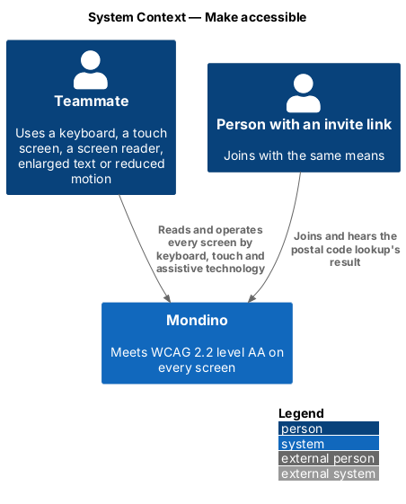
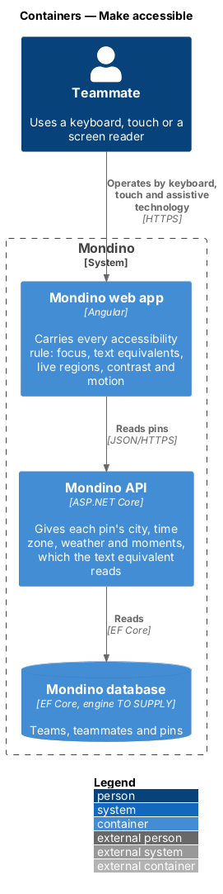
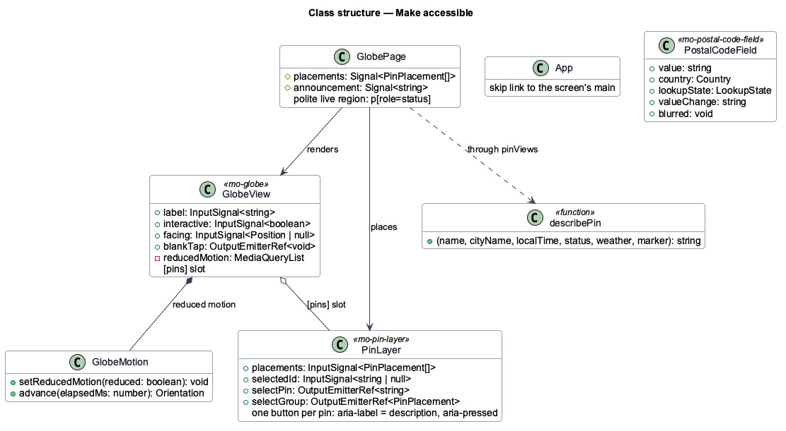

# Make accessible

## Overview

Mondino shows a team as pins on a 3D globe, each with a teammate's local time, weather and
moments. Mondino meets WCAG 2.2 level AA: every interaction works by keyboard and by touch,
everything shown on the globe is also available as text, and motion is reduced for a person
who asks for it. This feature covers the parts every screen shares to meet that level. A
screen's own controls are described in that screen's design; this design fixes the rules they
follow.

The globe is drawn on a canvas, which assistive technology cannot read. The feature's central
part is therefore the globe's text equivalent: the pins drawn over the canvas are a list of
buttons, and that list stands in place of the canvas.

The terms used below:

- **text equivalent** — list of pins, as text, that a screen reader and a keyboard reach in place of the 3D canvas
- **live region** — part of the page whose changes a screen reader announces without focus moving to it
- **reduced motion** — system setting, read through `prefers-reduced-motion`, that asks for motion to be removed

## Description

The feature lives in the `Mondino web app`. The `Mondino API` takes part only by giving each
pin's city, time zone, weather and moments, which the text equivalent reads.

**Keyboard and touch (L2-039).**

- **`App`** renders a "Skip to content" link as the first focusable element of every
  screen. Its target is the screen's `main` element (`adapt-to-every-width`).
- Each control is a native `button`, `a`, `input` or `select`, or a CDK primitive, so it takes
  focus in reading order with no positive `tabindex`.
- The global foundations define one `:focus-visible` indicator with a contrast of at least 3:1
  against its surroundings. No component removes it.
- Each interactive element in `components` has a minimum size of 44 × 44 CSS px, set in its own
  stylesheet from a foundation token.
- `InviteDialog`, `LeaveTeamDialog` and `DiscardChangesDialog` open through the CDK Dialog,
  which keeps focus inside the dialog, closes on Escape and returns focus to the control that
  opened it. Each is named by its title (`aria-labelledby`) and described by its text
  (`aria-describedby`), is modal, and makes the screen behind it inert.

  | Dialog | Role | Focus starts on |
  |--------|------|-----------------|
  | `InviteDialog` (`invite-teammates`) | `dialog`; it has a "Close" button | "Copy link" |
  | `LeaveTeamDialog` (`leave-team`) | `alertdialog` | "Stay"; "Try again" after a failure |
  | `DiscardChangesDialog` (`choose-display-and-sharing`) | `alertdialog` | "Keep editing" |

  The two that ask before something is lost are alert dialogs, and focus starts on the choice
  that loses nothing. `LeaveTeamDialog` stays open while its request is pending or has failed:
  while it is pending both buttons are disabled and Escape does not close it (L2-036). When a
  copy is refused, `InviteDialog` stays open and moves focus to the selected link.
- The header's "Invite teammate" button keeps its accessible name under 768 px, where it is an
  icon alone (`adapt-to-every-width`).
- "Your city", the field Join shows while the postal code lookup is down, is a combobox:
  `role="combobox"`, `aria-autocomplete="list"`, `aria-expanded` and `aria-controls`, with its
  list operated by the arrow keys and Enter (`place-pin-from-postal-code`).
- On Sign In and Create Team a field that is wrong carries `aria-invalid` and its message in a
  `role="alert"` element linked with `aria-describedby`, and focus moves to the first such
  field. When a screen's form gives way to a result ("Check your inbox", "Now bring everyone
  in."), focus moves to the new title.
- On the globe, one finger spins and one tap selects. No interaction needs a multi-finger or
  path-based gesture; each pin is a button, and selecting one turns the globe to it, which is
  the single-pointer and keyboard alternative to dragging.

**The globe's text equivalent (L2-040).**

- **`GlobeView`** (`mo-globe`) — its `.globe` element has `role="group"` and an accessible
  name from its input `label`. The canvas inside it carries `aria-hidden="true"`. `PinLayer`'s
  list of pins is drawn over the canvas, in `GlobeView`'s `[pins]` slot, and stands in its
  place in the accessibility tree.
- **`PinLayer`** — component in `components` (`show-pins`). The pins it draws are the list: the
  mocks' `ul.globe__pins` with one `li.globe__pin` per pin, each holding a `button.pin`. A
  button's accessible name is the pin's description, and the visible label beside it is
  `aria-hidden`, so a pin is read once. The button carries `aria-pressed`, which is true for
  the selected pin. Each button is a Tab stop, in a fixed order from west to east; Enter or
  Space selects. The arrow keys stay with the globe, which they turn (`turn-globe`). There is
  no separate, visually hidden list. A pin with focus lifts and carries the focus indicator,
  with a contrast of at least 3:1 over the day side and the night side.
- **The still picture keeps its pins.** Where the still picture stands in for the globe
  (`draw-globe`), `GlobeFallback` draws the same list of pins over it, placed by
  `stillPlacements` and named by the same `descriptions`: each pin is still a button, lifts,
  and opens its panel through the outputs `select` and `selectGroup`. The group is named "A still picture of the
  globe, with 13 teammates’ pins." and is not a Tab stop itself, since it does not turn and
  is not dragged. The legend says why it is still, in words: "Still view — 3D isn’t available
  in this browser"; on a phone a line under the globe reads the same and adds "Pins still
  open."
- **`describePin(name, cityName, localTime, status, weather, marker)`** — function in
  `domain`'s `pins/`, which `pinViews` calls for each pin. It returns one sentence: the teammate's name, city, local time, status, weather and any moment this week,
  as in "Tomás Herrera, Mexico City, 08:05, Early morning, Partly cloudy 22°, 2 moments this
  week: Día de Muertos, in 5 days; Clásico Nacional, in 6 days". `pinViews` works out the local time and status from `time/`. It leaves the
  status out when there is none to show, and the weather out when the pin has none. `globe`
  depends on `api` only, so `GlobePage` builds the pin views and their placements and hands
  them to `PinLayer` in `GlobeView`'s `[pins]` slot; each placement carries its description.
- **Selection is announced once.** `GlobePage` holds the mocks' polite live region,
  `p.visually-hidden[role=status][aria-live=polite]`, in the page before anything is
  selected. Its text is the selected teammate's name and city and the word "selected", as in
  "Tomás Herrera, Mexico City, selected.", and changes when the selected teammate id changes,
  whether the selection came from a tap, a click, the keyboard or the address. A group's is
  its title ("2 teammates close together."). `TeammatePanel` is not itself a live region
  (ADR 0029).
- **A minute tick is silent.** The descriptions and the panel update in place when the clock
  ticks. Neither is inside a live region, and `GlobePage` announces only a change of selection.
- **A toast is announced once.** `Toast` sits in the mocks' `toast-region`. A toast that
  confirms ("Invite link copied. Paste it wherever your team talks.", "You’re on the map.
  Northwind can now see your pin in Milan.") is in a `role="status"` region, polite, and
  dismisses itself after 4 s; the timer pauses while the toast is pointed at or focused, and
  "Dismiss" closes it at once. A toast that reports a failure ("Couldn’t copy the link. It’s
  selected — press Ctrl+C or ⌘C to copy it yourself.") is in a `role="alert"` region,
  assertive, and stays until it is dismissed. No toast takes focus.
- **A countdown is announced once.** The rate limit alert on Join ("Too many tries from this
  device. You can try again in 9:42.") is announced when it appears and not at each second.
- **The postal code lookup is announced.** `PostalCodeField` renders its result inside a
  polite live region and its error in an element with `role="alert"`, linked to the input
  with `aria-describedby`; the input carries `aria-invalid` when the postal code is not
  found, and not when the lookup is unavailable or rate limited, since nothing is wrong with
  what was typed. The help of "Your city" is a `role="status"` element, so the switch from the
  postal code to the city is announced.

**Colour, contrast and text size (L2-041).**

- Each colour role in the design tokens is paired with a background role, and each pair is
  verified at 4.5:1 for body text and 3:1 for large text and meaningful graphics in
  `docs/design-system/`. Components read colour by role, never by hex.
- `PinLabel` draws its text on its own surface, not on the globe, so its contrast does not
  depend on whether the pin is on the day side or the night side.
- A state is never carried by colour alone. `StatusBadge` shows the status in words.
  `FilterChips`, the Moments filter, is a labelled `group` of buttons and marks a pressed chip
  with `aria-pressed`. `Segmented` (`mo-segmented`) takes a `mode`: as `tabs`, the Team
  filter, it is a `tablist` whose chosen `tab` carries `aria-selected`, with a count on each
  option; as `radio`, the Profile choices, it is a `radiogroup` whose chosen `radio` carries
  `aria-checked`. The header's navigation marks the current screen with
  `aria-current="page"`. `MomentIcon` pairs the kind's icon with its name. An invalid field
  carries `aria-invalid` and a message.
- Sizes are in `rem` and layouts are fluid (`adapt-to-every-width`, L2-037), so text at 200%
  reflows at 1280 px wide with no sideways scrolling.
- Times and temperatures use `font-variant-numeric: tabular-nums`, set by a foundation utility.
- The behaviour specs measure every screen, in light and dark: the focus ring's contrast,
  every touch target, the contrast of each line of text over its painted background, the
  figures of each time and temperature, and 200% text as the browser's default font size at 32 px (ADR 0029).
- An axe sweep with the WCAG 2.2 AA rules covers every screen in every state. Like the visual
  and responsive sweeps, it is kept current and runs only when a person asks.

**Reduced motion (L2-042).**

- **`GlobeView`** reads `matchMedia('(prefers-reduced-motion: reduce)')` and gives it to
  `GlobeMotion`, and listens for its `change` event, so the globe follows the setting without
  a reload, until the view is destroyed. When it is true the globe does not turn on its own
  and a selected pin is shown facing the viewer with no animated turn. There is no
  `MotionPreference` token: the globe is the only code that moves something with script
  (ADR 0029).
- Every other motion is CSS, and CSS follows the setting by itself. The tokens set every
  `--duration-*` to 0.01 ms under `prefers-reduced-motion: reduce`, so the panel's fade, a
  dialog's and a toast's entrance and a lifted pin's growth happen at once; each animation
  that repeats or pulses (a new pin's pulse, the shimmer of a skeleton and of the globe's
  placeholder) is `animation: none` there, in its own component's stylesheet.
- No animation repeats faster than three times in a second. The pulse of a newly placed pin
  runs once.

## Requirements

The feature realizes the following level-2 (L2) requirements. Each L2 requirement refines a
level-1 (L1) requirement, cited by identifier.

| L2 ID | Refines (L1) | Requirement |
|-------|--------------|-------------|
| `L2-039` | `L1-013` | Every control is reachable and operable by keyboard alone and by touch alone, in an order that follows the screen, with a visible focus indicator. |
| `L2-040` | `L1-013` | Nothing is available only as a picture on the globe. Every teammate and moment shown on the globe can be reached as text by a screen reader, and the globe itself does not flood it. |
| `L2-041` | `L1-013` | Text and controls meet WCAG 2.2 AA contrast, colour never carries a meaning on its own, and the interface holds together when text is enlarged. Mondino is designed in a light theme and a dark theme, and both meet every criterion here. |
| `L2-042` | `L1-013` | When the system asks for reduced motion, Mondino removes motion that is not needed to understand the screen. |

## Diagrams

### System context

A teammate, or a person joining, uses Mondino by keyboard, touch, a screen reader, enlarged
text or reduced motion.

### Containers

Every accessibility rule is carried by the `Mondino web app`. The `Mondino API` supplies the
data the text equivalent reads.

### Components

`GlobeView` renders `PinLayer`'s list of pin buttons over the canvas, which it hides from the
accessibility tree. `GlobePage` builds each description with `describePin`, announces a selection
in its own polite live region and shows the teammate in `TeammatePanel`. `GlobeView` reads the
reduced motion setting before it turns.

### Class structure

`GlobePage` renders `GlobeView` with `PinLayer` in its `[pins]` slot. `PinLayer` renders one
button per pin. `GlobeView` reads the reduced motion setting and gives it to `GlobeMotion`.
`GlobePage` depends on `describePin`, through `pinViews`, and holds its own live region.

### Behaviour — select a pin by keyboard, with the change announced

The teammate tabs past the skip link to the pins. Each pin's button is a Tab stop; `PinLayer`
lifts the focused pin and shows its focus indicator (L2-039), and Enter or Space selects it. `GlobeView` turns to
the pin, or shows it with no animated turn when reduced motion is requested (L2-042).
`GlobePage` shows the teammate in `TeammatePanel` and announces the change once in its
polite live region (L2-040). A minute tick is not announced.

