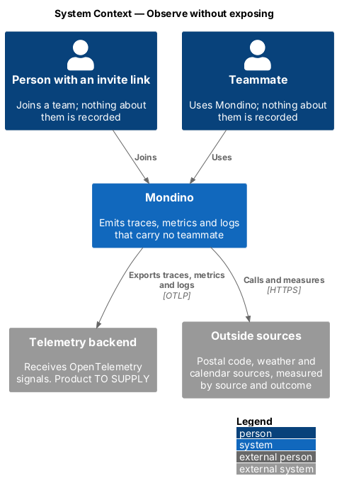
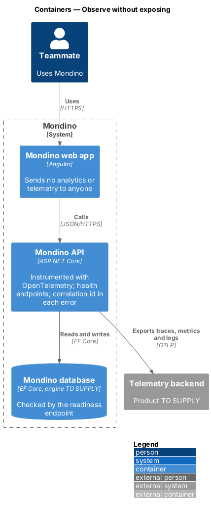
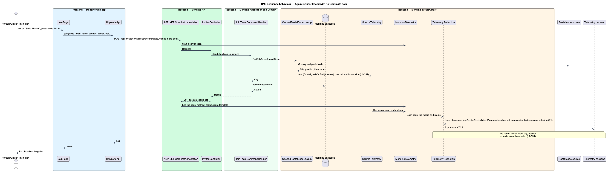

# Observe without exposing

## Overview

Mondino holds little about a teammate: a name, a postal code, the city, position and time
zone found from it, and, for a teammate who made a team, an email. This feature covers how the `Mondino API` is observed in production
without any of that reaching what it records. The backend emits OpenTelemetry traces, metrics
and logs, enough to see its own health and the health of each outside source. None of it
carries a name, an email, a postal code, a position, a city, a token, a query string or a
body, and a route is recorded as its template.

The terms used below:

- **telemetry** — traces, metrics and logs the backend emits
- **span** — record of one operation within a trace, with a name, a duration and attributes
- **route template** — route as it is declared, with placeholders in place of values, for example `/api/teams/{teamId}/pins`
- **correlation id** — identifier of one request's trace, present in its logs and in the error returned to the browser
- **outside source** — service outside Mondino that the backend calls for postal codes, weather or calendars

The product that receives the telemetry is `<TO SUPPLY>`. The API is hosted on Azure App
Service ([ADR 0004](../../../adr/0004-azure-hosting.md)).

## Description

The feature lives in the `Mondino API`. The `Mondino web app` sends no analytics and no
telemetry to anyone.

**`MondinoTelemetry`** — static class in `Mondino.Api` that sets up OpenTelemetry
([ADR 0031](../../../adr/0031-telemetry-from-an-allow-list.md)).

- `AddMondinoTelemetry(services, configuration)` registers tracing, metrics and logging with the
  ASP.NET Core and `HttpClient` instrumentation, names the service `mondino-api`, and subscribes
  to the `ActivitySource` and the `Meter` named `Mondino`. It adds the OTLP exporter only when
  `OTEL_EXPORTER_OTLP_ENDPOINT` is set. The database is not instrumented: readiness says whether
  it can be reached.

**`SourceTelemetry`** — class in `Mondino.Infrastructure` that owns the backend's own
instruments, beside the decorators that record them, which may not depend on `Mondino.Api`.

- It owns one `ActivitySource` and one `Meter` (from `IMeterFactory`), both named `Mondino`.
- `Start(source)` begins a `SourceCall`, and `SourceCall.End(outcome)` adds one to the counter
  `mondino.source.calls` and, for a call that was made, records its duration in seconds (read
  from `TimeProvider`) in the histogram `mondino.source.duration`. Both are labelled by `source`
  (`postal_code`, `weather`, `holiday_calendar`, `email`) and `outcome` (a `SourceOutcome`:
  `success`, `failure`, `timeout`, `circuit_open`), and by nothing else. Calls, failures and
  time-outs per source are read from the counter by outcome. Each call made is also a span,
  `source <name>`, with the attributes `mondino.source` and `mondino.source.outcome`.
- `CachedPostalCodeLookup`, `CachedWeatherSource`, `CachedOpenHolidays` and
  `PostmarkSignInEmailSender` start one call per call to a source, and one `circuit_open` call
  when the breaker leaves the source alone (`survive-source-failure`). A cached answer is not a
  call. Formula 1, local events and sport come from Mondino's own calendar, which makes no call
  and is not measured.

**`TelemetryRedaction`** — static class in `Mondino.Api` holding three allow-lists, so an
attribute that is not named is dropped, not kept. `MondinoTelemetry` registers its processors
first, before any exporter.

- **Spans** (`SpanRedaction`). A span keeps `http.request.method`,
  `http.response.status_code`, `http.route`, `error.type`, `server.address`,
  `mondino.source` and `mondino.source.outcome`, and nothing else: the path, the query string,
  the outgoing URL, the client address, the user agent and each header are dropped, with the
  status description, the trace state and the baggage; no instrumentation records an exception
  event. A server span is named by its method and route template. The template is written from
  the root with each parameter named and nothing else (`RouteTemplates`):
  `api/teams/{teamId:guid}/pins` is `/api/teams/{teamId}/pins`. A request's body is never recorded, and an email, a sign-in token, a postal
  code and the text of a city search travel in a body only. The sign-in routes are recorded as
  `/api/sign-in-links` and `/api/sign-in-links/redemptions`; the sign-in token is in the
  fragment of the emailed address, which no server receives. An outside source's client span
  keeps its host, the method and the status code.
- **Logs** (`LogRedaction`). A log record keeps its category, level, event, trace and span ids,
  its message template and the attributes `errorType` and `correlationId`. Every other
  attribute, the formatted message, a body that is not a template and the exception are
  dropped; of an exception only its type is kept, as `exception.type`. Scopes are not exported.
  Mondino's own messages are source-generated `LoggerMessage`s in `LogMessages`, with fixed
  templates that take only values from a closed set; today there is one, `UnhandledError`.
- **Metrics.** A view on every instrument keeps the tags `http.request.method`,
  `http.response.status_code`, `http.route`, `error.type`, `server.address`, `source` and
  `outcome`. A metric's `http.route` is the template as ASP.NET Core declares it
  (`api/teams/{teamId:guid}/pins`), since its meter sets it and no view can rewrite a value.

**Errors and the correlation id.**

- **`UnhandledExceptionHandler`** — `IExceptionHandler` in `Mondino.Api`, after
  `RefusalHandler`. For an unhandled error it logs `UnhandledError` with the error's type and the
  correlation id. It does not log the error's message or the request, since either can hold what
  a person typed. It answers 500 with the code `unexpected`, through the ProblemDetails writer.
- **ProblemDetails writer** (`ProblemCodes.Customize`) — adds the extension `correlationId` to
  each ProblemDetails, beside `code`, in place of the framework's `traceId`. The correlation id
  is the request's trace id. The same id appears on the request's span and logs, so an error a
  teammate reports is found without recording who they are.

**Health endpoints.**

- `GET /health/live` reports that the process is running. It checks nothing else.
- `GET /health/ready` runs `DatabaseReadyCheck`, which confirms through `IAppDbContext`
  (`CanConnectAsync`) that the `Mondino database` is reachable: 200 `Healthy`, or 503
  `Unhealthy`. An outside source's failure does not make the backend unready, since a pin
  still shows its local time without it.
- Each answers with a status only, one word of plain text that is never cached: no
  configuration, no versions of dependencies and no teammate data. A failed check reports no
  description and no error. Both are marked as open explicitly and need no session
  (`protect-team-data`).
- The health endpoints were built (`HealthEndpoints` and `DatabaseReadyCheck`, in
  `Mondino.Api`'s `Health`), with the database they check, by
  [`keep-team-data`](../keep-team-data/).

**Settings a deployed system needs.** The exporter reads the standard
`OTEL_EXPORTER_OTLP_ENDPOINT`, `OTEL_EXPORTER_OTLP_HEADERS` and `OTEL_EXPORTER_OTLP_PROTOCOL`;
the service is named `mondino-api`. With no endpoint set, nothing is exported and the API runs
as normal. The sampler reads `OTEL_TRACES_SAMPLER` and `OTEL_TRACES_SAMPLER_ARG`; with neither,
every trace is kept. The sampling rate is `<TO SUPPLY>` (`docs/deployment/README.md`).

**How it is proved.** An acceptance test joins as "Sofia Bianchi" with postal code "20121"
against in-memory exporters, with logging at every level, and a fake postal code lookup, then
searches every exported span, metric point and log record for the name, the postal code, the
city, its coordinates and the invite token. It finds none. A second test makes a team with the
email "sofia@northwind.co", asks for a sign-in link against a fake Email source and opens it,
then searches the same exports for the email and the sign-in token. It finds none. Others read
the route template of a team's endpoint, each source's calls, failures, time-outs and latency
through the real decorators against fake HTTP sources, and an unhandled error's log beside its
ProblemDetails. The telemetry tests run alone, since an `ActivitySource` and a `Meter` are seen
by every host in the process.

## Requirements

The feature realizes the following level-2 (L2) requirement. It refines a level-1 (L1)
requirement, cited by identifier.

| L2 ID | Refines (L1) | Requirement |
|-------|--------------|-------------|
| `L2-051` | `L1-017` | The backend emits OpenTelemetry traces, metrics and logs, enough to see its health and the health of each outside source. None of it carries a name, an email, a postal code, a position, a city, a token, a query string or a body, and a route is recorded as its template. |

## Diagrams

### System context

Mondino exports traces, metrics and logs to a telemetry backend and measures its calls to
outside sources. Nothing about a teammate, a person joining, a person making a team or a
person signing in is recorded.

### Containers

The `Mondino API` is the only container that emits telemetry. The `Mondino web app` sends
none. The readiness endpoint checks the `Mondino database`.

### Components

The caching decorators record each source call through `SourceTelemetry`, which
`MondinoTelemetry` subscribes to. Each span, log record and metric passes `TelemetryRedaction`'s
allow-lists before export. `UnhandledExceptionHandler` logs through `LogMessages` and answers
through the ProblemDetails writer. The health endpoints check the database for readiness.

### Class structure

`SourceTelemetry` owns the source instruments and labels them by `SourceOutcome`; the four
source decorators depend on it. `MondinoTelemetry` registers `TelemetryRedaction`'s processors
and subscribes to `SourceTelemetry`'s names. `UnhandledExceptionHandler` depends on
`LogMessages` and the ProblemDetails writer. `HealthEndpoints` depends on `DatabaseReadyCheck`.

### Behaviour — a join request traced with no teammate data

A person joins as "Sofia Bianchi" with postal code 20121. The name and postal code travel in
the request's body, which is never recorded. The server span keeps the method, the status and
the route template. The postal code lookup is recorded as a call to `postal_code` with its
outcome and duration. The join writes no log of its own.
`TelemetryRedaction` drops the path, which holds the invite token, and the outgoing URL
before export, so no name, postal code, city, position or invite token leaves the backend
(L2-051).

