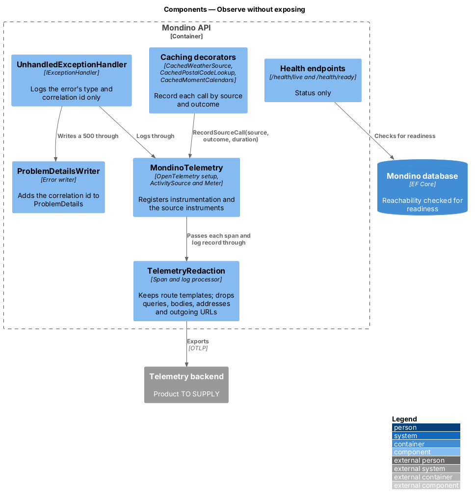
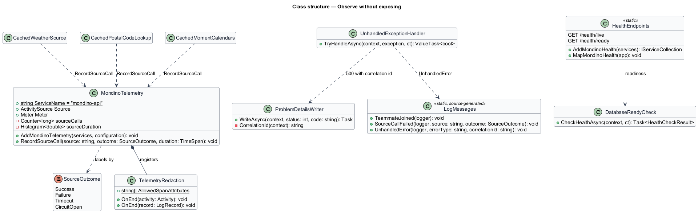

# Observe without exposing

## Overview

Mondino holds little about a teammate: a name, a postal code, the city, position and time
zone found from it, and, for a teammate who made a team, an email. This feature covers how the `Mondino API` is observed in production
without any of that reaching what it records. The backend emits OpenTelemetry traces, metrics
and logs, enough to see its own health and the health of each outside source. None of it
carries a name, an email, a postal code, a position, a city, a token, a query string or a
body, and a route is recorded as its template.

The terms used below:

- **telemetry** — traces, metrics and logs the backend emits
- **span** — record of one operation within a trace, with a name, a duration and attributes
- **route template** — route as it is declared, with placeholders in place of values, for example `/api/teams/{teamId}/pins`
- **correlation id** — identifier of one request's trace, present in its logs and in the error returned to the browser
- **outside source** — service outside Mondino that the backend calls for postal codes, weather or calendars

The product that receives the telemetry is `<TO SUPPLY>`. The API is hosted on Azure App
Service ([ADR 0004](../../../adr/0004-azure-hosting.md)).

## Description

The feature lives in the `Mondino API`. The `Mondino web app` sends no analytics and no
telemetry to anyone.

**`MondinoTelemetry`** — class in `Mondino.Api` that sets up OpenTelemetry and owns the
backend's own instruments.

- `AddMondinoTelemetry(services, configuration)` registers tracing, metrics and logging with
  the ASP.NET Core, `HttpClient` and EF Core instrumentation, and an OTLP exporter.
- It owns one `ActivitySource` and one `Meter`, both named `Mondino`.
- `RecordSourceCall(source, outcome, duration)` adds one to the counter
  `mondino.source.calls` and records the duration in the histogram
  `mondino.source.duration`. Both are labelled by `source` (`postal_code`, `weather`,
  `holiday_calendar`, `race_calendar`, `event_calendar`, `email`) and `outcome` (a `SourceOutcome`:
  `Success`, `Failure`, `Timeout`, `CircuitOpen`), and by nothing else. Calls, failures and
  time-outs per source are read from the counter by outcome.
- The caching decorators (`CachedWeatherSource`, `CachedPostalCodeLookup`,
  `CachedMomentCalendars`) and `SignInEmailSender` call `RecordSourceCall` once per call to a
  source (`survive-source-failure`).

**`TelemetryRedaction`** — span and log processor registered by `MondinoTelemetry`. It works
from an allow-list, so an attribute that is not named is dropped, not kept.

- **Incoming requests.** A server span keeps the method, the status code and `http.route`,
  the route template. The span's name is the method and the template. The processor drops the
  path, the query string, the client address, the user agent and each header. A request's
  body is never recorded, and an email, a sign-in token, a postal code and the text of a city
  search travel in a body only. The sign-in routes are recorded as `/api/sign-in-links` and
  `/api/sign-in-links/redemptions`; the sign-in token is in the fragment of the emailed
  address, which no server receives.
- **Outgoing calls.** An outside source's URL can carry a postal code or a position, and the
  call to the email source carries an address. A client span keeps the source's name, the
  method and the status code; the processor drops the URL and its query string.
- **Database calls.** The EF Core instrumentation is configured to record no statement text
  and no parameter values.
- **Logs.** Each log message is a source-generated `LoggerMessage` in `LogMessages`, with a
  fixed template. A message takes only values from a closed set: a source's name, a
  `SourceOutcome`, an error's type, a status code, a correlation id. No message takes a name,
  an email, a postal code, a city, a position, a token or an id of a team or a teammate. That
  a sign-in link was asked for, sent, opened or refused is logged with no field that says for
  whom. The framework's
  own request logging is set to a level that writes no path.

**Errors and the correlation id.**

- **`UnhandledExceptionHandler`** — `IExceptionHandler` in `Mondino.Api`. For an unhandled
  error it logs `UnhandledError` with the error's type and the correlation id. It does not log
  the error's message or the request, since either can hold what a person typed. It answers
  500 through `ProblemDetailsWriter`.
- **`ProblemDetailsWriter`** — adds the extension `correlationId` to each ProblemDetails it
  writes, beside `code`. The correlation id is the request's trace id. The same id appears on
  the request's span and logs, so an error a teammate reports is found without recording who
  they are.

**Health endpoints.**

- `GET /health/live` reports that the process is running. It checks nothing else.
- `GET /health/ready` runs `DatabaseReadyCheck`, which confirms through `IAppDbContext`
  (`CanConnectAsync`) that the `Mondino database` is reachable: 200 `Healthy`, or 503
  `Unhealthy`. An outside source's failure does not make the backend unready, since a pin
  still shows its local time without it.
- Each answers with a status only, one word of plain text that is never cached: no
  configuration, no versions of dependencies and no teammate data. A failed check reports no
  description and no error. Both are marked as open explicitly and need no session
  (`protect-team-data`).
- The health endpoints are built (`HealthEndpoints` and `DatabaseReadyCheck`, in
  `Mondino.Api`'s `Health`), with the database they check, by
  [`keep-team-data`](../keep-team-data/). The rest of this design is not built yet.

**Settings a deployed system needs.** The exporter reads the standard
`OTEL_EXPORTER_OTLP_ENDPOINT` and `OTEL_EXPORTER_OTLP_HEADERS`; the service is named
`mondino-api`. With no endpoint set, nothing is exported and the API runs as normal. The
sampling rate is `<TO SUPPLY>`.

**How it is proved.** An acceptance test joins as "Sofia Bianchi" with postal code "20121"
against in-memory exporters and a fake postal code lookup, then searches every exported span,
metric and log record for the name, the postal code, the city, its coordinates and the invite
token. It finds none. A second test makes a team with the email "sofia@northwind.co", asks
for a sign-in link against a fake email sender and opens it, then searches the same exports
for the email, the email's domain and the sign-in token. It finds none.

## Requirements

The feature realizes the following level-2 (L2) requirement. It refines a level-1 (L1)
requirement, cited by identifier.

| L2 ID | Refines (L1) | Requirement |
|-------|--------------|-------------|
| `L2-051` | `L1-017` | The backend emits OpenTelemetry traces, metrics and logs, enough to see its health and the health of each outside source. None of it carries a name, an email, a postal code, a position, a city, a token, a query string or a body, and a route is recorded as its template. |

## Diagrams

### System context

Mondino exports traces, metrics and logs to a telemetry backend and measures its calls to
outside sources. Nothing about a teammate, a person joining, a person making a team or a
person signing in is recorded.

### Containers

The `Mondino API` is the only container that emits telemetry. The `Mondino web app` sends
none. The readiness endpoint checks the `Mondino database`.

### Components

The caching decorators record each source call through `MondinoTelemetry`. Each span and log
record passes `TelemetryRedaction` before export. `UnhandledExceptionHandler` logs through
`MondinoTelemetry` and answers through `ProblemDetailsWriter`. The health endpoints check the
database for readiness.

### Class structure

`MondinoTelemetry` owns the source instruments, labels them by `SourceOutcome` and registers
`TelemetryRedaction`. The three caching decorators depend on it. `UnhandledExceptionHandler`
depends on `LogMessages` and `ProblemDetailsWriter`. `HealthEndpoints` depends on
`DatabaseReadyCheck`.

### Behaviour — a join request traced with no teammate data

A person joins as "Sofia Bianchi" with postal code 20121. The name and postal code travel in
the request's body, which is never recorded. The server span keeps the method, the status and
the route template. The postal code lookup is recorded as a call to `postal_code` with its
outcome and duration. The log of the join is a fixed message with no fields.
`TelemetryRedaction` drops the path, which holds the invite token, and the outgoing URL
before export, so no name, postal code, city, position or invite token leaves the backend
(L2-051).

