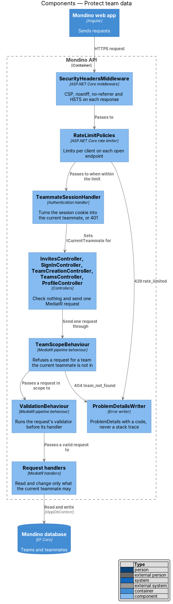
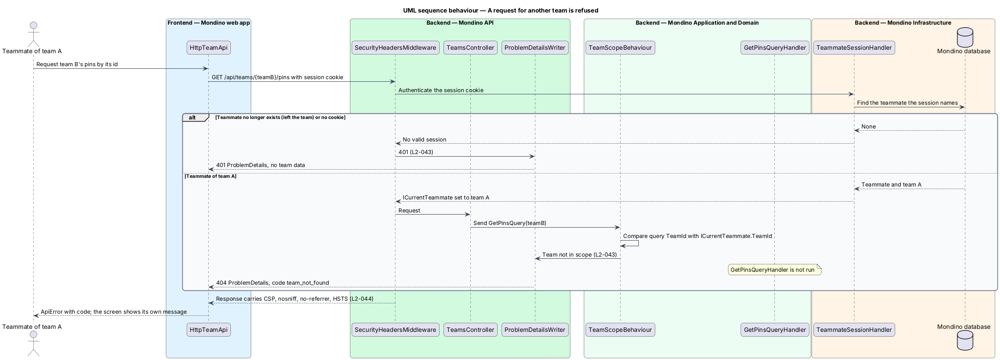

# Protect team data

## Overview

Mondino shows a team as pins on a globe. A teammate joins through the team's invite link with
a name, a country and a postal code, and the pin is placed at the postal code's city. This
feature covers how Mondino keeps that data to the people it belongs to. A teammate sees only
the team they are in and changes only their own pin. A postal code is returned only to the
teammate it belongs to. Every value a person types is validated by the backend and rendered as
text. What is open to anyone (opening an invite link, looking up a postal code, joining,
asking for a sign-in link and making a team) is marked as open and rate limited. An email is
the teammate's own, as a postal code is, and no screen and no answer says whether Mondino
knows an email.

The backend decides what is allowed. What the browser shows or hides is a convenience and
never the rule.

The terms used below:

- **session** — proof, held in a cookie, that a browser belongs to one teammate of one team
- **current teammate** — teammate a request's session belongs to
- **team scope** — rule that a request naming a team is served only when the current teammate is in that team
- **open endpoint** — endpoint that needs no session: one that needs an invite link's token, or one that anyone may call

How a team is made is in `make-team`, and how a teammate signs in again on another device in
`sign-in`.

## Description

The rules are enforced in the `Mondino API`. Controllers check nothing and send one MediatR
request; each rule sits in the request pipeline in front of them or in the MediatR pipeline
behind them.

**The session (L2-043).**

- **`TeammateSessionHandler`** — authentication handler in `Mondino.Infrastructure`. A
  successful `JoinTeamCommand`, `CreateTeamCommand` or `RedeemSignInLinkCommand` calls
  `SignInAsync`, which issues a cookie that is `HttpOnly`,
  `Secure` and `SameSite=Lax`. The cookie's protected payload names the teammate id and the
  team id and nothing else. On each request the handler reads the cookie and confirms through
  `IAppDbContext` that the teammate still exists in that team. A teammate who has left no
  longer exists, so an old session is refused with 401. The session's lifetime is `<TO SUPPLY>`.
- **`ICurrentTeammate`** — interface in `Mondino.Application` with `TeammateId`, `TeamId` and
  `IsAuthenticated`. **`CurrentTeammate`** in `Mondino.Infrastructure` implements it from the
  authenticated principal. Handlers read the current teammate from it and never from a
  request's body.
- **Fallback policy.** The API's fallback authorisation policy requires an authenticated
  teammate. `InvitesController`, `SignInController` and `TeamCreationController` are the only
  controllers marked `[AllowAnonymous]`, and each of their actions names a rate limit policy.
  The health endpoints are marked the same way (`observe-without-exposing`). No endpoint is
  open by omission (L2-045).
- **Cross-site request forgery.** State-changing requests under `/api/teams/` require an
  antiforgery token: the API issues it in a script-readable cookie, and Angular's `HttpClient`
  returns it in a request header. The open endpoints carry no session. How the requests that
  change state before a session exists (joining, making a team, asking for a sign-in link and
  opening one) are protected is `<TO SUPPLY>`.

**Team scope (L2-043, L2-007).**

- **`ITeamScopedRequest`** — interface in `Mondino.Application` with `Guid TeamId`.
  `GetPinsQuery`, `GetMomentsQuery`, `GetProfileQuery`, `UpdateProfileCommand`,
  `LeaveTeamCommand` and `ResetInviteLinkCommand` implement it. Any teammate of a team may
  reset its invite link (`invite-teammates`, L2-055): Mondino has no roles, and the team scope
  is the whole rule.
- **`TeamScopeBehaviour`** — MediatR pipeline behaviour. For an `ITeamScopedRequest` it
  compares the request's `TeamId` with `ICurrentTeammate.TeamId`. When they differ, it stops
  the pipeline with `team_not_found`, written as 404. A team that exists and a team that does
  not give the same answer, and the handler is not run.
- **Own pin only.** `ProfileController`'s routes are `/api/teams/{teamId}/me`. They carry no
  teammate id, and `GetProfileQueryHandler`, `UpdateProfileCommandHandler` and
  `LeaveTeamCommandHandler` act on `ICurrentTeammate.TeammateId`. No route addresses another
  teammate's profile, pin or settings, so such a request is answered 404.
- **Ids and tokens.** `Team.Id` and `Teammate.Id` are version 4 `Guid`s from a cryptographic
  random source, which carry 122 random bits. `Team.InviteToken` is at least 128 bits from
  `RandomNumberGenerator`, encoded for a URL. The token gives access to the open endpoints of
  its own team only. `IInviteTokens` issues it when a team is made (`make-team`) and when its
  link is reset, after which the old token matches no team.

**A postal code never reaches another teammate (L2-007).**

- `PinDto` and `MomentDto` have no postal code property, and no part or hash of one. They
  carry the city's name and country, and the city's position, never the postal code's own.
- `ProfileDto` is the only DTO returned to a teammate that carries a postal code, and
  `GetProfileQueryHandler` builds it for the current teammate only.
- `InviteDto` carries bare positions with no names, and `Avatars`: the initials and colour
  of the five teammates who joined most recently, with no name, id or city. Initials and a
  colour are the most a holder of an invite link learns of a teammate (L2-001).
  `PostalCodeResultDto` answers the person who typed the postal code.
- A postal code travels in a request body, never in a URL. In the browser it lives only in the
  form state of `JoinPage` and `ProfilePage`. `SettingsCache` and `TeamMembership` never hold
  one, so none is in local storage, session storage, IndexedDB, a cookie or the address bar.

**An email never reaches another teammate, and is never confirmed (L2-043, L2-045).**

- `Teammate.Email` is in no DTO but the request bodies that carry it in: `PinDto`,
  `MomentDto`, `ProfileDto`, `InviteDto` and `CreatedTeamDto` have no email property.
  `SignInResultDto` returns the email to the browser that opened the link sent to it.
- `POST /api/sign-in-links` answers 202 with no body for every email in the right form, and
  `RequestSignInLinkCommandHandler` does the same work for each, so neither the answer nor
  its timing says whether the email is on a team. The Sign In screen reads "Check your inbox"
  in every case (`sign-in`, L2-052).
- `POST /api/teams` never refuses because an email is already on a team.
- An email travels in a request body, never in a URL. In the browser it lives in the form
  state of `SignInPage` and `CreateTeamPage` and in the navigation state for
  `InviteNeededPage`; `TeamMembership` and `SettingsCache` never hold one.
- A sign-in token is stored as a hash, is used once and expires after 15 minutes by
  `TimeProvider`. It travels in the fragment of the emailed address and then in a request
  body.

**Validation and data as text (L2-044).**

- **`ValidationBehaviour`** — MediatR pipeline behaviour. It runs the request's validator and
  stops the pipeline with `validation_failed`, written as 400, before anything is stored.
- **`JoinTeamCommandValidator`**, **`CreateTeamCommandValidator`** and
  **`UpdateProfileCommandValidator`** — a name of 1 to 60 characters, a country in the
  supported list and a postal code of at most 12 characters; for a new team also a team name
  of 1 to 60 characters and an email of at most 254 characters in the form of an address.
  `RequestSignInLinkCommandValidator` checks the email the same way. The
  country's format is checked afterwards by the handler through `PostalCodeFormats`, which
  refuses with `postal_code_not_found` (422), not `validation_failed`.
- **`NameNormaliser`** — service in `Mondino.Application`. It removes control characters and
  trims leading and trailing spaces from a teammate's name and a team's name before validation
  and storage.
- **Narrow request bodies.** A request body binds to a record that has only the fields a
  person may set: name, team name, email, country, postal code or city id, and settings. A teammate id, a position or a
  colour in the body is ignored.
- **`ProblemDetailsWriter`** — writes each refusal as ProblemDetails with a `code` extension
  and no stack trace. A screen branches on `ApiError.code` and shows its own message.
- **Text, not HTML.** The web app renders a teammate's name, a team's name, a city and a
  moment's title and detail, an email on Sign In and on `InviteNeededPage`, and the address on
  `NotFoundPage`, through Angular interpolation. No template binds `innerHTML`, and
  no code calls `bypassSecurityTrust…`.
- **`SecurityHeadersMiddleware`** — adds to each response a Content-Security-Policy that allows
  scripts, styles, fonts, images and connections from the app's own origin only,
  `X-Content-Type-Options: nosniff`, `Referrer-Policy: no-referrer` and
  `Strict-Transport-Security`. The host that serves the web app's files shall send the same
  headers; the hosting platform, and how Angular's component styles receive a CSP nonce on it,
  are `<TO SUPPLY>`.
- The browser calls only the `Mondino API`. Fonts and the globe's map data are bundled and
  served from the app's origin.

**Rate limits (L2-045).**

**`RateLimitPolicies`** registers one fixed-window policy for each open endpoint with the
ASP.NET Core rate limiter, each partitioned by client address. The rate limiter runs before
authentication, the controller and any outside source.

| Policy | Endpoint | Limit per client |
|--------|----------|------------------|
| `OpenInvite` | `GET /api/invites/{inviteToken}` | 30 a minute |
| `PostalCodeLookup` | `POST /api/invites/{inviteToken}/postal-code-lookups`, `POST /api/postal-code-lookups` | 10 a minute |
| `Join` | `POST /api/invites/{inviteToken}/teammates` | 5 a minute |
| `CitySearch` | `POST /api/invites/{inviteToken}/city-searches`, `POST /api/city-searches` | `<TO SUPPLY>` |
| `Countries` | `GET /api/countries` | `<TO SUPPLY>` |
| `CreateTeam` | `POST /api/teams` | `<TO SUPPLY>` |
| `SignInLink` | `POST /api/sign-in-links` | `<TO SUPPLY>` |
| `SignInRedemption` | `POST /api/sign-in-links/redemptions` | `<TO SUPPLY>` |

A refused request is answered 429 with a `Retry-After` header and the code `rate_limited`.
For a lookup or a join request, `JoinPage` shows "Too many tries from this device. You can try
again in 9:42.", counts down from `Retry-After`, disables its button until the countdown ends
and keeps what was typed. For an open of an invite link, nothing has been typed yet, and
`JoinPage` shows "We couldn’t open this invite" with "Try again" (L2-001). Sign In and Create
Team have no state of their own for the refusal: each shows its alert with "Try again". A
limit on the sign-in links sent to one address, whatever client asks, is `<TO SUPPLY>`; it
keeps the open endpoint from being used to fill a person's inbox. `LookUpPostalCodeQueryHandler` finds the team by its invite token before it calls
`IPostalCodeLookup`, so the lookup cannot be used without a valid invite link. Behind a proxy,
the client address is read from the forwarded header the hosting platform sets, which is
`<TO SUPPLY>`. The limit on `POST /api/teams/{teamId}/me/postal-code-lookups`, which needs a
session, is `<TO SUPPLY>`.

## Requirements

The feature realizes the following level-2 (L2) requirements. Each L2 requirement refines a
level-1 (L1) requirement, cited by identifier.

| L2 ID | Refines (L1) | Requirement |
|-------|--------------|-------------|
| `L2-007` | `L1-002` | A postal code is returned only to the teammate it belongs to, on their own Join and Profile & Settings screens. Everything another teammate receives carries the city and country only. |
| `L2-043` | `L1-014` | The backend decides what is allowed. Every request must come from a teammate of the team it concerns, except those that are open to anyone (L2-045): opening an invite link, looking up a postal code or finding a city while joining or making a team, joining, making a team, asking for a sign-in link and opening one. What the browser shows or hides is a convenience and never the rule. Mondino has no roles: the teammate who made a team is a teammate like any other. |
| `L2-044` | `L1-014` | Every value from a browser is validated by the backend whatever the frontend checked. A teammate's name, a team's name, an email, a city, a moment's title and detail, what is typed in a search and the address of a page that is not there are rendered as text, never as HTML, wherever they appear. |
| `L2-045` | `L1-014` | Opening an invite link, looking up a postal code or finding a city while joining, and joining are open to anyone who holds an invite link. Sign In (asking for a sign-in link and opening one) and Create Team (its postal code lookup and making the team) are open to anyone at all. Each is marked as open explicitly and is rate limited. |

Sign In and Create Team add open endpoints (L2-052, L2-053). This design applies L2-043,
L2-044 and L2-045 to them: each is marked as open, each is rate limited, and none reveals
whether an email is known.

## Diagrams

### System context

A teammate reads their own team and changes their own pin. A person with an invite link may
open it, look up a postal code and join, and anyone may ask for a sign-in link or make a team. Mondino calls the postal code source only for a valid
invite link and within the rate limit.

### Containers

The `Mondino web app` sends the session cookie or an invite token. The `Mondino API`
authenticates, scopes, validates and rate limits each request before it reads the
`Mondino database` or calls the postal code source.

### Components

A request passes `SecurityHeadersMiddleware`, `RateLimitPolicies` and `TeammateSessionHandler`
before a controller sends one MediatR request. `TeamScopeBehaviour` and `ValidationBehaviour`
run before the handler. A refusal at any step is written by `ProblemDetailsWriter`.

### Class structure

`TeammateSessionHandler` populates `CurrentTeammate`, which implements `ICurrentTeammate`.
`TeamScopeBehaviour` compares it with each `ITeamScopedRequest`. `ValidationBehaviour` runs
validators such as `JoinTeamCommandValidator`. `PinDto` has no postal code; `ProfileDto`
carries the owner's.

### Behaviour — a request for another team is refused

A teammate of team A requests team B's pins by its id. `TeammateSessionHandler` refuses a
missing or outdated session with 401. For a valid session, `TeamScopeBehaviour` finds that the
team is not the current teammate's and answers 404 with `team_not_found`, the same answer as
for a team that does not exist; `GetPinsQueryHandler` is not run (L2-043). The response
carries the security headers (L2-044).

### Behaviour — a rate-limited postal code lookup

A person on the Join screen looks up a postal code. Past 10 lookups in a minute,
`RateLimitPolicies` answers 429 with `Retry-After` before any controller, handler or outside
source is called, and `JoinPage` keeps what was typed (L2-045). Within the limit, the handler
requires a valid invite token, validates the postal code (L2-044) and sends the outside source
a country and postal code only.

