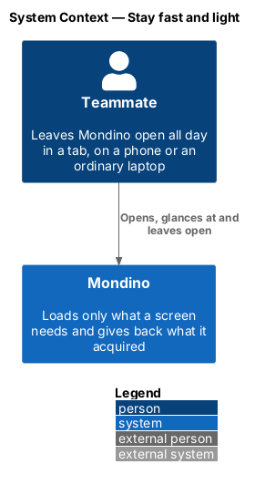

# Stay fast and light

## Overview

Mondino is left open all day, in a tab beside the work, and glanced at. Its globe is a 3D
scene, the heaviest thing in the application. This feature covers the parts that keep Mondino
quick to open on a phone, smooth to turn on an ordinary laptop, and no heavier at the end of
the day than at the start: what is loaded when, what is released when a screen is left, the
one clock that drives every local time, and the limit on how many rows a long list holds.

Lazy loading and memory management are the frontend's first priority. A change that grows the
initial bundle or leaks memory is not done, whatever else it achieves.

The terms used below:

- **initial bundle** — code the browser downloads before the first screen is shown
- **reference phone** — mid-range phone on a 4G connection throttled to 1.6 Mbps and 150 ms
- **reference laptop** — laptop with integrated graphics
- **detail step** — one level of resolution and model detail at which the globe's scene can be drawn
- **windowed list** — list that keeps in the page only the rows near the visible part
- **city section** — part of the Team list of a large team that holds one city's teammates and opens and closes

The globe's renderer and the format its Blender-built assets are exported to are decided in an
ADR before the Globe is built; both are `<TO SUPPLY>`. This design fixes what holds whichever
renderer is chosen.

## Description

**Load only what is needed now (L2-046).**

- **Lazy routes.** Each screen is loaded with `loadComponent` (`adapt-to-every-width`), so a
  screen's code arrives when its address is opened. Sign In (`/sign-in`), Create Team (`/new`)
  and the pages that say one thing are routes of their own, so a teammate who opens the Globe
  downloads none of them. Each of those routes binds its own API token (`SIGN_IN_API`,
  `TEAM_CREATION_API`) and provides its own store, which keeps the clients out of the initial
  bundle and lets the state go with the route.
- **The invite dialog is loaded on demand.** `InviteDialogOpener` imports `InviteDialog`
  dynamically when "Invite teammate" is first chosen (`invite-teammates`). The dialog, with
  `CopyField`, is in a chunk of its own: it is in no screen's chunk and not in the initial
  bundle, although the button that opens it is in the header of every teammate screen.
  `LeaveTeamDialog` and `DiscardChangesDialog` arrive with the `/profile` route.
- **The `globe` library is imported dynamically.** No file in the initial bundle imports
  `@mondino/globe` statically. `GlobePage`, `JoinPage`, `SignInPage`, `CreateTeamPage` and
  `ProfilePage` place `mo-globe` inside a `@defer` block, which imports the library, its renderer and its map data when a
  globe is first drawn. The block's placeholder reserves the globe's box, so the layout does
  not shift when the globe arrives.
- **The screen is usable before the globe.** `GlobePage` renders its heading, counts and panel
  from `TeamStore` without waiting for the `@defer` block.
- **Budgets.** `angular.json` sets an error budget on the initial bundle that corresponds to
  150 kB compressed, and `tools/verify/verify.mjs` measures the compressed size of the built
  initial chunks. Raising a budget needs a reason in the change. Fonts are self-hosted, subset
  and preloaded; only the weights the screens use are bundled.
- **Assets are cached.** The globe's assets and each chunk have content-hashed file names and
  are served with a long-lived, immutable `Cache-Control`. The hosting platform that sets the
  header is `<TO SUPPLY>`.
- **`DetailLevel`** — class in `globe`, owned by `GlobeView` (`draw-globe`). It holds an
  ordered list of `DetailStep`s (`pixelRatio`, `modelDetail`) and the current one. `GlobeView`
  passes it each frame's duration, which `GlobeScene.onFrame` reports, through
  `record(elapsedMs)`. When the frame rate stays under 30 for a sustained interval, it moves
  to the next lower step and `GlobeView` calls `GlobeScene.setDetail(step)`, which lowers the
  model's detail and the drawing resolution; this repeats until the frame rate recovers. The
  steps and the interval are `<TO SUPPLY>` with the renderer's ADR.
- **`GlobeFallback`** — component in `components`: the still picture shown when WebGL is
  unavailable or the `globe` library fails to load. It allocates no renderer and runs no
  animation frame. It keeps the team's pins, in place and working, drawn as HTML over the
  picture (`draw-globe`, `show-pins`); it does not turn and is not dragged, so it holds no
  pointer listener for dragging. `NoticePage` draws its small globe the same way, as a
  picture.
- **Interactions stay under 200 ms.** State is held in signals, every component is `OnPush`
  and the app is zoneless, so a selection or a filter re-renders only what reads the changed
  signal.
- **The backend answers a team of 500 quickly.** `GetPinsQueryHandler` loads the team's
  teammates in one query without tracking, and weather comes from the cache
  (`survive-source-failure`). The `Mondino API` compresses its responses. The 95th-percentile
  target is 300 ms.

**Release everything acquired (L2-047).**

- **`GlobeView`** owns one `GlobeScene` for as long as it is on the page. It registers its
  teardown with `DestroyRef`: it removes its pointer listeners, disconnects its
  `ResizeObserver` and calls `GlobeScene.dispose()`.
- **`GlobeScene.dispose()`** cancels the pending animation frame and releases the model, its
  materials and textures, the renderer and the WebGL context. After it returns, the scene
  holds nothing. `GlobeScene.stop()` and `start()` pause and resume the render loop without
  releasing anything.
- **`TeamStore`** is provided by `TeamShell`, the parent route of the four teammate screens,
  not in `root`. It holds the `AbortController` of its pending read; its 15-minute refresh runs
  from the one clock's minute tick, so it has no timer of its own (`keep-team-fresh`). When it
  is destroyed, or when a newer read starts, it aborts, which cancels the
  HTTP request. A page that starts its own request ties it to `takeUntilDestroyed`, so leaving
  a screen cancels the request.
- **Scoped state.** A screen's own state (a filter, a draft of the settings) lives in the page
  component or a service it provides, and goes when the teammate leaves the screen. An email
  typed on Sign In or Create Team, a postal code and a city search go the same way.
- **Timers that count down.** The toast's 4 s dismissal (`InviteLinkCopier`), the rate limit
  countdown and the pause before a city search (`JoinStore`) are each one timer, cleared when
  it ends and when its owner is destroyed. A pending city search is aborted when a newer one
  starts and when the route is left.

**One clock, and it rests (L2-047).**

- **`Clock`** / `CLOCK` — contract and token in `api`: `now(): Date` and the signal `minute`.
- **`BrowserClock`** — the one implementation, in `domain`'s `time/`, bound in
  `app.config.ts`. It holds one timer, aligned to the start of the next minute, and sets
  `minute` when it fires. Every local time, status, offset and overlap is a `computed` over
  `minute` and a pin's time zone; no pin and no component has a timer of its own.
- On `visibilitychange` to hidden, `BrowserClock` clears its timer. On return it sets `minute`
  at once and schedules again, so local times, statuses and the night side are correct at
  once.
- `GlobeView` listens for the same event and calls `GlobeScene.stop()` while the tab is hidden
  and `start()` when it returns. No frame is drawn while hidden.

**Bound what grows (L2-047).**

- **The Team list** is bounded by its sections, not by virtual scrolling. Past
  `LargeTeamThreshold` (40) teammates it is split into one `CitySection` per city; a closed
  section holds no rows, and an open one holds at most `CityRowLimit` (50)
  (`view-team-through-the-day`, L2-056). The day ribbon of such a team is 48 bars, whatever
  the team's size.
- **`MomentList`** renders its rows through CDK virtual scrolling (`cdkVirtualFor`), so the
  number of rows in the page stays under a fixed limit. The limit follows from the viewport's
  height and the buffer; the buffer size is `<TO SUPPLY>`.
- **The Globe's panel** lists at most six moments and six teammates in working hours
  (`view-week-around-the-world`).
- `TeamStore` replaces its pins on each refresh; it keeps no history. A team has at most 500
  teammates (`Team.MaxTeammates`).
- `GlobePage` groups close pins (`groupPins`, through `placePins`), so the pins and labels
  drawn at once are bounded by the globe's size, not the team's: a team of 500 is drawn as
  group pins with counts.

**Prove it.** A heap check enters and leaves the Globe screen 20 times and compares the heap
after garbage collection with its size after the first visit; a second check runs the Globe
screen for 8 simulated hours on a fake clock. Each allows growth of 5%. Like the visual and
accessibility sweeps, the heap checks run only when a person asks.

## Requirements

The feature realizes the following level-2 (L2) requirements. Each L2 requirement refines a
level-1 (L1) requirement, cited by identifier.

| L2 ID | Refines (L1) | Requirement |
|-------|--------------|-------------|
| `L2-046` | `L1-015` | Mondino opens quickly on a phone and the globe turns smoothly on an ordinary laptop. The reference devices are a mid-range phone on a 4G connection (throttled 1.6 Mbps, 150 ms) and a laptop with integrated graphics. |
| `L2-047` | `L1-015` | Mondino is left open all day. It uses no more memory at the end than at the start, and every screen gives its memory back when the teammate leaves it. |

## Diagrams

### System context

A teammate opens Mondino, glances at it and leaves it open all day. No outside system takes
part in this feature.

### Containers

The `Mondino web app` keeps its initial bundle small and loads the `globe` library and its
assets on first draw. The `Mondino API` answers a team of 500 within 300 ms at the 95th
percentile, compressed.

### Components

`app.routes.ts` loads the Globe chunk. `GlobePage` shows its text first, then defers
`GlobeView`, which creates and disposes `GlobeScene` and reports its frame times to
`DetailLevel`. `GlobePage` and `GlobeView` read the one `BrowserClock`.

### Class structure

`BrowserClock` implements `Clock`. `GlobeView` composes `GlobeScene` and
`DetailLevel`; `GlobeView` shows the `GlobeFallback` that `GlobePage` gives it when WebGL is unavailable. `GlobePage` depends
on `TeamStore`, `Clock` and, through a dynamic import, `GlobeView`. `TeamTable` and
`MomentList` hold a bounded number of rows.

### Behaviour — enter and leave the Globe screen

On entry, the router loads the Globe chunk, `GlobePage` shows its heading, counts and panel,
and the `@defer` block imports `@mondino/globe` and starts `GlobeScene` (L2-046). While the
screen is open, `DetailLevel` steps down when the frame rate stays under 30, one clock ticks
every local time, and both the clock and the render loop rest while the tab is hidden. On
leaving, a pending request of the page's own is cancelled, `GlobeView` removes its listeners and observer, and
`GlobeScene.dispose()` releases the renderer and the WebGL context (L2-047).

