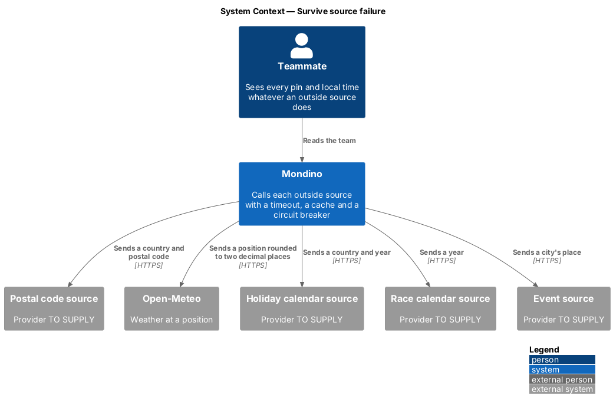
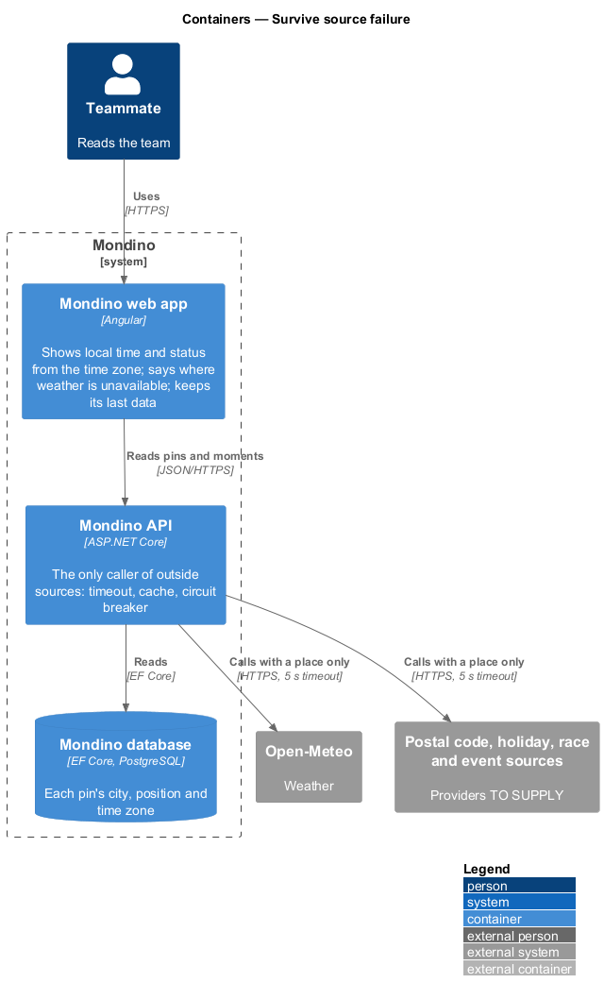
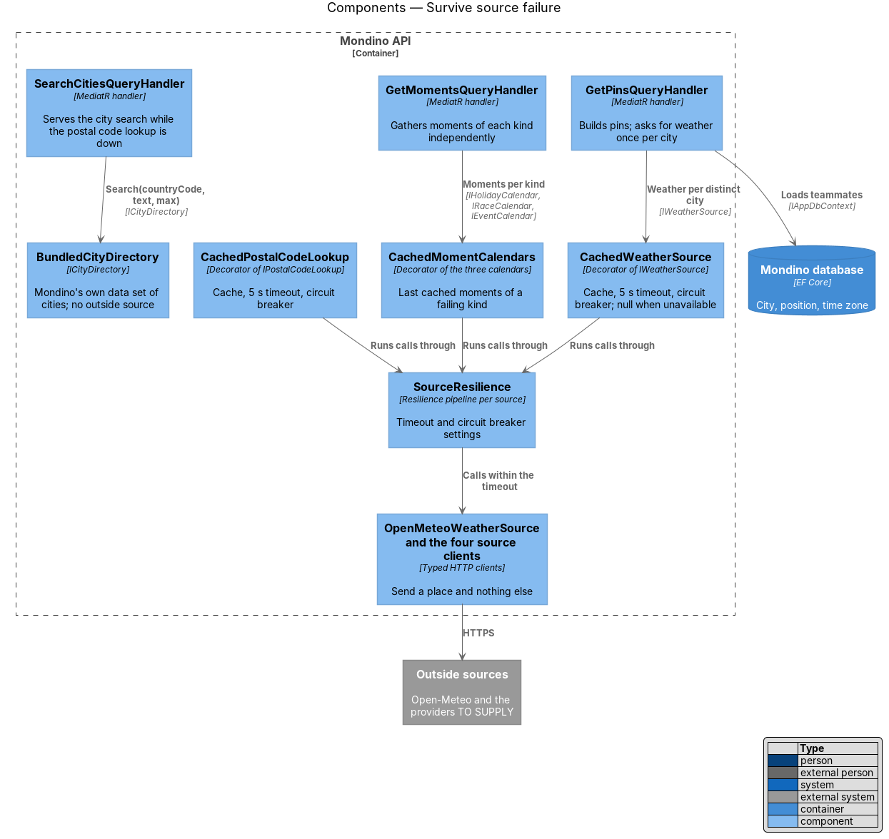

# Survive source failure

## Overview

Mondino depends on outside sources: a postal code source turns a postal code into a city, a
position and a time zone; Open-Meteo gives the weather at a city; a holiday calendar source, a
race calendar source and an event source give the moments where teammates live. Any of them
can be slow or fail. This feature covers how the `Mondino API` calls them so that a failure
costs only what depends on it: when the weather is missing, every pin still shows its city and
its local time.

The feature also fixes what an outside source learns. A call carries a place and never a
teammate's name, their team or anything that identifies them.

The terms used below:

- **outside source** — service outside Mondino that the backend calls for postal codes, weather or calendars
- **caching decorator** — class that implements an outside source's interface, wraps the real client, and adds a cache, a timeout and a circuit breaker
- **circuit breaker** — guard that stops calls to a source that keeps failing, for a short interval, before trying again
- **place** — a country and postal code, or a position, or a country and year

The providers of the postal code source, the holiday calendar source, the race calendar source
and the event source are `<TO SUPPLY>`.

## Description

**Interfaces and clients.** Each outside source sits behind an interface in
`Mondino.Application`: `IPostalCodeLookup`, `IWeatherSource`, `IHolidayCalendar`,
`IRaceCalendar` and `IEventCalendar`. `Mondino.Infrastructure` holds one typed HTTP client per
source: `PostalCodeLookupClient`, `OpenMeteoWeatherSource`, `HolidayCalendarClient`,
`RaceCalendarClient` and `EventCalendarClient`. The `Mondino API` is the only caller; the
browser calls no outside source (L2-050).

**Caching decorators.** Dependency injection registers each interface as its decorator, which
wraps the client. Handlers see the interface only.

- **`CachedWeatherSource`** — decorates `IWeatherSource`. It rounds the position to two
  decimal places and uses the rounded position as the cache key, so two teammates in one city
  share one entry and one call. An entry younger than 15 minutes is fresh and is returned
  without a call. Otherwise it calls
  `OpenMeteoWeatherSource` through `SourceResilience`. When the call gives no value, it
  returns the cached `Weather` if that is under 3 hours old (`MaxAge`), and `null` otherwise.
  It never returns a zero temperature in place of a missing one.
- **`CachedPostalCodeLookup`** — decorates `IPostalCodeLookup`. The key is the normalised
  `PostalCode`. A postal code's city does not change from hour to hour, so entries are kept
  for a long interval, which is `<TO SUPPLY>`. When the source fails and no entry exists, the
  handler answers `postal_code_unavailable`, which is distinct from `postal_code_not_found`.
- **`CachedMomentCalendars`** — decorates `IHolidayCalendar`, `IRaceCalendar` and
  `IEventCalendar`. Each kind is fetched and cached on its own, keyed by its place (a country
  and year, a year, or a city). When one calendar fails, the decorator returns the last cached
  moments of that kind, and moments of the other kinds are unaffected.

**`SourceResilience`** — one resilience pipeline per source, built with
`Microsoft.Extensions.Resilience`. `ExecuteAsync` runs a call inside it and returns a
`SourceAnswer<T>` with a `SourceOutcome` (`Success`, `Failure`, `Timeout`, `CircuitOpen`) and
the value, if any. It does not throw for a failed source.

- **Timeout.** Each call is cancelled after 5 s.
- **Circuit breaker.** After `FailuresBeforeBreak` failures the circuit opens for
  `BreakDuration`, and calls return `CircuitOpen` at once without reaching the source. Both
  values are `<TO SUPPLY>`.
- **No queue.** The pipeline does not retry and does not queue. Calls to one source run with a
  bounded concurrency, which is `<TO SUPPLY>`.

Time is read from `TimeProvider`, so tests advance a `FakeTimeProvider` and never sleep. The
cache is `IMemoryCache` with a size limit; a cache shared between instances of the API depends
on the hosting platform and is `<TO SUPPLY>`.

**What a handler does with a missing answer (L2-049).**

- **`GetPinsQueryHandler`** loads the team's teammates, takes the distinct cities, and asks
  `IWeatherSource` once per city, concurrently. Each `PinDto` carries the city, the position
  and the time zone id from the database. Where the source gave none, `Weather` is `null` and
  `WeatherState` is `Unavailable`; `WeatherState` is `NotShared` where the teammate does not
  share their weather and `Available` otherwise, so the browser can tell the two apart. The
  response succeeds in every case.
- **`GetMomentsQueryHandler`** returns the moments `CachedMomentCalendars` has for each kind.
- **A response waits at most 6 s on outside sources.** The calls for one request run
  concurrently under one deadline of 5 s, so the request completes with what the backend has.
- **The web app shows what it has.** Local time, status, offset and overlap are worked out in
  the browser from the pin's time zone and the clock, so they need no outside source. Where a
  pin's `weatherState` is `Unavailable`, `PinLabel` leaves the weather out, and `TeammatePanel`
  and the Team row say in the weather's place that it is unavailable ("Weather is unavailable
  right now."). `NotShared` has its own words (`show-weather`).
- **A first read that is pending shows the screen's loading state.** Until a screen's first
  read answers, the screen shows a placeholder in the shape of its content and announces the
  mock's words once, politely, in a visually hidden `role="status"` element:

  | Screen | Loading state announces |
  |--------|-------------------------|
  | Join | "Opening your invite link…" |
  | Globe | "Loading your team…" |
  | Team | "Loading your team…" |
  | Moments | "Loading moments…" |
  | Profile & Settings | "Loading your pin and settings…" |

  On Join, Globe and Profile & Settings the globe's box holds `GlobePlaceholder` ("The globe
  is loading"); on Team and Moments `main` carries `aria-busy="true"`.
- **A first read that fails shows the screen's error state.** The screen shows the mocks'
  `message-page` (on Join, the same title and text in the form's place) with "Try again",
  which reads again, and nothing of the team: no stale or partial pins, moments or settings.
  Team, Moments and Profile & Settings also offer "Back to the globe".

  | Screen | Title | Text |
  |--------|-------|------|
  | Join | "We couldn’t open this invite link" | "Mondino didn’t answer just now. Your link may be fine." |
  | Globe, Team | "We couldn’t load your team" | "Mondino didn’t answer just now. Nothing is lost — your pin and your team are as you left them." |
  | Moments | "We couldn’t load moments" | "Mondino didn’t answer just now. Your team’s moments are still there." |
  | Profile & Settings | "We couldn’t load your pin" | "Mondino didn’t answer just now. Your pin and settings are as you left them." |

  The error state is for a first read only: once a screen has data, a failed refresh keeps it
  and shows the banner below.
- **The backend itself unreachable.** When a refresh fails, `TeamStore` keeps its last pins,
  sets its `refreshFailed` signal and tries again at the next refresh. `TeamShell` shows, above whichever screen is
  open, a banner that it could not be refreshed, which time the weather and moments are
  from, and that Mondino will try again, with "Try now"; the clocks keep ticking, and the
  banner goes as soon as a refresh succeeds.

**What an outside source receives (L2-050).**

| Source | Carries |
|--------|---------|
| Postal code source | country and postal code |
| Open-Meteo | the city's position, rounded to two decimal places |
| Holiday calendar source | country and year |
| Race calendar source | year |
| Event source | the city's place; the exact parameters depend on the provider, `<TO SUPPLY>` |

Each client's method takes only those values, so a name, a team, a teammate id or a session is
not available to it. The clients' `HttpClient`s forward no header from the incoming request:
no cookie, no client address and no forwarded-for header.

## Requirements

The feature realizes the following level-2 (L2) requirements. Each L2 requirement refines a
level-1 (L1) requirement, cited by identifier.

| L2 ID | Refines (L1) | Requirement |
|-------|--------------|-------------|
| `L2-049` | `L1-016` | The postal code lookup, the weather and the calendars are called only by the backend, each with a timeout, and their answers are cached. When one fails, everything that does not depend on it is still shown. |
| `L2-050` | `L1-016` | A call to an outside source carries a place (a country and postal code, or a position, or a country and year) and never a teammate's name, their team or anything that identifies them. |

## Diagrams

### System context

Mondino calls five outside sources, and sends each a place only. A teammate reads the team
whatever any of them does.

### Containers

The `Mondino API` is the only caller of outside sources, each with a 5 s timeout. The
`Mondino database` holds each pin's city, position and time zone, which need no outside
source once stored.

### Components

`GetPinsQueryHandler` and `GetMomentsQueryHandler` reach the sources through the caching
decorators. Each decorator runs its calls through `SourceResilience`, which calls the typed
clients within the timeout.

### Class structure

`CachedWeatherSource` and `OpenMeteoWeatherSource` both implement `IWeatherSource`, and the
decorator wraps the client; `CachedPostalCodeLookup` and `PostalCodeLookupClient` relate the
same way. Each decorator depends on `SourceResilience`, which returns a `SourceAnswer<T>` with
a `SourceOutcome`. `PinDto.Weather` is nullable, and `PinDto.WeatherState` says why.

### Behaviour — read pins while the weather source is failing

`GetPinsQueryHandler` asks for weather once per distinct city (L2-050).
`CachedWeatherSource` returns a fresh entry when it has one. Otherwise `SourceResilience`
calls Open-Meteo with a 5 s timeout, or does not call it while the circuit is open. With no
value, the decorator gives the cached weather when it is under 3 hours old, and `null`
otherwise, which the handler marks `Unavailable`. The response succeeds, and each pin shows its local time and status; the panel
and the Team row say the weather is unavailable in its place (L2-049).

