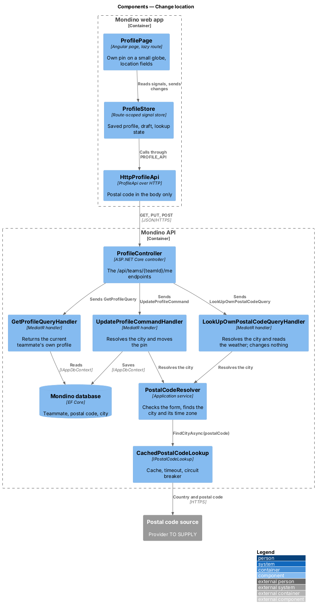
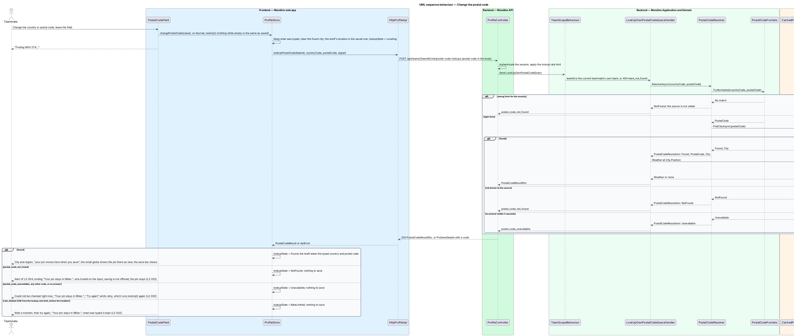

# Change location

## Overview

Mondino is where a team spread around the world sees each other. Each teammate appears on a 3D
globe as a pin placed at their city, with their local time, their weather and the moments
happening where they live. A teammate gives a country and a postal code when joining; the
backend turns the postal code into a city, a position and a time zone, and the postal code
itself stays private.

Profile & Settings, titled "Your pin", is the screen where a teammate sees and changes what
Mondino holds about them. This feature covers the top of that screen. It shows the viewer's own
pin on a small globe with their city, country, local time and time zone, and the reminder
"Teammates see your city, never your postal code." It also lets a teammate who has moved change
their country and postal code. The new postal code is looked up as it is on Join. On saving, the
pin moves to the new city and takes that city's time zone, weather and moments.

The terms used below:

- **viewer** — teammate looking at the screen, whose own data the screen shows
- **profile** — what the backend returns to a teammate about themselves: their own pin, country, postal code and settings
- **postal code lookup** — request that turns a country and a postal code into a city, without changing anything
- **draft** — copy of the profile that holds the viewer's changes until they are saved
- **found city** — city a postal code lookup answered with, shown before saving

The display settings, the sharing switches and the save bar that share this screen are described
in [Choose display and sharing](../choose-display-and-sharing/README.md). Leaving the team is
described in [Leave team](../leave-team/README.md).

## Description

The feature is a vertical slice from the `ProfilePage` to the `Mondino database`. The code does
not exist yet; each part below is introduced by this design.

### Frontend — `mondino` application

- **`ProfilePage`** — lazy route `/profile`, guarded by `teammateGuard`. It reads the profile
  through `PROFILE_API`, lays out "Your pin" beside the settings from tablet width up and in one
  column on a phone, and passes values to presentation components. It holds no rule of its own.
  The "Location" section reads "Moved? Update your postal code and your pin follows." and holds
  the Country field, which lists `Profile.countries` in alphabetical order, and the postal code
  field. The page passes `PostalCodeField` the chosen `Country`, the `lookupState`, the
  `LookupMessage` that `profileLookupMessage` gives for it, and `invalid`, which is true for
  `NotFound`.
  While the profile is being read it shows a placeholder for the globe and for each section, and
  announces "Loading your pin and settings…". When the read fails it shows "We couldn’t load
  your pin" in place of the screen, with "Mondino didn’t answer just now. Your pin and settings
  are as you left them.", "Try again" and "Back to the globe".
- **`ProfileStore`** — store provided at the `/profile` route, so its state goes when the viewer
  leaves the screen. It holds the saved `Profile`, the draft, the country and postal code as
  typed, the state of the postal code lookup and the state of the save as signals.
  `changeCountry(countryCode)` and `changePostalCode(value)` keep what was typed, clear the
  found city and return the draft's country and postal code to the saved ones. `lookUp()` calls
  `ProfileApi.lookUpPostalCode`, and only a lookup that finds a city puts the typed country and
  postal code in the draft. A postal code that is being looked up, was not found or could not
  be checked is therefore not an unsaved change: there is nothing to save for it, the save bar
  does not show for it, and saving is not offered for it (L2-032). `ProfilePage` calls
  `lookUp()` on the field's `blurred` and `retry`. `lookUp()` does nothing, and the state
  stays `Idle`, while the postal code typed is empty or the country and postal code typed are
  the saved ones, so moving through the field looks nothing up. The store aborts a pending
  lookup when a newer one starts and when the route is destroyed. After a save that moved the
  pin, the store calls `TeamStore.refresh()`, so the Globe, Team and Moments screens the
  viewer opens next show their own pin at the new city without waiting for the 15 minute
  refresh (`team/keep-team-fresh`).
- **`LookupState`** (`@mondino/api`) — the union the Join screen uses: `Idle`, `Locating`,
  `Found` (with its `PostalCodeResult`), `NotFound`, `Unavailable`, `RateLimited`. `ProfileStore`
  maps `postal_code_not_found` to `NotFound`, `rate_limited` to `RateLimited`, and
  `postal_code_unavailable`, any other code and no answer to `Unavailable`, as Join does.
- **The small globe** — `ProfilePage` imports `GlobeView` from `@mondino/globe` dynamically and
  renders `mo-globe` with one pin, the viewer's own, and `interactive` set to `false`. A globe
  that is not interactive does not turn on its own and cannot be dragged (L2-031). `GlobeView`
  has no input that takes a position: `ProfilePage` puts its one pin in `pins` (the saved pin,
  or the draft's "New · Toronto" pin) and names it in `selectedId`, so the globe turns to it
  and holds there (`globe/turn-globe`). While the
  draft holds a found city that is not saved, the globe shows the pin there, marked as new
  ("New · Toronto"); the city and local time beside it stay the saved ones until the save.
  The globe's accessible name is "A small globe with your pin at Milan", or "A small globe with
  your pin moved to Toronto, not saved yet" while it shows the new pin.
  `GlobeScene` is disposed when the page is destroyed.

### Frontend — libraries

- **`ProfileApi` / `PROFILE_API`** (`@mondino/api`) — contract and injection token. This feature
  uses `getProfile(teamId)`, `lookUpPostalCode(teamId, countryCode, postalCode, signal)` and
  `updateProfile(teamId, update)`. `HttpProfileApi` implements it. `lookUpPostalCode` sends
  `POST /api/teams/{teamId}/me/postal-code-lookups`; it needs the teammate's session and no
  invite token. The postal code travels in the request body, never in a URL.
- **`Profile`** — type holding `teamName`, the viewer's own `pin` (a `Pin`), `countryCode`,
  `postalCode`, `settings` and `countries`, the supported countries as the `Country` list an
  `Invite` carries. It is the only type in the frontend that carries a postal code
  after joining. `ProfileStore` keeps it in memory only; `SettingsCache` never receives it.
- **`ProfileUpdate`** — feature-local type sent on save: `countryCode`, `postalCode`, `settings`.
- **`ApiError`** — error with a `code`. `ProfileStore` branches on `postal_code_not_found`,
  `postal_code_unavailable` and `rate_limited`; the page shows its own message for each.
- **`PostalCodeField`** (`@mondino/components`) — the postal code field that Join also uses, in
  the same shape: inputs `value`, `country`, `lookupState`, `message` and `invalid`, outputs
  `valueChange`, `blurred` and `retry`. It injects nothing and holds no copy of its own: it
  renders the `LookupMessage` it is given, in a polite live region for `Idle`, `Locating` and
  `Found` and in an alert (`role="alert"`) for the other three, and links it to the input with
  `aria-describedby`. `invalid` sets `aria-invalid` on the input.
- **`LookupMessage`** (`@mondino/api`) — what the field shows for a lookup state: `text`
  and, where the message offers one, `retryLabel` ("Try again"). `Country` is a type in
  `@mondino/api` too.
- **`profileLookupMessage(lookupState, postalCode, country, savedCity)`** — pure helper beside
  `ProfilePage` that gives this screen's `LookupMessage`, or null for `Idle`. The states are
  Join's, with this screen's own copy:
  - `Locating`: "Finding M5V 2T6…".
  - `Found`: "Toronto, Ontario — your pin moves here when you save. 9° and cloudy right now."
    When the result carries no weather, the message ends after "when you save."
  - `NotFound`: the alert of L2-004, ending "Your pin stays in Milan." ("We couldn’t find
    “M5V 2T” in Canada. Canadian postal codes look like A1A 1A1. Your pin stays in Milan."),
    with `invalid` set, so the input carries `aria-invalid`. Its middle sentence is the
    country's `postalCodeHint`, as it stands, as on Join.
  - `Unavailable` (mock `profile/lookup-unavailable`): "We couldn’t check M5V 2T6 right now.
    Your postal code may be fine — nothing is wrong with what you typed. Your pin stays in
    Milan.", with "Try again", which emits `retry` and runs `lookUp()` again.
  - `RateLimited` (mock `profile/rate-limited`): "That was a lot of tries in a short time. Wait
    a moment, then try again. Your pin stays in Milan."

  In the last three states what the viewer typed is kept, saving is not offered for it, and
  the pin stays where it was.
- **`localTime` and `formatTime`** (`@mondino/domain`, `time/`) — work out the viewer's local
  time from the pin's time zone id and the injected `CLOCK`. On this screen the pin's card
  shows it in the draft's clock format, so a viewer who chooses the 12-hour clock sees
  "3:05 pm local" on the card before saving, as the mocks of the save bar draw; every other
  screen follows on saving.
  `timeZoneName(timeZoneId, now)`, beside them, gives the name of the time zone ("Central
  European Time") from `Intl.DateTimeFormat` with `timeZoneName: 'longGeneric'` (L2-031).

### Backend — `Mondino.Api`

- **`ProfileController`** — exposes `GET /api/teams/{teamId}/me`, `PUT /api/teams/{teamId}/me`
  and `POST /api/teams/{teamId}/me/postal-code-lookups`. Each action checks nothing itself and
  sends one MediatR request. `TeammateSessionHandler` authenticates the session cookie before
  the action runs; a request with no session is refused with 401. The lookup action sends one
  `LookUpOwnPostalCodeQuery`, takes the country and postal code from the request body, and
  carries a rate limit policy of its own from `RateLimitPolicies`.

### Backend — `Mondino.Application`

- **`GetProfileQuery` / `GetProfileQueryHandler`** — loads the teammate that `ICurrentTeammate`
  names and returns a `ProfileDto`. A `teamId` that is not the teammate's own team is refused
  by `TeamScopeBehaviour` with 404 and the code `team_not_found` (`protect-team-data`), the
  same answer as for a team that does not exist; that holds for each request of this feature.
- **`LookUpOwnPostalCodeQuery` / `LookUpOwnPostalCodeQueryHandler`** — the lookup for a
  teammate who has already joined: `TeamId`, `CountryCode` and `PostalCode`, and no invite
  token. Join's `LookUpPostalCodeQuery` cannot serve here, because its handler first finds the
  team by an invite token. This query is team scoped instead, and its handler then runs the
  same steps as Join's handler through the same `PostalCodeResolver`
  ([Place a pin from a postal code](../../joining/place-pin-from-postal-code/README.md)).
  `PostalCodeResolver.ResolveAsync` checks the postal code against the country's format with
  `PostalCodeFormats` and normalises it; a postal code in the wrong form is not found, without
  a call to the `Postal code source`. It then calls `IPostalCodeLookup.FindCityAsync` and
  answers a `PostalCodeResolution` (found with the `PostalCode` and the `City`, not found, or
  unavailable). `IWeatherSource` gives the weather at a found city. The handler returns the
  same `PostalCodeResultDto` as Join's and changes nothing.
- **`LookUpOwnPostalCodeQueryValidator`** — refuses a country outside the supported list and a
  postal code over 12 characters with `validation_failed`, as Join's validator does.
- **`UpdateProfileCommand` / `UpdateProfileCommandHandler`** — carries `TeamId`, `CountryCode`,
  `PostalCode` and `Settings`. The command has no teammate id: the handler changes the teammate
  that `ICurrentTeammate` names, so a request cannot change another teammate's location
  (L2-032). When the country or postal code differs from the stored one, the handler resolves
  the city again through `PostalCodeResolver.ResolveAsync` and, when the outcome is found, calls
  `Teammate.MoveTo(postalCode, city)`. It
  saves in one unit of work through `IAppDbContext` and returns the new `ProfileDto`. A postal
  code that cannot be found or checked is refused and nothing is stored.
- **`UpdateProfileCommandValidator`** — refuses a country outside the supported list and a
  postal code over 12 characters with `validation_failed`.
- **`ProfileDto`** — `TeamName`, the teammate's own `PinDto`, `CountryCode`, `PostalCode`,
  `Settings` and `Countries`. `Countries` is the supported list as `CountryDto` (`Code`, `Name`,
  `PostalCodeHint`), projected from
  `PostalCodeFormats` exactly as `InviteDto.Countries` is, so the Country field and the hint in
  the not-found message need no second copy in the frontend. The own `PinDto` always carries
  the weather, whatever the sharing switches say.
- **`PostalCodeResultDto`** — the city (name, region, country code, position, time zone id)
  and the weather, or null when `IWeatherSource` fails. It does not echo the postal code.

### Backend — `Mondino.Domain`

- **`Teammate`** — `MoveTo(postalCode, city)` replaces the `PostalCode`, the `CountryCode` and
  the `City`. The pin's position is `City.Position`, so a new postal code in the same city
  leaves the pin where it was (L2-032).
- **`City`**, **`Position`**, **`PostalCode`** — value objects. `City` carries the `TimeZoneId`
  from which the browser works out the local time; local time is not stored or sent.

### Backend — `Mondino.Infrastructure`

- **`CachedPostalCodeLookup`** — decorator over `PostalCodeLookupClient` with a cache, a
  5 second timeout and a circuit breaker. `PostalCodeLookupClient` calls the `Postal code
  source`; the provider is `<TO SUPPLY>`. The request carries the country and the postal code
  and nothing about the teammate or the team.
- **`CachedWeatherSource`** — decorator over `OpenMeteoWeatherSource`. It receives the city's
  position only.
- **`AppDbContext`** — EF Core implementation of `IAppDbContext`. The database engine is
  `<TO SUPPLY>`.

### Errors

| Case | Status | `code` | What the screen shows |
|------|--------|--------|-----------------------|
| Postal code in the wrong form, or not known to the source | 422 | `postal_code_not_found` | The alert of L2-004, naming the postal code and the country, then the country's `postalCodeHint`, and "Your pin stays in Milan." |
| `Postal code source` does not answer in time | 503 | `postal_code_unavailable` | That the postal code could not be checked right now and nothing is wrong with what was typed, "Your pin stays in Milan.", and "Try again" |
| Country unsupported or postal code over 12 characters, any other code, or no answer | 400, other or none | `validation_failed`, other or none | As for a lookup that could not be checked: `Unavailable`, with its message and "Try again" |
| Too many lookups | 429 | `rate_limited` | A request to wait a moment and try again, and "Your pin stays in Milan." |
| `teamId` is not the teammate's own team | 404 | `team_not_found` | The screen is not shown |

The table is for the lookup. `PUT /api/teams/{teamId}/me` refuses with the same statuses and
codes when the city cannot be resolved again on saving; the screen then shows `SaveBar` in
`failed` ("Couldn’t save. Your changes are still here." and "Try again"), whatever the code,
and the draft stays ([Choose display and sharing](../choose-display-and-sharing/README.md)).

The limit on `POST /api/teams/{teamId}/me/postal-code-lookups` for a teammate, per minute, is
`<TO SUPPLY>`; L2-045 sets 10 per minute for the lookup made while joining.

Other teammates see the move at their next read of `GET /api/teams/{teamId}/pins` and
`GET /api/teams/{teamId}/moments`: `GetPinsQueryHandler` and `GetMomentsQueryHandler` read the
teammate's `City` at that moment, so the new time zone, weather and moments follow without a
further step.

## Requirements

The feature realises the following level-2 (L2) requirements. Each refines the level-1 (L1)
requirement cited beside it.

| L2 ID | Refines (L1) | Requirement |
|-------|--------------|-------------|
| `L2-031` | `L1-011` | Profile & Settings, "Your pin", shows the viewer's own pin on a small globe, their city and country, their local time and time zone, and the reminder that teammates see the city and never the postal code. |
| `L2-032` | `L1-011` | A teammate who has moved changes their country and postal code. The new postal code is looked up as when joining, and on saving the pin moves to the new city with its time zone, weather and moments. |

## Diagrams

### System context

A teammate changes their location through Mondino. Mondino asks the `Postal code source` for the
city and `Open-Meteo` for the weather there; neither learns who the teammate is.

### Containers

The `Mondino web app` calls only the `Mondino API`. The API alone calls the two outside sources
and stores the teammate's new city in the `Mondino database`.

### Components

`ProfilePage` works through `ProfileStore` and `HttpProfileApi`. In the API, `ProfileController`
sends one request to one of three handlers; `LookUpOwnPostalCodeQueryHandler` and
`UpdateProfileCommandHandler` resolve the city through `PostalCodeResolver`, which finds it
through `CachedPostalCodeLookup`, and the second moves the `Teammate`.

### Class structure

`ProfileStore` holds a `Profile` and a `LookupState` and depends on the `ProfileApi` contract.
`ProfilePage` gives `PostalCodeField` the `LookupMessage` that `profileLookupMessage` builds.
On the backend, both lookups' handlers resolve through `PostalCodeResolver`, and
`UpdateProfileCommandHandler` moves a `Teammate`, which owns its `PostalCode`
and its `City`; the `City` owns the `Position` the pin takes.

### Behaviour — open the profile

`ProfilePage` reads the viewer's own profile. The response is the only one that carries a
postal code, and it carries the viewer's own (L2-031). The page then loads the globe library and
draws one pin on a globe that does not turn and cannot be dragged.

### Behaviour — change the postal code

Leaving the postal code field starts a lookup through
`POST /api/teams/{teamId}/me/postal-code-lookups`. A found postal code shows its city, enters
the draft and so shows the save bar. A postal code that cannot be found shows the alert of L2-004, one that cannot be
checked says so and offers "Try again", and a lookup refused with 429 asks the viewer to wait;
in each case the message ends "Your pin stays in Milan.", saving is not offered and the pin
stays where it was (L2-032).

### Behaviour — save the new location

Saving sends the country, the postal code and the settings in the request body. The handler
resolves the city again through `PostalCodeResolver`, so the stored city never depends on what
the browser claims, and moves the current teammate's pin and replaces their settings in one
unit of work. The store then refreshes `TeamStore`, so the viewer's own pin has moved on the
screens they open next.

