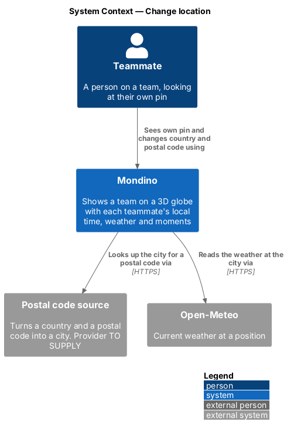
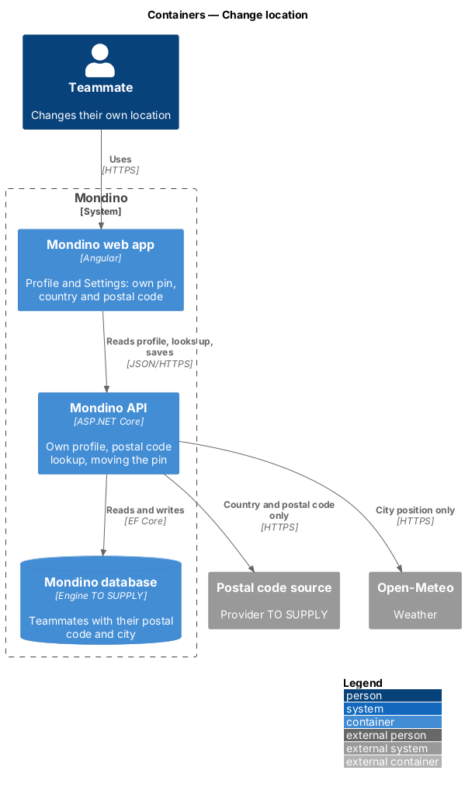
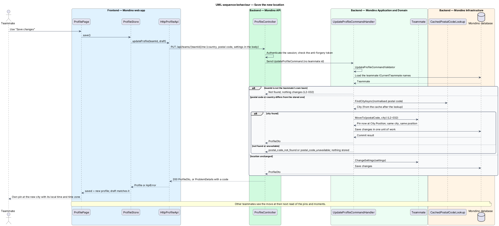

# Change location

## Overview

Mondino is where a team spread around the world sees each other. Each teammate appears on a 3D
globe as a pin placed at their city, with their local time, their weather and the moments
happening where they live. A teammate gives a country and a postal code when joining; the
backend turns the postal code into a city, a position and a time zone, and the postal code
itself stays private.

Profile & Settings, titled "Your pin", is the screen where a teammate sees and changes what
Mondino holds about them. This feature covers the top of that screen. It shows the viewer's own
pin on a small globe with their city, country, local time and time zone, and the reminder
"Teammates see your city, never your postal code." It also lets a teammate who has moved change
their country and postal code, under "Location" and its note "Moved? Look up your new postal
code and your pin follows when you save." The new postal code is looked up as it is on Join,
here when the teammate chooses the button "Look up" beside the field. On saving, the pin moves
to the new city and takes that city's time zone, weather and moments.

The terms used below:

- **viewer** — teammate looking at the screen, whose own data the screen shows
- **profile** — what the backend returns to a teammate about themselves: their own pin, country, postal code and settings
- **postal code lookup** — request that turns a country and a postal code into a city, without changing anything
- **draft** — copy of the profile that holds the viewer's changes until they are saved
- **found city** — city a postal code lookup answered with, shown before saving

The display settings, the sharing switches and the save bar that share this screen are described
in [Choose display and sharing](../choose-display-and-sharing/README.md). Leaving the team is
described in [Leave team](../leave-team/README.md).

## Description

The feature is a vertical slice from the `ProfilePage` to the `Mondino database`. The code does
not exist yet; each part below is introduced by this design.

### Frontend — `mondino` application

- **`ProfilePage`** — lazy route `/profile`, guarded by `teammateGuard`. It reads the profile
  through `PROFILE_API`, lays out "Your pin" beside the settings from 1024 px and in one
  column under it, and passes values to presentation components. It holds no rule of its own.
  While the profile is being read it shows a placeholder for the globe and for each section, and
  announces "Loading your pin and settings…". When the read fails it shows "Your settings
  didn’t load" and "We couldn’t reach Mondino. Your pin is unchanged — try again in a moment."
  in place of the screen, with "Try again" and "Back to the globe".
- **"Look up"** — button that `ProfilePage` renders in the row of the country and postal code
  fields (`field-row__action`). It calls `ProfileStore.lookUp()`. Leaving the postal code field
  starts no lookup on this screen. While the lookup runs the button is disabled and marked
  `aria-busy`.
- **`ProfileStore`** — store provided at the `/profile` route, so its state goes when the viewer
  leaves the screen. It holds the saved `Profile`, the draft, the state of the postal code lookup
  and the state of the save as signals. `changeCountry(countryCode)` and
  `changePostalCode(value)` update the draft and clear the found city. `lookUp()` calls
  `ProfileApi.lookUpPostalCode`. `canSave` is false while a changed postal code has no found
  city, so saving is not offered for a postal code that was not found (L2-032). The store aborts
  a pending lookup when a newer one starts and when the route is destroyed.
- **`LookupState`** (`@mondino/api`) — the union the Join screen uses: `Idle`, `Locating`,
  `Found` (with its `PostalCodeResult`), `NotFound`, `Unavailable`, `RateLimited`. `ProfileStore`
  maps `postal_code_not_found`, `postal_code_unavailable` and `rate_limited` to the last three.
- **The small globe** — `ProfilePage`, a lazy route, renders `mo-globe` from `@mondino/globe`
  with no bare pins, the viewer's own pin as its `you` (a `NewPin` with no label and no pulse,
  as `profile/default` draws it) and `interactive` left `false`, facing the pin. A globe that is
  not interactive does not turn on its own and cannot be dragged (L2-031, ADR 0013); it only
  turns to the pin it faces. While the draft holds a found city that is not saved, the globe
  shows the pin there, labelled "New · Toronto", and faces it; the city and local time beside
  it stay the saved ones until the save. Where the globe cannot be drawn, `GlobeFallback`
  stands in with the same pin. `GlobeScene` is disposed when the page is destroyed.
- **The save bar** — `SaveBar` (`@mondino/components`, block `save-bar`): "You have unsaved
  changes" and "Save changes" while `ProfileStore.canSave` is true, and "Saving…" with its button
  disabled while the save is answered. On success the store holds the new profile, the bar
  goes and `TeamStore` reads the pins and moments again, so the Globe shows the pin at the new
  city. Its confirmation, its failure, its timing and "Leave without saving?" are journey 23's
  ([Choose display and sharing](../choose-display-and-sharing/README.md), L2-035).

### Frontend — libraries

- **`ProfileApi` / `PROFILE_API`** (`@mondino/api`) — contract and injection token. This feature
  uses `getProfile(teamId)`, `lookUpPostalCode(teamId, countryCode, postalCode)` and
  `updateProfile(teamId, update)`. `HttpProfileApi` implements it. The postal code travels in
  the request body, never in a URL.
- **`Profile`** — type holding `teamName`, the viewer's own `pin` (a `Pin`), `countryCode` and
  `postalCode`; the `settings` join it with journey 23. It is the only type in the frontend that carries a postal code
  after joining. `ProfileStore` keeps it in memory only; `SettingsCache` never receives it.
- **`ProfileUpdate`** — type sent on save: `countryCode` and `postalCode`; `settings` join it with
  journey 23.
- **`ApiError`** — error with a `code`. `ProfileStore` branches on `postal_code_not_found`,
  `postal_code_unavailable` and `rate_limited`; the page shows its own message for each.
- **`TextField` and `LookupMessage`** (`@mondino/components`) — the postal code field and the
  line under it that Join and Create Team use, in the same shape. `LookupMessage` takes a `mode`:
  `Join`, the default, or `Move`, with `stays` (the saved city's name). In `Move` the line is
  empty while idle, and the states carry this screen's own copy:
  - `Locating`: "Finding M5V 2T6 in Canada…".
  - `Found`: "Toronto, Canada. Your pin moves here when you save.", with the city and country
    in bold. The line names no weather.
  - `NotFound`: the alert of L2-004, ending "Your pin stays in Milan." ("We couldn’t find
    “M5V 2T” in Canada. Canadian postal codes look like A1A 1A1. Your pin stays in Milan."),
    with `aria-invalid` on the input.

  `ProfilePage` shows the last two states as an `Alert` (`tone="warning"`) under the line:
  - `Unavailable` (mock `profile/lookup-unavailable`): "We couldn’t check M5V 2T6 right now.
    Your postal code may be fine — nothing is wrong with what you typed. Your pin stays in
    Milan.", with "Try again", which runs `lookUp()` again.
  - `RateLimited` (mock `profile/rate-limited`): "That was a lot of tries in a short time. Wait
    a moment, then try again. Your pin stays in Milan." There is no countdown here and "Look up"
    stays offered, as the mock draws it.

  In the last three states what the viewer typed is kept, the postal code has not been looked
  up, so there is nothing to save and no save bar for it, and the pin stays where it was.
  "Look up" works again after a moment. The city search that Join offers while the lookup is
  down (`place-pin-from-postal-code`) is not drawn on this screen and is not offered here.
- **`localTime` and `formatTime`** (`@mondino/domain`, `time/`) — work out the viewer's local
  time from the pin's time zone id and the injected `CLOCK`, in the clock format the viewer chose.

### Backend — `Mondino.Api`

- **`ProfileController`** — exposes `GET /api/teams/{teamId}/me`, `PUT /api/teams/{teamId}/me`
  and `POST /api/teams/{teamId}/me/postal-code-lookups`. Each action checks nothing itself and
  sends one MediatR request. `TeammateSessionHandler` authenticates the session cookie before
  the action runs; a request with no session is refused with 401. The lookup action carries the
  postal code lookup policy from `RateLimitPolicies`.

### Backend — `Mondino.Application`

- **`GetProfileQuery` / `GetProfileQueryHandler`** — loads the teammate that `ICurrentTeammate`
  names and returns a `ProfileDto`. A `teamId` that is not the teammate's own team is refused
  with 404, the same answer as for a team that does not exist.
- **`LookUpPostalCodeQuery` / `LookUpPostalCodeQueryHandler`** — the same query the Join screen
  sends. `PostalCodeFormats` checks the postal code against the country's format and normalises
  it; a postal code in the wrong form is refused without a call to the `Postal code source`.
  `IPostalCodeLookup.FindCityAsync` answers a `PostalCodeLookupOutcome` (found with a `City`,
  not found, or unavailable), and `IWeatherSource` gives the weather at a found city. The handler returns a `PostalCodeResultDto` and changes nothing.
- **`UpdateProfileCommand` / `UpdateProfileCommandHandler`** — carries `TeamId`, `CountryCode` and
  `PostalCode` (journey 23 adds `Settings`). The command has no teammate id: the handler changes the teammate
  that `ICurrentTeammate` names, so a request cannot change another teammate's location
  (L2-032). When the country or postal code differs from the stored one, the handler resolves
  the city again through `IPostalCodeLookup.FindCityAsync` and, when the outcome is found, calls
  `Teammate.MoveTo(postalCode, city)`. It
  saves in one unit of work through `IAppDbContext` and returns the new `ProfileDto`. A postal
  code that cannot be found or checked is refused and nothing is stored.
- **`UpdateProfileCommandValidator`** — refuses a country outside the supported list and a
  postal code empty or over 12 characters with `validation_failed`. Fields the body does not
  define (a teammate id, a position) are ignored (L2-044).
- **`ProfileDto`** — `TeamName`, the teammate's own `PinDto`, `CountryCode`, `PostalCode` and
  (journey 23 adds `Settings`). The `PostalCode` is null for a teammate whose pin was placed through the city
  search (`join-team`), and the field is then empty. The own `PinDto` always carries the weather, whatever the sharing switches say.
- **`PostalCodeResultDto`** — city name, region and weather, or weather as null when
  `IWeatherSource` fails.

### Backend — `Mondino.Domain`

- **`Teammate`** — `MoveTo(postalCode, city)` replaces the `PostalCode`, the `CountryCode` and
  the `City`. The pin's position is `City.Position`, so a new postal code in the same city
  leaves the pin where it was (L2-032).
- **`City`**, **`Position`**, **`PostalCode`** — value objects. `City` carries the `TimeZoneId`
  from which the browser works out the local time; local time is not stored or sent.

### Backend — `Mondino.Infrastructure`

- **`CachedPostalCodeLookup`** — decorator over `GeoNamesPostalCodeLookup` with a cache, a
  5 second timeout and a circuit breaker. `GeoNamesPostalCodeLookup` calls the `Postal code
  source`, GeoNames (ADR 0006). The request carries the country and the postal code
  and nothing about the teammate or the team.
- **`CachedWeatherSource`** — decorator over `OpenMeteoWeatherSource`. It receives the city's
  position only.
- **`AppDbContext`** — EF Core implementation of `IAppDbContext`. The database engine is
  PostgreSQL (ADR 0004, ADR 0017).

### Errors

| Case | Status | `code` | What the screen shows |
|------|--------|--------|-----------------------|
| Postal code in the wrong form, or not known to the source | 422 | `postal_code_not_found` | The alert of L2-004, naming the postal code, the country and the form its postal codes take |
| `Postal code source` does not answer in time | 503 | `postal_code_unavailable` | That the postal code could not be checked right now and nothing is wrong with what was typed, "Your pin stays in Milan.", and "Try again" |
| Country unsupported or postal code over 12 characters | 400 | `validation_failed` | A generic message |
| Too many lookups | 429 | `rate_limited` | A request to wait a moment and try again, and "Your pin stays in Milan." |
| `teamId` is not the teammate's own team | 404 | none | The screen is not shown |

A teammate may look up 10 postal codes a minute on this screen, counted for the teammate whose
session asks rather than for the client's address (ADR 0022); L2-045 sets the same 10 per minute
per client for the lookup made while joining. Over it the lookup is refused with 429, a
`Retry-After` header and `rate_limited`, and the source is not called.

Other teammates see the move at their next read of `GET /api/teams/{teamId}/pins` and
`GET /api/teams/{teamId}/moments`: `GetPinsQueryHandler` and `GetMomentsQueryHandler` read the
teammate's `City` at that moment, so the new time zone, weather and moments follow without a
further step.

## Requirements

The feature realises the following level-2 (L2) requirements. Each refines the level-1 (L1)
requirement cited beside it.

| L2 ID | Refines (L1) | Requirement |
|-------|--------------|-------------|
| `L2-031` | `L1-011` | Profile & Settings, "Your pin", shows the viewer's own pin on a small globe, their city and country, their local time and time zone, and the reminder that teammates see the city and never the postal code. |
| `L2-032` | `L1-011` | A teammate who has moved changes their country and postal code in the Location section ("Moved? Look up your new postal code and your pin follows when you save."). A "Look up" button beside the postal code field starts the lookup; on this screen leaving the field does not. On saving, the pin moves to the new city with its time zone, weather and moments. |

## Diagrams

### System context

A teammate changes their location through Mondino. Mondino asks the `Postal code source` for the
city and `Open-Meteo` for the weather there; neither learns who the teammate is.

### Containers

The `Mondino web app` calls only the `Mondino API`. The API alone calls the two outside sources
and stores the teammate's new city in the `Mondino database`.

### Components

`ProfilePage` works through `ProfileStore` and `HttpProfileApi`. In the API, `ProfileController`
sends one request to one of three handlers; the handlers resolve the city through
`IPostalCodeLookup` and move the `Teammate`.

### Class structure

`ProfileStore` holds a `Profile` and a `LookupState` and depends on the `ProfileApi` contract.
On the backend, `UpdateProfileCommandHandler` moves a `Teammate`, which owns its `PostalCode`
and its `City`; the `City` owns the `Position` the pin takes.

### Behaviour — open the profile

`ProfilePage` reads the viewer's own profile. The response is the only one that carries a
postal code, and it carries the viewer's own (L2-031). The page then loads the globe library and
draws one pin on a globe that does not turn and cannot be dragged.

### Behaviour — change the postal code

"Look up" starts a lookup. A found postal code shows its city and offers
saving. A postal code that cannot be found shows the alert of L2-004, one that cannot be
checked says so and offers "Try again", and a lookup refused with 429 asks the viewer to wait;
in each case the message ends "Your pin stays in Milan.", saving is not offered and the pin
stays where it was (L2-032).

### Behaviour — save the new location

Saving sends the country and postal code in the request body. The handler resolves the city
again, so the stored city never depends on what the browser claims, and moves the current
teammate's pin in one unit of work.

