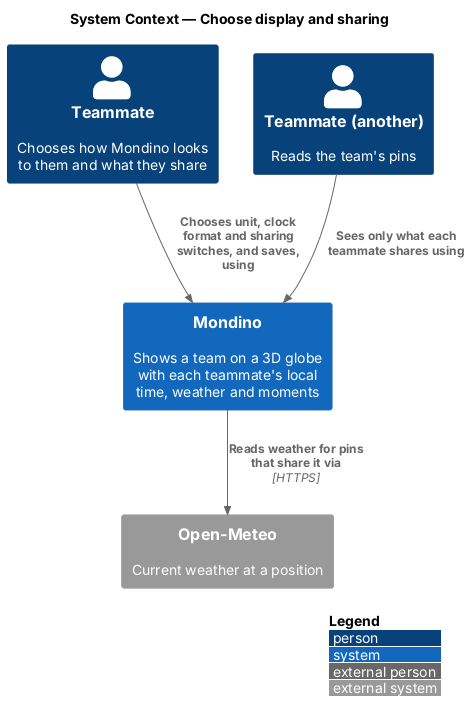
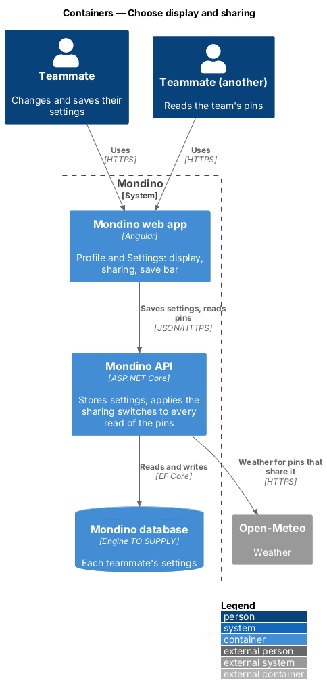
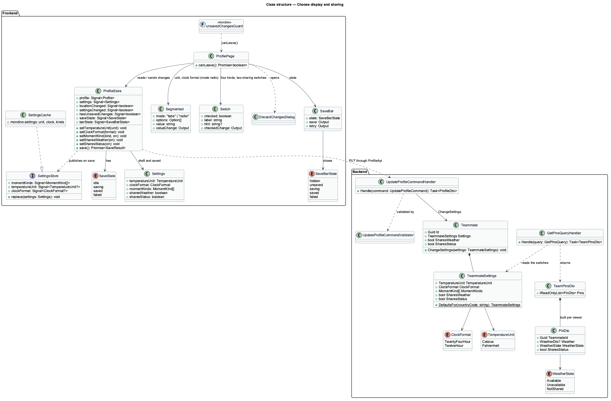
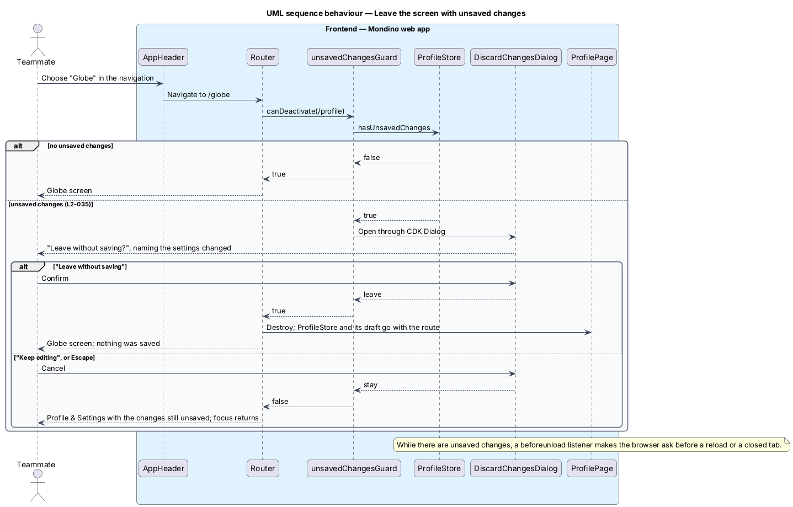

# Choose display and sharing

## Overview

Mondino is where a team spread around the world sees each other. Each teammate appears on a 3D
globe as a pin with their local time, their weather and their status, which follows from their
local hour: "Working hours", "Early morning", "Evening" or "Probably asleep".

Profile & Settings, titled "Your pin", is the screen where a teammate decides how Mondino looks
to them and what teammates see of them. This feature covers four things on that screen:

- **Display.** Under "Display", the viewer chooses °C or °F ("Temperature") and a 24-hour or
  12-hour clock ("Clock"). The choice belongs to the teammate, is stored by the backend, and
  applies on every screen.
- **Sharing.** Under "What teammates see", two switches, both on to begin with: "Share my
  local weather" and "Share whether I’m working or asleep". With the second off, teammates see
  no status for the viewer at any hour, and no working-hours overlap with them. The backend
  applies both, so what a teammate switched off never reaches another teammate's browser as
  something to hide.
- **Saving.** Nothing on the screen is applied until it is saved. A bar says when there are
  unsaved changes, confirms a save, and reports a save that failed.
- **Leaving with unsaved changes.** A viewer who tries to leave the screen with unsaved changes
  is asked whether to leave without saving.

The terms used below:

- **viewer** — teammate looking at a screen
- **settings** — a teammate's temperature unit, clock format, chosen kinds of moment and two sharing switches
- **draft** — copy of the profile that holds the viewer's changes until they are saved
- **unsaved change** — difference between the draft and what the backend last confirmed
- **save bar** — bar at the foot of Profile & Settings that reports unsaved changes and the result of a save

The same screen also holds the choice of which kinds of moment show on the globe (L2-022). That
choice is part of the same settings and is saved by the same bar; what it does on the globe is
described with the moments designs. Changing the location is described in
[Change location](../change-location/README.md), and leaving the team in
[Leave team](../leave-team/README.md).

## Description

The feature is a vertical slice from `ProfilePage` to the `Mondino database`, and it reaches
into the read of the team's pins, where the sharing switches take effect. The code does not
exist yet; each part below is introduced by this design.

### Frontend — `mondino` application

- **`ProfilePage`** — lazy route `/profile`. It binds the draft's settings to two `Segmented`
  controls and two `Switch` controls, and binds the save state to `SaveBar`. A change is an
  output from a presentation component that the page passes to `ProfileStore`. Each switch
  carries a line under its label (`switch-row__hint`) that says what its state means for
  teammates, and the word "On" or "Off" beside it; the table below gives the lines. While both
  switches are off in the draft, a note under them reads "Teammates will see only your name,
  city and local time." While either switch is off in the saved profile, the card of the
  viewer's own pin adds the note "You still see your own weather and status. Teammates don’t."
  (L2-034).

  | Switch | Line when on | Line when off |
  |--------|--------------|---------------|
  | "Share my local weather" | "Shown on your pin and in your panel." | "Teammates see your local time and no weather." |
  | "Share whether I’m working or asleep" | "Worked out from your local time — 09:00 to 18:00 counts as working." | "Teammates see no status for you, at any hour." |
- **`ProfileStore`** — store provided at the `/profile` route. It holds the saved `Profile` and
  the draft as signals. `hasUnsavedChanges` is computed by comparing the draft with the saved
  profile field by field, so a setting changed back to what was saved removes the bar (L2-035).
  `save()` calls `ProfileApi.updateProfile` and moves `saveState` through `SaveState`. On
  success it replaces the saved profile with the response and writes the display settings to
  `SettingsStore`. On failure it keeps the draft as it is. The 4 second dismissal of the
  confirmation is one timer, cleared when the store is destroyed; unit tests advance a fake
  clock.
- **`SaveState`** — feature-local union: `idle`, `saving`, `saved`, `failed`.
- **`unsavedChangesGuard`** — `CanDeactivateFn` on the `/profile` route. When
  `hasUnsavedChanges` is true it opens `DiscardChangesDialog` and lets the navigation continue
  only on "Discard and leave" (L2-035). It is asked on every way out of the screen inside the
  app: a tab in the header and the browser's back button.
- **`DiscardChangesDialog`** — CDK Dialog with `role="alertdialog"`, titled "Leave without
  saving?". It reads "You changed your settings but haven’t saved them. If you leave now,
  those changes are lost and your pin stays as it was." and offers "Discard and leave" and
  "Keep editing". Focus starts on "Keep editing". Escape and "Keep editing" close it and
  return focus to where it was.
- **Closing the tab** — while `hasUnsavedChanges` is true, `ProfilePage` holds a `beforeunload`
  listener so the browser asks before a reload or a closed tab. The listener is removed when the
  changes are saved and when the page is destroyed.

### Frontend — libraries

- **`Segmented`** (`@mondino/components`, `mo-segmented`) — a set of options of which one is
  chosen, used for "°C / °F" and "24-hour / 12-hour". It takes a `mode` (`tabs` or `radio`);
  here the mode is `radio`, so it is a `radiogroup` named "Temperature" or "Clock";
  each option is a `radio`, and the chosen one is exposed through `aria-checked` and carries a
  mark besides its colour (L2-033).
- **`Switch`** (`@mondino/components`) — a button with `role="switch"` and `aria-checked`,
  operated by Space and Enter, at least 44 × 44 px (L2-034).
- **`SaveBar`** (`@mondino/components`) — takes a `state` input and emits `save` and `retry`.
  It renders nothing when the state is `hidden`. Its text sits in a live region (`role="status"`)
  so "Saved — your pin is up to date" is announced; in `failed` it is an alert (`role="alert"`).
  Its states are in the table below.
- **`Settings`**, **`TemperatureUnit`**, **`ClockFormat`** (`@mondino/api`) — the types the
  draft holds. `ProfileApi.updateProfile(teamId, update)` sends the whole `Settings` with the
  country and postal code.
- **`SettingsStore`** (`@mondino/domain`, `storage/`) — the viewer's `Settings` as a signal,
  provided in `root` because every screen reads it. `formatTime` and the temperature formatting
  read the clock format and the unit from it, so a saved choice applies on every screen without
  a reload (L2-033). It starts from `SettingsCache` and is replaced when a profile is read or
  saved.
- **`SettingsCache`** (`@mondino/domain`, `storage/`) — keeps the display settings, and the chosen kinds of
  moment, in browser storage (ADR 0020) so the first screen of a later visit is drawn in the chosen unit and clock before the
  profile arrives. It never holds a postal code. The backend's copy is the one that holds
  (L2-033).
- **`statusFor(pin, time)`** (`@mondino/domain`, `time/`) — returns the status to show
  for a pin, or none. When `Pin.sharesStatus` is false it returns none, at every hour. The
  pin, the panel, the Team row and the day ribbon call it instead of showing `statusAt`
  directly. Whatever counts or filters by status calls it too, so a teammate who does not
  share their status is counted neither as working nor as asleep, and is listed under All
  only: not under "In working hours now", "Working now" or "Asleep". The panel of such a
  teammate shows no working-hours overlap (L2-034).

| `SaveBar` state | When | Text | Action |
|-----------------|------|------|--------|
| `hidden` | The draft equals the saved profile and no confirmation is showing | none | none |
| `unsaved` | `hasUnsavedChanges` is true | "You have unsaved changes" | "Save changes" |
| `saving` | A save is pending | "Saving…" | "Saving", disabled and marked busy |
| `saved` | For 4 seconds after a save succeeds | "Saved — your pin is up to date" | none |
| `failed` | A save failed and the changes are still unsaved; it stays until a save succeeds or the changes are undone | "Couldn’t save. Your changes are still here." | "Try again" |

### Backend — `Mondino.Api`

- **`ProfileController`** — `PUT /api/teams/{teamId}/me` sends one `UpdateProfileCommand`.
  `TeammateSessionHandler` authenticates the session cookie, and the request carries an
  anti-forgery token as every state-changing request does.
- **`TeamsController`** — `GET /api/teams/{teamId}/pins` sends one `GetPinsQuery` and answers a
  `TeamPinsDto`. This feature
  adds no endpoint to it; it defines what the handler withholds.

### Backend — `Mondino.Application`

- **`UpdateProfileCommand` / `UpdateProfileCommandHandler`** — carries `TeamId`, `CountryCode`,
  `PostalCode` and `Settings`, and no teammate id. The handler loads the teammate that
  `ICurrentTeammate` names, calls `Teammate.ChangeSettings(settings)`, saves through
  `IAppDbContext` in one unit of work and returns the `ProfileDto`. The location part of the
  command is described in [Change location](../change-location/README.md).
- **`UpdateProfileCommandValidator`** — refuses a temperature unit or clock format outside the
  enumeration, and a kind of moment that is unknown or repeated, with `validation_failed`. A
  field the teammate may not set is ignored.
- **`GetPinsQuery` / `GetPinsQueryHandler`** — builds one `PinDto` per teammate of the viewer's
  team, returns them in a `TeamPinsDto`, and applies each teammate's sharing switches for that
  viewer:
  - `ShareWeather` is false and the pin is another teammate's: the `PinDto` carries a null
    `Weather` (no weather and no temperature) and the `WeatherState` `NotShared`, and the
    handler does not ask `IWeatherSource` for it (L2-034).
  - `ShareStatus` is false and the pin is another teammate's: `PinDto.SharesStatus` is false.
    The browser then shows no status for that pin at any hour and no working-hours overlap.
    The time zone still travels, since the local time is still shown.
  - The pin is the viewer's own: the `PinDto` carries the weather and a true flag whatever the
    switches say. The viewer's own screens read the switches from `Settings` and add the note
    that teammates do not see them (L2-034).

  `PinDto.Weather` is null unless the weather is available, and `PinDto.WeatherState` is
  `Available`, `Unavailable` or `NotShared`, so a pin whose teammate does not share their
  weather and a pin whose weather could not be read (L2-049) show different messages.
- **`ProfileDto`** — returns the viewer's own `Settings` to the viewer and to no one else.
  Another teammate's `PinDto` carries the effect of the switches, never the switches themselves.

### Backend — `Mondino.Domain`

- **`TeammateSettings`** — value object: `TemperatureUnit`, `ClockFormat`, `MomentKinds`,
  `ShareWeather`, `ShareStatus`. `DefaultsFor(countryCode)` gives a new teammate's
  settings: Fahrenheit for the United States and Celsius elsewhere (L2-019), the 12-hour clock
  for the United States and Canada and the 24-hour clock otherwise (L2-033), all four kinds of
  moment, and both sharing switches on (L2-034). `JoinTeamCommandHandler` and
  `CreateTeamCommandHandler` call it.
- **`Teammate`** — `ChangeSettings(settings)` replaces the value object whole.

### Errors

| Case | Status | `code` | What the screen shows |
|------|--------|--------|-----------------------|
| A setting outside its allowed values | 400 | `validation_failed` | `SaveBar` in `failed` |
| The backend cannot be reached, or answers 5xx | none or 5xx | none | `SaveBar` in `failed`; the draft stays |
| The session has ended | 401 | none | `sessionExpiredInterceptor` forgets the membership and the address shows "You need an invite link" in place (`adapt-to-every-width`); the teammate signs in again through `sign-in` |

## Requirements

The feature realises the following level-2 (L2) requirements. Each refines the level-1 (L1)
requirement cited beside it.

| L2 ID | Refines (L1) | Requirement |
|-------|--------------|-------------|
| `L2-033` | `L1-011` | The viewer chooses °C or °F and a 24-hour or 12-hour clock. The choice belongs to the teammate and applies on every screen. |
| `L2-034` | `L1-011` | Under "What teammates see", two switches, both on to begin with, decide what teammates see of the viewer: "Share my local weather" ("Shown on your pin and in your panel.") and "Share whether I’m working or asleep" ("Worked out from your local time — 09:00 to 18:00 counts as working."). The backend applies both. A teammate's name, city and local time are always seen. |
| `L2-035` | `L1-011` | A change in Profile & Settings is not applied until it is saved. While there are unsaved changes a bar says so and offers "Save changes"; once saved it confirms and then dismisses itself. |

## Diagrams

### System context

A teammate chooses their display and sharing settings in Mondino, and another teammate sees the
effect. When a teammate does not share their weather, Mondino does not ask `Open-Meteo` for it
on another teammate's behalf.

### Containers

The `Mondino web app` sends the settings to the `Mondino API`, which stores them in the
`Mondino database` and applies the sharing switches when any teammate reads the pins.

### Components

`ProfilePage` drives `ProfileStore`, which saves through `HttpProfileApi` and publishes the
saved settings to `SettingsStore`. In the API, `UpdateProfileCommandHandler` stores the
settings and `GetPinsQueryHandler` reads them to decide what each `PinDto` carries.

### Class structure

`ProfileStore` holds the draft `Settings` and a `SaveState`, and `SaveBar` shows one
`SaveBarState`. On the backend, `Teammate` owns one `TeammateSettings`, which
`UpdateProfileCommandHandler` replaces and `GetPinsQueryHandler` reads.

### Behaviour — save display and sharing settings

A change shows the save bar. A save that succeeds confirms for 4 seconds and applies the
display settings on every screen. A save that fails keeps the changes on the screen unsaved and
offers to try again (L2-035).

### Behaviour — another teammate reads the pins after sharing is switched off

`GetPinsQueryHandler` applies both switches for the viewer who asks. The response to another
teammate carries no weather, and the `WeatherState` `NotShared`, for a teammate who does not share it, and a false
`SharesStatus` for one who does not share whether they are working or asleep (L2-034).

### Behaviour — leave the screen with unsaved changes

`unsavedChangesGuard` stops a navigation away from `/profile` while there are unsaved changes
and asks through `DiscardChangesDialog` (L2-035).

