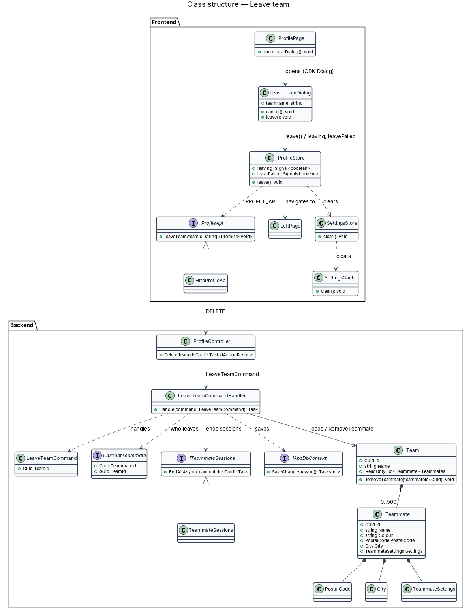

# Leave team

## Overview

Mondino is where a team spread around the world sees each other. A person joins a team through
its invite link with a name, a country and a postal code, and from then on appears to their
teammates as a pin on a 3D globe.

A teammate can undo that. At the foot of Profile & Settings, "Remove my pin and leave" followed
by the team's name opens a dialog. The dialog names the team, says the pin will be removed, and
offers to cancel or to leave. Nothing is removed until the teammate confirms. On confirming,
the backend deletes everything Mondino holds about the teammate in that team: their name, their
postal code, their city, their settings and their session. The pin is gone for every other
teammate at their next read of the team, and the teammate who left sees a screen confirming it.

The terms used below:

- **viewer** — teammate looking at the screen, here the one who leaves
- **session** — what lets the backend recognise a browser as a teammate, held in a cookie that scripts cannot read
- **leave** — removal of a teammate and their pin from a team, with everything held about them

Leaving is final for that pin. A person who has left and holds the invite link can join again
as a new teammate; nothing of the earlier pin comes back.

## Description

The feature is a vertical slice from `ProfilePage` to the `Mondino database`. The code does not
exist yet; each part below is introduced by this design.

### Frontend — `mondino` application

- **`ProfilePage`** — lazy route `/profile`. It shows the button "Remove my pin and leave
  Northwind", with the team's name from `Profile.teamName` rendered as text. The button opens
  `LeaveTeamDialog` through the CDK `Dialog` service, with the page's injector so the dialog
  reads the route's `ProfileStore`. The page makes no request itself.
- **`LeaveTeamDialog`** — CDK Dialog, loaded with the `/profile` route, titled "Leave" and the
  team's name ("Leave Northwind?"). It receives the team's name as dialog data. It says the pin
  will be removed for everyone in the team and what Mondino deletes, and offers "Cancel" and
  "Remove my pin and leave". Focus starts on "Cancel". "Remove my pin and leave" calls
  `ProfileStore.leave()` and the dialog stays open: while `leaving` is true both buttons are
  disabled, the action reads "Removing your pin…" and Escape does not close it; when
  `leaveFailed` is true an alert in the dialog reads "We couldn’t remove your pin just now.
  Nothing has changed — you’re still in Northwind." and the action reads "Try again". The CDK
  traps focus inside it, closes it on Escape, and returns focus to the button that opened it
  (L2-036). Under 576 px it is a sheet from the bottom.
- **`ProfileStore`** — store provided at the `/profile` route. `leave()` calls
  `ProfileApi.leaveTeam(teamId)` and holds a `leaving` signal that disables the dialog's buttons
  while the request is pending, so a second request is not sent. On success it discards the
  draft, so the guard against unsaved changes does not stop the navigation, clears
  `SettingsStore` and `SettingsCache`, calls `TeamMembership.forget()`, and navigates to `/left` with the team's name in the
  navigation state, replacing `/profile` in the history, which closes the dialog. On failure it leaves everything as it was and sets
  `leaveFailed`, and the dialog says so and offers to try again.
- **`LeftPage`** — lazy route `/left`, not behind `teammateGuard`. It confirms that the team is
  left ("You’ve left Northwind"), that the pin is gone from the globe and what Mondino has
  deleted, and says the team's invite link is the way back. It reads nothing from the backend;
  the team's name comes in the navigation state from `ProfileStore`, never in the URL, and is
  rendered as text. Opened or reloaded without it, the title reads "You’ve left the team". It
  shows no other team data.
- **`teammateGuard`** — guards `/globe`, `/team`, `/moments` and `/profile`. After leaving, the
  browser holds no membership and no session, so the guard refuses those routes and the team is not shown
  (L2-036). The guard sends the person nowhere: the address they opened shows the no-team page
  (`InviteNeededPage`, "You need an invite link") in place.

### Frontend — libraries

- **`ProfileApi` / `PROFILE_API`** (`@mondino/api`) — `leaveTeam(teamId): Promise<void>`.
  `HttpProfileApi` sends `DELETE /api/teams/{teamId}/me` with the anti-forgery token and no
  body.
- **`SettingsStore`** and **`SettingsCache`** (`@mondino/domain`, `storage/`) — `clear()`
  removes the display settings kept in the browser. Nothing else about the teammate is kept
  there: the profile, with its postal code, is held in memory by `ProfileStore` and goes with
  the route.
- **`TeamStore`** (`@mondino/domain`, `pins/`) — in another teammate's browser, the next read
  of the pins, at most 15 minutes later while the screen is visible, no longer carries the pin.

### Backend — `Mondino.Api`

- **`ProfileController`** — `DELETE /api/teams/{teamId}/me` sends one `LeaveTeamCommand` and
  answers 204 with no body. `TeammateSessionHandler` authenticates the session cookie first; a
  request with no session, or with the session of a teammate who has already left, is refused
  with 401.

### Backend — `Mondino.Application`

- **`LeaveTeamCommand`** — carries `TeamId` and no teammate id. The teammate who leaves is the
  one `ICurrentTeammate` names, so a request cannot remove another teammate's pin.
- **`LeaveTeamCommandHandler`** — loads the `Team` with the current teammate, calls
  `Team.RemoveTeammate(teammateId)`, calls `ITeammateSessions.EndAllAsync(teammateId)`, and
  saves through `IAppDbContext` in one unit of work. A `teamId` that is not the teammate's own
  team is refused by `TeamScopeBehaviour` with 404 and the code `team_not_found`
  (`protect-team-data`), and nothing changes. The handler reads no outside source.
- **`ITeammateSessions`** — interface for ending sessions: `EndAllAsync(teammateId)` deletes
  every session the teammate holds and expires the session cookie on the current response.

### Backend — `Mondino.Domain`

- **`Team`** — `RemoveTeammate(teammateId)` removes the `Teammate` from `Teammates`. The
  `Teammate` owns its `Name`, `PostalCode`, `City`, `Colour` and `TeammateSettings`, so all go
  with it.

### Backend — `Mondino.Infrastructure`

- **`AppDbContext`** — maps `Teammate` as owned by `Team` with its value objects stored in the
  teammate's own row, so removing the teammate deletes the row and nothing is left behind. The
  removal is a deletion, not a mark on the row.
- **`TeammateSessions`** — implementation of `ITeammateSessions` beside
  `TeammateSessionHandler`. How a session is stored is `<TO SUPPLY>` with the design of sign-in;
  whatever the form, a session ended here shall be refused on its next use (L2-043).

### What is deleted, and what is not

| Held about the teammate | After leaving |
|-------------------------|---------------|
| Name, colour, joined date | Deleted with the `Teammate` |
| Postal code and country | Deleted with the `Teammate` |
| City, position, time zone | Deleted with the `Teammate` |
| Settings | Deleted with the `Teammate`; the browser's `SettingsCache` is cleared |
| Session | Deleted by `ITeammateSessions`; the cookie is expired |
| Cached weather, cities and moments | Kept: they are keyed by place and carry nothing about a teammate |
| Telemetry | Kept: it carries no name, postal code or position (L2-051) |

What becomes of a team when its last teammate leaves is `<TO SUPPLY>`; how a team is made is
not designed.

### Errors

| Case | Status | `code` | What the screen shows |
|------|--------|--------|-----------------------|
| `teamId` is not the teammate's own team | 404 | `team_not_found` | The alert in `LeaveTeamDialog` |
| No session, or the teammate has already left | 401 | none | `sessionExpiredInterceptor` forgets the membership and the address shows the no-team page in place |
| The backend cannot be reached, or answers 5xx | none or 5xx | none | The alert in `LeaveTeamDialog`, which stays open, with "Try again"; the pin stays |

## Requirements

The feature realises the following level-2 (L2) requirement, which refines the level-1 (L1)
requirement cited beside it.

| L2 ID | Refines (L1) | Requirement |
|-------|--------------|-------------|
| `L2-036` | `L1-011` | A teammate can remove their pin and leave the team. It is confirmed in a dialog, and it deletes everything Mondino holds about them in that team. |

## Diagrams

### System context

A teammate leaves their team through Mondino. No outside source takes part.

### Containers

The `Mondino web app` sends one request to the `Mondino API`, which deletes the teammate and
their session from the `Mondino database`.

### Components

`ProfilePage` opens `LeaveTeamDialog`, which on confirmation leaves through `ProfileStore` and
`HttpProfileApi`; the store then shows `LeftPage`. In the API, `ProfileController` sends
`LeaveTeamCommand` to `LeaveTeamCommandHandler`, which removes the teammate from the `Team` and
ends their sessions.

### Class structure

`LeaveTeamCommandHandler` depends on `ICurrentTeammate` for who leaves, on `Team` for the
removal and on `ITeammateSessions` for ending the session. `Team` owns its `Teammate` entities,
and each `Teammate` owns the values deleted with it.

### Behaviour — confirm leaving the team

Confirming in the dialog sends `DELETE /api/teams/{teamId}/me`; the dialog stays open and busy
until the answer. The handler removes the teammate and their sessions in one unit of work, the
browser clears its settings, and `LeftPage` confirms. A request that fails is reported in the
dialog, which offers "Try again". Other teammates no longer receive the pin at their next read (L2-036).

### Behaviour — cancel leaving the team

Escape or "Cancel" closes the dialog. No request is sent, focus returns to the button that
opened the dialog, and nothing has changed (L2-036).

