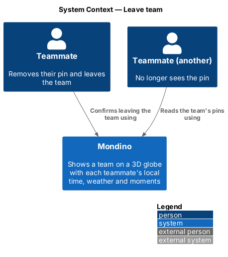
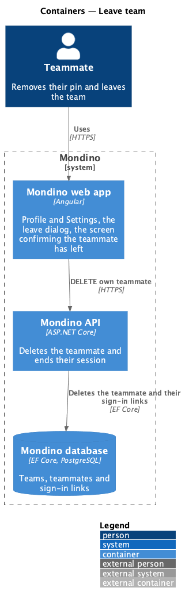
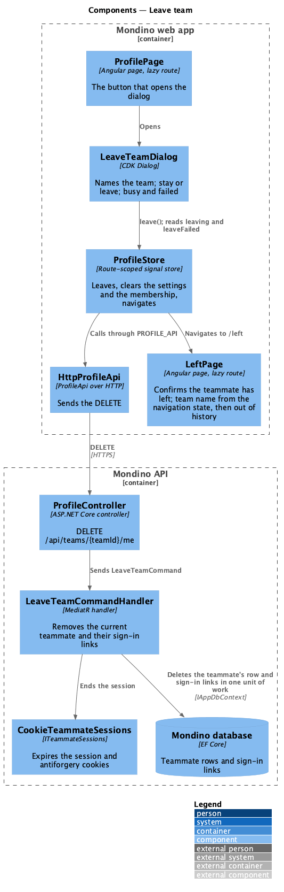
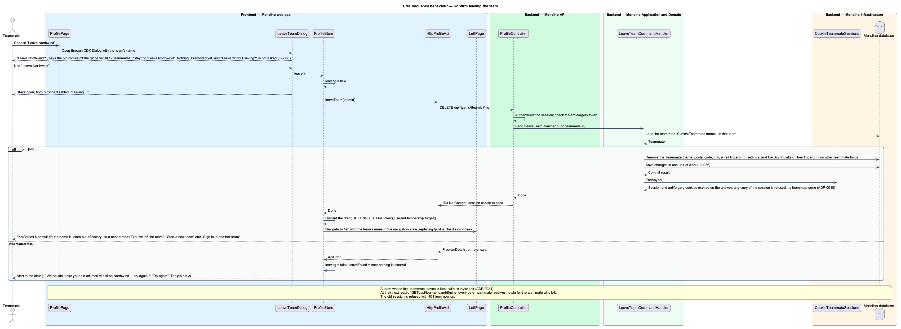
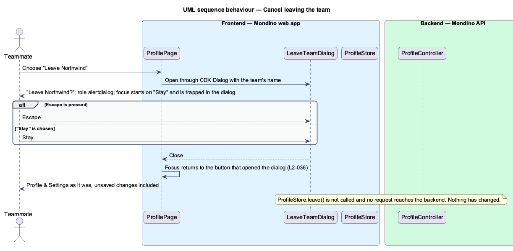

# Leave team

## Overview

Mondino is where a team spread around the world sees each other. A person joins a team through
its invite link with a name, a country and a postal code, and from then on appears to their
teammates as a pin on a 3D globe.

A teammate can undo that. At the foot of Profile & Settings, "Leave" followed by the team's
name ("Leave Northwind") opens a dialog. The dialog names the team, says the pin comes off the
globe for every teammate, and offers to stay or to leave. Nothing is removed until the teammate confirms. On confirming,
the backend deletes everything Mondino holds about the teammate in that team: their name, their
postal code, their city, their settings and their session. The pin is gone for every other
teammate at their next read of the team, and the teammate who left sees a screen confirming it.

The terms used below:

- **viewer** — teammate looking at the screen, here the one who leaves
- **session** — what lets the backend recognise a browser as a teammate, held in a cookie that scripts cannot read
- **leave** — removal of a teammate and their pin from a team, with everything held about them

Leaving is final for that pin. A person who has left and holds the invite link can join again
as a new teammate; nothing of the earlier pin comes back. The screen that confirms leaving
offers two ways on: starting a new team (`make-team`) and signing in to another team
(`sign-in`).

## Description

The feature is a vertical slice from `ProfilePage` to the `Mondino database`. `ProfilePage`,
`ProfileStore`, `HttpProfileApi`, `ProfileController`, `SettingsCache` and `TeammateSessionHandler`
exist (journeys 6, 22 and 23); the parts below are added to them or are new.

### Frontend — `mondino` application

- **`ProfilePage`** — lazy route `/profile`. Under its sections it shows "Leave" followed by the
  team's name ("Leave Northwind", `settings__leave`, a `link` button), with the name from
  `Profile.teamName` rendered as text. The button opens `LeaveTeamDialog` through the CDK `Dialog`
  service, imported on first use with the dialog (as "Leave without saving?" is), with the page's
  injector so the dialog reads the route's `ProfileStore`, and with focus restored to the button.
  The page makes no request itself.
- **"Leave Northwind" and unsaved changes.** The dialog opens at once, whatever is unsaved:
  "Leave without saving?" is not asked first, because leaving deletes the settings too. "Stay"
  keeps the unsaved changes on the screen. Confirming discards them with everything else, and the
  guard against unsaved changes (`unsavedChangesGuard`) does not ask on the way to `/left`.
- **`LeaveTeamDialog`** — CDK Dialog with `role="alertdialog"`, loaded with its own chunk on first
  use, titled "Leave" and the team's name with a question mark ("Leave Northwind?"). It reads the
  team's name from `ProfileStore.profile()` and the number of other teammates from `TeamStore`
  (the pins less the viewer's). It reads "Your pin comes off the globe for all 12 teammates, along
  with your weather and moments. To come back you’ll need the team’s invite link."; with one other
  teammate, "for your 1 teammate"; with none, "Your pin comes off the team’s globe, along with your
  weather and moments. To come back you’ll need the team’s invite link." It offers "Stay" and
  "Leave Northwind" (`btn--danger`). Focus starts on "Stay". "Leave Northwind" calls
  `ProfileStore.leave()` and the dialog stays open: while `leaving` is true both buttons are
  disabled, the action reads "Leaving…" with a turning icon and is marked `aria-busy`, and Escape
  does not close it (`disableClose` while leaving); when `leaveFailed` is true an alert in the
  dialog reads "We couldn’t take your pin off. You’re still on Northwind — try again.", the action
  reads "Try again" and takes focus. The CDK traps focus inside it, closes it on Escape or "Stay",
  and returns focus to the button that opened it (L2-036). Under 576 px it is a sheet from the
  bottom, as "Leave without saving?" is.
- **`ProfileStore`** — store provided at the `/profile` route. `leave()` calls
  `ProfileApi.leaveTeam(teamId)` and holds a `leaving` signal that disables the dialog's buttons
  while the request is pending, so a second request is not sent. On success it discards the draft
  (`hasUnsavedChanges` is then false), clears `SETTINGS_STORE`, calls `TeamMembership.forget()`,
  and navigates to `/left` with the team's name in the navigation state, replacing `/profile` in
  the history; leaving `/profile` destroys the page and with it the dialog. On failure, whatever the
  answer (no answer, 5xx, 401 or 404), it leaves everything as it was and sets `leaveFailed`, and
  the dialog says so and offers to try again.
- **`LeftPage`** — lazy route `/left`, not behind `teammateGuard`, titled "You’ve left · Mondino".
  It renders `NoticePage` (`adapt-to-every-width`): the wordmark, a small globe, a title, one text
  and its actions, with no app header. The title reads "You’ve left Northwind" and the text "Your
  pin is off Northwind’s globe and they can no longer see your time, weather or moments. To come
  back, ask a teammate for the team’s invite link." Its actions are the links "Start a new team",
  to `/new`, and "Sign in to another team", to `/sign-in`. It reads nothing from the backend; the
  team's name comes in the navigation state from `ProfileStore`, never in the URL, and is rendered
  as text. It reads the name once and takes it out of the history entry, as `InviteNeededPage`
  does with an email, so the browser keeps nothing of the team. Opened or reloaded, then, without
  it, the title reads "You’ve left the team" and the text says "the team’s globe". It shows no
  other team data.
- **`teammateGuard`** — guards `/globe`, `/team`, `/moments` and `/profile`. After leaving, the
  browser holds no membership and no session, so the guard refuses those routes and the team is
  not shown (L2-036). The guard sends the person nowhere: the address they opened shows
  `InviteNeededPage`, "You need an invite link", in place.

### Frontend — libraries

- **`ProfileApi` / `PROFILE_API`** (`@mondino/api`) — `leaveTeam(teamId, signal): Promise<void>`.
  `HttpProfileApi` sends `DELETE /api/teams/{teamId}/me` with the antiforgery token and no body.
- **`SettingsStore` / `SETTINGS_STORE`** (`@mondino/api`) and **`SettingsCache`**
  (`@mondino/domain`, `storage/`) — `clear()` removes the display settings kept in the browser
  (`mondino.settings`) and gives the defaults again. Nothing else about the teammate is kept
  there: the profile, with its postal code, is held in memory by `ProfileStore` and goes with
  the route.
- **`TeamMembership`** (`@mondino/api`, `LocalTeamMembership` in `domain`) — `forget()` removes
  `mondino.membership`.
- **`TeamStore`** (`@mondino/domain`, `pins/`) — in another teammate's browser, the next read
  of the pins, at most 15 minutes later while the screen is visible, no longer carries the pin.

### Backend — `Mondino.Api`

- **`ProfileController`** — `DELETE /api/teams/{teamId}/me` sends one `LeaveTeamCommand` and
  answers 204 with no body. The session cookie is authenticated first, and the antiforgery token
  checked; a request with no session, or with the session of a teammate who has already left, is
  refused with 401 (ADR 0010).

### Backend — `Mondino.Application`

- **`LeaveTeamCommand`** — carries `TeamId` and no teammate id, and is an `ITeamScopedRequest`:
  a `teamId` that is not the teammate's own team is refused with 404 `team_not_found` before the
  handler runs, and nothing changes. The teammate who leaves is the one `ICurrentTeammate` names,
  so a request cannot remove another teammate's pin.
- **`LeaveTeamCommandHandler`** — loads the current teammate in that team, removes it through
  `IAppDbContext`, removes the `SignInLink`s whose fingerprint is the teammate's when no other
  teammate holds that fingerprint, and saves in one unit of work; then it calls
  `ITeammateSessions.EndAsync()`. The handler reads no outside source (ADR 0024).
- **`ITeammateSessions`** — interface for ending the asker's session: `EndAsync()` expires the
  session cookie and the antiforgery cookie on the current answer. Every other copy of the
  session is refused from then on, because the teammate it names no longer exists (ADR 0010).

### Backend — `Mondino.Domain`

- **`Teammate`** — one row, holding its `Name`, `Colour`, `JoinedAt`, `PostalCode`, `City`,
  `EmailFingerprint` and settings (ADR 0023), so all go with it.
- **`SignInLink`** — a link asked for an email, with its fingerprint and the address sealed by
  the link's token (ADR 0011).

### Backend — `Mondino.Infrastructure`

- **`AppDbContext`** — maps `Teammate` to its own row, with its values in it, so removing the
  teammate deletes the row and nothing is left behind. The removal is a deletion, not a mark on
  the row.
- **`CookieTeammateSessions`** — implementation of `ITeammateSessions` beside
  `TeammateSessionHandler`: it signs the current answer out of the cookie scheme and deletes the
  antiforgery cookie. Sessions are not stored (ADR 0008); a session ended here, or any copy of
  it, is refused on its next use because its teammate is gone (L2-043).

### What is deleted, and what is not

| Held about the teammate | After leaving |
|-------------------------|---------------|
| Name, colour, joined date | Deleted with the `Teammate` |
| Postal code and country | Deleted with the `Teammate` |
| City, position, time zone | Deleted with the `Teammate`; the `City` row is a place, kept for others |
| Email fingerprint | Deleted with the `Teammate` |
| Sign-in links asked for the email, with the sealed address | Deleted, unless another teammate holds the same fingerprint |
| Settings | Deleted with the `Teammate`; the browser's `mondino.settings` is cleared |
| Session | Refused everywhere once the `Teammate` is gone; the cookies are expired on the answer |
| Membership in the browser | `mondino.membership` is removed |
| Cached weather, cities and moments | Kept: they are keyed by place and carry nothing about a teammate |
| Telemetry | Kept: it carries no name, postal code or position (L2-051) |

A team whose last teammate leaves is kept, with its name and its invite link, and nothing about
the teammate remains (L2-036 criterion 8, ADR 0024). Whoever holds the invite link can still
join it.

### Errors

| Case | Status | `code` | What the screen shows |
|------|--------|--------|-----------------------|
| `teamId` is not the teammate's own team | 404 | `team_not_found` | The alert in `LeaveTeamDialog`, with "Try again" |
| No session, or the teammate has already left | 401 | none | The alert in `LeaveTeamDialog`, with "Try again"; what an ended session does on Profile & Settings is journey 27's |
| No antiforgery token, or another session's | 403 | `cross_site_request` | The alert in `LeaveTeamDialog`; nothing changes |
| The backend cannot be reached, or answers 5xx | none or 5xx | none | The alert in `LeaveTeamDialog`, which stays open, with "Try again"; the pin stays |

## Requirements

The feature realises the following level-2 (L2) requirement, which refines the level-1 (L1)
requirement cited beside it.

| L2 ID | Refines (L1) | Requirement |
|-------|--------------|-------------|
| `L2-036` | `L1-011` | A teammate can leave the team, which takes their pin off the globe. It is confirmed in a dialog, and it deletes everything Mondino holds about them in that team. |

## Diagrams

### System context

A teammate leaves their team through Mondino. No outside source takes part.

### Containers

The `Mondino web app` sends one request to the `Mondino API`, which deletes the teammate and
their session from the `Mondino database`.

### Components

`ProfilePage` opens `LeaveTeamDialog`, which on confirmation leaves through `ProfileStore` and
`HttpProfileApi`; the store then shows `LeftPage`. In the API, `ProfileController` sends
`LeaveTeamCommand` to `LeaveTeamCommandHandler`, which removes the teammate from the `Team` and
ends their sessions.

### Class structure

`LeaveTeamCommandHandler` depends on `ICurrentTeammate` for who leaves, on `Team` for the
removal and on `ITeammateSessions` for ending the session. `Team` owns its `Teammate` entities,
and each `Teammate` owns the values deleted with it.

### Behaviour — confirm leaving the team

Confirming in the dialog sends `DELETE /api/teams/{teamId}/me`; the dialog stays open and busy
until the answer. The handler removes the teammate and their sessions in one unit of work, the
browser clears its settings, and `LeftPage` confirms. A request that fails is reported in the
dialog, which offers "Try again". Other teammates no longer receive the pin at their next read (L2-036).

### Behaviour — cancel leaving the team

Escape or "Stay" closes the dialog. No request is sent, focus returns to the button that
opened the dialog, and nothing has changed (L2-036).

