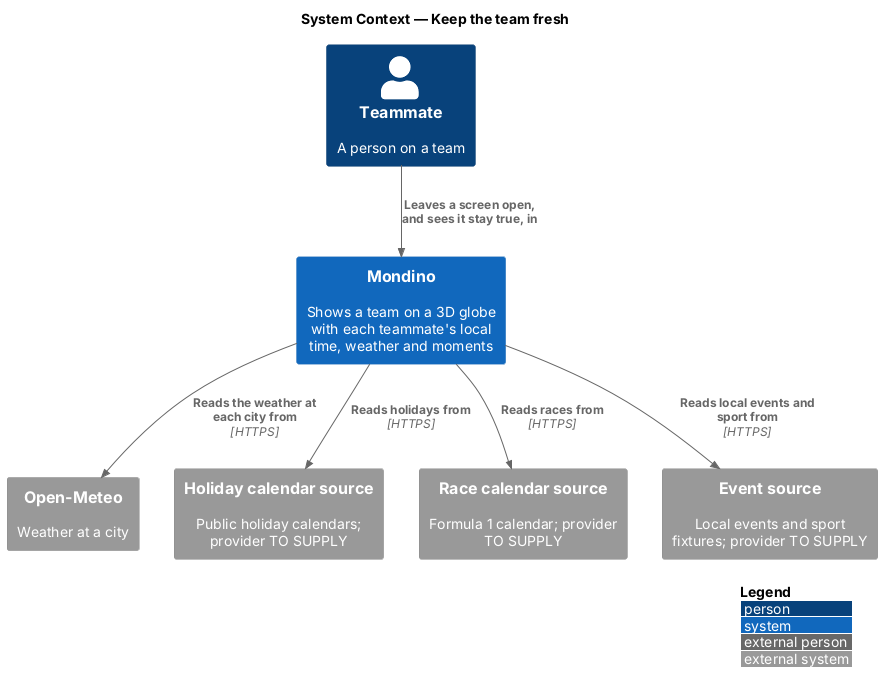
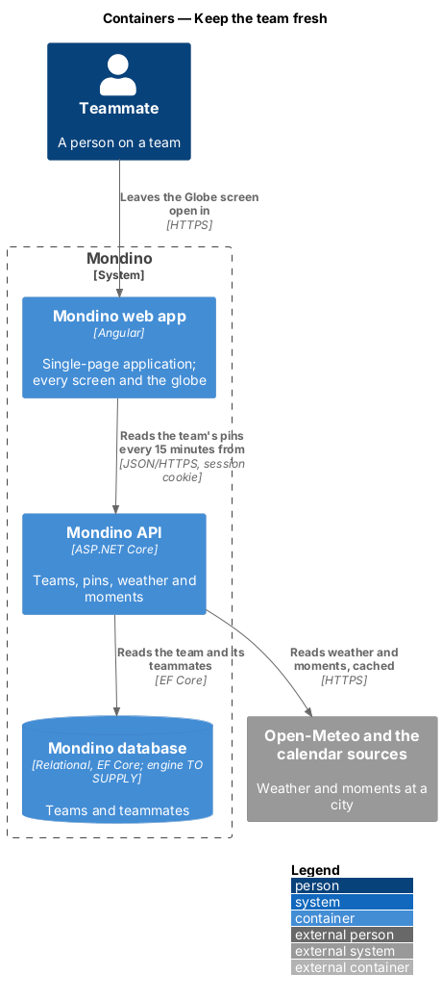
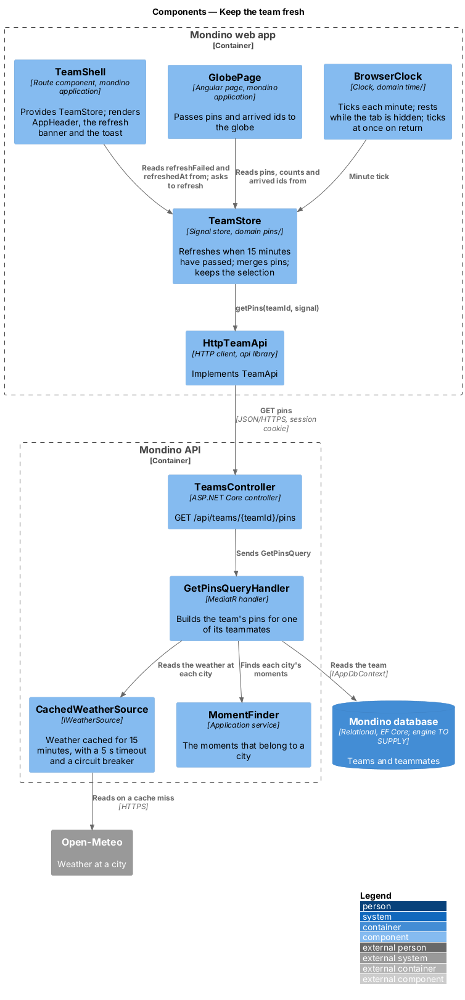
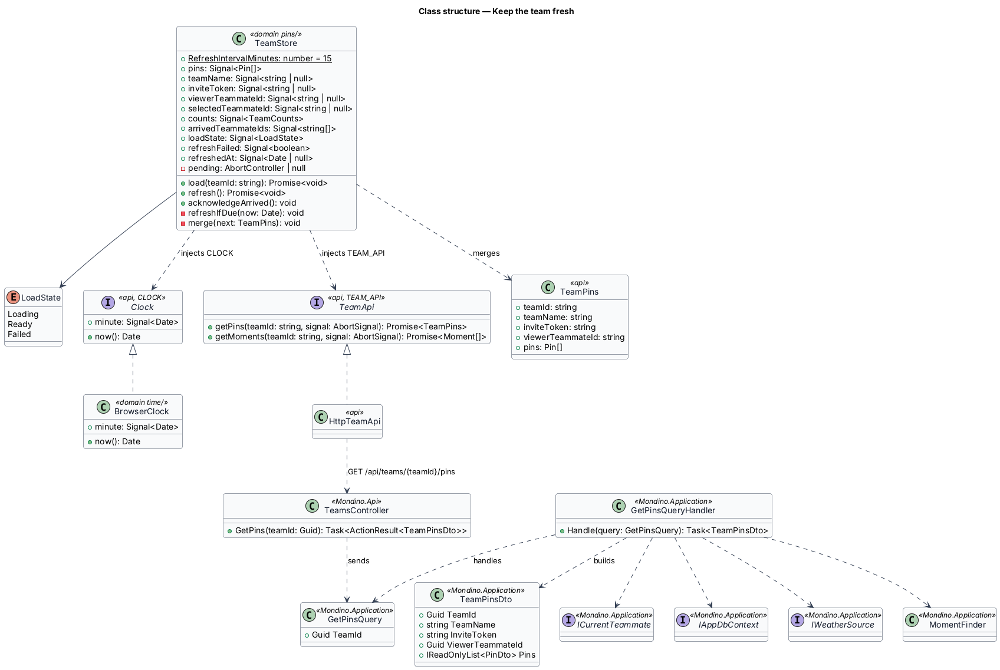
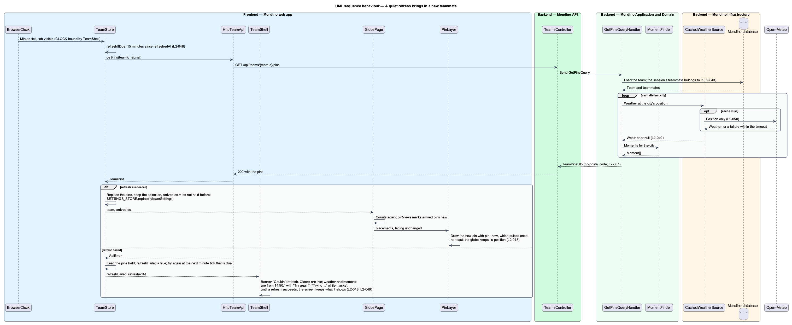
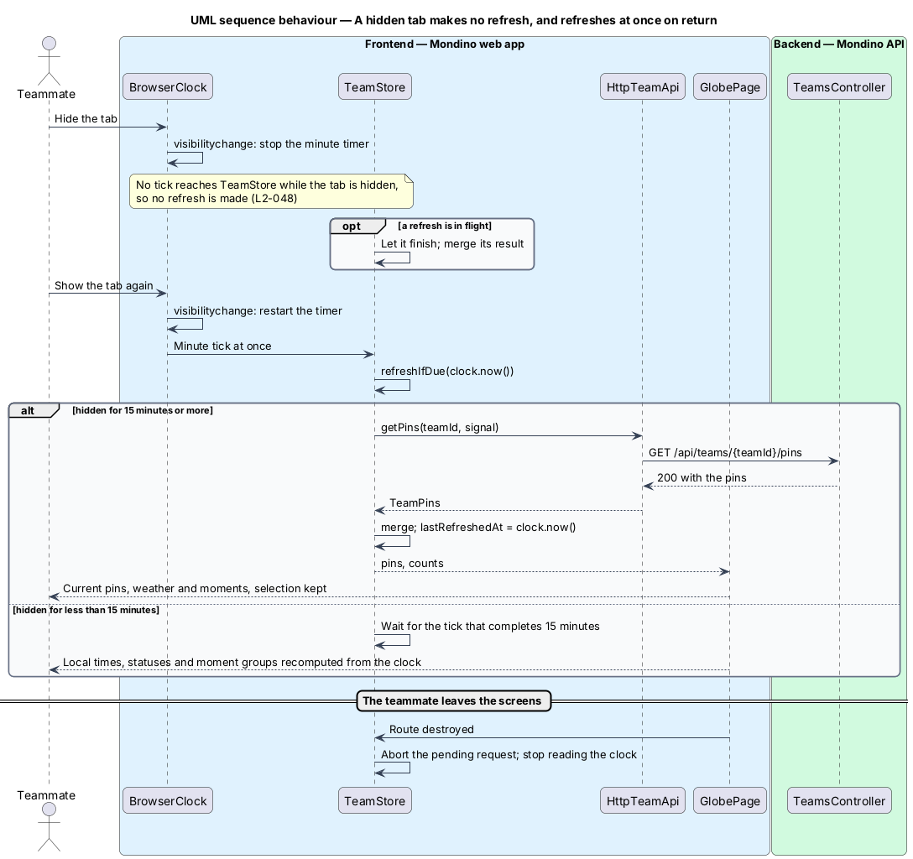

# Keep the team fresh

## Overview

Mondino is left open all day in a tab beside the work, and glanced at. A screen left open has to
stay true: the weather changes, moments come and go, and teammates join and leave. This feature
covers how the Mondino web app reads the team again without a reload.

- **teammate** — person who belongs to a team
- **pin** — a teammate's place on the globe, carrying their city, time zone, weather and moments
- **refresh** — reading the team's pins again from the Mondino API and merging them into what the screen holds
- **quiet** — without a loading state, without losing the selected pin and without moving the globe
- **shared clock** — the one clock every local time on a screen ticks from

Two things keep a screen true. Local times, statuses, counts and the grouping of moments by day
are worked out in the browser from the shared clock, so they follow the minute with no request.
The pins themselves (who is on the team, their weather, their moments) come from the backend,
and the `TeamStore` reads them again every 15 minutes while the tab is visible. A hidden tab
makes no request. A tab shown again after 15 minutes or more refreshes at once.

A teammate who joined while the screen was open appears at the next refresh: their pin is added
to the globe, pulses once, and the counts change.

## Description

The slice runs from the `TeamStore` in the browser to the Mondino database and Open-Meteo.

Frontend:

- **`TeamStore`** — signal store in `domain`'s `pins/`, provided at the route that holds the
  Globe, Team, Moments and Profile & Settings screens. It injects `TEAM_API` and `CLOCK`.
  `load(teamId)` reads the pins once when the route opens. An effect on the clock's minute tick
  calls `refreshIfDue(now)`, which calls `refresh()` when `RefreshIntervalMinutes` (15) or more
  have passed since `refreshedAt` and no request is pending (L2-048). The store has no
  timer of its own.
- **`BrowserClock`** — the one shared clock, bound to `CLOCK`. It ticks each minute, stops its
  timer while the tab is hidden and ticks at once when the tab is shown again. Because the
  store refreshes only on a tick, a hidden tab makes no refresh, and a tab hidden for 15 minutes
  or more refreshes at once on return, with no visibility listener in the store.
- **`merge(next)`** — replaces `pins` with the pins received. It keeps `selectedTeammateId` when
  that teammate is still on the team and clears it when they have left. It records in
  `arrivedTeammateIds` each teammate id that was not held before; the first load records none.
  `pins` holds one team's pins, at most 500, and each refresh replaces them, so nothing
  accumulates over a day.
- **`arrivedTeammateIds`** — ids whose pins are new since the last refresh. `GlobePage` passes
  them to `GlobeView` as `arrivedIds`; the globe pulses each new pin once (not under reduced
  motion) and emits `arrivedShown`, and `GlobePage` calls `acknowledgeArrived()`, which empties
  the list. `arrivedIds` and `arrivedShown` are an input and an output this design adds to
  `GlobeView`.
- **`loadState`** — `Loading`, `Ready` or `Failed`, for the first load only. A refresh never
  changes it: a failed refresh keeps the pins held, sets `refreshFailed`, and the store tries
  again at the next minute tick. `Loading` shows skeletons and announces "Loading your team…";
  `Failed` shows "We couldn't load your team" with "Try again", which calls `load` again.
- **`refreshFailed`** and **`refreshedAt`** — whether the last refresh failed, and when the pins
  held were read. While `refreshFailed` is true a banner (`Alert` as a banner, block `banner`,
  `role="status"`) sits under the header of whichever screen is open: "Couldn't refresh just
  now. Clocks are still right; weather and moments are from 14:50. Mondino will try again
  shortly.", the time being `refreshedAt` on the viewer's clock, with "Try now", which calls
  `refresh()`. `TeamShell`, the route component that provides the `TeamStore`, renders it under
  `AppHeader`, where it also renders the toast. The screen keeps everything it showed. The next
  refresh that succeeds clears `refreshFailed` and the banner goes, with no message (L2-048,
  L2-049).
- **`TeamApi`** (`TEAM_API`) and **`HttpTeamApi`** — contract and HTTP client in the `api`
  library. `getPins(teamId, signal)` calls `GET /api/teams/{teamId}/pins` and returns a
  `TeamPins`. The store passes an `AbortSignal` and aborts the pending request when the route
  is destroyed.
- **`TeamPins`** — type in `api`: `teamId`, `teamName`, `inviteToken`, `viewerTeammateId` and
  `pins`. It mirrors `TeamPinsDto`.
- **Moments across midnight** — `groupMoments(moments, now)` in `moments/` is called from
  computed signals that read the clock's minute tick, with today taken in the teammate's city.
  When the clock passes a teammate's midnight, their moments move between Today, This week and
  Later with no request (L2-048).

The globe keeps its position through a refresh because `GlobeView` receives a new `pins` value
and an unchanged `selectedId`; `PinLayer` adds, moves and removes pins by teammate id and does
not rebuild the scene.

Backend:

- **`TeamsController`** — `GET /api/teams/{teamId}/pins`. It checks nothing itself and sends one
  `GetPinsQuery`. `TeammateSessionHandler` authenticates the session cookie before the
  controller runs.
- **`GetPinsQueryHandler`** — MediatR handler. It reads `ICurrentTeammate`, loads the `Team`
  and its `Teammate` entities through `IAppDbContext`, and refuses when the session's teammate
  does not belong to the team. It reads the weather once for each distinct `City` through
  `IWeatherSource`, finds each city's moments through `MomentFinder`, and returns a
  `TeamPinsDto`. A `PinDto` carries a null `Weather` when the teammate does not share it or the
  source fails, and its `WeatherState` (`Available`, `Unavailable` or `NotShared`) says which;
  the pin is still returned with its time zone.
- **`TeamPinsDto`** — `TeamId`, `TeamName`, `InviteToken`, `ViewerTeammateId` and the `PinDto`
  list. It carries no postal code and no local time.
- **`CachedWeatherSource`** — decorator over `OpenMeteoWeatherSource` with a 5 second timeout
  (L2-049) and a circuit breaker. Weather is fresh for 15 minutes (L2-018), the interval of a
  refresh, so a refresh usually finds the weather in the cache; a miss sends Open-Meteo a
  position and nothing else.

The interval is one constant, `TeamStore.RefreshIntervalMinutes`. Unit tests advance a fake
clock bound to `CLOCK`; none sleeps. How the web app learns its team id when a teammate returns
on another device is `<TO SUPPLY>`, since signing in again is not designed.

## Requirements

The feature realises the following level-2 (L2) requirement, which refines a level-1 (L1)
requirement cited by identifier.

| L2 ID | Refines (L1) | Requirement |
|-------|--------------|-------------|
| `L2-048` | `L1-015` | A screen left open stays true: weather, moments and the team itself are refreshed quietly. |

The banner is also what L2-049 asks of a screen when the backend cannot be reached; the rest of
L2-049 is designed in `platform/survive-source-failure`.

## Diagrams

### System context

A teammate leaves Mondino open. Mondino reads the weather from Open-Meteo and the moments from
the calendar sources, so what the teammate sees stays current.

### Containers

Every 15 minutes while the tab is visible, the Mondino web app reads the team's pins from the
Mondino API. The API reads the team from the Mondino database and the weather and moments from
the outside sources, through its caches.

### Components

In the web app, `BrowserClock` ticks `TeamStore`, which calls `HttpTeamApi`. In the API,
`TeamsController` sends `GetPinsQuery` to `GetPinsQueryHandler`, which reads the database,
`CachedWeatherSource` and `MomentFinder`.

### Class structure

`TeamStore` depends on the `Clock` and `TeamApi` contracts and merges a `TeamPins`.
`GetPinsQueryHandler` builds the `TeamPinsDto` from `IAppDbContext`, `IWeatherSource` and
`MomentFinder`, for the teammate `ICurrentTeammate` names.

### Behaviour — a quiet refresh brings in a new teammate

A minute tick finds 15 minutes passed, and the store reads the pins again. The handler returns
every teammate's pin with weather or null. The store merges them, keeps the selection, and
reports the new teammate's id, whose pin the globe adds and pulses once. A failed refresh keeps
the pins held and shows the banner until a refresh succeeds.

### Behaviour — a hidden tab, and the return to it

`BrowserClock` stops while the tab is hidden, so no tick reaches the store and no refresh is
made. On return the clock ticks at once; the store refreshes when 15 minutes or more have
passed, and otherwise waits for the tick that completes them.

