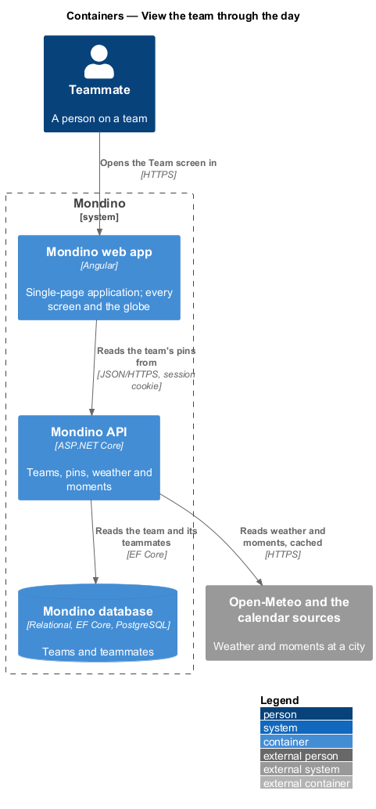
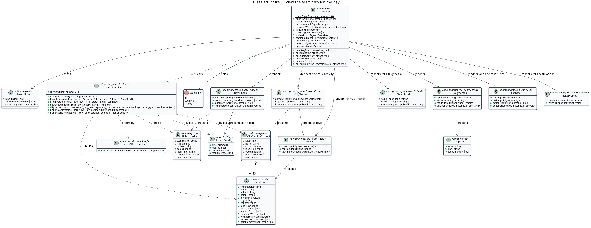
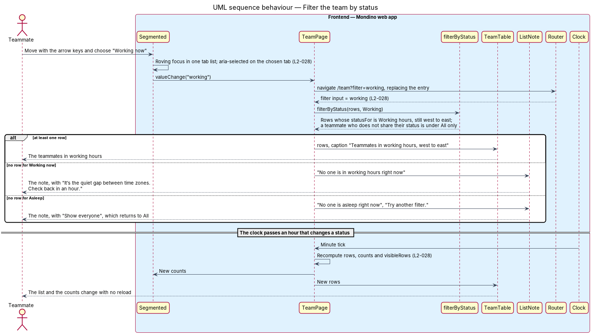
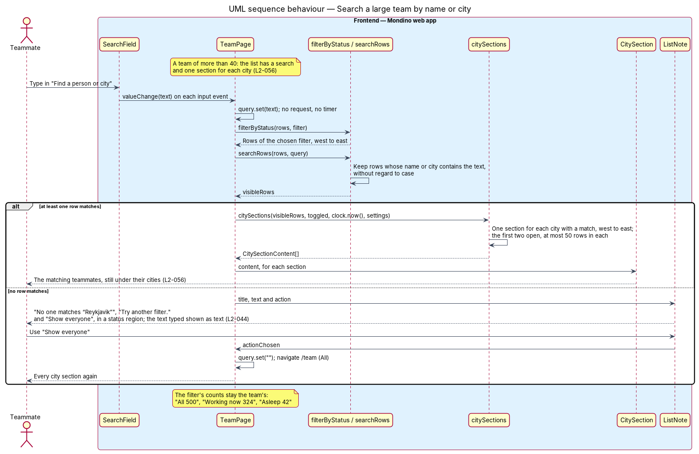
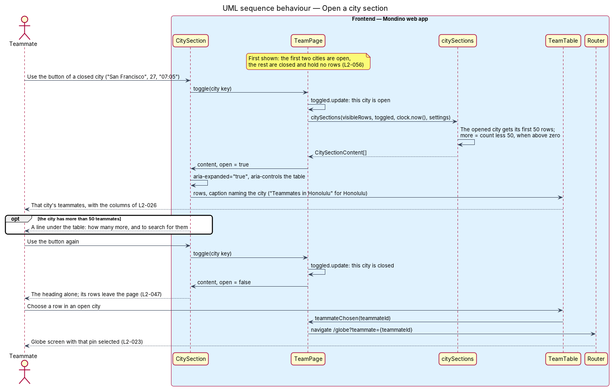

# View the team through the day

## Overview

Mondino shows a team spread around the world. The Globe screen shows where teammates are; the
Team screen, "Where everyone is in their day", shows when they are. This feature covers the Team
screen.

- **teammate** — person who belongs to a team
- **viewer** — teammate looking at the screen
- **pin** — a teammate's place on the globe, placed at their city
- **local time** — time of day in a teammate's city
- **status** — label that follows from a teammate's local hour: Working hours (09:00 to 18:00), Early morning (07:00 to 09:00), Evening (18:00 to 23:00) or Probably asleep (23:00 to 07:00)
- **offset** — how far ahead or behind a teammate's local time is, compared with the viewer's
- **day ribbon** — strip that lays out the 24 hours of a day and places each teammate at the hour they are living through
- **west to east** — order by a time zone's current offset from UTC, then by longitude
- **large team** — team of more than 40 teammates, for which the day ribbon is a bar chart and the list is searched and split by city
- **city section** — part of a large team's list that holds the teammates of one city, under a button that opens and closes it

The screen has three parts. The day ribbon sits on top, with the night, the morning, working
hours and the evening marked. Under it are the filters All, Working now and Asleep, each with
the number of teammates it holds. Under them is every teammate from west to east, with
location, local time, offset, weather and next moment. From 768 px the list is a table; under
768 px each teammate shows name, status, local time with city and offset, and next moment.
Choosing a row or a ribbon marker opens the Globe screen with that teammate's pin selected.

The screen has three sizes of team to serve. A team of one has no list to filter: under the
ribbon a card offers "Invite teammates". A team of 2 to 40 is drawn as described above. In a
large team faces no longer fit on the ribbon and rows no longer fit on a screen, so the ribbon
becomes a bar chart of how many teammates are at each half hour of their day, and the list
gains a search and is split into one city section for each city (L2-056).

The Team screen reads no data of its own. It presents the pins the `TeamStore` holds, and
recomputes from the one shared clock each minute. A team may hold 500 teammates, so the page
holds rows only for the city sections that are open, and at most 50 for each.

## Description

The slice lives in the Mondino web app. The pins come from `GET /api/teams/{teamId}/pins`, whose
loading and refreshing are designed in `keep-team-fresh`.

**The page and its state**

- **`TeamPage`** — page of the `mondino` application at `/team`, a lazy route. It receives the
  `filter` query parameter as a component input and reads the `StatusFilter` from it: none is
  `All`, `working` is `Working` and `asleep` is `Asleep`. Choosing a tab navigates to the
  address of that filter, replacing the current entry, so "2 more on the Team page" on the
  Globe screen opens `/team?filter=working` with Working now chosen
  (`view-week-around-the-world`). It holds the search text as the signal `query` and the city
  sections the teammate has opened or closed as the signal `toggled`. Neither is in the
  address: what is typed in the search can be a teammate's name, and a name never goes into a
  URL. `large` is true when `TeamStore.pins` holds more than `LargeTeamThreshold` (40) pins.
  Its `rows`, `visibleRows`, `sections`, `markers`, `density` and `options` are computed
  signals over `TeamStore.pins`, the filter, the search and the clock's minute tick. It
  navigates to `/globe?teammate={teammateId}` when a teammate is chosen. The search and the
  opened sections are the screen's own state and go when the teammate leaves the screen.

**In `domain`'s `pins/` and `time/`**

- **`orderWestToEast(pins, now)`** — pure function in `pins/`. It orders pins by
  `zoneOffsetMinutes(now, timeZoneId)` ascending, then by longitude ascending (L2-026). The
  offset is the current one, so the order follows daylight saving time. The teammates of one
  city are next to each other in this order.
- **`zoneOffsetMinutes(now, timeZoneId)`** — pure function in `time/`: a time zone's offset from
  UTC at an instant, in minutes.
- **`teamRows(pins, viewer, now, settings)`** — pure function in `pins/`. It returns one
  `TeamRow` per pin in west-to-east order: name, city and country, formatted local time, offset
  from the viewer, status, weather and next moment. The offset is in the row's form ("7h
  behind", "4h 30m ahead", "Same time"; `time/show-offset-and-overlap`). The status is what
  `statusFor(pin, time)` gives, so it is null, and the row shows none, at every hour, for a
  teammate who does not share their status. The viewer's own row has `isViewer` set and a null
  offset. `nextMoment` is the pin's earliest moment dated today or later in its city, or
  null, and `nextMomentWhen` says when it is: `whenLabel`'s words up to 7 days ahead ("Today",
  "In 5 days"), and from 8 days ahead its day and month ("9 Nov"). The row carries the pin's
  `weatherState` beside its weather, so weather that is unavailable is told from weather that
  is not shared (`show-weather`). A `TeamRow` holds no postal code; the `Pin` type has none to give.
- **`filterByStatus(rows, filter)`** — pure function in `pins/`. `All` keeps every row,
  `Working` keeps status Working hours and `Asleep` keeps status Probably asleep. A row whose
  status is null is kept by `All` only. The order is unchanged (L2-028).
- **`searchRows(rows, query)`** — pure function in `pins/`. It trims the query and, when
  anything is left, keeps the rows whose name or city contains it, without regard to case. An
  empty query keeps every row. The order is unchanged. Whether accents are ignored, so that
  São Paulo is found without its tilde, is `<TO SUPPLY>`. `TeamPage` applies it to what
  `filterByStatus` returns, so the search works within the filter that is on (L2-056).
- **`citySections(rows, toggled, now, settings)`** — pure function in `pins/`. It gathers the
  rows it is given by city, in the order they arrive, which is west to east, and returns one
  `CitySectionContent` for each city that has a row: a `key` (the city and its country), the city's
  `name`, the `count` of its rows, the city's formatted `localTime`, `open`, its `rows` and
  `more`. A section is open when the teammate opened it, or when it is one of the first two
  sections of the list and the teammate has not closed it. An open section holds its first
  `CityRowLimit` (50) rows, and `more` is the count less those; a closed section holds no
  rows. A city none of whose teammates passes the filter and the search has no section.
- **`ribbonMarkers(pins, now, settings)`** — pure function in `pins/`, for a team of 40 or
  fewer. It returns one `RibbonMarker` per pin. `dayFraction` is the local hour and minute as a
  fraction of 24 hours, so a local time of 08:05 sits just after the 08:00 mark. Markers close
  enough to overlap, those at the same local time and those less than an hour after the marker
  before them, take successive `lane` values, so each stays visible and can be chosen (L2-027).
- **`ribbonDensity(pins, now, settings)`** — pure function in `pins/`, for a large team. It
  counts the pins in 48 bins, one for each half hour of the day, by each pin's local time: a
  pin at 15:05 is in the bin that starts at 15:00. It returns a `RibbonDensity`: the 48
  `bins`, the largest count as `max`, the bin that holds it as `maxBin`, and that bin's start
  as a formatted time in the viewer's clock format. Every teammate is counted, since a local
  time is always shown. It is one pass over the pins.

**In the `components` library**

- **`DayRibbon`** (`mo-day-ribbon`) — presentation component, the mocks' `day-ribbon` block, a
  section named by its visually hidden heading "The day, hour by hour". It takes `markers` or
  `density`, and `summary`. It draws the 24 hours with a
  mark every three hours, labelled "00:00", "03:00", "06:00" and so on, or on the 12-hour clock
  by the hour alone ("12 am", "3 am", "6 am"), and four bands, each with a text label and not
  by colour alone: "Night" from 23:00 to 07:00, "Morning" from 07:00 to 09:00, "Working hours"
  from 09:00 to 18:00 and "Evening" from 18:00 to 23:00. Given `markers`, each marker is a
  link holding an `Avatar`,
  placed by percentage so the ribbon fits any width without scrolling the page. A marker's
  accessible name is the teammate's name and local time ("Noah Williams, 01:05"), and its
  tooltip the name and city ("Noah Williams · Melbourne"). It emits `teammateChosen`.
- **The ribbon as a bar chart** — given `density`, `DayRibbon` draws no marker. Over the same
  four bands it draws 48 bars (`day-ribbon__bar`), one for each half hour, each as tall as its
  bin's share of `max`; an empty bin is a `day-ribbon__bar--none`. The count stands in figures
  over the tallest bar ("123", `day-ribbon__bar-count`). Above the track a summary line
  (`day-ribbon__summary`) reads "324 of 500" and "are in working hours right now"; `TeamPage`
  builds it from `TeamStore.counts`, so it follows the clock and leaves out a teammate who
  does not share their status. The track (`day-ribbon__track--density`) is one picture,
  `role="img"`, named "How many teammates are at each half hour of their day. The most, 123,
  are at 15:00."; its bars are hidden from assistive technology and are not controls. Where
  the 24 hours are wider than the screen the track scrolls sideways inside
  `day-ribbon__scroll`, a focusable group named "The day ribbon; scroll sideways to see all 24
  hours", and the page itself does not scroll sideways. A teammate of a large team is reached
  through the list and its search, not through the ribbon.
- **`Segmented`** (`mo-segmented`) — presentation component. It takes `options`, each with an
  optional `count`, `value` and a `mode` (`tabs` or `radio`), and emits `valueChange`. Here its
  mode is `tabs`: one `tablist` named "Filter by status": the arrow keys
  move between its tabs, one tab is in the tab order, the chosen tab carries `aria-selected`,
  and the list under it is its `tabpanel` (L2-028). `TeamPage` builds the filter's three tabs
  from `TeamStore.counts`: "All 13", "Working now 8", "Asleep 2", and for a team of 500 "All
  500", "Working now 324", "Asleep 42". The counts are the team's, and a search does not
  change them.
- **`SearchField`** (`mo-search-field`) — presentation component, shown for a large team
  beside the filters (`section-head__tools`). It is an `input` of type `search` named "Find a
  person or city", with the same words as its placeholder, and it names the list as what it
  controls (`aria-controls`). It takes `value` and emits `valueChange` on each input event.
  `TeamPage` sets `query` at once: `searchRows` is a pass over at most 500 rows held in
  memory, so the search needs no request, no delay and no timer. What is typed is data: it is
  rendered as text and sent nowhere (L2-044).
- **`TeamTable`** (`mo-team-table`) — presentation component, the mocks' `team-table` block. It
  takes `rows` and `caption`, and emits `teammateChosen`. From 768 px it has the columns
  Person, Location, Local time, Compared to you, Weather and Coming up; below that each row
  gives the name, the status in words, the local time, the city with the offset ("Mexico City
  · 7h behind") and the next moment. The viewer's row shows the name
  followed by "(you)" and a dash for the offset, named "You" for assistive technology. Coming
  up gives the next moment's kind icon, its title and when it is ("October Bank Holiday ·
  Today", "Día de Muertos · In 5 days", "São Paulo Grand Prix · 9 Nov"). A row with no next
  moment shows a dash under Coming up, named "Nothing coming up". Each row holds one link over
  the teammate's name that covers the row, so a row is chosen by pointer, touch or keyboard.
  For a team of 40 or fewer the list is one table, headed "Everyone, west to east", whose
  caption names what it holds:
  "Everyone, west to east", "Teammates in working hours, west to east" or "Teammates probably
  asleep, west to east". It holds at most 40 rows.
- **`CitySection`** (`mo-city-section`) — presentation component, the mocks' `city-section`
  block, one for each `CitySectionContent` of a large team. It takes `content`. Its heading holds a button
  (`city-section__toggle`) with the city's name, its count ("4", followed by "teammates" for
  assistive technology) and its local time in tabular figures ("Honolulu", "4", "04:05"). The
  button carries `aria-expanded` and, while open, `aria-controls` naming the table under it;
  it emits `toggle`. An open section renders a `TeamTable` of its rows, with the caption
  "Teammates in Honolulu". When `more` is above zero a line under the table says how many
  more teammates the city has and to search for them; its words are `<TO SUPPLY>`, since the
  largest open city in the mocks has four teammates. A closed section renders no table. From
  768 px one row of column headings (`team-head`), hidden from assistive technology, stands
  above the sections, and each table keeps its own headings for assistive technology.
- **`ListNote`** (`mo-list-note`) — presentation component, the mocks' `list-note` block, a
  `role="status"` region shown in the list's place when it holds no row. It takes a `title`,
  a `text` and an optional `action`, and emits `actionChosen`.
- **`InvitePrompt`** (`mo-invite-prompt`) — presentation component, the mocks' `invite-prompt`
  card, shown for a team of one. It takes the team's name and emits `invite` with the button's
  element, to which focus returns when the dialog closes.

**A team of one**

The heading of the screen gives the number of teammates and of distinct time zones from
`TeamStore.counts`, as "13 teammates · 12 time zones · live". For a team of one it reads "Just
you · 1 time zone · live". The day ribbon shows the viewer's own marker. Under it
`InvitePrompt` reads "It’s just you on Northwind so far" and "This list fills up west to east
as teammates join with the invite link.", with the button "Invite teammates". On `invite`,
`TeamPage` calls `InviteDialogOpener.open(trigger)`, which opens the invite dialog, the one
"Invite teammate" in the header opens; the opener and the dialog are designed in
`joining/invite-teammates` (L2-054) and not here. No filter, no search
and no table are shown. The team's name is data and is rendered as text.

**Nothing to list**

When the filter or the search leaves no row, `TeamPage` shows a `ListNote` in the list's place:

| Case | Title | Text | Action |
|---|---|---|---|
| Asleep, and no one is asleep | "No one is asleep right now" | "Try another filter." | "Show everyone" |
| Working now, and no one is in working hours | "No one is in working hours right now" | "It’s the quiet gap between time zones. Check back in an hour." | `<TO SUPPLY>` |
| A search that matches no one | "No one matches “Reykjavik”" | "Try another filter." | "Show everyone" |

"Show everyone" clears the search and returns the filter to All. The title of the third case
quotes what was typed, as text. Whether the note for Working now carries "Show everyone" is
`<TO SUPPLY>`; the mocks draw the note for Asleep and for a search.

**A large team**

For a team of more than 40, `TeamPage` passes `density` to `DayRibbon` in place of `markers`,
shows `SearchField` beside the filters, and renders one `CitySection` for each value of
`sections` in place of the one table. The first two cities start open, as the mock of a team
of 500 draws Honolulu and Vancouver. The same rule holds for the list a filter or a search
leaves: its first two sections are open unless the teammate closed them. The mocks draw the
sections for All with no search.

The rows in the page stay bounded (L2-047, L2-056):

- A closed city section holds no rows, and an open one at most 50.
- The page holds one heading for each city with a teammate that passes the filter and the
  search, at most 500 and in practice the number of the team's cities.
- A search or a filter shortens the list; neither adds rows beyond these limits.
- The bar chart is 48 bars whatever the size of the team, in place of up to 500 markers.
- `rows`, `visibleRows`, `sections` and `density` are computed signals. Each is replaced when
  the pins, the filter, the search or the clock's minute change, and none accumulates over a
  visit.

Whether the number of city sections open at once also needs a limit is `<TO SUPPLY>`; the
heap check of a team of 500 (L2-047) settles it. The limit of 500 teammates in a team is the
ceiling in every case.

**What does not depend on the team's size**

A teammate who does not share their status still has a row and a ribbon marker, or a place in
their half hour's bar, since all three follow from the local time. Their row shows no status
at any hour and they are listed under All only: not under Working now or Asleep, and in
neither count, since `teamCounts` and `filterByStatus` both read `statusFor` (L2-015, L2-028).

The viewer's time zone is the time zone of the viewer's own pin. The viewer's display settings
(°C or °F, 24-hour or 12-hour clock) come from `SettingsCache`. A teammate's name, a city and a
moment's title are rendered as text, never as HTML.

## Requirements

The feature realises the following level-2 (L2) requirements. Each refines a level-1 (L1)
requirement, cited by identifier.

| L2 ID | Refines (L1) | Requirement |
|-------|--------------|-------------|
| `L2-026` | `L1-009` | The Team screen, "Where everyone is in their day", lists every teammate under "Everyone, west to east": ordered by their time zone's current offset from UTC, then by longitude. Each row gives the teammate's name with their status in words under it, city and country, local time, offset from the viewer, weather and next moment. A team of more than 40 is listed city by city, with a search (L2-056). |
| `L2-027` | `L1-009` | Above the list, a day ribbon, "The day, hour by hour", lays out the 24 hours of a day and places each teammate at the hour they are living through, with the night, the morning, working hours and the evening marked. In a team of more than 40, where faces no longer fit, the ribbon is a bar chart of how many teammates are at each half hour of their day. |
| `L2-028` | `L1-009` | The list is filtered by All, Working now or Asleep. Each filter shows how many teammates it holds. |
| `L2-056` | `L1-009` | In a team of more than 40, the Team list gains a search and is split into one section per city, so that a teammate or a city can be found without scrolling through hundreds of rows. The day ribbon becomes a bar chart (L2-027). A team of 40 or fewer is listed as in L2-026, with no search and no sections. |

## Diagrams

### System context

A teammate reads where every teammate is in their day in Mondino. The weather and moments in
each row reach Mondino from Open-Meteo and the calendar sources, through the backend only.

### Containers

The Team screen is built in the Mondino web app from the pins the Mondino API returns. The API
reads the team from the Mondino database.

### Components

`TeamPage` reads the pins and counts from `TeamStore`, builds rows, city sections, markers and
the density with the `pins/` functions, and passes them to `DayRibbon`, `Segmented`,
`SearchField`, `TeamTable` and `CitySection`. Each reports a choice back to `TeamPage`.
`InvitePrompt` stands in the list's place for a team of one, and `ListNote` when nothing
matches.

### Class structure

`TeamPage` holds a `StatusFilter`, the search text and the toggled cities, and renders the
presentation components. The `pins/` functions build the `TeamRow`, `CitySectionContent`,
`RibbonMarker` and `RibbonDensity` values those components present, and order by
`zoneOffsetMinutes`. A `CitySectionContent` holds at most 50 `TeamRow`s.

### Behaviour — open the Team screen, ordered west to east

`TeamPage` orders the pins by current UTC offset and then longitude and builds the rows. For a
team of 40 or fewer it builds the ribbon markers and one table. For a large team it builds the
density and the city sections, the first two open. A chosen row or marker navigates to the
Globe screen with that teammate's id.

### Behaviour — filter the team by status

Choosing a tab navigates to the filter's address, and `filterByStatus` keeps the matching rows
in west-to-east order. An empty result shows the filter's own note. A clock tick that changes
a status changes the list and the counts with no reload.

### Behaviour — search a large team

Each input event sets the search text. `searchRows` keeps the rows of the chosen filter whose
name or city matches, and `citySections` gathers them under their cities again. No request is
sent and no timer runs. A search that matches no one shows "No one matches “Reykjavik”", and
"Show everyone" clears the search and returns to All (L2-056).

### Behaviour — open a city section

A city's button opens or closes its section. `TeamPage` records the choice, and `citySections`
gives the opened section its first 50 rows and the closed one none, so the rows in the page
stay bounded (L2-056, L2-047).

