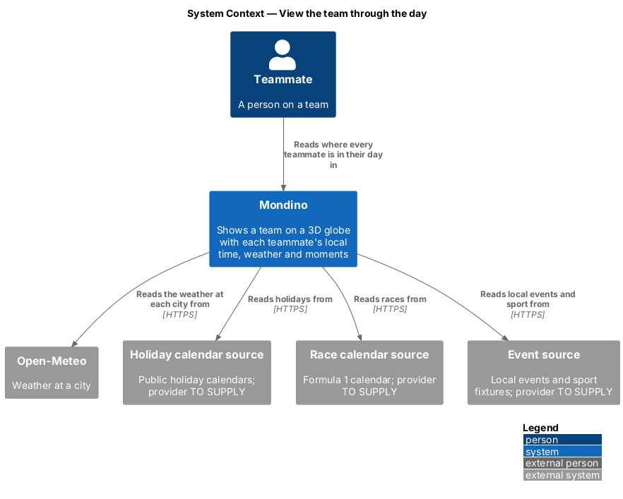
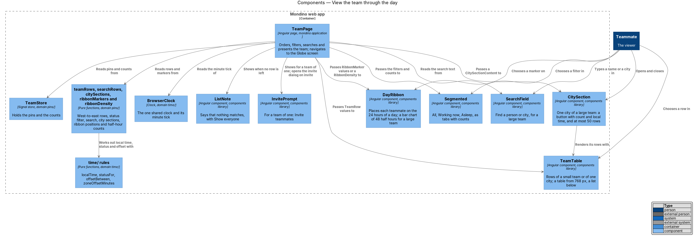
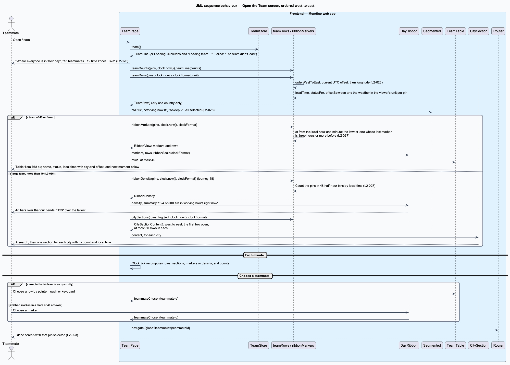

# View the team through the day

## Overview

Mondino shows a team spread around the world. The Globe screen shows where teammates are; the
Team screen, "Where everyone is in their day", shows when they are. This feature covers the Team
screen.

- **teammate** — person who belongs to a team
- **viewer** — teammate looking at the screen
- **pin** — a teammate's place on the globe, placed at their city
- **local time** — time of day in a teammate's city
- **status** — label that follows from a teammate's local hour: Working hours (09:00 to 18:00), Early morning (07:00 to 09:00), Evening (18:00 to 23:00) or Probably asleep (23:00 to 07:00)
- **offset** — how far ahead or behind a teammate's local time is, compared with the viewer's
- **day ribbon** — strip that lays out the 24 hours of a day and places each teammate at the hour they are living through
- **west to east** — order by a time zone's current offset from UTC, then by longitude

The screen has three parts. The day ribbon sits on top, with working hours and the night marked.
Under it are the filters All, Working now and Asleep, each with the number of teammates it
holds. Under them is every teammate from west to east, with location, local time, offset,
weather and next moment. From 768 px the list is a table; on a phone it is a list of name, local
time and next moment. Choosing a row or a ribbon marker opens the Globe screen with that
teammate's pin selected.

The Team screen reads no data of its own. It presents the pins the `TeamStore` holds, and
recomputes from the one shared clock each minute. A team may hold 500 teammates, so the list
keeps only the rows near the viewport in the page.

## Description

The slice lives in the Mondino web app. The pins come from `GET /api/teams/{teamId}/pins`, whose
loading and refreshing are designed in `keep-team-fresh`.

- **`TeamPage`** — page of the `mondino` application at `/team`, a lazy route. It holds the
  chosen `StatusFilter` as a signal, starting at `All`. Its `rows`, `markers` and `chips` are
  computed signals over `TeamStore.pins`, the filter and the clock's minute tick. It navigates
  to `/globe?teammate={teammateId}` when a teammate is chosen. The filter is the screen's own
  state and goes when the teammate leaves the screen.
- **`orderWestToEast(pins, now)`** — pure function in `domain`'s `pins/`. It orders pins by
  `zoneOffsetMinutes(now, timeZoneId)` ascending, then by longitude ascending (L2-026). The
  offset is the current one, so the order follows daylight saving time.
- **`zoneOffsetMinutes(now, timeZoneId)`** — pure function in `time/`: a time zone's offset from
  UTC at an instant, in minutes.
- **`teamRows(pins, viewer, now, settings)`** — pure function in `pins/`. It returns one
  `TeamRow` per pin in west-to-east order: name, city and country, formatted local time, offset
  from the viewer, status, weather and next moment. The viewer's own row has `isViewer` set and
  a null offset. `nextMoment` is the pin's earliest moment dated today or later in its city, or
  null. A `TeamRow` holds no postal code; the `Pin` type has none to give.
- **`filterByStatus(rows, filter)`** — pure function in `pins/`. `All` keeps every row,
  `Working` keeps status Working hours and `Asleep` keeps status Probably asleep. The order is
  unchanged (L2-028).
- **`ribbonMarkers(pins, now, settings)`** — pure function in `pins/`. It returns one
  `RibbonMarker` per pin. `dayFraction` is the local hour and minute as a fraction of 24 hours,
  so a local time of 08:05 sits just after the 08:00 mark. Markers at the same local hour take
  successive `lane` values, so each stays visible and can be chosen (L2-027).
- **`DayRibbon`** (`mo-day-ribbon`) — presentation component. It draws the 24 hours, the span
  09:00 to 18:00 labelled as working hours and the span 23:00 to 07:00 labelled as night, each
  with a text label and not by colour alone. Each marker is a button holding an `Avatar`,
  placed by percentage so the ribbon fits any width without scrolling the page. A marker's
  accessible name is the teammate's name and local time. It emits `teammateChosen`.
- **`FilterChips`** (`mo-filter-chips`) — presentation component. It takes `chips` and
  `selected`, and emits `selectedChange`. It is one `radiogroup`: the arrow keys move between
  chips, one chip is in the tab order, and the chosen chip carries `aria-checked` (L2-028).
  `TeamPage` builds the filter's three tabs from `TeamStore.counts`: "All 12", "Working now 7",
  "Asleep 2".
- **`TeamTable`** (`mo-team-table`) — presentation component. It takes `rows` and
  `emptyMessage`, and emits `teammateChosen`. From 768 px it has the columns Person, Location,
  Local time, vs you, Weather and Coming up; below that each row gives the name, the local time
  and the next moment. The viewer's row shows the name followed by "(you)" and a dash for the
  offset. A row with no next moment shows a dash under Coming up. Each row holds one link-styled
  button over the teammate's name that covers the row, so a row is chosen by pointer, touch or
  keyboard.
- **Windowed rows** — `TeamTable` renders its rows through the Angular CDK virtual scroll
  viewport with a fixed row height per layout. The page holds the rows in and near the viewport
  and no more, whatever the size of the team (L2-026, L2-047). The table states
  `aria-rowcount` and each row its `aria-rowindex`, so assistive technology knows the full
  length.

The heading of the screen gives the number of teammates and of distinct time zones from
`TeamStore.counts`. The empty messages are "Nobody is in working hours right now." for Working
now and "Everyone is awake right now." for Asleep.

A teammate whose settings hide their status outside working hours still has a row and a ribbon
marker, since both follow from the local time. How the Asleep filter and its count treat such a
teammate is `<TO SUPPLY>`; L2-028 does not say.

The viewer's time zone is the time zone of the viewer's own pin. The viewer's display settings
(°C or °F, 24-hour or 12-hour clock) come from `SettingsCache`. A teammate's name, a city and a
moment's title are rendered as text, never as HTML.

## Requirements

The feature realises the following level-2 (L2) requirements. Each refines a level-1 (L1)
requirement, cited by identifier.

| L2 ID | Refines (L1) | Requirement |
|-------|--------------|-------------|
| `L2-026` | `L1-009` | The Team screen, "Where everyone is in their day", lists every teammate from west to east: ordered by their time zone's current offset from UTC, then by longitude. Each row gives the teammate's name with their status in words under it, city and country, local time, offset from the viewer, weather and next moment. |
| `L2-027` | `L1-009` | Above the list, a day ribbon lays out the 24 hours of a day and places each teammate at the hour they are living through, with working hours and the night marked. |
| `L2-028` | `L1-009` | The list is filtered by All, Working now or Asleep. Each filter shows how many teammates it holds. |

## Diagrams

### System context

A teammate reads where every teammate is in their day in Mondino. The weather and moments in
each row reach Mondino from Open-Meteo and the calendar sources, through the backend only.

### Containers

The Team screen is built in the Mondino web app from the pins the Mondino API returns. The API
reads the team from the Mondino database.

### Components

`TeamPage` reads the pins and counts from `TeamStore`, builds rows and markers with the `pins/`
functions, and passes them to `DayRibbon`, `FilterChips` and `TeamTable`. Each of the three
reports a choice back to `TeamPage`.

### Class structure

`TeamPage` holds a `StatusFilter` and renders three presentation components. The `pins/`
functions build the `TeamRow` and `RibbonMarker` values those components present, and order by
`zoneOffsetMinutes`.

### Behaviour — open the Team screen, ordered west to east

`TeamPage` orders the pins by current UTC offset and then longitude, builds the ribbon markers
and the rows, and `TeamTable` renders only the rows near the viewport. A chosen row or marker
navigates to the Globe screen with that teammate's id.

### Behaviour — filter the team by status

Choosing a chip sets the filter, and `filterByStatus` keeps the matching rows in west-to-east
order. An empty result shows the filter's own message. A clock tick that changes a status
changes the list and the counts with no reload.

