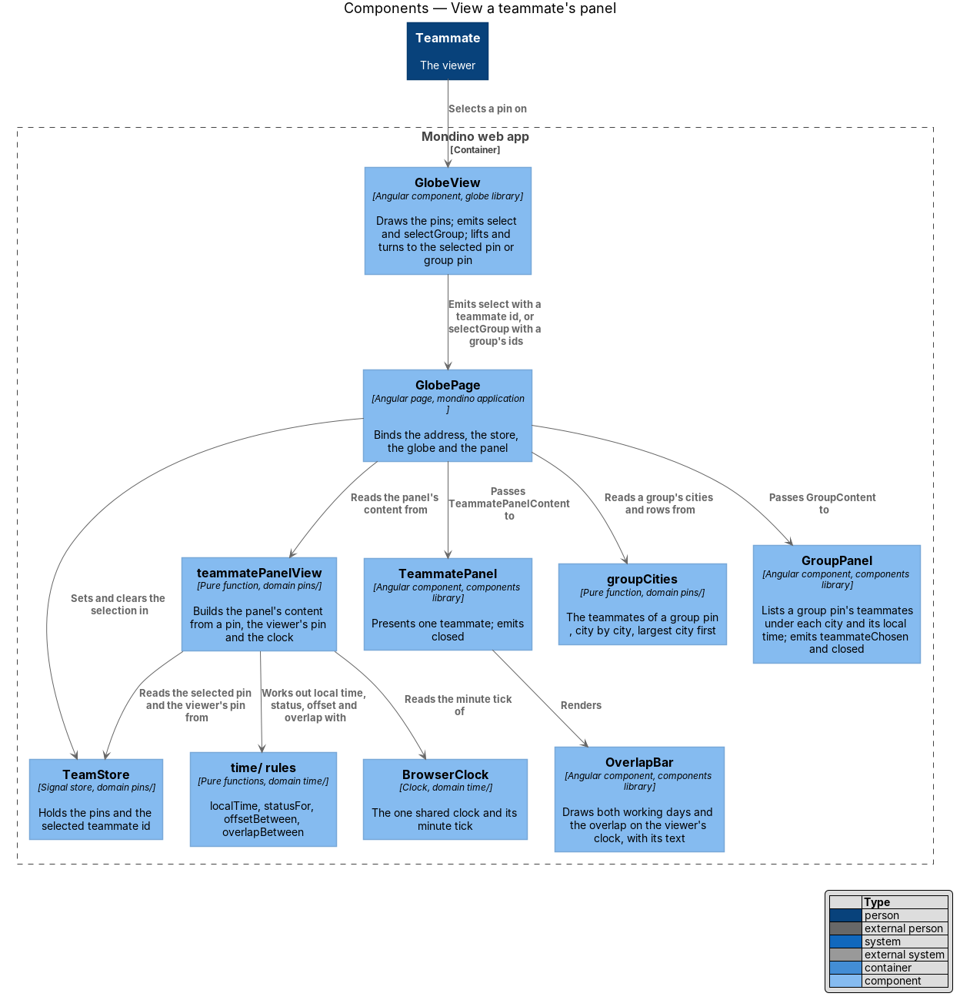
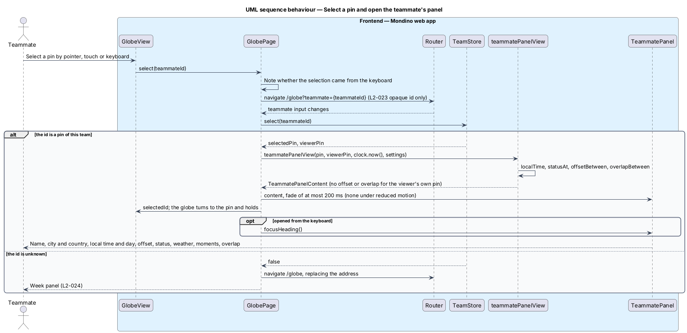

# View a teammate's panel

## Overview

Mondino shows a team spread around the world as pins on a 3D globe. The Globe screen is the home
screen: the globe on one side and a panel beside it (under it on a phone). This feature covers
what the panel shows when a pin, or a group pin, is selected.

- **teammate** — person who belongs to a team
- **viewer** — teammate looking at the screen
- **pin** — a teammate's place on the globe, placed at their city
- **status** — label that follows from a teammate's local hour: Working hours, Early morning, Evening or Probably asleep
- **offset** — how far ahead or behind a teammate's local time is, compared with the viewer's
- **overlap** — part of two teammates' working hours (09:00 to 18:00) that coincides, shown on the viewer's clock
- **moment** — something happening where a teammate lives: a holiday, Formula 1, a local event or sport

Selecting a pin opens that teammate in the panel: name, city and country, local time and day,
offset, status, weather, upcoming moments and overlap. The selection is held in one place, the
`TeamStore`, and is mirrored in the address as an opaque teammate id, so a reload or a shared
address selects the same teammate. Closing the panel clears the selection and returns the panel
to the week around the world (L2-024, designed in `view-week-around-the-world`).

Where pins sit too close together to tell apart, the globe draws them as one group pin with a
count (`globe/show-pins`). Selecting a group pin opens the group in the panel: its teammates,
west to east, each a link that selects that teammate's pin.

The feature reads no data of its own. Every value in the panel is worked out in the browser from
the pins the `TeamStore` already holds and from the one shared clock.

## Description

The slice lives in the Mondino web app. The pins come from `GET /api/teams/{teamId}/pins`, whose
loading and refreshing are designed in `keep-team-fresh`.

- **`GlobePage`** — page of the `mondino` application at `/globe`, a lazy route. It binds the
  address, the `TeamStore`, the `GlobeView` and the panel. It receives the `teammate` query
  parameter as a component input and passes it to `TeamStore.select`. It renders `TeammatePanel`
  when a pin is selected, `GroupPanel` when a group pin is selected, and `WeekPanel` otherwise.
  It listens for Escape while a teammate's or a group's panel is open.
- **Address** — `/globe?teammate={teammateId}`. The parameter carries the teammate's id, an
  opaque `Guid`, and no name, city or postal code (L2-023). The address is the source of the
  selection: a select or a close navigates, and the store follows the address.
- **`TeamStore`** — signal store in `domain`'s `pins/`. It holds `pins`,
  `viewerTeammateId` and `selectedTeammateId`, and derives `selectedPin` and `viewerPin`.
  `select(teammateId)` returns `false` and leaves the selection empty when no pin of the team has
  that id; `GlobePage` then removes the parameter from the address. `clearSelection()` empties
  the selection. `keep-team-fresh` lists what else the store holds. The store is provided at the
  route that holds the Globe, Team, Moments and Profile & Settings screens, so the selection is
  released when the teammate leaves those screens.
- **`teammatePanelView(pin, viewer, now, settings)`** — pure function in `pins/`. It builds a
  `TeammatePanelContent` from the selected pin, the viewer's pin, the clock's time and the
  viewer's display settings. It calls `localTime`, `formatTime`, `formatDay`, `statusFor`,
  `offsetBetween`, `formatOffset`, `workingDayOnViewerClock`, `overlapBetween` and
  `formatOverlap` from `time/`, and keeps the pin's moments that are today or later in the
  pin's city, in date order, each as a `PanelMoment`: its kind, title and detail, its emblem
  from `emblemFor` and its `when` from `whenLabel(daysAhead, date)`, both in `moments/`. The offset is in the panel's form, which names the viewer: "7 h
  behind you", "10 h ahead of you", "Same time as you". For the viewer's own pin it sets
  `isViewer` and leaves `offset`, `overlap`, `theirDay` and `overlapText` null. `status` is
  what `statusFor(pin, time)` gives: null when the pin's status visibility flag hides it.
  `weather` is null unless the pin's `weatherState` is `Available`, and `weatherState` is
  carried so the panel can say which of the two it is. `firstName` is `firstName(pin.name)`
  from `pins/`, the first word of the name, by which the panel's running copy names the
  teammate.
- **`TeammatePanelContent`** — feature-local type in `pins/`: the strings and values the panel
  presents. It holds no postal code; the `Pin` type has none to give.
- **`TeammatePanel`** (`mo-teammate-panel`) — presentation component. It takes `content` and
  emits `closed`. It renders the `Avatar`, the name (followed by "(you)" when `isViewer`), the
  city and country, the local time and day in tabular figures, the offset, a `StatusBadge`, a
  `WeatherIcon` with the temperature and the weather in words, one moment card per moment (its emblem, its
  kind and `when`, "Holiday · In 5 days" within 7 days and the day and month, "Formula 1 · 12
  Nov", beyond them, its title and its detail) and the `OverlapBar`. In the weather's place it says
  "Weather is unavailable right now." with "Tomás’s local time is still right." when
  `weatherState` is `Unavailable`, and "Ahmed doesn’t share local weather." when it is
  `NotShared` (designed in `weather/show-weather`). It omits the moments section when
  `moments` is empty and the offset and overlap when they are null. The close button is named
  "Close" and the teammate's name. Its heading is focusable by script through `focusHeading()`.
  A change of `content` fades in at most 200 ms; the `prefers-reduced-motion` query removes the
  fade.
- **`OverlapBar`** (`mo-overlap-bar`) — presentation component, the `overlap` block of the
  mocks, designed in `time/show-offset-and-overlap`. `TeammatePanel` gives it the inputs that
  design defines, all from `content`: `overlap` (an `Overlap` or null), `theirDay` (the
  teammate's working day on the viewer's clock, a `DaySpan`), `nowMinute` (the viewer's minute
  of the day), `firstName` and `text` (an `OverlapText`: the `figure` beside the title and the
  `sentence` under the bar). With no overlap it still draws both working days, and the text
  reads "None today".
- **`groupRows(pins, teammateIds, viewer, now, settings)`** — pure function in `pins/`. It keeps
  the pins whose teammate id is in the group, orders them with `orderWestToEast` and returns
  one `GroupRow` each: teammate id, name, initials, colour, `isViewer`, city and formatted local
  time.
- **`GroupPanel`** (`mo-group-panel`) — presentation component, `TeammatePanel`'s sibling. It
  takes `rows` and emits `teammateChosen` with a teammate id and `closed`. Its heading is the
  count, "3 teammates close together", over "Choose one to see where they are in their day.".
  Each row is a link holding an `Avatar`, the name (followed by "(you)" for the viewer), the
  city and the local time in tabular figures. Under the rows, "This week around the world"
  emits `closed`; the group's panel has no close button, as the mock draws it. Its heading is focusable by script through
  `focusHeading()`.
- **`GlobeView`** (`mo-globe`) — component of the `globe` library. It emits `select` with a
  teammate id, or null for a tap elsewhere on the globe, which closes the panel as the close
  button does; it takes `selectedId`, turns to the selected pin and lifts it. It emits `selectGroup`
  with the teammate ids of a group pin (`globe/show-pins`). `focusPin(teammateId)` returns focus
  to a pin; it is a method this design adds to the component (`globe/draw-globe` lists the whole of it).
- **`Clock`** (`CLOCK`) — the one injected clock. `panel` is a computed signal that reads the
  clock's minute tick, so the local time, the status and the offset change as the minute passes,
  with no timer of the panel's own.

Focus follows L2-023: when the selection came from the keyboard, `GlobePage` calls
`focusHeading()` after the panel renders, and on close calls `GlobeView.focusPin` with the
teammate that was selected.

A group is held by `GlobePage` alone, as `groupTeammateIds`, and is not in the address. On
`selectGroup` the page removes the `teammate` parameter, which clears the selection, sets
`groupTeammateIds` and renders `GroupPanel` from `groupRows`; the globe does not turn. A polite
`role="status"` region says "3 teammates close together." once, when the group opens. Choosing
a row navigates to `/globe?teammate={teammateId}`, which empties `groupTeammateIds` and opens
that teammate's panel. "This week around the world" and Escape empty
`groupTeammateIds`, and `WeekPanel` returns. A refresh that takes a teammate off the team drops
them from the rows; a group left with no teammate closes. Focus follows the same rule as for a
teammate's panel.

The viewer's time zone is the time zone of the viewer's own pin. The viewer's display settings
(°C or °F, 24-hour or 12-hour clock) come from `SettingsStore` (`profile/choose-display-and-sharing`).

The name, the city and a moment's title are data: `TeammatePanel` renders each as text, never as
HTML.

## Requirements

The feature realises the following level-2 (L2) requirement, which refines a level-1 (L1)
requirement cited by identifier.

| L2 ID | Refines (L1) | Requirement |
|-------|--------------|-------------|
| `L2-023` | `L1-008` | Selecting a pin opens that teammate in the panel: name, city and country, local time and day, offset from the viewer, status, weather, upcoming moments and the overlap with the viewer. |

L2-023's last criterion, the group pin's panel, is realised by `GroupPanel`.

## Diagrams

### System context

A teammate reads another teammate's panel in Mondino. The weather and moments the panel shows
reach Mondino from Open-Meteo and the calendar sources, through the backend only.

### Containers

The panel is built in the Mondino web app from pins the Mondino API has already returned. The
API reads the team from the Mondino database and the weather and moments from the outside
sources.

### Components

Inside the web app, `GlobeView` reports a selected pin to `GlobePage`. `GlobePage` records the
selection in `TeamStore`, asks `teammatePanelView` for the content and passes it to
`TeammatePanel`. A selected group pin goes through `groupRows` to `GroupPanel`.

### Class structure

`GlobePage` depends on `TeamStore`, the `CLOCK` and `teammatePanelView`, and renders `GlobeView`
and `TeammatePanel`. `TeammatePanelContent` is the only thing `TeammatePanel` receives, and it
owns the `Overlap`, the `DaySpan` and the `OverlapText` that `OverlapBar` draws. `GroupPanel`
presents `GroupRow` values.

### Behaviour — select a pin and open the panel

A selection becomes a navigation to `/globe?teammate={teammateId}`, and the store follows the
address. An id that is not a pin of the team clears the parameter and leaves the week panel in
place. A panel opened from the keyboard takes focus on its heading. A group pin opens
`GroupPanel`, and choosing one of its rows selects that teammate.

### Behaviour — close the panel

The close button, Escape and a tap elsewhere on the globe all remove the parameter from the
address. `TeamStore` clears the
selection, the pin settles back, `WeekPanel` replaces `TeammatePanel`, and focus returns to the
pin when the panel was opened from the keyboard.

