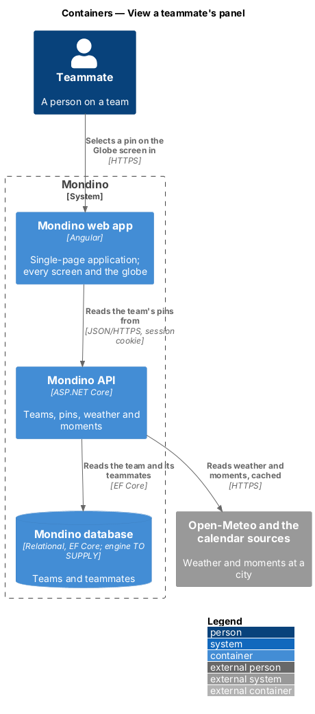
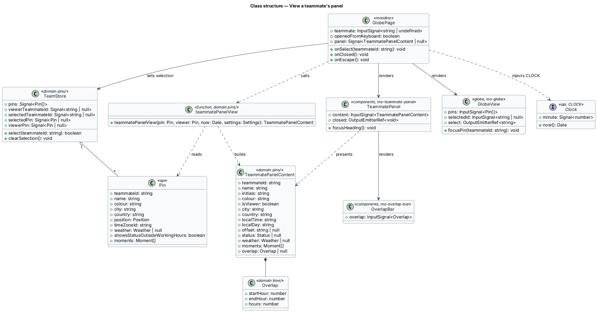

# View a teammate's panel

## Overview

Mondino shows a team spread around the world as pins on a 3D globe. The Globe screen is the home
screen: the globe on one side and a panel beside it (under it on a phone). This feature covers
what the panel shows when a pin is selected.

- **teammate** — person who belongs to a team
- **viewer** — teammate looking at the screen
- **pin** — a teammate's place on the globe, placed at their city
- **status** — label that follows from a teammate's local hour: Working hours, Early morning, Evening or Probably asleep
- **offset** — how far ahead or behind a teammate's local time is, compared with the viewer's
- **overlap** — part of two teammates' working hours (09:00 to 18:00) that coincides, shown on the viewer's clock
- **moment** — something happening where a teammate lives: a holiday, Formula 1, a local event or sport

Selecting a pin opens that teammate in the panel: name, city and country, local time and day,
offset, status, weather, upcoming moments and overlap. The selection is held in one place, the
`TeamStore`, and is mirrored in the address as an opaque teammate id, so a reload or a shared
address selects the same teammate. Closing the panel clears the selection and returns the panel
to the week around the world (L2-024, designed in `view-week-around-the-world`).

The feature reads no data of its own. Every value in the panel is worked out in the browser from
the pins the `TeamStore` already holds and from the one shared clock.

## Description

The slice lives in the Mondino web app. The pins come from `GET /api/teams/{teamId}/pins`, whose
loading and refreshing are designed in `keep-team-fresh`.

- **`GlobePage`** — page of the `mondino` application at `/globe`, a lazy route. It binds the
  address, the `TeamStore`, the `GlobeView` and the panel. It receives the `teammate` query
  parameter as a component input and passes it to `TeamStore.select`. It renders `TeammatePanel`
  when a pin is selected and `WeekPanel` otherwise. It listens for Escape while a panel is open.
- **Address** — `/globe?teammate={teammateId}`. The parameter carries the teammate's id, an
  opaque `Guid`, and no name, city or postal code (L2-023). The address is the source of the
  selection: a select or a close navigates, and the store follows the address.
- **`TeamStore`** — signal store in `domain`'s `pins/`. It holds `pins`,
  `viewerTeammateId` and `selectedTeammateId`, and derives `selectedPin` and `viewerPin`.
  `select(teammateId)` returns `false` and leaves the selection empty when no pin of the team has
  that id; `GlobePage` then removes the parameter from the address. The store is provided at the
  route that holds the Globe, Team, Moments and Profile & Settings screens, so the selection is
  released when the teammate leaves those screens.
- **`teammatePanelView(pin, viewer, now, settings)`** — pure function in `pins/`. It builds a
  `TeammatePanelContent` from the selected pin, the viewer's pin, the clock's time and the
  viewer's display settings. It calls `localTime`, `formatTime`, `statusAt`, `offsetBetween` and
  `overlapBetween` from `time/`, and keeps the pin's moments that are today or later in the
  pin's city, in date order. For the viewer's own pin it sets `isViewer` and leaves `offset` and
  `overlap` null. It leaves `status` null when the pin's status visibility flag hides it, and
  `weather` null when the pin carries none.
- **`TeammatePanelContent`** — feature-local type in `pins/`: the strings and values the panel
  presents. It holds no postal code; the `Pin` type has none to give.
- **`TeammatePanel`** (`mo-teammate-panel`) — presentation component. It takes `content` and
  emits `closed`. It renders the `Avatar`, the name (followed by "(you)" when `isViewer`), the
  city and country, the local time and day in tabular figures, the offset, a `StatusBadge`, a
  `WeatherIcon` with the temperature, one `MomentIcon` row per moment and the `OverlapBar`. It
  omits the moments section when `moments` is empty and the offset and overlap when they are
  null. Its heading is focusable by script through `focusHeading()`. A change of `content` fades
  in at most 200 ms; the `prefers-reduced-motion` query removes the fade.
- **`OverlapBar`** (`mo-overlap-bar`) — presentation component that draws the overlap on a
  24-hour bar of the viewer's day, with the hours also given as text.
- **`GlobeView`** (`mo-globe`) — component of the `globe` library. It emits `select` with a
  teammate id, takes `selectedId`, turns to the selected pin and lifts it. `focusPin(teammateId)`
  returns focus to a pin; it is a method this design adds to the component.
- **`Clock`** (`CLOCK`) — the one injected clock. `panel` is a computed signal that reads the
  clock's minute tick, so the local time, the status and the offset change as the minute passes,
  with no timer of the panel's own.

Focus follows L2-023: when the selection came from the keyboard, `GlobePage` calls
`focusHeading()` after the panel renders, and on close calls `GlobeView.focusPin` with the
teammate that was selected.

The viewer's time zone is the time zone of the viewer's own pin. The viewer's display settings
(°C or °F, 24-hour or 12-hour clock) come from `SettingsCache`.

The prototype's "Message" button on a teammate's panel has no design for what it leads to, so
`TeammatePanel` shall not render it. What it leads to is `<TO SUPPLY>`.

The name, the city and a moment's title are data: `TeammatePanel` renders each as text, never as
HTML.

## Requirements

The feature realises the following level-2 (L2) requirement, which refines a level-1 (L1)
requirement cited by identifier.

| L2 ID | Refines (L1) | Requirement |
|-------|--------------|-------------|
| `L2-023` | `L1-008` | Selecting a pin opens that teammate in the panel: name, city and country, local time and day, offset from the viewer, status, weather, upcoming moments and the overlap with the viewer. |

## Diagrams

### System context

A teammate reads another teammate's panel in Mondino. The weather and moments the panel shows
reach Mondino from Open-Meteo and the calendar sources, through the backend only.

### Containers

The panel is built in the Mondino web app from pins the Mondino API has already returned. The
API reads the team from the Mondino database and the weather and moments from the outside
sources.

### Components

Inside the web app, `GlobeView` reports a selected pin to `GlobePage`. `GlobePage` records the
selection in `TeamStore`, asks `teammatePanelView` for the content and passes it to
`TeammatePanel`.

### Class structure

`GlobePage` depends on `TeamStore`, the `CLOCK` and `teammatePanelView`, and renders `GlobeView`
and `TeammatePanel`. `TeammatePanelContent` is the only thing `TeammatePanel` receives, and it
owns the `Overlap` that `OverlapBar` draws.

### Behaviour — select a pin and open the panel

A selection becomes a navigation to `/globe?teammate={teammateId}`, and the store follows the
address. An id that is not a pin of the team clears the parameter and leaves the week panel in
place. A panel opened from the keyboard takes focus on its heading.

### Behaviour — close the panel

The close button and Escape both remove the parameter from the address. `TeamStore` clears the
selection, the pin settles back, `WeekPanel` replaces `TeammatePanel`, and focus returns to the
pin when the panel was opened from the keyboard.

