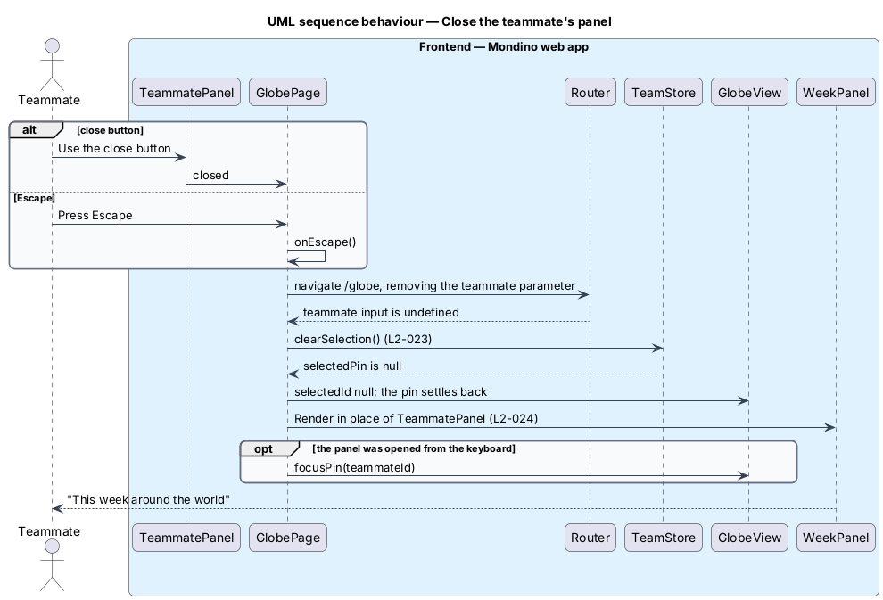

# View a teammate's panel

## Overview

Mondino shows a team spread around the world as pins on a 3D globe. The Globe screen is the home
screen: the globe on one side and a panel beside it (under it on a phone). This feature covers
what the panel shows when a pin, or a group pin, is selected.

- **teammate** — person who belongs to a team
- **viewer** — teammate looking at the screen
- **pin** — a teammate's place on the globe, placed at their city
- **status** — label that follows from a teammate's local hour: Working hours, Early morning, Evening or Probably asleep
- **offset** — how far ahead or behind a teammate's local time is, compared with the viewer's
- **overlap** — part of two teammates' working hours (09:00 to 18:00) that coincides, shown on the viewer's clock
- **moment** — something happening where a teammate lives: a holiday, Formula 1, a local event or sport

Selecting a pin opens that teammate in the panel: name, city and country, local time and day,
offset, status, weather, upcoming moments and overlap. The selection is held in one place, the
`TeamStore`, and is mirrored in the address as an opaque teammate id, so a reload or a shared
address selects the same teammate. Closing the panel clears the selection and returns the panel
to the week around the world (L2-024, designed in `view-week-around-the-world`).

Where pins would cover each other, the globe draws them as one group pin with a count
(`globe/show-pins`). Selecting a group pin turns the globe to it and opens the group in the
panel: its teammates, city by city, each a link that selects that teammate's pin.

A teammate chooses what teammates see of them in Profile & Settings. A teammate who shares
neither their weather nor their status keeps a panel with their name, city, local time, offset
and moments, and a note in place of the rest.

The feature reads no data of its own. Every value in the panel is worked out in the browser from
the pins the `TeamStore` already holds and from the one shared clock.

## Description

The slice lives in the Mondino web app. The pins come from `GET /api/teams/{teamId}/pins`, whose
loading and refreshing are designed in `keep-team-fresh`.

- **`GlobePage`** — page of the `mondino` application at `/globe`, a lazy route. It binds the
  address, the `TeamStore`, the `GlobeView` and the panel. It receives the `teammate` query
  parameter as a component input and passes it to `TeamStore.select`. It renders `TeammatePanel`
  when a pin is selected, `GroupPanel` when a group pin is selected, and `WeekPanel` otherwise.
  It listens for Escape while a teammate's or a group's panel is open. It passes the same
  selection to `GlobeFallback` where the still picture stands in for the globe
  (`globe/draw-globe`), so a pin on the still picture opens the same panels.
- **Address** — `/globe?teammate={teammateId}`. The parameter carries the teammate's id, an
  opaque `Guid`, and no name, city or postal code (L2-023). The address is the source of the
  selection: a select or a close navigates, and the store follows the address.
- **`TeamStore`** — signal store in `domain`'s `pins/`. It holds `pins`,
  `viewerTeammateId` and `selectedTeammateId`, and derives `selectedPin` and `viewerPin`.
  `select(teammateId)` returns `false` and leaves the selection empty when no pin of the team has
  that id; `GlobePage` then removes the parameter from the address. The store is provided at the
  route that holds the Globe, Team, Moments and Profile & Settings screens, so the selection is
  released when the teammate leaves those screens.
- **`teammatePanelView(pin, viewer, now, settings)`** — pure function in `pins/`. It builds a
  `TeammatePanelContent` from the selected pin, the viewer's pin, the clock's time and the
  viewer's display settings. It calls `localTime`, `formatTime`, `formatDay`, `statusFor`,
  `offsetBetween`, `formatOffset`, `workingDayOnViewerClock`, `overlapBetween` and
  `formatOverlap` from `time/`, and keeps the pin's moments that are today or later in the
  pin's city, in date order. The offset is in the panel's form, which names the viewer: "7h
  behind you", "10h ahead of you", "same time as you". For the viewer's own pin it sets
  `isViewer` and leaves `offset`, `overlap`, `theirDay` and `overlapText` null. `status` is
  what `statusFor(pin, time)` gives: null, at every hour, when the pin's `sharesStatus` is
  false. For such a pin `overlap`, `theirDay` and `overlapText` are null as well, since the
  overlap would say when the teammate is working (L2-017). `weather` is null unless the pin's
  `weatherState` is `Available`, and `weatherState` is carried so the panel can say which of
  the two it is. `keepsPrivate` is true when the pin shares neither: `sharesStatus` is false
  and `weatherState` is `NotShared`. `firstName` is `firstName(pin.name)`
  from `pins/`, the first word of the name, by which the panel's running copy names the
  teammate.
- **`TeammatePanelContent`** — feature-local type in `pins/`: the strings and values the panel
  presents. It holds no postal code; the `Pin` type has none to give.
- **`TeammatePanel`** (`mo-teammate-panel`) — presentation component. It takes `content` and
  emits `closed`. It renders the `Avatar`, the name (followed by "(you)" when `isViewer`), the
  city and country, the local time and day in tabular figures, the offset, a `StatusBadge`, a
  `WeatherIcon` with the temperature and the weather in words, one moment card per moment (its
  kind and when, "Holiday · In 5 days" within 7 days and the date, "Formula 1 · 12 Nov", beyond
  them, its title and its detail) and the `OverlapBar`. A teammate with two moments has two
  cards, one under the other: for Tomás, "Holiday · In 5 days", "Día de Muertos", and "Sport ·
  In 6 days", "Clásico Nacional", "América vs. Chivas at the Azteca, 19:00 local". The day
  and the offset share one line ("Monday 27 Oct · 7h behind you"). In the weather's place it
  says "Weather for Mexico City isn’t available right now. We’ll try again in a few minutes.",
  naming the pin's city, when `weatherState` is `Unavailable` (designed in
  `weather/show-weather`). It omits the moments section when `moments` is empty, the offset
  when it is null, the status when it is null and the overlap when it is null.
- **The private note** — when `keepsPrivate` is true, `TeammatePanel` shows one note
  (`panel__note`, an icon and a sentence) under the local time: "Ahmed keeps their weather and
  working hours private. You’ll still see their local time and city.", naming the teammate by
  `firstName`. With it the panel hides the status, the weather section and the working-hours
  overlap, and keeps the avatar, the name, the city and country, the local time, the day and
  offset ("Monday 27 Oct · 3h ahead of you") and the moment cards. Moments belong to the
  teammate's city, not to what they share, so they stay. The teammate's pin gives the local
  time alone in its label and its accessible name ("Ahmed Al-Sayed, Dubai, 18:05"). What the
  panel says for a teammate who shares one of the two and not the other is `<TO SUPPLY>`; the
  mocks draw the teammate who shares neither. Such a panel shows what is shared and omits the
  rest. The close button is named
  "Close" and the teammate's name. Its heading is focusable by script through `focusHeading()`.
  A change of `content` fades in at most 200 ms; the `prefers-reduced-motion` query removes the
  fade.
- **`OverlapBar`** (`mo-overlap-bar`) — presentation component, the `overlap` block of the
  mocks, designed in `time/show-offset-and-overlap`. `TeammatePanel` gives it the inputs that
  design defines, all from `content`: `overlap` (an `Overlap` or null), `theirDay` (the
  teammate's working day on the viewer's clock, a `DaySpan`), `nowMinute` (the viewer's minute
  of the day), `firstName` and `text` (an `OverlapText`: the `figure` beside the title and the
  `sentence` under the bar). With no overlap it still draws both working days, and the text
  reads "None today".
- **`groupCities(pins, teammateIds, now, settings)`** — pure function in `pins/`. It keeps the
  pins whose teammate id is in the group and gathers them by city. It returns a
  `GroupContent`: the `count` of teammates, the `lead` line and one `GroupCity` for each city,
  the city with the most teammates first and cities of one size west to east. A `GroupCity`
  holds the city's name, its formatted local time and one `GroupRow` for each teammate there:
  teammate id, name, initials, colour and `isViewer`. The local time is the city's, worked out
  once from its time zone, not once for each row. The order of the teammates within a city is
  `<TO SUPPLY>`; the mock lists the viewer first.
- **`GroupPanel`** (`mo-group-panel`) — presentation component, `TeammatePanel`'s sibling, in
  the mocks' `panel` block. It takes `content` and emits `teammateChosen` with a teammate id
  and `closed`. Its heading is the count, "2 teammates close together". Under it the lead
  (`panel__lead`) reads "All in Milan · pick someone to see their pin" when the group is in one
  city, and gives the number of cities when it is in two or more: "3 cities · pick someone to
  see their pin". Then comes one block for each city: the city's name as a heading with the
  city's local time in tabular figures beside it (`panel__city`, `panel__city-time`: "Milan",
  "15:05"), and under it a list of rows (`row-list`). Each row is a link holding an `Avatar`
  and the name, followed by "(you)" for the viewer; the city and the time are said once, in
  the block's heading. The head carries a close button named "Close"
  (`panel__head--close`), which emits `closed`. Its heading is focusable by script through
  `focusHeading()`. A group pin of a team of 500 stands for as many as 68 teammates in the
  mocks; how the rows of a group of that size are bounded in the page is `<TO SUPPLY>`, since
  the mocks draw the panel for a group of 2.
- **`GlobeView`** (`mo-globe`) — component of the `globe` library. It emits `select` with a
  teammate id, takes `selectedId`, turns to the selected pin and lifts it. It emits `selectGroup`
  with the teammate ids of a group pin (`globe/show-pins`) and takes them back as
  `selectedGroupIds`, which keeps that group pin together, lifted and pressed, and turns the
  globe to it (`globe/turn-globe`). `focusPin(teammateId)` returns focus to the pin, or the
  group pin, that stands for that teammate; it is a method this design adds to the component.
- **`Clock`** (`CLOCK`) — the one injected clock. `panel` is a computed signal that reads the
  clock's minute tick, so the local time, the status and the offset change as the minute passes,
  with no timer of the panel's own.

Focus follows L2-023: when the selection came from the keyboard, `GlobePage` calls
`focusHeading()` after the panel renders, and on close calls `GlobeView.focusPin` with the
teammate that was selected.

A group is held by `GlobePage` alone, as `groupTeammateIds`, and is not in the address. On
`selectGroup` the page removes the `teammate` parameter, which clears the selection, sets
`groupTeammateIds`, passes them to `GlobeView` as `selectedGroupIds` and renders `GroupPanel`
from `groupCities`; the globe turns to the group pin and holds. A polite `role="status"`
region says "2 teammates close together." once, when the group opens. Choosing a row
navigates to `/globe?teammate={teammateId}`, which empties `groupTeammateIds` and opens that
teammate's panel; that teammate's pin then stands alone on the globe. The close button and
Escape empty `groupTeammateIds`, and `WeekPanel` returns. A refresh that takes a teammate off
the team drops them from the rows; a group left with one teammate, or none, closes. Focus
follows the same rule as for a teammate's panel: opened from the keyboard, the panel takes
focus on its heading, and closing returns focus to the group pin.

The viewer's time zone is the time zone of the viewer's own pin. The viewer's display settings
(°C or °F, 24-hour or 12-hour clock) come from `SettingsCache`.

The name, the city and a moment's title are data: `TeammatePanel` renders each as text, never as
HTML.

## Requirements

The feature realises the following level-2 (L2) requirement, which refines a level-1 (L1)
requirement cited by identifier.

| L2 ID | Refines (L1) | Requirement |
|-------|--------------|-------------|
| `L2-023` | `L1-008` | Selecting a pin opens that teammate in the panel: name, city and country, local time and day, offset from the viewer, status, weather, upcoming moments and the overlap with the viewer. Selecting a group pin lists the teammates it stands for. |

L2-023's criterion for a group pin's panel is realised by `GroupPanel`, and its criterion for a
teammate who shares neither their weather nor their status by the private note.

## Diagrams

### System context

A teammate reads another teammate's panel in Mondino. The weather and moments the panel shows
reach Mondino from Open-Meteo and the calendar sources, through the backend only.

### Containers

The panel is built in the Mondino web app from pins the Mondino API has already returned. The
API reads the team from the Mondino database and the weather and moments from the outside
sources.

### Components

Inside the web app, `GlobeView` reports a selected pin to `GlobePage`. `GlobePage` records the
selection in `TeamStore`, asks `teammatePanelView` for the content and passes it to
`TeammatePanel`. A selected group pin goes through `groupCities` to `GroupPanel`.

### Class structure

`GlobePage` depends on `TeamStore`, the `CLOCK` and `teammatePanelView`, and renders `GlobeView`
and `TeammatePanel`. `TeammatePanelContent` is the only thing `TeammatePanel` receives, and it
owns the `Overlap`, the `DaySpan` and the `OverlapText` that `OverlapBar` draws. `GroupPanel`
presents a `GroupContent`: its `GroupCity` values and their `GroupRow`s.

### Behaviour — select a pin and open the panel

A selection becomes a navigation to `/globe?teammate={teammateId}`, and the store follows the
address. An id that is not a pin of the team clears the parameter and leaves the week panel in
place. A panel opened from the keyboard takes focus on its heading. A teammate who shares
neither weather nor status gets the private note in place of status, weather and overlap. A
group pin turns the globe to it and opens `GroupPanel`, and choosing one of its rows selects
that teammate.

### Behaviour — close the panel

The close button and Escape both remove the parameter from the address. `TeamStore` clears the
selection, the pin settles back, `WeekPanel` replaces `TeammatePanel`, and focus returns to the
pin when the panel was opened from the keyboard. A group's panel closes the same way: its
close button and Escape empty the group, and `WeekPanel` returns.

