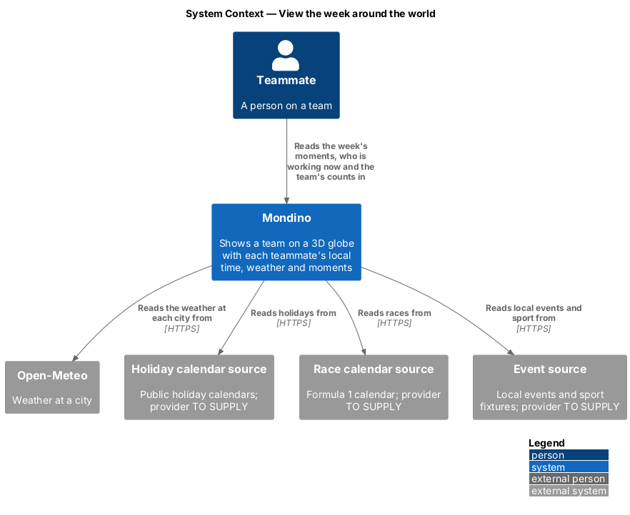
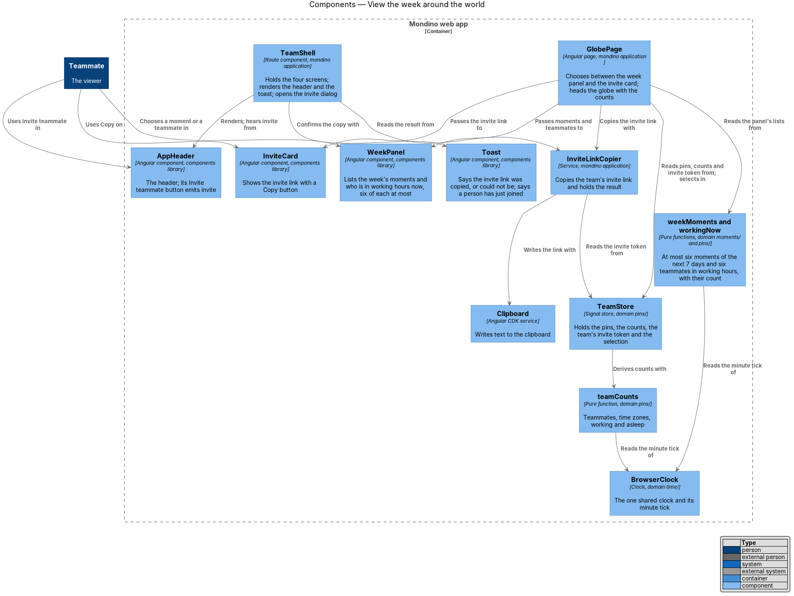
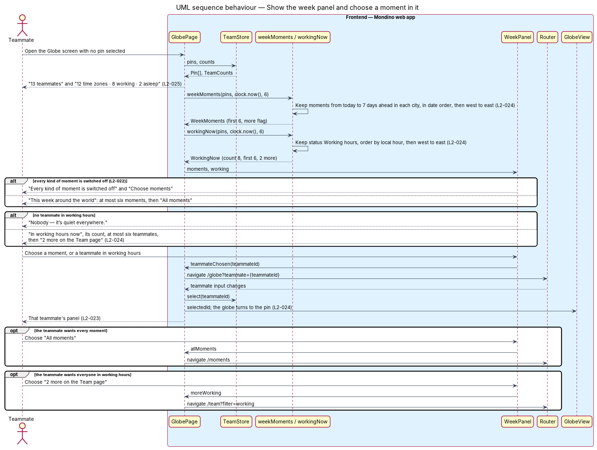
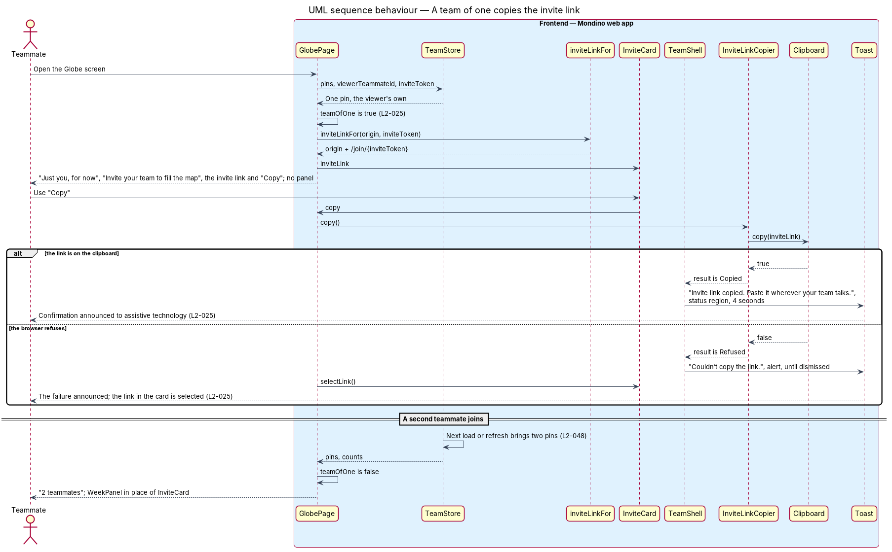

# View the week around the world

## Overview

Mondino shows a team spread around the world as pins on a 3D globe. The Globe screen is the home
screen: the globe, a heading over it, and a panel beside it (under it on a phone). This feature
covers the Globe screen when no pin is selected.

- **teammate** — person who belongs to a team
- **viewer** — teammate looking at the screen
- **pin** — a teammate's place on the globe, placed at their city
- **status** — label that follows from a teammate's local hour: Working hours (09:00 to 18:00), Early morning, Evening or Probably asleep (23:00 to 07:00)
- **moment** — something happening where a teammate lives: a holiday, Formula 1, a local event or sport
- **invite link** — address through which a person joins a team
- **team of one** — team whose only teammate is the viewer

With no pin selected, the panel is headed "This week around the world". It lists at most six
of the team's moments from today to 7 days ahead, then "In working hours now": how many
teammates have the status Working hours, and at most six of them, with a link to the rest on
the Team screen. Choosing a moment selects its teammate's pin. The heading over the globe gives
the number of teammates, the number of distinct time zones, and how many teammates are working
and asleep. The panel is the same length for a team of 13 and a team of 500.

A team of one has nobody else to show. The Globe screen then reads "Just you, for now" and shows
the team's invite link with a "Copy" button, in place of the panel. "Invite teammate" in the
header opens the invite dialog, from any of the four screens; the dialog is designed in
`joining/invite-teammates` (L2-054).

Everything here is worked out in the browser from the pins the `TeamStore` holds and from the one
shared clock, so the lists and the counts change as the hours pass, with no reload.

## Description

The slice lives in the Mondino web app. It adds one field to what the Mondino API returns with
the pins: the team's invite token.

- **`GlobePage`** — page of the `mondino` application at `/globe`. With no selection it renders
  `WeekPanel`, or `InviteCard` for a team of one. It heads the globe with `TeamStore.counts`.
- **`TeamStore`** — signal store in `domain`'s `pins/`. It holds `pins`, `viewerTeammateId`
  and `inviteToken`, and derives `counts`.
- **`teamCounts(pins, now)`** — pure function in `pins/` that returns a `TeamCounts`: the number
  of teammates, the number of distinct time zones (distinct `timeZoneId` values), the number
  whose status is Working hours and the number whose status is Probably asleep. The status is
  what `statusFor(pin, time)` gives, so a teammate who does not share their status is counted
  as a teammate and in neither of the two (L2-015). The cast of 13 reads "13 teammates" and
  "12 time zones · 8 working · 2 asleep"; a team of 500 reads "500 teammates" and "38 time
  zones · 324 working · 42 asleep". The function is one pass over the pins. `counts` is a computed signal over `pins` and the clock's
  minute tick, so a count changes when the clock passes an hour that changes a status (L2-025).
- **`weekMoments(pins, now, limit)`** — pure function in `moments/`. It takes each pin's
  moments, keeps those dated from today to 7 days ahead, where today is the date in that pin's
  city, orders them by date and then west to east, and returns the first `limit` as
  `WeekMoment` values with a `more` flag. West to east is the order `orderWestToEast` gives the
  moments' teammates, the Team screen's order. `GlobePage` passes a limit of 6 (L2-024), so
  the panel holds at most six moment rows whatever the size of the team. The
  `when` text comes from `whenLabel`, the emblem from `emblemFor` and the teammate's first name
  from `firstName(name)` in `pins/`, the first word of the name.
- **`workingNow(pins, now, limit)`** — pure function in `pins/`. It takes each pin whose
  `statusFor(pin, time)` is Working hours, ordered by local hour and then west to east, and
  returns a `WorkingNow`: the `count` of them all, the first `limit` as `WorkingTeammate`
  values with city and formatted local time, and `more`, the count less those listed.
  `GlobePage` passes a limit of 6. A teammate who does not share their status has none, so
  they are neither counted nor listed here.
- **`WeekPanel`** (`mo-week-panel`) — presentation component, in the mocks' `panel` block. It
  takes `moments`, `working` and `momentsOff`, and emits `teammateChosen` with a teammate id,
  `allMoments`, `moreWorking` and `chooseMoments`. Under the heading it reads "Holidays, races
  and local moments where your teammates live." Each moment is a row with a `MomentIcon`, its
  title, its kind, the teammate's first name and city, and when it is; a teammate with two
  moments this week has two rows. "All moments" (`panel__more`) is always shown under the
  moments. "In working hours now" carries its count beside the heading (`panel__count`, "8",
  named "Teammates: 8" for assistive technology). Each teammate in working hours is a row with
  an `Avatar`, name, city and local time, and the viewer's own row adds "(you)". When `more`
  is above zero a link under the rows reads "2 more on the Team page" and emits `moreWorking`;
  for a team of 500 it reads "318 more on the Team page". Choosing a moment's or a teammate's
  row emits `teammateChosen`. When nobody is in working hours the section shows no count and
  reads "Nobody — it’s quiet everywhere.".
- **The moments-off note** — with every kind of moment switched off (L2-022,
  `moments/mark-pins-with-moments`) `GlobePage` sets `momentsOff`. In place of the lead, the
  moment rows and "All moments", `WeekPanel` shows a note (`panel__note`): "Every kind of
  moment is switched off", "Holidays, races, events and sport won’t show on pins until you turn
  some back on." and the link "Choose moments", which emits `chooseMoments`; the page then
  navigates to Profile & Settings. "In working hours now" is unchanged. The legend under the
  globe drops "Moment this week".
- **`InviteCard`** (`mo-invite-card`) — presentation component. It takes `inviteLink` and
  emits `copy`. It is headed "Bring the team onto the globe", says "Anyone with this link adds
  their pin with a postal code. Only their city is shown.", and shows the link as selectable
  text beside "Copy". `selectLink()` selects the link's text.
- **`AppHeader`** (`mo-app-header`) — presentation component, the header of the four screens.
  Its "Invite teammate" button emits `invite`. Under 768 px the button is an icon alone, with
  the same accessible name.
- **`TeamShell`** — route component of the `mondino` application that holds the Globe, Team,
  Moments and Profile & Settings screens, provides `TeamStore` and `InviteLinkCopier`, and
  renders `AppHeader` and the `Toast`. On `invite` it calls `InviteDialogOpener.open(trigger)`,
  which opens the invite dialog, a CDK Dialog; both are designed in
  `joining/invite-teammates`. `TeamShell` copies nothing itself.
- **`InviteLinkCopier`** — service of the `mondino` application, provided at `TeamShell`'s
  route. `copy()` builds the link with `inviteLinkFor` from `TeamStore.inviteToken`, calls the
  CDK `Clipboard` and sets `result` to `Copied` or `Refused`; `dismiss()` clears it. "Copy" on
  the invite card calls it, and copies directly, with no dialog. The invite dialog's "Copy
  link" ends in the same two toasts.
- **`Toast`** (`mo-toast`) — presentation component, rendered by `TeamShell`. After a copy
  it follows `InviteLinkCopier.result`. "Invite link copied. Paste it wherever your team
  talks." sits in a `role="status"` region and dismisses itself after 4 seconds; the timer
  pauses while the toast is pointed at or focused. "Couldn’t copy the link." with "It’s
  selected — press Ctrl+C or ⌘C to copy it yourself." sits in a `role="alert"` region and
  stays until dismissed, and `GlobePage` calls `InviteCard.selectLink()`, so the sentence is
  true on the card, where there is no dialog. Each toast has a button named "Dismiss".
  Assistive technology announces both (L2-025).
- **The just-joined toast** — a person who has just joined arrives on the Globe screen with
  their new teammate id and a "new" flag in the navigation state, which `JoinPage` sets
  (`joining/join-team`, L2-005). `GlobePage` selects that pin and shows, once, "You’re on the
  map." with "Northwind can now see your pin in Milan.", naming the team and the viewer's
  city, in the `role="status"` toast region; it dismisses itself after 4 seconds. The viewer's
  new pin pulses at the same time (`globe/show-pins`), and reduced motion removes the pulse
  and keeps the toast. The team's name and the city are data and are rendered as text. A
  teammate who joins while the screen is open appears at the next refresh with the pulse and
  no toast (`keep-team-fresh`).
- **`inviteLinkFor(origin, inviteToken)`** — pure function in `pins/` that returns
  `{origin}/join/{inviteToken}`, the address of `JoinPage`.
- **`Clipboard`** — Angular CDK service. `InviteLinkCopier` calls `copy(inviteLink)` and sets
  `result` from what it returns, which chooses the toast. When the browser refuses, the link
  stays on the invite card as selectable text.

`GlobePage` treats the team as a team of one when `pins` holds exactly one pin and its teammate
id equals `viewerTeammateId`. The Globe screen then reads "Just you, for now" and, in place of
the counts, "Invite your team to fill the map", and shows no panel. When a later load or refresh
(L2-048, designed in `keep-team-fresh`) brings a second pin, `InviteCard` gives way to
`WeekPanel` and the heading reads "2 teammates".

Choosing a moment or a teammate in working hours navigates to `/globe?teammate={teammateId}`; the selection, the turn of the
globe and the teammate's panel then follow the design in `view-teammate-panel`. "All moments"
navigates to `/moments`, and "2 more on the Team page" to `/team?filter=working`, the Team
screen with Working now chosen (`view-team-through-the-day`).

A team of 500 costs the panel nothing more. `weekMoments`, `workingNow` and `teamCounts` are
each one pass over the pins, run when the pins or the clock's minute change, and the panel
holds at most six rows of each list. Nothing in it grows with the size of the team or the
length of a visit.

On the backend, `GET /api/teams/{teamId}/pins` returns a `TeamPinsDto`: the team's id and
name, the viewer's teammate id, the team's invite token and the `PinDto` list. `GetPinsQueryHandler`
builds it for a teammate of that team only. The `api` library mirrors it as the `TeamPins` type.
`TeamPinsDto` and `TeamPins` are names this design adds.

A teammate's name, a city and a moment's title are rendered as text, never as HTML.

## Requirements

The feature realises the following level-2 (L2) requirements. Each refines a level-1 (L1)
requirement, cited by identifier.

| L2 ID | Refines (L1) | Requirement |
|-------|--------------|-------------|
| `L2-024` | `L1-008` | With no pin selected the panel shows "This week around the world" ("Holidays, races and local moments where your teammates live."), the team's moments from today to 7 days ahead in date order and, on one date, west to east by their teammate, and "In working hours now", the teammates whose status is Working hours with their city and local time. Neither list ever holds more than six, however large the team. |
| `L2-025` | `L1-008` | The Globe screen heads the globe with the number of teammates and, under it, the number of distinct time zones and how many teammates are working and asleep. A team with only the viewer shows "Just you, for now" and a card with the team's invite link to copy. "Invite teammate" in the header opens the invite dialog (L2-054). |

"Invite teammate" in the header opens the invite dialog, which L2-054 covers and
`joining/invite-teammates` designs.

## Diagrams

### System context

A teammate reads the week's moments and the team's counts in Mondino. The moments reach Mondino
from the calendar sources and the weather from Open-Meteo, through the backend only.

### Containers

The Mondino web app builds the week panel from the pins the Mondino API returns. The API reads
the team, its invite token and its teammates from the Mondino database.

### Components

`GlobePage` reads the pins, the counts and the invite token from `TeamStore`. It passes the
lists from `weekMoments` and `workingNow` to `WeekPanel`, or the invite link to `InviteCard`
for a team of one. `InviteLinkCopier` copies the link through the CDK `Clipboard` for the
card, and `TeamShell` confirms it with `Toast`. `AppHeader`'s "Invite teammate" reaches
`TeamShell`, which opens the invite dialog.

### Class structure

`GlobePage` renders `WeekPanel` from `WeekMoments` and `WorkingNow`, each holding at most six
rows, and `InviteCard` from the invite link. `TeamStore` owns the `TeamCounts` that head the globe. `TeamShell` renders
`AppHeader` and `Toast`, and `InviteLinkCopier` holds the `CopyResult`.

### Behaviour — show the week panel and choose a moment

`GlobePage` asks for at most 6 moments of the next 7 days and at most 6 of the teammates in
working hours, with their count. Choosing a moment or a teammate navigates to that teammate's
id, which selects the pin and turns the globe to it. "2 more on the Team page" opens the Team
screen filtered to Working now.

### Behaviour — a team of one copies the invite link

With one pin, the viewer's own, the Globe screen shows `InviteCard` and no panel. "Copy" puts
the link on the clipboard and a toast confirms it in a status region; a refusal is said in an
alert and the link in the card is selected. When a second teammate's pin arrives, the card
gives way to `WeekPanel`.

