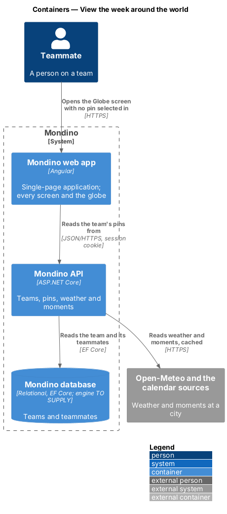

# View the week around the world

## Overview

Mondino shows a team spread around the world as pins on a 3D globe. The Globe screen is the home
screen: the globe, a heading over it, and a panel beside it (under it on a phone). This feature
covers the Globe screen when no pin is selected.

- **teammate** — person who belongs to a team
- **viewer** — teammate looking at the screen
- **pin** — a teammate's place on the globe, placed at their city
- **status** — label that follows from a teammate's local hour: Working hours (09:00 to 18:00), Early morning, Evening or Probably asleep (23:00 to 07:00)
- **moment** — something happening where a teammate lives: a holiday, Formula 1, a local event or sport
- **invite link** — address through which a person joins a team
- **team of one** — team whose only teammate is the viewer

With no pin selected, the panel is headed "This week around the world". It lists the team's
moments from today to 7 days ahead, then "In working hours now": the teammates whose status is
Working hours. Choosing a moment selects its teammate's pin. The heading over the globe gives the
number of teammates, the number of distinct time zones, and how many teammates are working and
asleep.

A team of one has nobody else to show. The Globe screen then reads "Just you, for now" and shows
the team's invite link with a "Copy" button, in place of the panel.

Everything here is worked out in the browser from the pins the `TeamStore` holds and from the one
shared clock, so the lists and the counts change as the hours pass, with no reload.

## Description

The slice lives in the Mondino web app. It adds one field to what the Mondino API returns with
the pins: the team's invite token.

- **`GlobePage`** — page of the `mondino` application at `/globe`. With no selection it renders
  `WeekPanel`, or `InviteCard` for a team of one. It heads the globe with `TeamStore.counts`.
- **`TeamStore`** — signal store in `domain`'s `pins/`. It holds `pins`, `viewerTeammateId`
  and `inviteToken`, and derives `counts`.
- **`teamCounts(pins, now)`** — pure function in `pins/` that returns a `TeamCounts`: the number
  of teammates, the number of distinct time zones (distinct `timeZoneId` values), the number
  whose status is Working hours and the number whose status is Probably asleep. `counts` is a
  computed signal over `pins` and the clock's minute tick, so a count changes when the clock
  passes an hour that changes a status (L2-025).
- **`weekMoments(pins, now, limit)`** — pure function in `moments/`. It takes each pin's
  moments, keeps those dated from today to 7 days ahead, where today is the date in that pin's
  city, orders them by date and then west to east, and returns the first `limit` as
  `WeekMoment` values with a `more` flag. `GlobePage` passes a limit of 8 (L2-024). The `when`
  text comes from `whenLabel` and the emblem from `emblemFor`.
- **`workingNow(pins, now)`** — pure function in `pins/`. It returns one `WorkingTeammate` for
  each pin whose status is Working hours, ordered by local hour and then west to east, with
  city and formatted local time. A pin whose status visibility flag hides the status is still listed, since Working hours
  is not hidden by that setting.
- **`WeekPanel`** (`mo-week-panel`) — presentation component. It takes `moments` and
  `working`, and emits `teammateChosen` with a teammate id and `allMoments`. Under the heading
  it reads "Holidays, races and local moments where your teammates live." Each moment is a row
  with a `MomentIcon`, its title, its kind, the teammate's first name and city, and when it is;
  each teammate in working hours is a row with an `Avatar`, name, city and local time. Choosing
  either row emits `teammateChosen`. "All moments" is always shown under the moments, and
  "Nobody — it's quiet everywhere." when `working` is empty. With every kind of moment turned
  off (L2-022) the list gives way to "Nothing to show: every kind of moment is turned off for
  your globe." and "Choose what shows", which leads to Profile & Settings.
- **`InviteCard`** (`mo-invite-card`) — presentation component. It takes `inviteLink` and
  emits `copy`. It is headed "Bring the team onto the globe", says "Anyone with this invite link
  adds their pin with a postal code. No addresses are shown.", and shows the link as selectable
  text beside "Copy".
- **`Toast`** (`mo-toast`) — presentation component that confirms the copy. "Invite link
  copied", with "Send it to a teammate. They add their pin with a name and a postal code.", sits
  in a `role="status"` region and dismisses itself after 4 seconds; the timer pauses while the
  toast is pointed at or focused. "Couldn't copy the invite link", with "Your browser didn't
  allow it. Select the link in the card and copy it yourself.", sits in a `role="alert"` region
  and stays until dismissed. Assistive technology announces both (L2-025).
- **`inviteLinkFor(origin, inviteToken)`** — pure function in `pins/` that returns
  `{origin}/join/{inviteToken}`, the address of `JoinPage`.
- **`Clipboard`** — Angular CDK service. `GlobePage` calls `copy(inviteLink)` and sets
  `copyResult` from the result, which chooses the toast. When the browser refuses, the link
  stays on screen as selectable text.

`GlobePage` treats the team as a team of one when `pins` holds exactly one pin and its teammate
id equals `viewerTeammateId`. The Globe screen then reads "Just you, for now" and, in place of
the counts, "Invite your team to fill the map", and shows no panel. When a later load or refresh
(L2-048, designed in `keep-team-fresh`) brings a second pin, `InviteCard` gives way to
`WeekPanel` and the heading reads "2 teammates".

Choosing a moment or a teammate in working hours navigates to `/globe?teammate={teammateId}`; the selection, the turn of the
globe and the teammate's panel then follow the design in `view-teammate-panel`. "All moments"
navigates to `/moments`.

On the backend, `GET /api/teams/{teamId}/pins` returns a `TeamPinsDto`: the team's name, the
viewer's teammate id, the team's invite token and the `PinDto` list. `GetPinsQueryHandler`
builds it for a teammate of that team only. The `api` library mirrors it as the `TeamPins` type.
`TeamPinsDto` and `TeamPins` are names this design adds.

The prototype's "Invite teammate" button has no design for what it leads to and is not
part of this feature. A teammate's name, a city and a moment's title are rendered as text, never
as HTML.

## Requirements

The feature realises the following level-2 (L2) requirements. Each refines a level-1 (L1)
requirement, cited by identifier.

| L2 ID | Refines (L1) | Requirement |
|-------|--------------|-------------|
| `L2-024` | `L1-008` | With no pin selected the panel shows "This week around the world", the team's moments from today to 7 days ahead in date order, and "In working hours now", the teammates whose status is Working hours with their city and local time. |
| `L2-025` | `L1-008` | The Globe screen heads the globe with the number of teammates and, under it, the number of distinct time zones and how many teammates are working and asleep. A team with only the viewer shows "Just you, for now" and the team's invite link to copy. |

## Diagrams

### System context

A teammate reads the week's moments and the team's counts in Mondino. The moments reach Mondino
from the calendar sources and the weather from Open-Meteo, through the backend only.

### Containers

The Mondino web app builds the week panel from the pins the Mondino API returns. The API reads
the team, its invite token and its teammates from the Mondino database.

### Components

`GlobePage` reads the pins, the counts and the invite token from `TeamStore`. It passes the
lists from `weekMoments` and `workingNow` to `WeekPanel`, or the invite link to `InviteCard`
for a team of one, copies the link through the CDK `Clipboard` and confirms it with `Toast`.

### Class structure

`GlobePage` renders `WeekPanel` from `WeekMoment` and `WorkingTeammate` values, and `InviteCard`
from the invite link. `TeamStore` owns the `TeamCounts` that head the globe.

### Behaviour — show the week panel and choose a moment

`GlobePage` asks for at most 8 moments of the next 7 days and for the teammates in working
hours. Choosing a moment or a teammate navigates to that teammate's id, which selects the pin and turns the
globe to it.

### Behaviour — a team of one copies the invite link

With one pin, the viewer's own, the Globe screen shows `InviteCard` and no panel. "Copy" puts
the link on the clipboard and a toast confirms it in a status region; a refusal is said in an
alert. When a second teammate's
pin arrives, the card gives way to `WeekPanel`.

