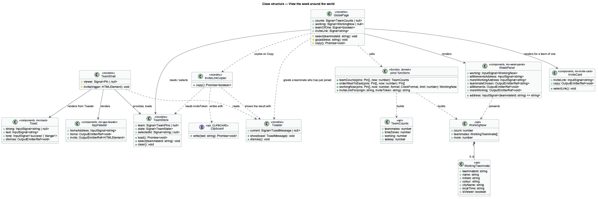

# View the week around the world

## Overview

Mondino shows a team spread around the world as pins on a 3D globe. The Globe screen is the home
screen: the globe, a heading over it, and a panel beside it (under it on a phone). This feature
covers the Globe screen when no pin is selected.

- **teammate** — person who belongs to a team
- **viewer** — teammate looking at the screen
- **pin** — a teammate's place on the globe, placed at their city
- **status** — label that follows from a teammate's local hour: Working hours (09:00 to 18:00), Early morning, Evening or Probably asleep (23:00 to 07:00)
- **moment** — something happening where a teammate lives: a holiday, Formula 1, a local event or sport
- **invite link** — address through which a person joins a team
- **team of one** — team whose only teammate is the viewer

With no pin selected, the panel is headed "This week around the world". It lists at most six
of the team's moments from today to 7 days ahead, then "In working hours now": how many
teammates have the status Working hours, and at most six of them, with a link to the rest on
the Team screen. Choosing a moment selects its teammate's pin. The heading over the globe gives
the number of teammates, the number of distinct time zones, and how many teammates are working
and asleep. The panel is the same length for a team of 13 and a team of 500.

A team of one has nobody else to show. The Globe screen then reads "Just you, for now" and shows
the team's invite link with a "Copy" button, in place of the panel. "Invite teammate" in the
header opens the invite dialog, from any of the four screens; the dialog is designed in
`joining/invite-teammates` (L2-054).

Everything here is worked out in the browser from the pins `TeamStore` holds and from the one
shared clock, so the lists and the counts change as the hours pass, with no reload.

## Description

The slice lives in the Mondino web app. The Mondino API already returns what it needs with the
pins: the team's invite token (`TeamPinsDto`, `show-pins`).

- **`TeamShell`** — route component of the `mondino` application, the component of the guarded
  pathless parent route that holds the Globe screen and, as their journeys build them, Team,
  Moments and Profile & Settings. It provides `TeamStore`, the `TEAM_API`, the `CLIPBOARD`
  (`NavigatorClipboard`, ADR 0009), `Toaster` and `InviteLinkCopier`, so they load with the first
  teammate screen and go when the teammate leaves them; it reads the pins once (`TeamStore.load`).
  It renders `AppHeader`, the router outlet and the toasts: a `role="status"` region for a toast
  that dismisses itself and a `role="alert"` region for one that stays. Into the header's `nav`
  slot it projects the links Globe, Team and Moments (`segmented__option`, `routerLink`,
  `ariaCurrentWhenActive="page"`), and into its `me` slot the link to Profile & Settings, the
  viewer's avatar from their pin, named "Profile & Settings". Team, Moments and Profile & Settings
  join its children with journeys 17, 21 and 22; until then their addresses fall through to the
  routes after it. On `invite` it opens the invite dialog with journey 16 (`invite-teammates`).
- **`AppHeader`** (`mo-app-header`) — presentation component, block `app-header`. It renders the
  mark and wordmark (`Wordmark` with `collapses`) as a link to `homeAddress`, the `nav` slot in a
  `nav` landmark named "Primary", and at its end (`app-header__actions`) its own "Invite
  teammate" button (`app-header__invite`, an icon alone under 768 px with the same accessible
  name) and the `me` slot. A plain click on the mark emits `home`; the button emits `invite`. It
  injects no router and no service.
- **`TeamStore`** — signal store of the `mondino` application, provided by `TeamShell`. It holds
  `team` (the `TeamPins`: the pins, `viewerTeammateId` and `inviteToken`), its load `state`, and
  the selection (`view-teammate-panel`).
- **`GlobePage`** — page of the `mondino` application at `/globe`, a child of `TeamShell`. With
  no selection it renders `WeekPanel`, or `InviteCard` for a team of one. It heads the globe
  (`globe-screen__heading`) with an `h1` and the counts under it, worked out by `teamCounts` in a
  computed signal over the pins and the one clock's minute, so a count changes when the clock
  passes an hour that changes a status (L2-025).
- **`teamCounts(pins, now)`** — pure function in `domain`'s `pins/` that returns a `TeamCounts`
  (`api`): the number of teammates, the number of distinct time zones (distinct `timeZoneId`
  values), the number whose status is Working hours and the number whose status is Probably
  asleep. The status is what `statusFor(pin, time)` gives, so a teammate who does not share their
  status is counted as a teammate and in neither of the two (L2-015). The cast of 13 reads "13
  teammates" and "12 time zones · 8 working · 2 asleep"; a team of 500 reads "500 teammates" and
  "38 time zones · 324 working · 42 asleep". It is one pass over the pins.
- **`orderWestToEast(pins, now)`** — pure function in `pins/`: the pins ordered by their time
  zone's current offset from UTC, then by longitude, then by name (L2-026). The Team screen and
  the moments use the same order.
- **`workingNow(pins, now, format, limit)`** — pure function in `pins/`. It takes each pin whose
  `statusFor(pin, time)` is Working hours, ordered by local hour and then west to east, and
  returns a `WorkingNow` (`api`): the `count` of them all, the first `limit` as
  `WorkingTeammate` values (id, name, initials, colour, city, the local time on the viewer's
  clock, and whether it is the viewer), and `more`, the count less those listed. `GlobePage`
  passes a limit of 6. A teammate who does not share their status has none, so they are neither
  counted nor listed here. The cast at its "now" lists Jordan, Chloé, Liam, Kwame, Luca and Sofia
  "(you)", and "2 more on the Team page" (Lena and Mara).
- **`WeekPanel`** (`mo-week-panel`) — presentation component, in the mocks' `panel` block, with
  two sections. "This week around the world" reads "Holidays, races and local moments where your
  teammates live." and lists the week's moments; "All moments" (`panel__more`) is always under
  it, a link to `allMomentsAddress` whose plain click emits `allMoments`. Until the moments are
  found (journey 19), and whenever none falls from today to 7 days ahead, the list's place says
  "No moments this week." (`panel__empty`, `pages/globe/no-moments`). "In working hours now"
  carries its count beside the heading (`panel__count`, "8", named "Teammates: 8" for assistive
  technology). Each teammate in working hours is a row (a link to `address(teammateId)`) with an
  `Avatar`, name, city and local time, and the viewer's own row adds "(you)". When `more` is above
  zero a link under the rows reads "2 more on the Team page" (`moreWorkingAddress`) and a plain
  click emits `moreWorking`; for a team of 500 it reads "318 more on the Team page". A plain click
  on a row emits `teammateChosen`. When nobody is in working hours the section shows no count
  and reads "Nobody — it’s quiet everywhere.".
- **The moment rows** — `weekMoments(moments, pins, now, limit)` in `moments/`, the moment rows
  (`MomentIcon`, title, kind, first name and city, when) and their `teammateChosen` come with the
  moments themselves (`moments/find-moments`, journey 19): it keeps the moments dated from today
  to 7 days ahead, where today is the date in that pin's city, orders them by date and then west
  to east (`orderWestToEast`), and returns the first six.
- **The moments-off note** — with every kind of moment switched off (L2-022, L2-035) `WeekPanel`
  shows, in place of the lead, the moment rows and "All moments", a note (`panel__note`): "Every
  kind of moment is switched off", "Holidays, races, events and sport won’t show on pins until you
  turn some back on." and the link "Choose moments", to Profile & Settings. It comes with the
  viewer's chosen kinds (`profile/choose-display-and-sharing`, journey 23), as `pages/globe/quiet`
  draws it.
- **`InviteCard`** (`mo-invite-card`) — presentation component, block `invite-card` on a raised
  `card`. It takes `inviteLink` and emits `copy`. It is headed "Bring the team onto the globe",
  says "Anyone with this link adds their pin with a postal code. Only their city is shown.", and
  shows the link without its scheme as selectable text (`invite-card__url`) beside "Copy".
  `selectLink()` selects the link's text.
- **`Toaster`** — service of the `mondino` application, provided by `TeamShell`. It holds the
  one toast shown (`tone`, `strong`, `text`): `show(toast)` replaces it, and a success toast
  dismisses itself after 4 seconds; a danger toast stays until `dismiss()`. Its timer is
  released with the shell.
- **`InviteLinkCopier`** — service of the `mondino` application, provided by `TeamShell`.
  `copy()` builds the link with `inviteLinkFor` from `TeamStore`'s invite token, writes it with
  the `CLIPBOARD`, and shows "Invite link copied. Paste it wherever your team talks." through
  `Toaster`, or "Couldn’t copy the link." with "It’s selected — press Ctrl+C or ⌘C to copy it
  yourself." as a danger toast; it returns whether the copy was made. "Copy" on the invite card
  calls it and copies directly, with no dialog; on a refusal `GlobePage` calls
  `InviteCard.selectLink()`, so the sentence is true on the card. The invite dialog's "Copy link"
  (journey 16) ends in the same two toasts.
- **`Toast`** (`mo-toast`) — presentation component, rendered by `TeamShell` from `Toaster`. Each
  toast has a button named "Dismiss". Assistive technology announces both: the success in the
  status region, the refusal in the alert region (L2-025). The pause while a toast is pointed at
  or focused comes with the invite dialog (L2-054, journey 16).
- **The just-joined toast** — a person who has just joined arrives on the Globe screen with
  their new teammate id in the navigation state, which `JoinPage` sets (`joining/join-team`,
  L2-005). `GlobePage` selects that pin and shows, once, through `Toaster`, "You’re on the map."
  with "Northwind can now see your pin in Milan.", which dismisses itself after 4 seconds. The
  viewer's new pin pulses at the same time (`globe/show-pins`). A teammate who joins while the
  screen is open appears at the next refresh with the pulse and no toast (`keep-team-fresh`).
- **`inviteLinkFor(origin, inviteToken)`** — pure function in `pins/` that returns
  `{origin}/join/{inviteToken}`, the address of `JoinPage`, with the token encoded.

`GlobePage` treats the team as a team of one when the pins hold exactly one pin, the viewer's
own. The Globe screen then reads "Just you, for now" and, in place of the counts, "Invite your
team to fill the map", and shows `InviteCard` (`globe-screen__invite`) and no panel. When a later
load or refresh (L2-048, designed in `keep-team-fresh`) brings a second pin, `InviteCard` gives
way to `WeekPanel` and the heading reads "2 teammates".

Choosing a teammate in working hours (and, with journey 19, a moment) navigates to
`/globe?teammate={teammateId}`; the selection, the turn of the globe and the teammate's panel
then follow the design in `view-teammate-panel`. Closing that panel, or a group's, clears the
selection and the week's view is shown again. "All moments" navigates to `/moments`, and "2 more
on the Team page" to `/team?filter=working`, the Team screen with Working now chosen
(`view-team-through-the-day`).

A team of 500 costs the panel nothing more. `workingNow` and `teamCounts` are each one pass over
the pins (and a sort of those working), run when the pins or the clock's minute change, and the
panel holds at most six rows of each list. Nothing in it grows with the size of the team or the
length of a visit.

A teammate's name, a city and a moment's title are rendered as text, never as HTML.

## Requirements

The feature realises the following level-2 (L2) requirements. Each refines a level-1 (L1)
requirement, cited by identifier.

| L2 ID | Refines (L1) | Requirement |
|-------|--------------|-------------|
| `L2-024` | `L1-008` | With no pin selected the panel shows "This week around the world" ("Holidays, races and local moments where your teammates live."), the team's moments from today to 7 days ahead in date order and, on one date, west to east by their teammate, and "In working hours now", the teammates whose status is Working hours with their city and local time. Neither list ever holds more than six, however large the team. |
| `L2-025` | `L1-008` | The Globe screen heads the globe with the number of teammates and, under it, the number of distinct time zones and how many teammates are working and asleep. A team with only the viewer shows "Just you, for now" and a card with the team's invite link to copy. "Invite teammate" in the header opens the invite dialog (L2-054). |

"Invite teammate" in the header opens the invite dialog, which L2-054 covers and
`joining/invite-teammates` designs.

## Diagrams

### System context

A teammate reads the week's moments and the team's counts in Mondino. The moments reach Mondino
from the calendar sources and the weather from Open-Meteo, through the backend only.

### Containers

The Mondino web app builds the week panel from the pins the Mondino API returns. The API reads
the team, its invite token and its teammates from the Mondino database.

### Components

`TeamShell` provides `TeamStore`, which reads the pins and the invite token, and renders
`AppHeader` and the toasts. `GlobePage` heads the globe with `teamCounts` and passes the list
from `workingNow` to `WeekPanel`, or the invite link to `InviteCard` for a team of one.
`InviteLinkCopier` copies the link through the `CLIPBOARD` for the card and says how it went
through `Toaster`. `AppHeader`'s "Invite teammate" reaches `TeamShell`, which opens the invite
dialog with journey 16.

### Class structure

`GlobePage` renders `WeekPanel` from `WorkingNow`, which holds at most six rows, and
`InviteCard` from the invite link, and heads the globe with `TeamCounts`. `TeamShell` renders
`AppHeader` and `Toast` from `Toaster`, which `InviteLinkCopier` and the just-joined greeting
fill.

### Behaviour — show the week panel and choose a moment

`GlobePage` asks for at most 6 of the teammates in working hours, with their count (and, with
journey 19, at most 6 moments of the next 7 days). Choosing a moment or a teammate navigates to that teammate's
id, which selects the pin and turns the globe to it. "2 more on the Team page" opens the Team
screen filtered to Working now.

### Behaviour — a team of one copies the invite link

With one pin, the viewer's own, the Globe screen shows `InviteCard` and no panel. "Copy" puts
the link on the clipboard and a toast confirms it in a status region; a refusal is said in an
alert and the link in the card is selected. When a second teammate's pin arrives, the card
gives way to `WeekPanel`.

