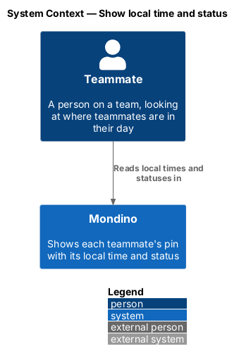
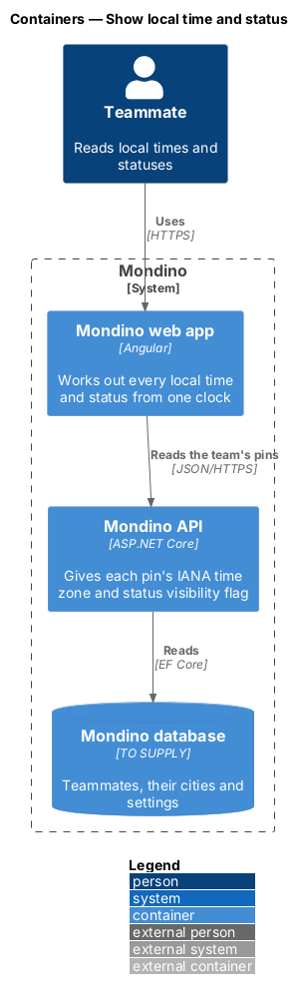
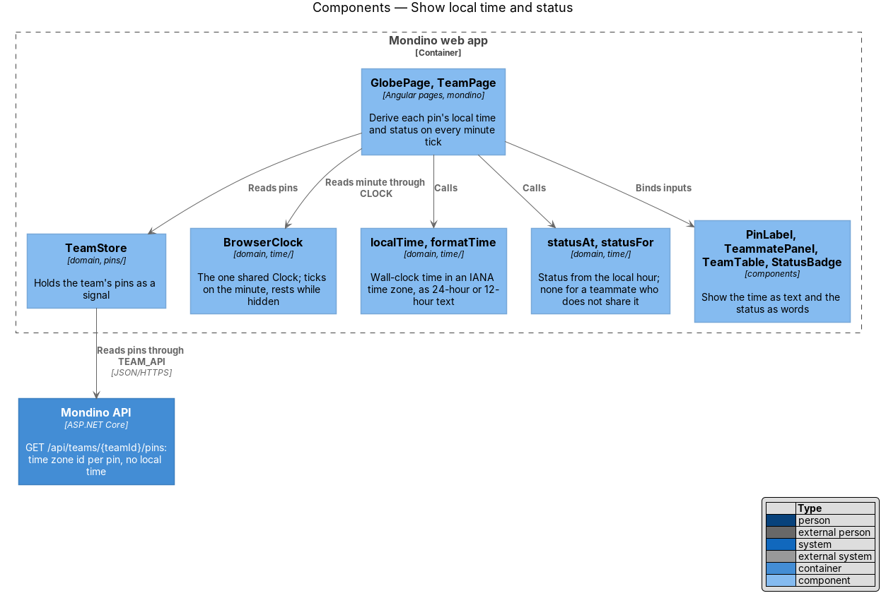
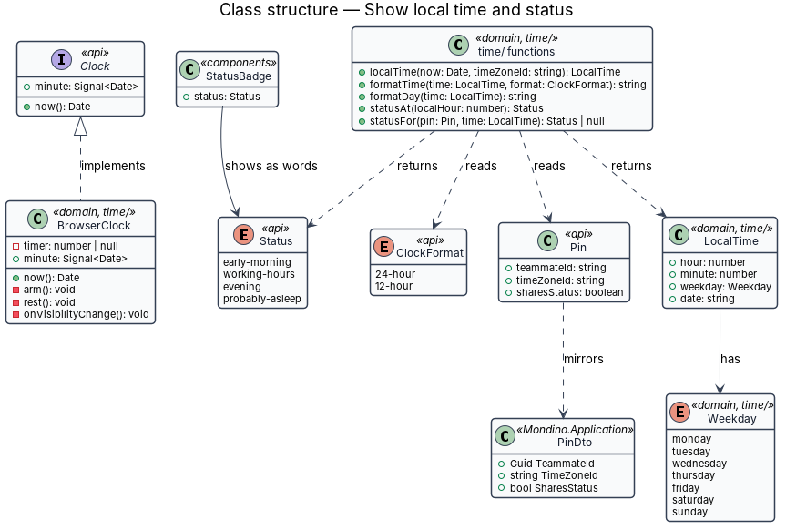
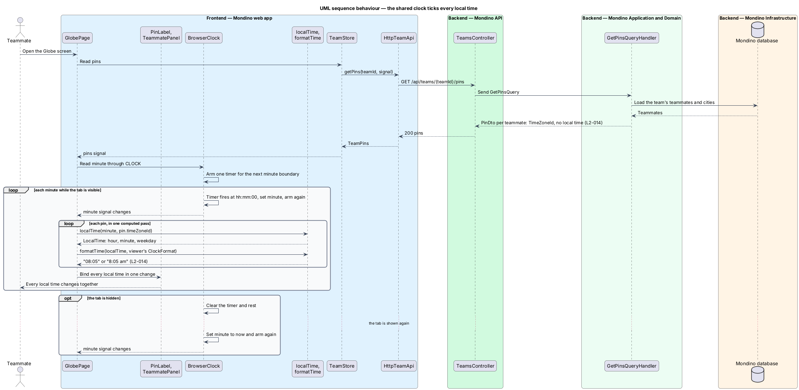
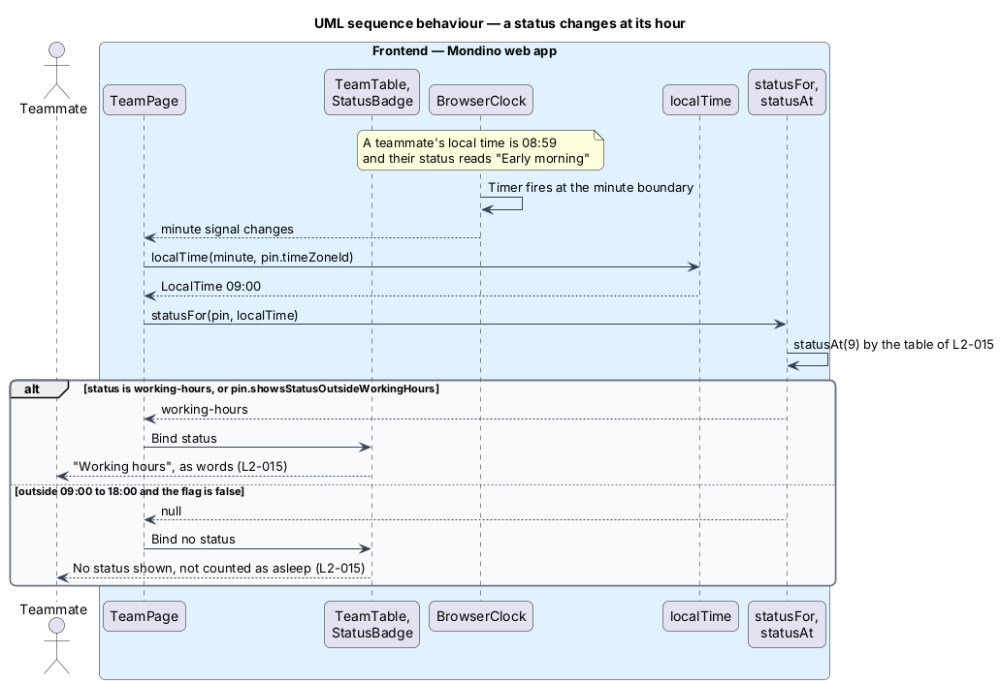

# Show local time and status

## Overview

Mondino is where a team spread around the world sees each other. Each teammate appears on a
globe as a pin, placed at their city. This feature gives every pin two things that answer "what
is it like where my teammate is, right now": the teammate's local time and their status.

- **local time** — wall-clock time at a teammate's city, worked out from the time zone of their
  pin and the current instant
- **status** — one of "Early morning", "Working hours", "Evening" or "Probably asleep", decided
  only by the teammate's local hour
- **clock** — single injected source of the current instant in the browser, which also announces
  each new minute
- **time zone id** — IANA name of a city's time zone, such as `Europe/Rome`

The feature lives almost wholly in the browser. The Mondino API gives each pin its time zone id
and a flag that says whether the teammate's status outside working hours may be shown. The API
stores and sends no local time. The Mondino web app works out every local time and status
itself, from that time zone id and one shared clock, in the `domain` library's `time/` folder.

A screen left open stays true without a reload. When the minute changes, every local time on
the screen changes together. When a teammate's local hour crosses a boundary of the status
table, their status changes. A daylight-saving change in a teammate's time zone is followed
because each local time is worked out afresh from the zone's rule on every tick.

Status is never taken from activity, presence or anything a teammate does. Saturday and Sunday
use the same table; Mondino keeps no calendar of working days.

## Description

The slice runs from the `GetPinsQueryHandler`, which supplies the time zone id, to the
presentation components that show a time and a status.

### Backend

- **`City`** — value object in `Mondino.Domain`. Its `TimeZoneId` holds the IANA name found when
  the teammate's postal code was looked up.
- **`TeammateSettings`** — value object in `Mondino.Domain`. Its `ShowOutsideWorkingHours`
  records the teammate's choice for "Show when I'm outside working hours".
- **`GetPinsQueryHandler`** — MediatR handler in `Mondino.Application`. It returns one `PinDto`
  per teammate of the viewer's team.
- **`PinDto`** — carries `TimeZoneId` and `ShowsStatusOutsideWorkingHours`, and no local time
  (L2-014). The handler sets `ShowsStatusOutsideWorkingHours` to the teammate's
  `ShowOutsideWorkingHours`, except on the viewer's own pin, where it is `true`: a teammate
  still sees their own status. The backend therefore applies the choice, and the frontend only
  follows the flag.
- **`TeamsController`** — exposes `GET /api/teams/{teamId}/pins`, checks nothing itself and
  sends one `GetPinsQuery`.

### Frontend — `api` library

- **`Clock`** and **`CLOCK`** — contract and injection token of the one clock. `now(): Date`
  returns the current instant. `minute: Signal<Date>` holds the instant of the latest minute
  boundary and changes once per minute.
- **`Pin`** — type mirroring `PinDto`, with `timeZoneId: string` and
  `showsStatusOutsideWorkingHours: boolean`.
- **`Status`** — `'early-morning' | 'working-hours' | 'evening' | 'probably-asleep'`.
- **`ClockFormat`** — `'24-hour' | '12-hour'`, the viewer's choice in `Settings`.

### Frontend — `domain` library, `time/`

- **`BrowserClock`** — the implementation of `Clock`, bound to `CLOCK` once in `app.config.ts`
  because the whole app shares it. It holds one timer however many pins a screen shows. The
  timer is a `setTimeout` armed for the next minute boundary (`60 000 ms` minus the current
  instant modulo `60 000 ms`). When it fires, `BrowserClock` sets `minute` and arms the timer
  again from the current instant, so delay does not accumulate and the tick stays within one
  second of the minute. `BrowserClock` listens to `visibilitychange`. While the tab is hidden it
  clears the timer and rests. When the tab is shown again it sets `minute` at once and arms the
  timer. It removes the listener and clears the timer through `DestroyRef`.
- **`localTime(now, timeZoneId): LocalTime`** — pure function. It reads the hour, minute,
  weekday and calendar date of `now` in the given time zone through `Intl.DateTimeFormat` with
  `timeZone` set and the `h23` hour cycle. The browser's time zone data supplies the zone's rule,
  including daylight-saving changes. Formatters are kept in a map keyed by time zone id, which
  is bounded by the number of IANA time zones.
- **`LocalTime`** — `hour` (0 to 23), `minute` (0 to 59), `weekday` (`Weekday`) and `date` (the
  local calendar date as `YYYY-MM-DD`). The `weekday` is the teammate's own day, so a panel
  shows Tuesday for Melbourne while the viewer in Milan is on Monday evening.
- **`formatDay(time): string`** — pure function. It gives the weekday in full, the day of the
  month and the short month of the teammate's own date ("Monday 27 Oct", "Tuesday 28 Oct"), the
  day line of a panel.
- **`formatTime(time, format): string`** — pure function. On the 24-hour clock it gives two-digit
  hours and minutes ("08:05"). On the 12-hour clock it gives the hour without a leading zero and
  a lowercase "am" or "pm" ("8:05 am").
- **`statusAt(localHour): Status`** — pure function holding the table of L2-015: 7 and 8 give
  `early-morning`, 9 to 17 give `working-hours`, 18 to 22 give `evening`, and 23 and 0 to 6 give
  `probably-asleep`. It takes no day of the week.
- **`statusFor(pin, time): Status | null`** — pure function. It returns `statusAt(time.hour)`
  when that status is `working-hours` or when `pin.showsStatusOutsideWorkingHours` is `true`,
  and `null` otherwise. A `null` status is shown nowhere and is counted neither as working nor
  as asleep.

No function in `time/` calls `new Date()`. Each takes the instant as an argument, and the
instant comes from `CLOCK`. Unit tests bind a fake `Clock` and advance it; none sleeps.

### Frontend — pages and presentation

- **`GlobePage`** and **`TeamPage`** — pages in the `mondino` application. Each holds one
  `computed` that reads `CLOCK`'s `minute`, the pins of `TeamStore` and the viewer's
  `ClockFormat`, and derives each pin's `LocalTime`, time text and status. One change of
  `minute` therefore changes every local time on the screen in one pass. A page's `computed` is
  released with the page.
- **`PinLabel`**, **`TeammatePanel`**, **`TeamTable`** and **`DayRibbon`** — presentation
  components in `components`. Each takes the time text, and where it shows one the day text, as
  inputs. Times are set in Gabarito with tabular figures. None injects `CLOCK`.
- **`StatusBadge`** — presentation component, the `status` block of the mocks. It takes a
  `Status` and shows it as its words;
  colour accompanies the words and never replaces them. It renders nothing for `null`.

The words for each status and for each weekday follow the mocks in `docs/mocks/`.

## Requirements

The feature realises the following level-2 (L2) requirements. Each L2 requirement refines a
level-1 (L1) requirement, cited by identifier.

| L2 ID | Refines (L1) | Requirement |
|-------|--------------|-------------|
| `L2-014` | `L1-005` | A teammate's local time is worked out in the browser from the time zone of their pin and one shared clock. It is shown as a 24-hour or 12-hour time as the viewer has chosen, with the day of the week and the date where a panel shows it ("Monday 27 Oct"). |
| `L2-015` | `L1-005` | A teammate's status is decided only by their local hour. It is never taken from activity, presence or anything the teammate does. |

## Diagrams

### System context

A teammate reads local times and statuses in Mondino. The feature calls no outside source: the
time zone rules come from the browser.

### Containers

The Mondino web app reads the team's pins from the Mondino API, which reads teammates, their
cities and their settings from the Mondino database. The API gives a time zone id and a status
visibility flag per pin; the web app works out the time and the status.

### Components

Inside the Mondino web app, a page reads the pins from `TeamStore` and the minute from
`BrowserClock`, calls `localTime`, `formatTime` and `statusFor`, and binds the results to the
presentation components.

### Class structure

`BrowserClock` implements `Clock`. The functions of `time/` return a `LocalTime` and a `Status`
and read a `Pin` and a `ClockFormat`. `Pin` mirrors the `PinDto` the backend sends.

### Behaviour — the shared clock ticks every local time

The pins arrive once with their time zone ids and no local time (L2-014). `BrowserClock` then
fires one timer at each minute boundary, and the page works out every pin's local time in one
pass. While the tab is hidden the clock rests; when the tab is shown again it sets the minute at
once.

### Behaviour — a status changes at its hour

When the clock reaches 09:00 at a teammate's city, `statusFor` returns `working-hours` and the
badge reads "Working hours" with no reload. Outside 09:00 to 18:00, a pin whose flag is `false`
gets no status (L2-015).

