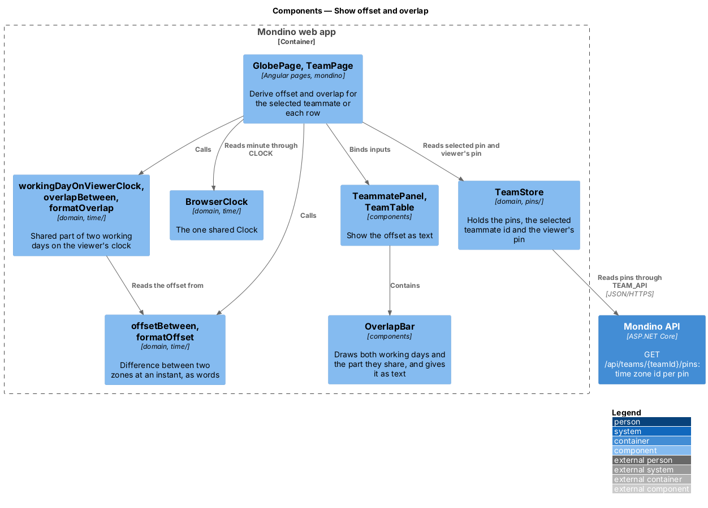
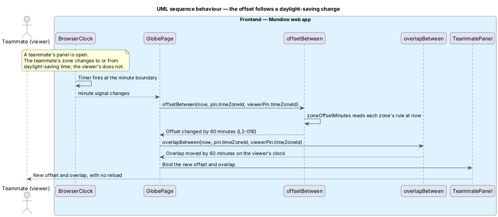

# Show offset and overlap

## Overview

Mondino is where a team spread around the world sees each other. Each teammate appears on a
globe as a pin, placed at their city, with their local time. This feature compares a teammate's
day with the day of the teammate who is looking.

- **viewer** — teammate looking at the screen
- **offset** — difference between a teammate's local time and the viewer's, in hours and, where
  the time zones differ by part of an hour, minutes
- **working day** — 09:00 to 18:00 local time, on every day of the week
- **overlap** — part of the viewer's and a teammate's working days that coincides, given on the
  viewer's own clock
- **time zone id** — IANA name of a city's time zone, such as `America/Mexico_City`

The offset appears on a selected teammate's panel and on each row of the Team screen, in the
column "Compared to you". The overlap appears on a selected teammate's panel, as text and as a
bar that draws both working days and the part they share across the viewer's day. The viewer's
own pin and row show neither. A teammate who does not share their status has an offset and no
overlap: the overlap would say when they are working.

Both are worked out in the browser, in the `domain` library's `time/` folder, from two time zone
ids and the one injected clock. The Mondino API supplies only each pin's time zone id. The
viewer's side of the comparison is the time zone of the viewer's own pin, so the comparison is
between two cities on the globe and does not depend on where the viewer's device happens to be.

Because both values are worked out afresh on every tick of the clock, a daylight-saving change
on one side changes the offset by one hour, and moves the overlap, with no reload.

## Description

### Backend

- **`GetPinsQueryHandler`** and **`PinDto`** — the handler returns one `PinDto` per teammate
  with the `TimeZoneId` of the teammate's `City`. The backend works out no offset and no
  overlap.

### Frontend — `api` library

- **`Clock`** and **`CLOCK`** — the one injected clock: `now(): number` and `minute: Signal<number>`,
  each in milliseconds since the epoch (`show-local-time-and-status`).
- **`Pin`** — carries `teammateId`, `timeZoneId` and `sharesStatus`, which is false for a
  teammate who has switched off "Share whether I’m working or asleep"
  (`show-local-time-and-status`).
- **`ClockFormat`** — `'24-hour' | '12-hour'`, the viewer's choice in `Settings`.
- **`Offset`**, **`DaySpan`**, **`Overlap`** and **`OverlapText`** (`time/`) — the types the
  functions of `domain`'s `time/` return, described below. They are declared in `api`, beside
  `Status` and `ClockFormat`, because `OverlapBar` in `components` takes them and `components`
  depends on `api` alone, for types only.

### Frontend — `domain` library

- **`TeamStore`** (`pins/`) — holds the pins, the selected teammate id and `viewerPin`, the pin
  that belongs to the viewer.
- **`zoneOffsetMinutes(now, timeZoneId): number`** (`time/`) — pure function. It gives the
  minutes by which the time zone is ahead of UTC at the instant `now`, read from the browser's
  time zone data through `Intl.DateTimeFormat`. It is the one place that reads a zone's rule for
  this feature.
- **`offsetBetween(now, timeZoneId, viewerTimeZoneId): Offset`** (`time/`) — pure function. It
  subtracts the viewer's `zoneOffsetMinutes` from the teammate's.
- **`Offset`** (`api`) — `minutes` (the size of the difference, never negative) and `direction`
  (`'ahead' | 'behind' | 'same'`). A teammate in Mexico City seen from Milan in winter has 420
  minutes and `behind`; a teammate in Bengaluru has 270 minutes and `ahead`.
- **`formatOffset(offset, form): string`** (`time/`) — pure function; `form` is `'row'` or
  `'panel'`. It gives whole hours, adds minutes only when the difference has a part of an hour,
  and gives the words for the same time when `direction` is `same`; it never gives "0h". The
  hours and minutes are written with no space before their letter. The words are the mocks':
  "7h behind", "4h 30m ahead" and "Same time" on a Team row, and on the panel, which adds the
  viewer and follows the day in one line ("Monday 27 Oct · 7h behind you"), "7h behind you",
  "10h ahead of you" and "same time as you".
- **`WorkingDay`** (`api`, `time/`) — the constants of the working day in minutes from midnight:
  `startMinute` 540 and `endMinute` 1080. `statusAt` and `overlapBetween` read the same
  constants, and so does `OverlapBar`, so "Working hours", the overlap and its bar cannot
  disagree. It is declared in `api` because `components` may read nothing else.
- **`workingDayOnViewerClock(now, timeZoneId, viewerTimeZoneId): DaySpan`** (`time/`) — pure
  function. It takes the offset between the two zones at `now` and moves the teammate's working
  day onto the viewer's clock by subtracting that offset.
- **`DaySpan`** (`api`) — `startMinute` and `endMinute` in minutes from midnight on the viewer's clock;
  the end is smaller than the start when the span passes midnight. For a viewer in Milan it is
  960 and 60 for a teammate in Mexico City (16:00 to 01:00) and 1380 and 480 for a teammate in
  Melbourne (23:00 to 08:00).
- **`overlapBetween(now, timeZoneId, viewerTimeZoneId): Overlap | null`** (`time/`) — pure
  function. It intersects the teammate's working day on the viewer's clock with the viewer's
  working day. Because a working day recurs every 24 hours, the moved interval is also tried one
  day earlier and one day later. A working day lasts 9 hours and the gap between two is 15
  hours, so at most one of the three intersects. An empty intersection gives `null`.
- **`Overlap`** (`api`) — `startMinute` and `endMinute` in minutes from midnight on the viewer's clock,
  and `lengthMinutes`. For a viewer in Milan (UTC+1) and a teammate in Mexico City (UTC−6) it is
  960, 1080 and 120: 16:00 to 18:00, two hours. For a teammate in the viewer's own time zone it
  is 540, 1080 and 540.
- **`formatMinuteOfDay(minute, format): string`** (`time/`) — pure function. A minute of the
  viewer's day as the overlap gives it: "16:00" on the 24-hour clock, and on the 12-hour clock
  "4 pm" on the hour and "4:30 pm" otherwise. `formatTime` keeps its minutes on the hour
  ("4:00 pm") for local times; the overlap drops them (L2-017 criterion 4).
- **`formatOverlap(overlap, theirDay, firstName, format): OverlapText`** (`time/`) — pure
  function. It gives the start and end through `formatMinuteOfDay` in the viewer's
  `ClockFormat`, and the length in hours and minutes: "2 hours", "1 hour", "4 hours 30 minutes",
  "30 minutes". No mock draws an overlap of part of an hour; Bengaluru's, seen from Milan, is
  "09:00 to 13:30", four hours and a half, and is worded so.
- **`OverlapText`** (`api`) — `figure` and `sentence`, worded as the mocks word them. With an overlap
  they are "16:00–18:00 your time" and "You and Tomás share 2 hours of working hours: 16:00 to
  18:00 on your clock."; on the 12-hour clock, "4 pm–6 pm your time" and "… 4 pm to 6 pm on your
  clock.". For `null` they are "None today" and "You and Noah share no working hours. Noah’s
  working day is 23:00 to 08:00 on your clock.", the teammate's working day being `theirDay`.
  The first name is `firstName(name)` from `pins/`, the first word of the teammate's name,
  which the page passes in; it is data and is rendered as text.
- **`WorkingDay`** is read by `statusAt` too: "Working hours" begins at `startMinute` and ends at
  `endMinute`.

`overlapBetween` uses the offset at the instant `now` for the whole day. On the day of a
daylight-saving change the overlap shown before the change is the one that held before it, and
the next tick after the change corrects it.

No function in `time/` calls `new Date()` or `Date.now()`; each takes the instant, in milliseconds
since the epoch, as an argument, and the instant comes from `CLOCK`.

### Frontend — pages and presentation

- **`GlobePage`** — holds one `computed` over the selected pin, `viewerPin`, `CLOCK`'s `minute`
  and the viewer's `ClockFormat`. When the selected pin is the viewer's own, or `viewerPin` is
  absent, it binds no offset and no overlap. Otherwise it calls `offsetBetween` and
  `formatOffset`, and, when the selected pin's `sharesStatus` is true,
  `workingDayOnViewerClock`, `overlapBetween` and `formatOverlap`. When `sharesStatus` is false
  it binds the offset and no overlap, no working day and no overlap text, so the panel shows no
  "Working-hours overlap" section for that teammate.
- **`TeamPage`** — derives the offset text of each row in the same way and binds none for the
  viewer's own row. Under 768 px a row gives the offset after the city ("Dubai · 3h ahead").
- **`TeammatePanel`** — presentation component. It takes the offset text, the `Overlap`, the
  teammate's `DaySpan` and the `OverlapText` in its `content` (`TeammatePanelContent`, designed
  in `team/view-teammate-panel`). It shows no offset when the offset text is `null` and no
  overlap section when the `OverlapText` is `null`.
- **`TeamTable`** — presentation component. Its column "Compared to you" shows the offset text
  of each row.
- **`OverlapBar`** — presentation component, the `overlap` block of the mocks, under the title
  "Working-hours overlap". It takes the `Overlap` or `null`, the teammate's `DaySpan`, the
  viewer's minute of the day (`nowMinute`), the teammate's first name, the `OverlapText` and the
  viewer's `ClockFormat`, which chooses the scale. `barParts`, a pure helper beside it with its
  own tests, turns those minutes into the parts of the track, each a `from` and a `span` in
  percent of the day, a span past midnight split in two. It draws the
  viewer's day as a 24-hour track: the viewer's working day outlined, the teammate's filled
  faintly (in two parts when it passes midnight), the part both share filled solid, and a tick
  for now, each positioned by its minute divided by 1440. Under the track are a scale ("00:00",
  "06:00", "12:00", "18:00", "00:00", or "12 am", "6 am", "12 pm", "6 pm", "12 am") and a legend
  ("You", the teammate's first name, "Both"). With no overlap it draws both working days and no
  shared part. The track, the scale and the legend are hidden from assistive technology; the
  `figure` beside the title and the `sentence` under the bar give the overlap as text with its
  start, end and length, so the bar never carries the overlap by colour or position alone.

## Requirements

The feature realises the following level-2 (L2) requirements. Each L2 requirement refines a
level-1 (L1) requirement, cited by identifier.

| L2 ID | Refines (L1) | Requirement |
|-------|--------------|-------------|
| `L2-016` | `L1-005` | A teammate's offset is the difference between their local time and the viewer's, in hours and, where the zones differ by part of an hour, minutes. It is written with "h" and "m" straight after the numbers ("7h", "4h 30m"), followed by "behind" or "ahead". |
| `L2-017` | `L1-005` | The overlap between the viewer and a teammate is the part of both their working days (09:00 to 18:00 local) that coincides, given on the viewer's own clock, with a bar that draws both working days, the part they share and the time now across the viewer's day. |

## Diagrams

### System context

The viewer reads a teammate's offset and overlap in Mondino. The feature calls no outside
source.

### Containers

The Mondino web app reads the team's pins, each with its time zone id, from the Mondino API,
and works out the offset and the overlap itself.

### Components

Inside the Mondino web app, a page reads the selected pin and the viewer's pin from `TeamStore`
and the minute from `BrowserClock`, calls the offset and overlap functions of `time/`, and binds
the results to `TeammatePanel`, `TeamTable` and `OverlapBar`.

### Class structure

The functions of `time/` return an `Offset`, a `DaySpan`, an `Overlap` and an `OverlapText`, and
read the `WorkingDay` constants. `TeammatePanel` contains an `OverlapBar` and shows the `Overlap`.

### Behaviour — work out the offset and the overlap for a selected teammate

Selecting the viewer's own pin gives a panel with no offset and no overlap. Selecting another
teammate works out the offset from the two zones (L2-016). Where that teammate shares their
status, the page moves their working day onto the viewer's clock, intersects it with the
viewer's (L2-017) and gives the bar both working days and its text. Where they do not, the
panel shows the offset and no overlap.

### Behaviour — the offset follows a daylight-saving change

With a panel open, the first tick after a daylight-saving change on one side works the offset
out again from the zones' rules. The offset changes by 60 minutes (L2-016) and the overlap moves
with it.

