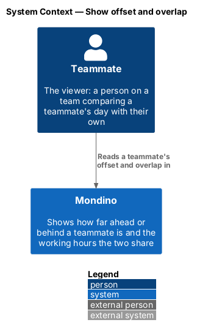
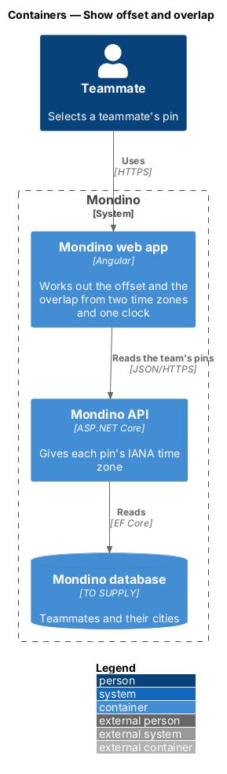
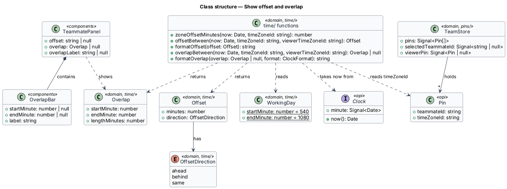
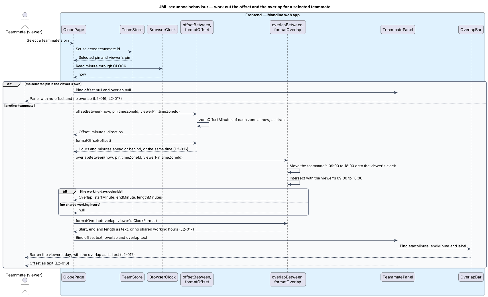

# Show offset and overlap

## Overview

Mondino is where a team spread around the world sees each other. Each teammate appears on a
globe as a pin, placed at their city, with their local time. This feature compares a teammate's
day with the day of the teammate who is looking.

- **viewer** — teammate looking at the screen
- **offset** — difference between a teammate's local time and the viewer's, in hours and, where
  the time zones differ by part of an hour, minutes
- **working day** — 09:00 to 18:00 local time, on every day of the week
- **overlap** — part of the viewer's and a teammate's working days that coincides, given on the
  viewer's own clock
- **time zone id** — IANA name of a city's time zone, such as `America/Mexico_City`

The offset appears on a selected teammate's panel and on each row of the Team screen. The
overlap appears on a selected teammate's panel, as text and as a bar that draws it across the
viewer's day. The viewer's own pin and row show neither.

Both are worked out in the browser, in the `domain` library's `time/` folder, from two time zone
ids and the one injected clock. The Mondino API supplies only each pin's time zone id. The
viewer's side of the comparison is the time zone of the viewer's own pin, so the comparison is
between two cities on the globe and does not depend on where the viewer's device happens to be.

Because both values are worked out afresh on every tick of the clock, a daylight-saving change
on one side changes the offset by one hour, and moves the overlap, with no reload.

## Description

### Backend

- **`GetPinsQueryHandler`** and **`PinDto`** — the handler returns one `PinDto` per teammate
  with the `TimeZoneId` of the teammate's `City`. The backend works out no offset and no
  overlap.

### Frontend — `api` library

- **`Clock`** and **`CLOCK`** — the one injected clock: `now(): Date` and `minute: Signal<Date>`.
- **`Pin`** — carries `teammateId` and `timeZoneId`.
- **`ClockFormat`** — `'24-hour' | '12-hour'`, the viewer's choice in `Settings`.

### Frontend — `domain` library

- **`TeamStore`** (`pins/`) — holds the pins, the selected teammate id and `viewerPin`, the pin
  that belongs to the viewer.
- **`zoneOffsetMinutes(now, timeZoneId): number`** (`time/`) — pure function. It gives the
  minutes by which the time zone is ahead of UTC at the instant `now`, read from the browser's
  time zone data through `Intl.DateTimeFormat`. It is the one place that reads a zone's rule for
  this feature.
- **`offsetBetween(now, timeZoneId, viewerTimeZoneId): Offset`** (`time/`) — pure function. It
  subtracts the viewer's `zoneOffsetMinutes` from the teammate's.
- **`Offset`** — `minutes` (the size of the difference, never negative) and `direction`
  (`'ahead' | 'behind' | 'same'`). A teammate in Mexico City seen from Milan in winter has 420
  minutes and `behind`; a teammate in Bengaluru has 270 minutes and `ahead`.
- **`formatOffset(offset): string`** (`time/`) — pure function. It gives whole hours, adds
  minutes only when the difference has a part of an hour, and gives the words for the same time
  when `direction` is `same`; it never gives "0 hours". The panel's short form ("7 h behind")
  and the exact words follow the mocks in `docs/mocks/`.
- **`WorkingDay`** (`time/`) — the constants of the working day in minutes from midnight:
  `startMinute` 540 and `endMinute` 1080. `statusAt` and `overlapBetween` read the same
  constants, so "Working hours" and the overlap cannot disagree.
- **`overlapBetween(now, timeZoneId, viewerTimeZoneId): Overlap | null`** (`time/`) — pure
  function. It takes the offset between the two zones at `now`, moves the teammate's working day
  onto the viewer's clock by subtracting that offset, and intersects it with the viewer's
  working day. Because a working day recurs every 24 hours, the moved interval is also tried one
  day earlier and one day later. A working day lasts 9 hours and the gap between two is 15
  hours, so at most one of the three intersects. An empty intersection gives `null`.
- **`Overlap`** — `startMinute` and `endMinute` in minutes from midnight on the viewer's clock,
  and `lengthMinutes`. For a viewer in Milan (UTC+1) and a teammate in Mexico City (UTC−6) it is
  960, 1080 and 120: 16:00 to 18:00, two hours. For a teammate in the viewer's own time zone it
  is 540, 1080 and 540.
- **`formatOverlap(overlap, format): string`** (`time/`) — pure function. It gives the start and
  end through `formatTime` in the viewer's `ClockFormat`, and the length in hours and minutes.
  For `null` it gives the words saying the two share no working hours.

`overlapBetween` uses the offset at the instant `now` for the whole day. On the day of a
daylight-saving change the overlap shown before the change is the one that held before it, and
the next tick after the change corrects it.

No function in `time/` calls `new Date()`; each takes the instant as an argument, and the
instant comes from `CLOCK`.

### Frontend — pages and presentation

- **`GlobePage`** — holds one `computed` over the selected pin, `viewerPin`, `CLOCK`'s `minute`
  and the viewer's `ClockFormat`. When the selected pin is the viewer's own, or `viewerPin` is
  absent, it binds no offset and no overlap. Otherwise it calls `offsetBetween`, `formatOffset`,
  `overlapBetween` and `formatOverlap`.
- **`TeamPage`** — derives the offset text of each row in the same way and binds none for the
  viewer's own row.
- **`TeammatePanel`** — presentation component. It takes the offset text, the `Overlap` and the
  overlap text as inputs and shows no offset or overlap section when they are `null`.
- **`TeamTable`** — presentation component. Its offset column shows the offset text of each row.
- **`OverlapBar`** — presentation component. It takes `startMinute`, `endMinute` and `label`,
  and draws the viewer's day with the overlap in leaf, positioned by `startMinute / 1440` and
  `endMinute / 1440`. With no overlap it draws the day with nothing marked. The bar is exposed
  as one image (`role="img"`) whose accessible name is `label`, the text from `formatOverlap`
  with the start, end and length, and the same text is shown beside the bar, so the bar never
  carries the overlap by colour or position alone.

## Requirements

The feature realises the following level-2 (L2) requirements. Each L2 requirement refines a
level-1 (L1) requirement, cited by identifier.

| L2 ID | Refines (L1) | Requirement |
|-------|--------------|-------------|
| `L2-016` | `L1-005` | A teammate's offset is the difference between their local time and the viewer's, in hours and, where the zones differ by part of an hour, minutes. |
| `L2-017` | `L1-005` | The overlap between the viewer and a teammate is the part of both their working days (09:00 to 18:00 local) that coincides, given on the viewer's own clock, with a bar that draws it. |

## Diagrams

### System context

The viewer reads a teammate's offset and overlap in Mondino. The feature calls no outside
source.

### Containers

The Mondino web app reads the team's pins, each with its time zone id, from the Mondino API,
and works out the offset and the overlap itself.

### Components

Inside the Mondino web app, a page reads the selected pin and the viewer's pin from `TeamStore`
and the minute from `BrowserClock`, calls the offset and overlap functions of `time/`, and binds
the results to `TeammatePanel`, `TeamTable` and `OverlapBar`.

### Class structure

The functions of `time/` return an `Offset` and an `Overlap` and read the `WorkingDay`
constants. `TeammatePanel` contains an `OverlapBar` and shows the `Overlap`.

### Behaviour — work out the offset and the overlap for a selected teammate

Selecting the viewer's own pin gives a panel with no offset and no overlap. Selecting another
teammate works out the offset from the two zones (L2-016), moves the teammate's working day onto
the viewer's clock and intersects it with the viewer's (L2-017), and gives the bar its text.

### Behaviour — the offset follows a daylight-saving change

With a panel open, the first tick after a daylight-saving change on one side works the offset
out again from the zones' rules. The offset changes by 60 minutes (L2-016) and the overlap moves
with it.

