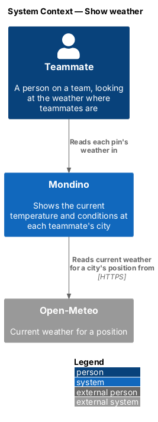
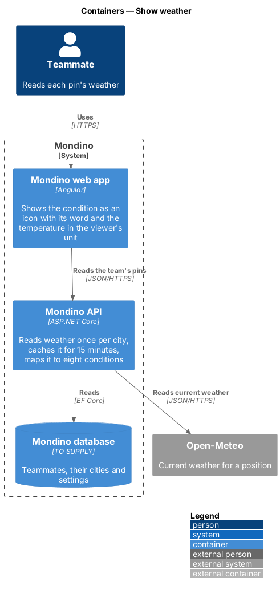
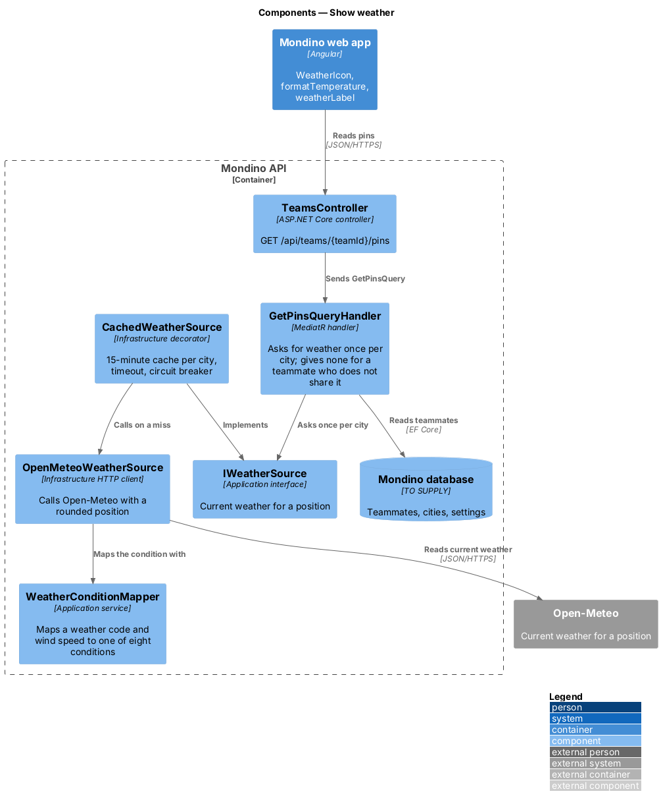
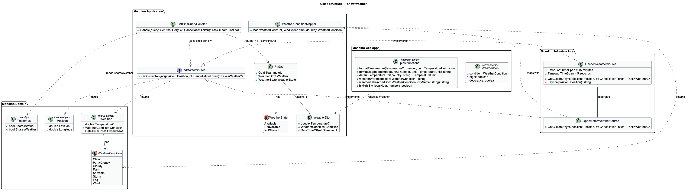
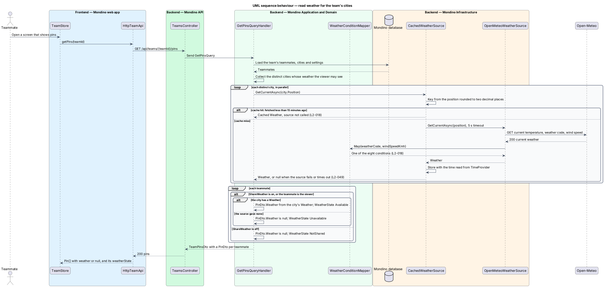
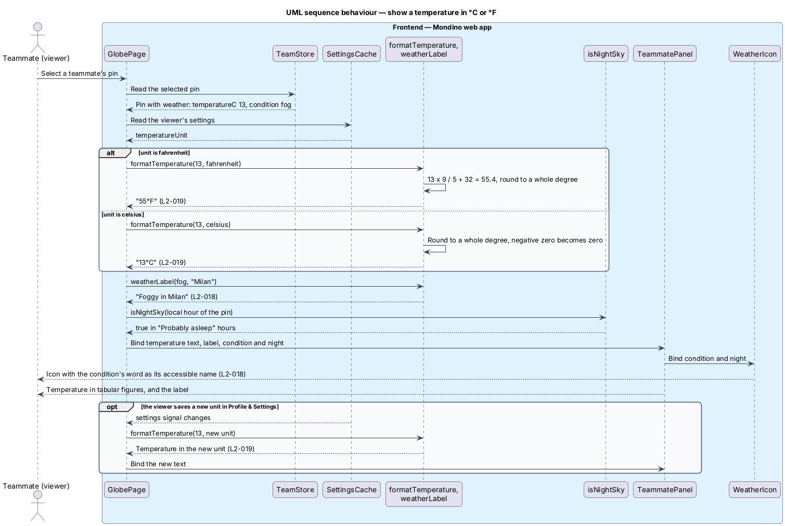

# Show weather

## Overview

Mondino is where a team spread around the world sees each other. Each teammate appears on a
globe as a pin, placed at their city. This feature gives each pin its sky: the current
temperature and weather at that city.

- **weather** — current temperature and one condition at a teammate's city
- **condition** — one of eight fixed values: clear, partly cloudy, cloudy, rain, showers, storm,
  fog, wind
- **weather source** — outside service that reports current weather for a position; Mondino
  uses Open-Meteo
- **viewer** — teammate looking at the screen
- **unit** — °C or °F, chosen by the viewer

The Mondino API is the only part of Mondino that calls Open-Meteo. The browser never does, so
no third party learns where a teammate is. The API asks for weather once per city, however many
teammates live there, and keeps each answer for 15 minutes. It sends Open-Meteo a position and
nothing about a teammate.

Whatever Open-Meteo reports, the API maps it to one of the eight conditions, so the web app
always has an icon and a word to show. The web app shows the condition as an icon with its
word, and uses the night form of the icon for a clear or partly cloudy sky at night. It shows
the temperature as whole degrees in the viewer's unit: with the unit on a panel ("13°C") and as
degrees alone on a pin's label and a Team row ("13°").

A teammate may turn off "Share my local weather". The API then gives no weather for that
teammate to anyone else, while the teammate still sees their own. Each pin says whether its
weather is available, unavailable or not shared, so the web app can say which.

## Description

### Backend — `Mondino.Domain`

- **`Weather`** — value object: `TemperatureC`, `Condition` and `ObservedAt`. The temperature is
  held in °C only; conversion to °F is a matter of display.
- **`WeatherCondition`** — enumeration of the eight conditions: `Clear`, `PartlyCloudy`,
  `Cloudy`, `Rain`, `Showers`, `Storm`, `Fog`, `Wind`.
- **`Teammate`** — entity. Its `SharesWeather` records the teammate's choice for "Share my
  local weather", on to begin with, beside `SharesStatus`. The switch that changes it comes with
  Profile & Settings (`choose-display-and-sharing`), which moves both into `TeammateSettings`
  beside the unit and the clock. Until then no unit is stored: the browser starts the unit from
  the country (`defaultTemperatureUnit`), as it starts the clock (ADR 0015).

### Backend — `Mondino.Application`

- **`IWeatherSource`** — interface over the weather source:
  `GetCurrentAsync(Position position, CancellationToken ct): Task<Weather?>`. It takes a
  position and no teammate. It returns `null` when no weather can be given.
- **`GetPinsQueryHandler`** — MediatR handler for `GetPinsQuery`. It loads the team's teammates,
  collects the distinct cities among those whose weather the viewer may see, by their position
  rounded to two decimal places, and calls `IWeatherSource` once per city, in parallel. It then builds each `PinDto` and returns them in
  the `TeamPinsDto`. A teammate whose `SharesWeather` is off gets `Weather` `null` and
  `WeatherState` `NotShared`, except on the viewer's own pin. A city whose weather is `null`
  gives `Weather` `null`, `WeatherState` `Unavailable` and the rest of the pin unchanged; the
  handler does not fail. Every other pin has its `Weather` and `WeatherState` `Available`.
- **`WeatherDto`** — `TemperatureC`, `Condition` and `ObservedAt`, carried as `PinDto.Weather`
  and as `PostalCodeResultDto.Weather`, the weather at the city a postal code was found in
  (`LookUpPostalCodeQueryHandler` asks `IWeatherSource` for it; none when it has none). It
  carries no unit and no temperature in °F. `Condition` travels as the web app's word for it:
  `clear`, `partly-cloudy`, `cloudy`, `rain`, `showers`, `storm`, `fog` or `wind`.
- **`WeatherState`** — enumeration carried as `PinDto.WeatherState`: `Available`, `Unavailable`
  or `NotShared`. `PinDto.Weather` is `null` unless the state is `Available`.
- **`WeatherConditionMapper`** — service with
  `Map(int weatherCode, double windSpeedKmh): WeatherCondition`. It turns Open-Meteo's WMO
  weather code into one of the eight conditions by the table below. Each code has a row, and a
  code outside the table gives `Cloudy`, so the mapper always returns a condition (L2-018).

| WMO weather code | Reported as | `WeatherCondition` |
|---|---|---|
| 0, 1 | Clear sky, mainly clear | `Clear` |
| 2 | Partly cloudy | `PartlyCloudy` |
| 3 | Overcast | `Cloudy` |
| 45, 48 | Fog, depositing rime fog | `Fog` |
| 51 to 57 | Drizzle, freezing drizzle | `Rain` |
| 61 to 67 | Rain, freezing rain | `Rain` |
| 71 to 77 | Snowfall, snow grains | `Rain` |
| 80 to 82 | Rain showers | `Showers` |
| 85, 86 | Snow showers | `Showers` |
| 95 to 99 | Thunderstorm, with or without hail | `Storm` |
| any other | — | `Cloudy` |

  The WMO codes hold no code for wind. When the code maps to `Clear`, `PartlyCloudy` or `Cloudy`
  and `windSpeedKmh` is at or above the wind threshold, 39 km/h (Beaufort force 6, a strong
  breeze; ADR 0015), the mapper returns `Wind`.

### Backend — `Mondino.Infrastructure`

- **`OpenMeteoWeatherSource`** — typed `HttpClient` implementing `IWeatherSource`. It requests
  the current `temperature_2m`, `weather_code` and `wind_speed_10m` for a latitude and
  longitude from Open-Meteo's forecast endpoint. The latitude and longitude are the city's
  position rounded to two decimal places, and the request carries nothing else about a
  teammate. It passes the weather code and wind speed to `WeatherConditionMapper` and returns a
  `Weather`, observed at the answer's `current.time` (GMT). No answer, a status other than 200 or
  an answer without a temperature or a code is `null`. Its settings are
  `WeatherSource:BaseAddress` and, for a commercial subscription, `WeatherSource:ApiKey`, sent as
  `apikey` (ADR 0015). Its client logs nothing.
- **`CachedWeatherSource`** — decorator implementing `IWeatherSource` over
  `OpenMeteoWeatherSource`; it is the implementation registered for the interface. Its key is
  the position rounded to two decimal places, so two teammates in one city share one entry and
  one call (L2-018). An entry younger than 15 minutes is returned without calling the source.
  Age is measured with `TimeProvider`. Concurrent requests for one key share one call. A call
  runs under a 5 second timeout; a call that fails or times out gives `null`, and is not kept.
  At most 10,000 entries are held, one per city with a teammate. The circuit breaker, and
  returning an entry up to 3 hours old while the source fails (L2-049), come with
  `survive-source-failure` (journey 26), which keeps entries 3 hours for it.

### Backend — `Mondino.Api`

- **`TeamsController`** — exposes `GET /api/teams/{teamId}/pins`, checks nothing itself and
  sends one `GetPinsQuery`.

### Frontend — `api` library

- **`Weather`** — `temperatureC: number`, `condition: WeatherCondition`, `observedAt: string`.
- **`WeatherCondition`** — `'clear' | 'partly-cloudy' | 'cloudy' | 'rain' | 'showers' | 'storm'
  | 'fog' | 'wind'`.
- **`Pin`** — its `weather` is a `Weather` or `null`, and its `weatherState` a `WeatherState`.
- **`WeatherState`** — `'Available' | 'Unavailable' | 'NotShared'`, the names `PinDto.WeatherState` carries.
- **`TemperatureUnit`** — `'celsius' | 'fahrenheit'`, in the viewer's `Settings`.
- **`PostalCodeResult`** — its `weather` is a `Weather` or `null`.
- **`PinView`** — its `weather` is a `PinWeather` (`degrees`, `condition`, `word`, `night`) or
  `null` when the pin's weather is not `Available`.

### Frontend — `domain` library, `pins/`

- **`formatTemperature(temperatureC, unit): string`** — pure function. For `fahrenheit` it
  converts with `temperatureC × 9 / 5 + 32`. It rounds to a whole degree, turns a negative zero
  into zero, and appends "°C" or "°F" with no space. 13 °C gives "13°C" and "55°F"; −0.4 °C
  gives "0°C" (L2-019). This is the form a panel shows.
- **`formatDegrees(temperatureC, unit): string`** — pure function. It converts and rounds as
  `formatTemperature` does and appends the degree sign alone: 13 °C gives "13°" and, for
  `fahrenheit`, "55°". This is the form a pin's label, a pin's accessible name and a Team row
  show.
- **`defaultTemperatureUnit(country): TemperatureUnit`** — pure function: `fahrenheit` for the
  United States, `celsius` elsewhere (L2-019), until Profile & Settings stores a choice.
- **`weatherWord(condition): string`** — pure function: the condition's word, "Partly cloudy".
- **`weatherLabel(condition, cityName): string`** — pure function. It gives the condition's
  word with the city ("Foggy in Milan"). The city's name is data and is rendered as text. The
  words are the mocks': "Clear", "Partly cloudy", "Cloudy", "Rainy", "Showers", "Stormy",
  "Foggy" and "Windy".
- **`isNightSky(localHour): boolean`** — pure function. It is `true` when `statusAt(localHour)`
  from `time/` is `probably-asleep`, that is from 23:00 to 06:59 at the pin's city (L2-018). It
  reads the hour only, so it applies whether or not the teammate's status is shown.

### Frontend — pages and presentation

- **`GlobePage`**, **`TeamPage`** and **`JoinPage`** — pages in the `mondino` application. Each
  derives, in a `computed`, the temperature text from `pin.weather` and the viewer's
  `TemperatureUnit`, the label, and the night flag from the pin's local hour. `GlobePage` does it
  through `pinViews`, which gives each `PinView` its `PinWeather` and puts the word and the
  degrees in the pin's accessible name after the status ("Partly cloudy 22°"). `JoinPage` and
  `CreateTeamPage` give `LookupMessage` the found line's weather, `foundWeather(weather, unit)`:
  "13° and foggy right now.", in the unit of the country chosen in the form, the word in lower
  case; nothing when the lookup has no weather. The viewer's
  settings are a signal held by `SettingsCache` and updated when `ProfilePage` saves, so a saved
  change of unit reaches every temperature on every screen (L2-019).
- **`WeatherIcon`** (`svg[mo-weather-icon]`, the mocks' `svg.icon`) — presentation component
  with inputs `condition` and `night`. It draws one bundled SVG per condition, with a night form for `clear` and
  `partly-cloudy`; `night` has no effect on the other six. The icon is exposed as an image whose
  accessible name is the condition's word (L2-018), unless it is `decorative`: beside its word,
  or in a pin's label, whose pin names the word, it is hidden, as the mocks draw it. Icons are
  bundled with the app and never loaded from a CDN.
- **`PinLabel`**, **`TeammatePanel`** and **`TeamTable`** — presentation components. Each takes
  the temperature text, the condition and the night flag as inputs and sets the temperature in
  tabular figures. A pin's label shows the icon and the degrees beside the local time, and,
  when the pin is lifted, the condition's word as well (`pages/globe/default`,
  `pages/globe/selected`). The label placer allows a label with weather the width it is drawn at. The panel shows the icon, the temperature
  with its unit and the label. A Team row shows the icon and the degrees.

When `pin.weather` is `null` no temperature and no condition is shown, and a pin's label and
its accessible name leave the weather out; the local time and status are unaffected.
`pin.weatherState` says why. When it is `Unavailable`, the source could not give the weather:
in the weather's place the panel says "Weather for Mexico City isn’t available right now.
We’ll try again in a few minutes.", naming the pin's city, and a Team row shows a mark named
"Weather unavailable" (L2-049). The city's name is data and is rendered as text. The next
refresh of the team (`team/keep-team-fresh`) asks again; the panel has no control of its own
for it.

When it is `NotShared`, the panel shows no weather section. A teammate who shares neither
their weather nor their status gets one note in the panel, in place of both: "Ahmed keeps
their weather and working hours private. You’ll still see their local time and city."
(`team/view-teammate-panel`). Their pin's label and accessible name give the local time
alone. The teammate is named by `firstName(name)` from `pins/`, the first word of their name;
it is data and is rendered as text. What the panel says for a teammate who shares their
status and not their weather is `<TO SUPPLY>`: the mocks draw only the teammate who shares
neither.

Open questions: where Open-Meteo's attribution (CC BY 4.0) is shown; no mock draws it
(ADR 0015).

## Requirements

The feature realises the following level-2 (L2) requirements. Each L2 requirement refines a
level-1 (L1) requirement, cited by identifier.

| L2 ID | Refines (L1) | Requirement |
|-------|--------------|-------------|
| `L2-018` | `L1-006` | Each pin carries the current temperature and one of a fixed set of conditions (clear, partly cloudy, cloudy, rain, showers, storm, fog, wind) for its city, from Open-Meteo by way of the backend. Conditions are shown as an icon with its word ("Clear", "Partly cloudy", "Cloudy", "Rainy", "Showers", "Stormy", "Foggy", "Windy"); at night a clear or partly cloudy sky uses its night icon. |
| `L2-019` | `L1-006` | Temperatures are shown in the unit the viewer has chosen, as whole degrees with tabular figures: with the unit on a panel ("13°C") and as degrees alone on a pin and a Team row ("13°"). A new teammate's unit starts from their country: °F for the United States, °C elsewhere. |

## Diagrams

### System context

A teammate reads each pin's weather in Mondino, which reads current weather for a city's
position from Open-Meteo.

### Containers

The Mondino web app reads the team's pins from the Mondino API. The API reads teammates from the
Mondino database and current weather from Open-Meteo; the web app calls neither.

### Components

Inside the Mondino API, `TeamsController` sends `GetPinsQuery` to `GetPinsQueryHandler`, which
asks `IWeatherSource` once per city. `CachedWeatherSource` implements the interface and calls
`OpenMeteoWeatherSource` on a miss, which maps the condition with `WeatherConditionMapper`.

### Class structure

`CachedWeatherSource` and `OpenMeteoWeatherSource` both implement `IWeatherSource`, and the
first decorates the second. `GetPinsQueryHandler` depends on the interface and returns a
`TeamPinsDto` of `PinDto`, each with a `WeatherState` and a `WeatherDto` or none. The web app's functions and `WeatherIcon` read the same shape.

### Behaviour — read weather for the team's cities

`GetPinsQueryHandler` asks for each distinct city once. A cache hit younger than 15 minutes is
returned without a call (L2-018). A miss calls Open-Meteo, maps the answer to one of the eight
conditions (L2-018) and stores it. A teammate who does not share weather gets none, with
`WeatherState` `NotShared`; a city the source could not answer for gives `Unavailable`.

### Behaviour — show a temperature in °C or °F

The page formats the pin's temperature in the viewer's unit as a whole degree (L2-019), builds
the label and the night flag, and binds them to `TeammatePanel` and `WeatherIcon` (L2-018). A
saved change of unit changes the text with no reload.

